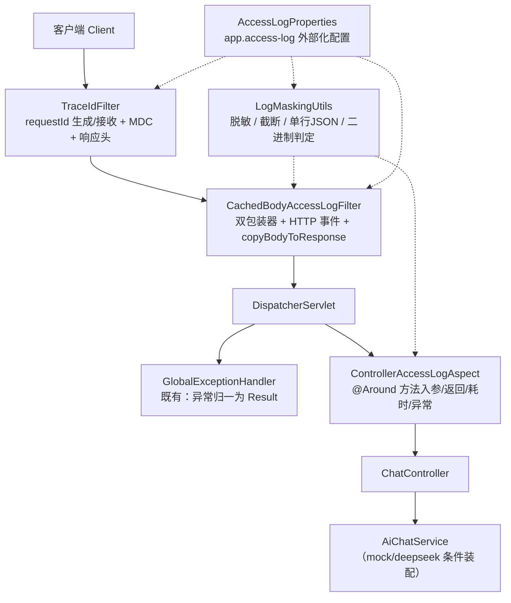
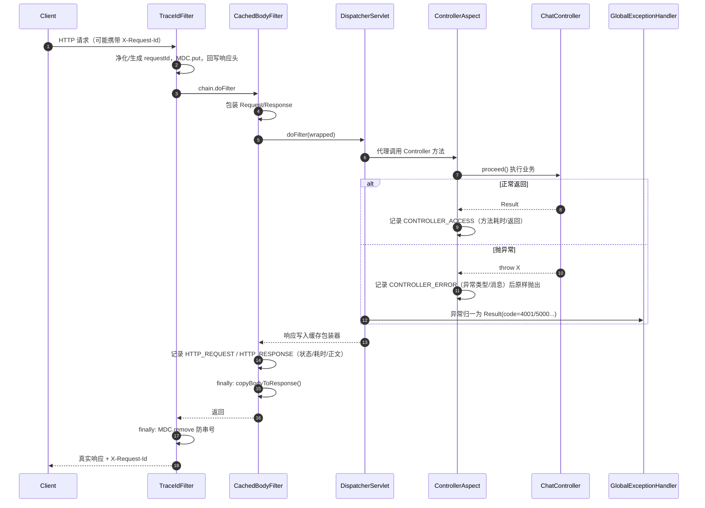

# D13-03 AOP 切面请求/响应日志 —— 技术说明与操作实践指南

> 作者视角：12 年架构师 + 6 年教学。本文讲“是什么 → 为什么 → 底层机制 → 执行流程 → 核心代码 → 常见问题 → 工程实践”，与《D13-02》互为表里。
> 运行基线：Spring Boot 3.5.16（对应 Spring Framework 6.2.x）、JDK 21、Servlet/Tomcat + Spring MVC、Logback、Jackson。

---

## 第 1 章 核心概念与技术选型

### 1.1 统一访问日志要解决的本质问题

一次 HTTP 请求在服务端会跨越“过滤器 → DispatcherServlet → 拦截器 → Controller → Service”多个边界。排障需要回答三件事：**请求是谁（requestId）、带了什么/返回了什么（参数与响应）、表现如何（耗时/状态/异常）**。单靠业务里零散 `log.info` 无法保证覆盖率与一致性，必须在框架边界统一切入。

### 1.2 为什么 AOP 不够，还要加 Servlet 过滤器

Spring AOP（Aspect-Oriented Programming，面向切面编程）基于**动态代理**工作，只对“Spring 容器管理的 Bean 的方法调用”生效。这带来三条硬边界：

1. 代理只包裹 Bean 方法，看不到 Servlet 容器层面的最终响应字节与真实 HTTP 状态；
2. 请求未到达 Controller（如无 handler、被容器错误处理接管）时，切面根本不会执行；
3. 同类内部自调用（`this.xxx()`）不走代理，Advice 不触发。

而 Servlet `Filter` 位于请求最外层，包裹整个 DispatcherServlet，能覆盖完整 HTTP 生命周期。两者结合才能既拿到“业务语义化的方法入参/返回对象”，又拿到“完整可信的 HTTP 报文与状态”。

### 1.3 请求/响应正文为什么需要包装器

Servlet 输入流是**一次性消费**的：`InputStream` 读完即尽，不能先读一遍打日志再让 Jackson 读第二遍。Spring 提供两个缓存包装器解决该问题：

- `ContentCachingRequestWrapper`：不提前读流，而是在框架后续读取时**旁路缓存已被读取的字节**，链返回后通过 `getContentAsByteArray()` 取回；
- `ContentCachingResponseWrapper`：把 Handler 写出的响应先缓存到内部字节数组，**必须**显式调用 `copyBodyToResponse()` 才会真正写给客户端。

### 1.4 MDC 与 requestId

MDC（Mapped Diagnostic Context，映射诊断上下文）是 SLF4J 提供的线程级日志上下文，底层通常是 `ThreadLocal`。把 requestId 放进 MDC 后，logback pattern 用 `%X{requestId}` 即可在每条日志自动输出同一 ID。关键纪律：请求结束必须 `MDC.remove()`，否则 Tomcat 工作线程被复用时会发生“串号”。

---

## 第 2 章 整体架构与组件关系

### 2.1 组件责任分层



### 2.2 单次请求时序（含异常路径）



---

## 第 3 章 核心代码解析（与真实源码一一对应）

包路径：`com.zl.d01.springai.logging`。

### 3.1 AccessLogProperties：配置收口

`@ConfigurationProperties(prefix = "app.access-log")` 集中管理开关、头名、截断长度、排除路径与脱敏关键字。所有脱敏关键字都给了安全默认值，意味着**不改任何配置也默认脱敏**。`enabled` 通过 `@ConditionalOnProperty(matchIfMissing = true)` 实现“缺省即开启、显式 false 即整体关闭”。

### 3.2 LogMaskingUtils：所有安全策略的唯一出口

设计要点：

- **结构化输出**：内部专用 `ObjectMapper`（关闭 `FAIL_ON_EMPTY_BEANS`，**不开启 default typing**，杜绝多态反序列化风险），所有事件 `writeValueAsString` 成单行 JSON，换行/引号被转义，防止日志伪造（Log Forging）。
- **递归脱敏**：`maskTree` 深度遍历 JSON 对象与数组，字段名小写后做“包含匹配”，命中即整体替换为掩码 `*****`，能覆盖 `apiKey`、`userPassword`、`x-auth-token` 等变体。
- **截断标记**：`truncate` 超过 `maxPayloadLength` 时截断并拼接 `...<truncated,originLength=n>`，同时返回 `truncated=true`，避免日志无限膨胀。
- **失败兜底**：非法 JSON 不回显原文（可能含密钥），输出 `<unparseable body,length=n>`；对象序列化失败回退为类名摘要。**工具方法本身不向外抛异常**。
- **requestId 净化**：`sanitizeInboundRequestId` 用 `[^A-Za-z0-9_-]` 剔除换行等字符，防止外部通过请求头注入伪造日志行。
- **二进制/流式判定**：`isBinaryOrStreaming` 命中 multipart、octet-stream、image/video/audio、text/event-stream、attachment 时只记元数据。

### 3.3 TraceIdFilter：最高优先级的身份过滤器

继承 `OncePerRequestFilter` 保证单次请求只执行一次。逻辑为：读取上游头 → 净化，缺失则生成 32 位无横线 UUID → `MDC.put` + 请求属性 + 响应头回写 → `finally { MDC.remove }`。注册顺序设为 `Ordered.HIGHEST_PRECEDENCE`，确保后续所有组件都能取到 ID。

### 3.4 CachedBodyAccessLogFilter：HTTP 全生命周期记录

关键实现纪律：

1. `shouldNotFilter` 用 `AntPathMatcher` 匹配 `exclude-paths`，被排除路径不打访问日志（但外层 TraceIdFilter 仍透传 requestId）。
2. 同时包装请求与响应后再放行；
3. `finally` 中**先记日志、再 `copyBodyToResponse()`**，且日志记录整体 try/catch，任何日志异常只告警不外溢；
4. 请求体为 0 字节时区分“真空体/流未被读取”，输出 `skipReason` 而非假装读到内容；
5. 过滤器链若真的抛出未被接住的 `Throwable`，在 HTTP_RESPONSE 中记录 `exception` 字段，再原样抛出，不吞异常。

### 3.5 ControllerAccessLogAspect：业务语义切面

- 切点显式限定 `execution(public * com.zl.d01.springai.controller..*.*(..))`，不误伤框架 Bean；
- 通过 `MethodSignature.getParameterNames()` 取参数名，缺失时回退 `argN`，不依赖编译参数的极端情况；
- ServletRequest/Response 等容器对象不做 JSON 序列化，输出占位符；
- `@Around` 中 `proceed()` 成功记 `CONTROLLER_ACCESS`，异常记 `CONTROLLER_ERROR`（只记异常类名与消息，完整堆栈仍交给既有 `GlobalExceptionHandler`，避免重复刷堆栈），最后**原样 throw**。

### 3.6 AccessLogAutoConfiguration：装配与顺序

`@Configuration + @EnableConfigurationProperties + @ConditionalOnProperty`，注册两个 `FilterRegistrationBean`：TraceIdFilter 顺序 `HIGHEST_PRECEDENCE`，CachedBody 过滤器 `HIGHEST_PRECEDENCE + 10`，URL 模式均为 `/*`。

---

## 第 4 章 脱敏与截断策略明细

### 4.1 匹配规则

- 匹配维度：名称统一转小写，采用**包含匹配**（`keywords.stream().anyMatch(lower::contains)`），用召回率换安全，宁可多掩码不可漏密钥；
- 作用位置：请求头、Query 参数、JSON/POJO 字段名；
- 掩码值：默认 `*****`，可配。

### 4.2 各内容类型处理矩阵

| 内容类型 | 请求处理 | 响应处理 |
|---|---|---|
| 普通 JSON/文本 | 缓存→脱敏→截断 | 缓存→脱敏→截断 |
| 非法 JSON | 输出长度占位，不回显原文 | 同左 |
| 空体/未读取 | `skipReason` 说明 | `skipReason` 说明 |
| multipart/二进制 | 仅记 Content-Type、size、skipReason | 同左 |
| SSE 等流式 | 仅记元数据，不缓存正文 | 同左 |
| 容器对象（方法入参） | 类名占位，不序列化 | — |

---

## 第 5 章 配置与运行实践

### 5.1 关键配置

```yaml
app:
  access-log:
    enabled: ${ACCESS_LOG_ENABLED:true}
    request-id-header: X-Request-Id
    max-payload-length: 2048
    exclude-paths: [/error, /favicon.ico]
```

logback 输出目录由 `APP_LOG_HOME` 覆盖，默认 `E:/AI/project/AI-Learning-one/M2-Java/logs`；滚动策略 10MB/15 天/1GB；pattern 固定携带 `[requestId=%X{requestId}]`。

### 5.2 常用运维动作

```powershell
# 1. 编译
mvn -pl D01_SpringAI_init -am compile -DskipTests
# 2. 全量测试
mvn -pl D01_SpringAI_init test
# 3. mock 模式启动（默认，无需密钥与外网）
mvn -pl D01_SpringAI_init spring-boot:run
# 4. 发起请求并查看响应头中的 requestId
curl -i -X POST http://localhost:8080/api/v1/ai/chat `
  -H "Content-Type: application/json" `
  -d '{\"message\":\"hello\"}'
# 5. 按 requestId 关联检索一次请求的全部日志
Select-String -Path "E:\AI\project\AI-Learning-one\M2-Java\logs\d01-access.log" -Pattern "<requestId>"
```

### 5.3 关闭与降级

- 临时整体关闭：设置环境变量 `ACCESS_LOG_ENABLED=false`，过滤器与切面均不注册，应用回到无访问日志状态；
- 只关正文：将 `include-request-body` / `include-response-body` / `include-method-args` 置 false；
- 调小/调大截断：修改 `max-payload-length`，超限事件会显式带 `truncated=true`。

---

## 第 6 章 常见问题与排障（FAQ）

**Q1：为什么客户端收到空响应体？**
多半是用了 `ContentCachingResponseWrapper` 却漏掉 `copyBodyToResponse()`。本项目在过滤器 finally 中强制调用，并有真实容器测试守护；自行改造时务必保留。

**Q2：为什么请求体日志是空的并带 skipReason？**
`ContentCachingRequestWrapper` 只缓存被读取过的字节。GET 无体、或请求未进入 Controller（未触发消息读取）时字节为空，这是框架机制而非缺陷。

**Q3：并发压测后为什么不同请求日志出现同一个 requestId？**
MDC 基于 ThreadLocal，Tomcat 线程复用会串号。根因是忘记在 finally 清理；`TraceIdFilter` 已保证 `MDC.remove`。若后续引入异步线程池，还需在线程切换处手动桥接 MDC。

**Q4：未匹配路径为什么不是 404？**
Framework 6 抛 `NoResourceFoundException`，本项目兜底异常处理器把所有 `Exception` 归一为 HTTP 200 + body code 5000。需要标准 404 时，新增 `@ExceptionHandler(NoResourceFoundException.class)` 并设置 404 状态，属独立接口契约变更，需单独评估。

**Q5：日志里为什么看不到堆栈，只有异常类名？**
切面事件只记录异常类型与消息，避免与 `GlobalExceptionHandler` 的完整 ERROR 堆栈重复；用 requestId 即可关联到同一请求的完整堆栈日志。

**Q6：上游伪造 X-Request-Id 怎么办？**
过滤器只保留字母/数字/中划线/下划线，非法字符被剥离，且即使传入合法 ID 也只是日志关联键、不参与鉴权；如需要可信链路，应在网关层统一覆写该头。

**Q7：PowerShell 控制台中文乱码是代码问题吗？**
不是。Surefire 控制台回显受当前代码页影响，日志文件按 UTF-8 写入，直接读文件中文正常。

---

## 第 7 章 测试策略与结论

- **纯单测**（`AccessLogMaskingTest`，8 例）：不启动容器，穷举脱敏/截断/兜底/类型判定，反馈快；
- **MockMvc 集成**（`AccessLogIntegrationTest`，3 例）：给 `ACCESS_LOG` Logger 挂内存 `ListAppender`，断言事件关联、ID 不串、错误码与响应完整；
- **真实容器**（`AccessLogRealContainerTest`，2 例）：`RANDOM_PORT + TestRestTemplate` 走真实 Socket，验证包装器响应写回与未匹配路径的真实表现。
- 全量结果：**9 个测试类、31 个用例，0 失败 0 错误，1 个在线冒烟用例按设计跳过**。
- 未覆盖声明：本模块无文件上传/SSE 端点，二进制与流式分支仅有单测、无运行期实证；未执行独立 `java -jar` 进程启动（内嵌容器已完成等效 Socket 验证）。

---

## 第 8 章 记忆简语与知识层级树

### 8.1 记忆简语（便于快速回忆）

- **“切面管方法，过滤器管全程；要想不漏网，双层一起上。”**
- **“请求流一次性，包装来缓存；响应不回写，客户端空白。”**
- **“MDC 是 ThreadLocal，用完不 remove，线程一复用，请求就串号。”**
- **“日志先脱敏，超长就截断；异常不吞掉，原样往上抛。”**
- **“JSON 单行写，换行被转义；注入伪造头，净化再入 MDC。”**

### 8.2 竖屏层级树（适配手机/窄屏归档背诵）

```text
D13 统一访问日志
├─ 边界分层
│  ├─ Servlet Filter（HTTP 全生命周期）
│  │  ├─ TraceIdFilter：requestId / MDC / 响应头 / finally 清理
│  │  └─ CachedBodyAccessLogFilter：双包装器 / HTTP 事件 / copyBodyToResponse
│  └─ Spring AOP（Controller 方法语义）
│     └─ ControllerAccessLogAspect：入参 / 返回 / 耗时 / 异常原样抛
├─ 安全与体积
│  ├─ LogMaskingUtils
│  │  ├─ 递归脱敏（头 / Query / JSON 字段，小写包含匹配）
│  │  ├─ 截断 + truncated=true
│  │  ├─ 非法 JSON 安全占位
│  │  ├─ 二进制/流式只记元数据
│  │  └─ 单行 JSON + requestId 净化（防日志伪造）
│  └─ AccessLogProperties：开关 / 头名 / 上限 / 排除路径 / 关键字
├─ 装配
│  └─ AccessLogAutoConfiguration：条件开关 + 过滤器固定顺序
└─ 输出
   └─ logback-spring.xml：CONSOLE + 滚动 FILE，pattern 携带 %X{requestId}
```

---

## 第 9 章 官方参考资料（与基线版本对应）

- 《Proxying mechanisms | 代理机制》：https://docs.spring.io/spring-framework/reference/6.2/core/aop/proxying.html
- 《Understanding the AOP Abstraction | AOP 概念与定义》：https://docs.spring.io/spring-framework/reference/6.2/core/aop/introduction-defn.html
- 《ContentCachingRequestWrapper (Javadoc API) | 请求缓存包装器 API》：https://docs.spring.io/spring-framework/docs/6.2.19/javadoc-api/org/springframework/web/util/ContentCachingRequestWrapper.html
- 《ContentCachingResponseWrapper (Javadoc API) | 响应缓存包装器 API》：https://docs.spring.io/spring-framework/docs/6.2.8/javadoc-api/org/springframework/web/util/ContentCachingResponseWrapper.html
- 《Spring Boot Reference: Logging | Spring Boot 日志参考》：https://docs.spring.io/spring-boot/reference/features/logging.html

> 说明：以上为 Spring 官方文档站点链接，按本项目 Spring Boot 3.5.16 对应的 Spring Framework 6.2 系列锚定版本号；具体类行为以本地依赖中的实际字节码与上述对应版本文档为准。本文中凡属“本项目实现分析”的结论，均已在正文结合本地源码说明，未冒充官方原文。
