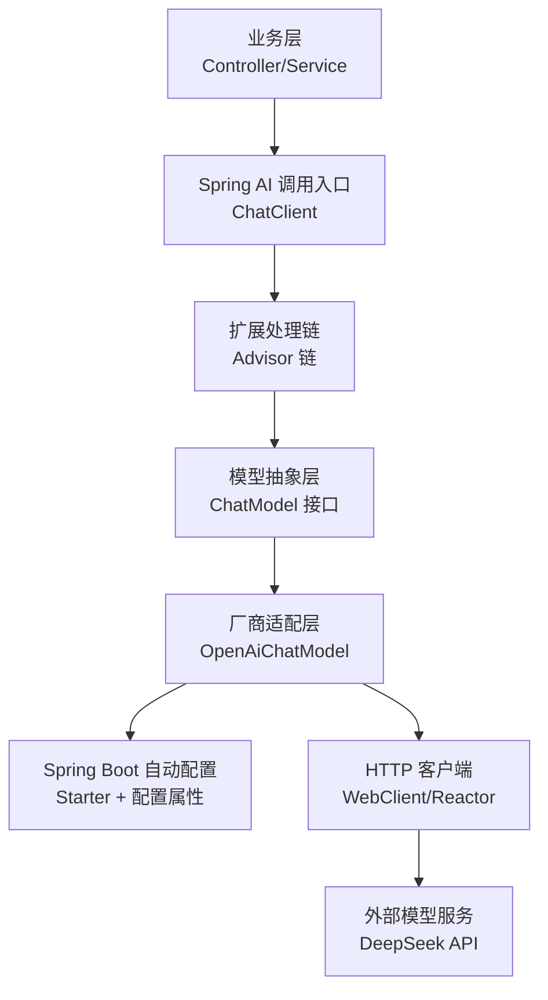

# Spring AI 入门：架构、核心组件与模型接入

>
> 适用版本：Spring AI 1.1.8 / Spring Boot 3.5.x / JDK 21 LTS
> 学习目标：建立Spring AI整体架构认知，掌握核心组件职责边界，完成DeepSeek模型接入与基础调用，具备常见故障排查能力
> 前置知识：Spring Boot、Maven依赖注入、HTTP接口、REST API开发基础
> 范围边界：聚焦模型调用基础能力，不深入RAG、Agent、MCP等进阶主题

---

## 一、Spring AI 定位与基础概念

### 1.1 核心定义

Spring AI 是 Spring 生态官方提供的 AI 应用开发框架，对主流大语言模型、向量数据库、文档处理能力进行统一抽象封装，让 Java 开发者以熟悉的 Spring 编程范式快速构建 AI 应用，无需直接对接各家模型 SDK。

它的核心价值是**模型无关的抽象层**：业务代码面向统一接口编程，切换模型供应商时仅需修改配置，无需改动业务逻辑。

《Getting Started | Spring AI 入门指南》：[https://docs.spring.io/spring-ai/reference/1.1/getting-started.html](https://docs.spring.io/spring-ai/reference/1.1/getting-started.html)

### 1.2 解决的核心问题

1. **供应商接口差异**：各家模型 API 格式、参数、鉴权方式不统一，切换模型成本高。
2. **调用抽象缺失**：原生 SDK 偏向底层 HTTP 调用，缺少与 Spring 生态集成的配置管理、依赖注入、自动配置能力。
3. **工程集成成本高**：AI 能力与业务系统解耦差，对话记忆、工具调用、向量检索等通用能力需要重复开发。
4. **版本管理混乱**：不同模型 SDK 依赖冲突，升级困难。

### 1.3 生态角色与能力边界

| 层级             | 职责                           | 代表组件                           |
| ---------------- | ------------------------------ | ---------------------------------- |
| 业务应用层       | 业务逻辑、接口、编排           | Controller、Service、业务流程      |
| Spring AI 抽象层 | 统一模型调用接口、通用扩展机制 | ChatClient、ChatModel、Advisor     |
| 模型适配层       | 具体厂商协议转换、参数映射     | OpenAiChatModel、DeepSeek 兼容适配 |
| 模型服务层       | 大语言模型推理能力             | DeepSeek、OpenAI 等第三方服务      |

>
> **关键边界**：Spring AI 是调用框架，不是模型训练框架；它不生产模型，不保证回答准确性，不具备自主推理能力，所有输出依赖底层模型服务。

### 1.4 常见概念辨析

| 概念对                    | 区别说明                                                     |
| ------------------------- | ------------------------------------------------------------ |
| AI 应用 vs AI 模型        | AI 模型是具备推理能力的服务；AI 应用是调用模型能力的业务系统 |
| 模型提供商 vs 模型名称    | 提供商是服务公司（如DeepSeek）；模型名称是具体产品（如deepseek-flash） |
| 模型 API vs Spring AI API | 模型 API 是厂商提供的原生接口；Spring AI API 是对前者的封装抽象 |
| 聊天模型 vs 嵌入模型      | 聊天模型生成自然语言；嵌入模型将文本转换为向量，用于语义检索 |
| API 调用 vs 模型训练      | 调用是使用已有模型能力；训练是调整模型参数，Spring AI 不涉及训练 |
| 调用框架 vs Agent 平台    | 框架提供基础调用能力；Agent 平台是完整的自主任务执行体系     |

### 1.5 Java 开发者的学习价值

对于后端工程师，Spring AI 降低了 AI 工程化的门槛：

- 用熟悉的依赖注入、自动配置、Starter 模式快速接入 AI 能力
- 无需学习 Python 生态，基于 Java 技术栈即可构建 AI 应用
- 可以复用 Spring 生态的事务、安全、监控、配置管理等工程能力

---

## 二、整体架构与调用流程

### 2.1 分层架构



#### 各层职责说明

1. **业务层**：业务代码发起调用，只依赖 ChatClient 接口，不感知具体模型厂商。
2. **ChatClient**：面向业务的 Fluent 风格调用入口，封装消息组织、参数传递、响应转换。
3. **Advisor 链**：请求/响应的拦截扩展机制，可插入日志、记忆、检索增强等能力。
4. **ChatModel 接口**：模型调用的统一抽象，定义标准的 call/stream 方法。
5. **厂商适配层**：将统一请求转换为对应厂商的 API 格式，处理鉴权、参数映射、响应解析。
6. **自动配置层**：Spring Boot Starter 机制，根据配置自动创建 Bean，管理依赖版本。
7. **HTTP 客户端**：负责底层 HTTP 通信、超时、重试、流式响应处理。

### 2.2 一次模型调用的完整流程


~~~mermaid
graph TD
    Start["业务代码发起请求"] --> BuildPrompt["构建 Prompt：消息 + 选项"]
    BuildPrompt --> AdvisorBefore["Advisor 链前置处理：记忆、检索增强等"]
    AdvisorBefore --> ModelCall["ChatModel 接口接收请求"]
    ModelCall --> Adapter["厂商适配层：参数转换、鉴权封装"]
    Adapter --> HTTP["HTTP 客户端发送请求到模型 API"]
    HTTP --> API{"模型服务返回"}

    API -->|成功| Parse["解析响应为标准结构"]
    Parse --> AdvisorAfter["Advisor 链后置处理"]
    AdvisorAfter --> Return["返回业务层结果"]

    API -->|失败| Exception["异常转换与传播"]
    Exception --> Return
~~~


#### 流程分步说明

1. **请求构建**：业务代码通过 ChatClient 构建用户输入、系统提示、模型参数，形成标准 Prompt。
2. **前置扩展**：Advisor 链依次处理请求，例如补充对话历史、检索相关文档。
3. **模型抽象调用**：调用 ChatModel 接口，不感知具体厂商实现。
4. **厂商适配**：具体模型实现将标准请求转换为对应厂商的 API 格式，添加鉴权头。
5. **HTTP 传输**：底层 HTTP 客户端执行网络请求，处理超时、重试。
6. **响应解析**：将厂商返回的 JSON 转换为统一的 ChatResponse 结构。
7. **后置处理**：Advisor 链处理响应，例如保存对话历史。
8. **结果返回**：将最终结果返回业务层，异常统一转换为 Spring AI 异常体系。

### 2.3 自动配置与依赖注入原理

1. **Starter 机制**：引入`spring-ai-starter-model-deepseek` (`spring-ai-starter-model-openai`可接入openai) 依赖后，Spring Boot 自动扫描并加载对应自动配置类。
2. **BOM 版本管理**：`spring-ai-bom` 统一管理所有 Spring AI 组件版本，避免版本冲突。
3. **Bean 创建流程**：
   - 配置属性（如 `spring.ai.openai.api-key`）驱动配置
   - 自动配置类创建 `OpenAiApi`、`OpenAiChatModel` 等底层 Bean
   - 自动创建 `ChatClient.Builder` 原型 Bean，可直接注入使用
4. **为什么依赖添加不代表调用一定成功**：
   - 依赖只解决代码编译与 Bean 创建，不解决网络、鉴权、模型权限问题
   - 配置缺失、密钥无效、网络不通都会导致启动失败或运行时报错

---

## 三、核心组件详解

### 3.1 ChatClient

#### 定义与定位

面向业务的流式调用入口，提供 Fluent API 风格的模型调用体验，是业务代码最常用的接口。

#### 核心能力

- 同步/流式双模式调用
- 系统消息、用户消息构建
- 模板变量替换
- 结构化输出解析
- Advisor 扩展配置

#### 基础调用示例

```
@RestController
public class ChatController {

    private final ChatClient chatClient;

    // 注入自动配置的 ChatClient.Builder
    public ChatController(ChatClient.Builder chatClientBuilder) {
        this.chatClient = chatClientBuilder.build();
    }

    @GetMapping("/ai/chat")
    public String chat(String message) {
        return chatClient.prompt()
                .user(message)
                .call()
                .content();
    }
}
```

#### 核心方法

| 方法                   | 作用                       |
| ---------------------- | -------------------------- |
| `prompt()`             | 启动流式调用构建           |
| `user(String)`         | 设置用户消息内容           |
| `system(String)`       | 设置系统提示词             |
| `call()`               | 同步调用，返回完整响应     |
| `stream()`             | 流式调用，返回 Flux 响应流 |
| `entity(Class)`        | 将响应解析为指定 Java 对象 |
| `advisors(Advisor...)` | 配置本次调用的 Advisor     |

#### 边界说明

- ChatClient 本身是不可变的请求执行器，默认无状态、线程安全，可单例复用； 每次 `builder.build()` 会生成独立的新实例，批量创建多实例时建议复用 Builder 减少重复配置； 仅当集成 ChatMemory 记忆组件后，对话链路才会表现出状态性，状态由记忆组件承载。
- 默认单例 `ChatClient.Builder` 是原型 Bean，每次调用 build 生成独立实例
- 流式调用需要响应式栈支持，Servlet 栈只能完整返回后输出

《Chat Client API | ChatClient 接口官方文档》：[https://docs.spring.io/spring-ai/reference/1.1/api/chatclient.html](https://docs.spring.io/spring-ai/reference/1.1/api/chatclient.html)

### 3.2 ChatModel

#### 定义与定位

模型调用的抽象接口，定义了标准的模型调用契约，是 Spring AI 抽象层的核心。

#### 职责

- 统一不同厂商的调用接口
- 接收标准 Prompt，返回标准 ChatResponse
- 屏蔽底层厂商差异，支持模型无缝切换

#### 与 ChatClient 的关系

- ChatClient 是面向业务的调用入口，更易用
- ChatModel 是底层抽象接口，更偏向模型交互
- ChatClient 内部基于 ChatModel 实现，增加了流式 API、模板、Advisor 等上层能力

#### 为什么需要抽象

业务代码依赖 ChatModel 接口，切换模型厂商时，只需更换配置与实现类，业务代码零改动，符合开闭原则。

《Chat Model API | ChatModel 接口官方文档》：[https://docs.spring.io/spring-ai/reference/api/chatmodel.html](https://docs.spring.io/spring-ai/reference/api/chatmodel.html)

### 3.3 Prompt 与 Message

#### Prompt

一次模型请求的完整封装，包含消息列表 + 模型调用选项。

>
> 不是简单的字符串，而是结构化的请求对象，包含角色、内容、参数、元数据等完整信息。

#### Message 与角色

Message 是单条消息的抽象，按角色分为不同实现：

| 角色      | 作用                                               |
| --------- | -------------------------------------------------- |
| System    | 系统提示，定义模型身份、规则、输出格式，优先级最高 |
| User      | 用户输入，业务侧提交的问题与指令                   |
| Assistant | 模型回复，用于多轮对话历史上下文                   |
| Tool      | 工具调用结果，用于工具调用交互                     |

#### 多消息请求示例

```
String response = chatClient.prompt()
        .system("你是专业的Java技术助手，回答简洁准确")
        .user("解释Spring AI的作用")
        .call()
        .content();
```

#### 关键认知

- 模型本身**没有跨请求记忆**，多轮对话必须每次携带历史消息
- 消息顺序与角色是模型理解上下文的关键，顺序错误会导致输出异常
- 系统提示对输出风格影响很大，是 Prompt 工程的核心

### 3.4 ChatOptions

#### 定义与作用

控制模型生成行为的参数集合，包括模型名称、温度、最大长度、惩罚系数等。

#### 核心通用参数

| 参数          | 作用                 | 说明                        |
| ------------- | -------------------- | --------------------------- |
| `model`       | 指定调用的模型名称   | 不同厂商模型名不同          |
| `temperature` | 采样温度，控制创造性 | 0~2，越低越确定，越高越随机 |
| `maxTokens`   | 最大生成 Token 数    | 控制输出长度，影响费用      |
| `topP`        | 核采样参数           | 替代温度的另一种采样方式    |

#### 配置层级

1. **全局默认**：配置文件中设置，所有请求默认生效
2. **单次请求**：调用时通过 options 覆盖，优先级更高

>
> **重要边界**：很多参数是模型相关的，不是所有模型都支持全部参数；推理模型、不同厂商的参数支持度存在差异。

### 3.5 ChatResponse 与 Generation

#### ChatResponse

模型调用的完整响应对象，包含生成结果、元数据、使用信息。

#### Generation

单次生成结果，包含回复消息与本次生成的元数据。一次请求可能有多个生成结果。

#### 两种使用方式对比

```
// 只需要内容字符串
String content = chatClient.prompt().user("你好").call().content();

// 需要完整响应信息
ChatResponse response = chatClient.prompt().user("你好").call().chatResponse();
int tokenUsage = response.getMetadata().getUsage().getTotalTokens();
```

#### 工程边界

- 生产环境不能只关注内容字符串，Token 用量、模型版本等元数据是成本核算与监控的关键
- 流式响应的元数据会在最后一个 chunk 返回，不是逐块返回

### 3.6 Advisor 机制

#### 定义与定位

请求/响应拦截器机制，在模型调用前后对请求/响应进行修改扩展，是 Spring AI 的核心扩展点。

#### 典型用途

- 对话记忆：自动补充历史消息
- RAG 检索增强：查询前检索相关文档补充上下文
- 日志审计：记录请求响应内容
- 内容过滤：输入输出敏感词校验
- 工具调用：自动处理工具调用逻辑

#### 执行顺序

多个 Advisor 按添加顺序执行，前置处理顺序与后置处理顺序相反，类似过滤器链。

>
> **当前阶段认知**：Advisor 是扩展机制，不是魔法；最终效果依赖具体实现，添加 Advisor 不代表业务一定更准确。

### 3.7 其他组件基础认知

| 组件           | 作用                         | 当前阶段要求                       |
| -------------- | ---------------------------- | ---------------------------------- |
| ChatMemory     | 对话历史存储，维护多轮上下文 | 理解概念，知道需要手动配置         |
| EmbeddingModel | 嵌入模型，文本转向量         | 知道用途，后续 RAG 阶段深入        |
| VectorStore    | 向量数据库，存储与检索向量   | 知道用途，后续 RAG 阶段深入        |
| Tool Calling   | 模型调用外部工具的能力       | 理解调用机制，后续工具调用阶段深入 |
| Observability  | 指标、日志、追踪观测能力     | 知道有观测能力，生产环境需要配置   |

---

## 四、核心概念对比表

| 对比项                            | 核心区别                                                     | 典型场景                                               |
| --------------------------------- | ------------------------------------------------------------ | ------------------------------------------------------ |
| **ChatClient vs ChatModel**       | ChatClient是业务调用入口，提供Fluent API；ChatModel是底层模型抽象接口 | 业务代码用ChatClient；自定义扩展用ChatModel            |
| **Prompt vs Message**             | Prompt是一次完整请求，包含多条Message；Message是单条消息     | 一次调用一个Prompt；一个Prompt包含多个角色的Message    |
| **ChatResponse vs Generation**    | ChatResponse是完整响应包装；Generation是单条生成结果         | 简单调用取content用String；需要元数据用ChatResponse    |
| **ChatModel vs EmbeddingModel**   | ChatModel生成自然语言对话；EmbeddingModel将文本转为向量      | 聊天、生成用ChatModel；语义检索、聚类用EmbeddingModel  |
| **模型 Starter vs Spring AI BOM** | Starter提供自动配置与Bean；BOM统一管理所有组件版本           | 加Starter接入能力；加BOM管理版本                       |
| **Advisor vs 普通Service**        | Advisor拦截模型调用链路，透明扩展；Service是业务编排         | 模型交互扩展用Advisor；业务逻辑编排用Service           |
| **Chat Memory vs 模型上下文**     | Chat Memory是应用侧维护历史，每次请求携带；模型本身无跨请求记忆 | 多轮对话必须配置Memory；不能假设模型记得上一轮         |
| **Tool Calling vs 工具执行**      | Tool Calling是模型提出调用请求；工具执行由应用侧完成，权限可控 | 模型只决定调用什么；实际执行、权限、校验由业务代码负责 |

---

## 五、DeepSeek 模型接入实战

### 5.1 接入方案说明

DeepSeek 提供与 OpenAI 兼容的 API 格式，因此使用 Spring AI 官方的 `spring-ai-starter-model-openai` 接入，通过修改 `base-url` 指向 DeepSeek 服务地址。

#### 方案依据

- Spring AI 1.1.x 的 OpenAI 实现成熟稳定，兼容性好
- DeepSeek API 完全兼容 OpenAI 接口协议，参数、响应格式对齐
- 无需额外第三方依赖，官方支持，风险低

《OpenAI Chat | OpenAI 模型接入官方文档》：[https://docs.spring.io/spring-ai/reference/1.1/api/chat/openai-chat.html](https://docs.spring.io/spring-ai/reference/1.1/api/chat/openai-chat.html)
《DeepSeek API 官方文档》：[https://api-docs.deepseek.com/zh-cn/](https://api-docs.deepseek.com/zh-cn/)

### 5.2 Maven 依赖配置

#### BOM 与依赖

```
<dependencyManagement>
    <dependencies>
        <!-- Spring AI BOM 统一版本管理 -->
        <dependency>
            <groupId>org.springframework.ai</groupId>
            <artifactId>spring-ai-bom</artifactId>
            <version>1.1.8</version>
            <type>pom</type>
            <scope>import</scope>
        </dependency>
    </dependencies>
</dependencyManagement>

<dependencies>
    <!-- OpenAI 兼容模型 Starter -->
    <dependency>
        <groupId>org.springframework.ai</groupId>
        <artifactId>spring-ai-starter-model-openai</artifactId>
    </dependency>
</dependencies>
```

#### 说明

- 通过 BOM 统一管理版本，避免组件版本不一致
- Starter 包含自动配置、Web 客户端、模型实现完整能力
- 版本 1.1.8 为 Spring AI 1.1 分支稳定版本，兼容 Spring Boot 3.5.x

### 5.3 application.yml 配置

```
spring:
  ai:
    openai:
      base-url: https://api.deepseek.com # DeepSeek API 地址
      api-key: ${DEEPSEEK_API_KEY}  # 从环境变量注入密钥，禁止硬编码
      chat:
        options:
          model: deepseek-flash  # 模型名称
          temperature: 0.7
          max-tokens: 1024
```

#### 配置项说明

| 配置项        | 作用           | 注意事项                                 |
| ------------- | -------------- | ---------------------------------------- |
| `base-url`    | 模型服务地址   | 替换默认 OpenAI 地址为 DeepSeek          |
| `api-key`     | API 鉴权密钥   | 必须通过环境变量注入，禁止提交到代码仓库 |
| `model`       | 调用的模型名称 | 必须与服务商支持的模型名一致             |
| `temperature` | 生成随机性     | 业务场景建议 0.3~0.8                     |

>
> **安全强制**：API 密钥严禁硬编码在配置文件或代码中，必须通过环境变量、配置中心或密钥管理系统注入。

### 5.4 最小可运行代码示例

```
package com.example.ai.controller;

import org.springframework.ai.chat.client;
import org.springframework.web.bind.annotation.GetMapping;
import org.springframework.web.bind.annotation.RequestParam;
import org.springframework.web.bind.annotation.RestController;

@RestController
public class DeepSeekChatController {

    private final ChatClient chatClient;

    // 注入自动配置的 ChatClient.Builder
    public DeepSeekChatController(ChatClient.Builder chatClientBuilder) {
        this.chatClient = chatClientBuilder.build();
    }

    @GetMapping("/api/chat")
    public String chat(@RequestParam(defaultValue = "你好") String message) {
        return chatClient.prompt()
                .system("你是专业的Java技术助手，回答简洁准确")
                .user(message)
                .call()
                .content();
    }
}
```

#### 启动类

```
package com.example.ai;

import org.springframework.boot.SpringApplication;
import org.springframework.boot.autoconfigure.SpringBootApplication;

@SpringBootApplication
public class AiApplication {
    public static void main(String[] args) {
        SpringApplication.run(AiApplication.class, args);
    }
}
```

### 5.5 验证步骤（预期）

>
> 以下为标准验证流程，实际执行结果依赖环境与密钥有效性。

1. **环境检查**：JDK 21、Maven 3.9.x 版本正确。
2. **依赖检查**：执行 `mvn dependency:resolve`，确认依赖下载成功无冲突。
3. **密钥配置**：设置环境变量 `DEEPSEEK_API_KEY` 为有效密钥。
4. **启动应用**：启动 Spring Boot 应用，观察启动日志无报错。
5. **接口调用**：访问 `[http://localhost:8080/api/chat?message=Java](http://localhost:8080/api/chat?message=Java)是什么`，验证返回内容。
6. **日志检查**：查看控制台日志，确认无异常、无密钥泄露。
7. **边界验证**：测试空输入、超长输入、异常输入的处理。

---

## 六、常见故障排查

| 现象                      | 可能原因                                   | 排查步骤                                                     | 解决方向                                             |
| ------------------------- | ------------------------------------------ | ------------------------------------------------------------ | ---------------------------------------------------- |
| **Maven 依赖解析失败**    | 版本不存在、镜像拦截、仓库未配置           | 1. 检查版本号是否正确   2. 检查Maven镜像是否拦截Spring仓库   3. 确认Maven Central可用 | 校正版本号；配置镜像排除Spring快照仓库；切换公共仓库 |
| **启动时报Bean创建失败**  | 配置缺失、starter未引入、属性名错误        | 1. 检查starter依赖是否添加   2. 检查配置前缀与属性名   3. 检查是否配置了api-key | 补全starter依赖；修正配置属性名；补充必填配置        |
| **401 Unauthorized**      | API Key无效、缺失、格式错误                | 1. 检查密钥是否配置正确   2. 检查Bearer前缀格式   3. 确认密钥有效且未过期 | 重新配置正确密钥；检查鉴权格式；确认账户状态         |
| **404 Not Found**         | base-url错误、路径不对、模型名错误         | 1. 检查base-url是否正确   2. 检查模型名称拼写   3. 确认接口路径存在 | 修正base-url；使用官方模型名；确认端点               |
| **429 Too Many Requests** | 调用频率超限、额度不足、限流               | 1. 检查调用频率   2. 确认账户额度   3. 检查是否有重试风暴    | 降低调用频率；充值额度；配置退避重试                 |
| **响应为空或解析失败**    | 模型返回格式异常、流式处理不当、参数不支持 | 1. 检查模型是否支持对应参数   2. 检查响应结构   3. 确认是否流式调用处理正确 | 修正参数；使用标准响应解析；检查流式处理逻辑         |
| **调用超时**              | 网络不通、代理问题、服务端超时             | 1. 检查网络连通性   2. 检查是否需要代理   3. 调整超时配置    | 排查网络；配置代理；调整超时时间                     |
| **模型返回内容异常**      | 提示词问题、参数不合适、模型能力限制       | 1. 检查系统提示与用户输入   2. 调整temperature参数   3. 确认模型能力边界 | 优化Prompt；调整参数；更换合适模型                   |
| **同样代码换模型不工作**  | 参数不兼容、模型能力差异、base-url错误     | 1. 检查模型特有参数   2. 确认模型支持对应能力   3. 检查地址切换是否正确 | 移除不兼容参数；更换支持的模型；修正地址             |
| **Token消耗异常高**       | 输出过长、提示词冗余、模型选择不对         | 1. 检查maxTokens设置   2. 优化提示词长度   3. 选择合适模型   | 限制输出长度；精简Prompt；更换成本更低的模型         |

---

## 七、基础工程化与安全边界

### 7.1 API 密钥安全

- **禁止硬编码**：密钥不能出现在代码、配置文件、Git提交中
- **环境变量注入**：开发环境用环境变量，生产环境用配置中心或密钥管理服务
- **最小权限**：密钥遵循最小权限原则，定期轮换
- **日志脱敏**：日志中禁止打印密钥、Authorization 头

### 7.2 输入与输出安全

- **输入校验**：限制输入长度，校验输入格式，避免注入攻击
- **输出校验**：关键业务场景必须校验模型输出，不能直接信任
- **敏感过滤**：输入输出都要做敏感信息过滤，避免泄露
- **业务规则校验**：模型输出不能替代业务规则校验、权限校验

### 7.3 超时与重试

- **合理超时**：根据业务场景设置连接超时、读取超时，避免无限等待
- **有限重试**：配置指数退避重试，只对网络异常、5xx错误重试
- **幂等保证**：写操作场景必须保证幂等，避免重试导致重复执行
- **熔断降级**：模型服务不可用时，提供降级方案，不阻塞主业务

### 7.4 限流与成本控制

- **接口限流**：按用户、按接口限流，避免异常调用耗尽额度
- **Token 统计**：监控 Token 消耗量，预算告警
- **模型分级**：简单任务用低成本模型，复杂任务用高性能模型
- **缓存策略**：高频相同请求缓存结果，减少重复调用

### 7.5 日志与观测

- **请求日志**：记录请求ID、模型、耗时、Token 用量，不记录完整内容
- **异常日志**：异常时记录关键信息，便于排查
- **指标监控**：调用量、成功率、耗时、Token 消耗监控告警
- **问题定位**：结合链路追踪，定位慢调用环节

---

## 八、学习边界与后续路线

| 方向             | 当前入门要求                   | 后续进阶目标                           |
| ---------------- | ------------------------------ | -------------------------------------- |
| 模型接入         | 掌握单模型接入、配置、基础调用 | 多模型集成、模型路由、能力差异适配     |
| Prompt 与消息    | 理解结构、角色、基础调用       | 提示工程、结构化输出、上下文管理       |
| Advisor          | 理解基础机制与作用             | 深入掌握上下文增强、自定义扩展         |
| 对话记忆         | 建立概念，知道用途             | 会话隔离、持久化、历史压缩             |
| Embedding        | 知道用途与基本概念             | 向量化原理、向量数据库选型             |
| RAG              | 理解组成与用途                 | 文档解析、切分、检索、重排、评估全链路 |
| Tool Calling     | 理解调用机制                   | 工具设计、参数校验、权限控制、失败恢复 |
| MCP              | 知道工具生态概念               | 协议、客户端、服务端、安全边界         |
| Agent / Workflow | 知道发展方向                   | 流程编排、状态管理、执行控制           |
| 可观测性         | 基础日志概念                   | 指标、追踪、告警、成本分析             |

>
> **当前阶段核心**：先把模型调用基础打牢，理解架构、组件、边界、接入、排查，再向进阶主题延伸。

---

## 九、核心知识总结

1. Spring AI 是模型调用框架，不是训练框架，核心价值是模型无关的抽象层。
2. 架构分层：业务层 → ChatClient → Advisor链 → ChatModel → 厂商适配 → 外部模型服务。
3. 核心组件：ChatClient是业务入口，ChatModel是抽象接口，Prompt是完整请求，Message是单条消息。
4. 自动配置是 Spring Boot Starter 的核心能力，依赖只解决编译，不解决运行时问题。
5. DeepSeek 可通过 OpenAI 兼容 Starter 接入，修改 base-url 与密钥即可。
6. API 密钥严禁硬编码，必须通过环境变量注入。
7. 模型输出不可全信，业务场景必须做规则校验与安全过滤。
8. 故障排查按依赖→配置→鉴权→网络→模型参数的顺序逐层定位。

---

## 十、自我检查清单

- 能说出 Spring AI 的核心作用与能力边界
- 能画出从业务调用到模型返回的完整链路
- 能区分 ChatClient 与 ChatModel 的职责
- 能解释 Prompt、Message、ChatResponse 的关系
- 能正确添加 Spring AI BOM 与模型 Starter
- 能配置 DeepSeek 接入并编写最小调用示例
- 能说出至少 5 种常见故障的排查思路
- 知道 API 密钥的安全管理要求
- 能区分当前入门范围与后续进阶主题
- 能解释为什么模型输出必须经过业务校验

---

## 参考文献

[1] Spring AI 官方文档. Getting Started | Spring AI 入门指南. [https://docs.spring.io/spring-ai/reference/1.1/getting-started.html](https://docs.spring.io/spring-ai/reference/1.1/getting-started.html)
[2] Spring AI 官方文档. Chat Client API | ChatClient 接口官方文档. [https://docs.spring.io/spring-ai/reference/1.1/api/chatclient.html](https://docs.spring.io/spring-ai/reference/1.1/api/chatclient.html)
[3] Spring AI 官方文档. Chat Model API | ChatModel 接口官方文档. [https://docs.spring.io/spring-ai/reference/api/chatmodel.html](https://docs.spring.io/spring-ai/reference/api/chatmodel.html)
[4] Spring AI 官方文档. OpenAI Chat | OpenAI 模型接入官方文档. [https://docs.spring.io/spring-ai/reference/1.1/api/chat/openai-chat.html](https://docs.spring.io/spring-ai/reference/1.1/api/chat/openai-chat.html)
[5] DeepSeek 官方文档. DeepSeek API 官方文档. [https://api-docs.deepseek.com/zh-cn/](https://api-docs.deepseek.com/zh-cn/)
[6] Spring AI 官方发布. Releases | Spring AI 官方版本发布记录. [https://github.com/spring-projects/spring-ai/releases](https://github.com/spring-projects/spring-ai/releases)