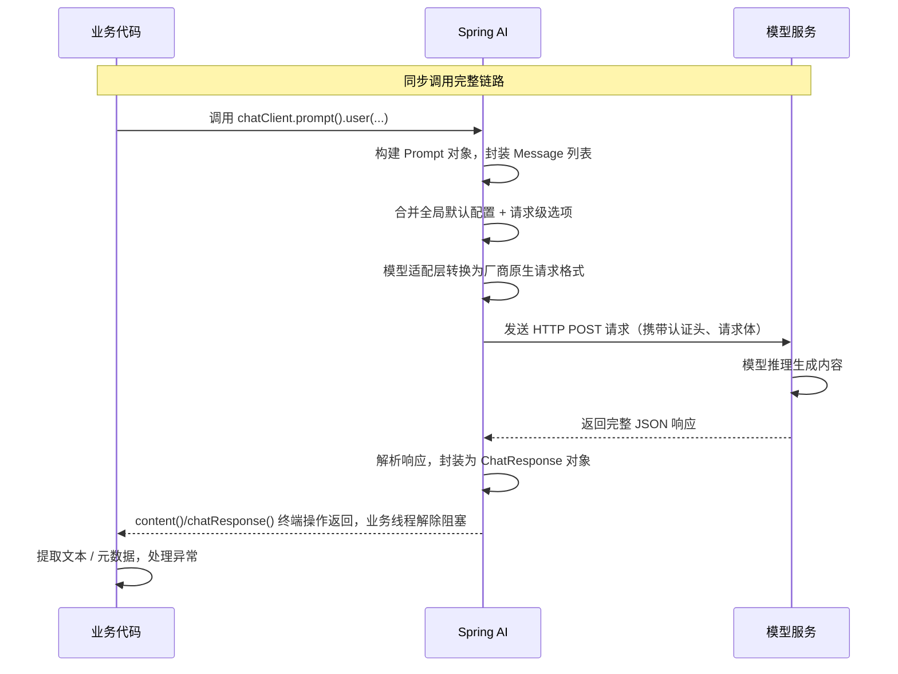

# Spring AI 模型 API：聊天接口、流式输出与 Temperature / Token 参数

>
> 目标读者：具备4年Java后端经验，转型Java AI工程师
> 技术基线：JDK 21 LTS / Spring Boot 3.5.16 / Spring AI 1.1.8 / DeepSeek API
> 文档定位：原理+工程+实战，覆盖调用链路、同步/流式机制、参数调优、故障排查与可运行代码
> 前置知识：具备Spring Boot、依赖注入、Maven、HTTP、REST API基础；不要求机器学习专业背景

>
> **修订记录（2026-10-28，验收整改）**：
> 1. 纠正 `ChatClient.call()` 执行时机——`call()` 仅返回 `CallResponseSpec`，终端操作 `call().content()` / `call().chatResponse()` 才真正发起模型调用；
> 2. 明确 `stream()` 返回 `StreamResponseSpec`、`stream().content()` 产出的 `Flux<String>` 需被订阅才执行；
> 3. 区分 HTTP/1.1 分块传输编码、HTTP/2 DATA 帧与 SSE 事件协议三层概念，SSE 不等同于 `Transfer-Encoding: chunked`；
> 4. 流式控制器示例按 WebFlux 与 Spring MVC 分栈说明，MVC 栈（本项目）以 `SseEmitter` 桥接 `Flux`，不能直接返回 `Flux<String>`。

---

## 一、模型聊天 API 的基本结构与完整请求链路

### 1.1 什么是模型聊天 API

聊天API是大模型对外提供的对话式交互接口，通过**结构化消息列表**提交请求，模型根据上下文生成对应回复，支持系统指令、多轮对话、工具调用、多模态等扩展能力。

#### 为什么用结构化消息列表，而不是单字符串

- **角色区分**：明确区分系统指令、用户输入、模型回复、工具调用，模型可根据角色做不同处理
- **上下文承载**：多轮对话历史可完整传入，模型理解上下文
- **扩展能力**：统一支持多模态、工具调用、元数据等附加信息
- **协议标准**：主流模型厂商统一遵循的接口规范，便于切换兼容

#### Spring AI 的职责与边界

Spring AI 在业务代码与模型API之间做抽象适配层：
✅ **统一接口**：`ChatClient`、`ChatModel`等标准API，业务代码不直接耦合具体厂商
✅ **自动转换**：请求构建、响应解析、错误映射、流式适配、参数对齐
✅ **配置管理**：全局默认配置、请求级动态覆盖、环境变量注入
❌ **能力抹平**：模型特有参数、能力差异仍然存在，切换厂商仍需业务适配
❌ **效果等价**：不同模型的相同参数取值效果可能差异很大，不能直接复用调优参数

### 1.2 一次聊天请求的完整过程

按三层架构拆分：业务应用层、Spring AI 内部层、外部模型服务层。



#### 各阶段职责说明

1. **业务层**：组装业务输入，调用Spring AI接口，消费结果，处理业务异常
2. **Spring AI层**：请求构建、参数合并、格式转换、网络调用、响应解析、异常包装
3. **模型服务层**：接收标准API请求，执行推理生成，返回结构化响应

### 1.3 消息结构与响应结构

#### 请求侧核心对象

| 对象          | 作用         | 核心组成                                              |
| ------------- | ------------ | ----------------------------------------------------- |
| `Prompt`      | 请求顶层封装 | 消息列表 + 模型选项（ChatOptions）                    |
| `Message`     | 单条对话消息 | 角色（system/user/assistant/tool）+ 文本内容 + 元数据 |
| `ChatOptions` | 模型参数配置 | temperature、maxTokens、topP等生成参数                |

#### 响应侧核心对象

| 对象                   | 作用         | 核心组成                                         |
| ---------------------- | ------------ | ------------------------------------------------ |
| `ChatResponse`         | 完整响应封装 | 生成结果 + 响应元数据 + Token用量统计 + 结束原因 |
| `Generation`           | 单条生成结果 | 助手消息 + 生成元数据                            |
| `ChatResponseMetadata` | 响应元数据   | Token用量、模型名称、指纹等                      |

#### 典型请求结构（对应DeepSeek）

```
{
  "messages": [
    {"role": "system", "content": "你是专业Java技术助手"},
    {"role": "user", "content": "解释Java线程安全"}
  ],
  "model": "deepseek-v4-pro",
  "temperature": 0.7,
  "max_tokens": 1024
}
```

---

## 二、同步聊天调用与响应处理

### 2.1 `ChatClient` 的同步调用

#### 标准调用链

```
String result = chatClient.prompt()
        .user("请用通俗语言解释什么是Java线程安全")
        .call()
        .content();
```

#### 逐段职责

| 方法                  | 职责                                                          | 是否触发网络请求 |
| --------------------- | ------------------------------------------------------------- | ---------------- |
| `prompt()`            | 进入请求构建器，初始化 Prompt 构建                            | ❌               |
| `user(...)`           | 添加用户角色消息                                              | ❌               |
| `call()`              | 选择同步路径，返回 `CallResponseSpec` 响应规格对象            | ❌               |
| `call().content()`    | 终端操作：真正执行模型调用，阻塞返回纯文本 `String`           | ✅               |
| `call().chatResponse()` | 终端操作：执行模型调用，返回含用量/元数据的完整 `ChatResponse` | ✅               |
| `stream().content()`  | 返回 `Flux<String>`，被订阅时才发起流式调用并逐块发出文本     | 订阅时触发       |

>
> 关键认知（2026-10-28 修订）：构建阶段只在内存组装对象；`call()` 本身只是 fluent API 的“路径选择器”，
> 返回响应规格对象而不发请求，**终端操作** `call().content()` / `call().chatResponse()` 才真正触发网络 IO 与模型调用；
> 流式侧 `stream().content()` 得到的是 `Flux<String>`，订阅发生后才开始消费模型流。调用终端操作期间业务线程全程阻塞。

#### 适用场景与局限

- ✅ 适用：后端服务内部调用、批量处理、需要完整结果才能继续的业务逻辑
- ❌ 局限：长文本生成时线程阻塞时间长，面向用户的接口体验差
- ⚠️ 注意：返回字符串不代表没有网络延迟，完整耗时 = 网络耗时 + 模型生成耗时 + 解析耗时

### 2.2 获取完整响应

#### 三种获取方式对比

| 写法                     | 返回值         | 包含信息                             | 适用场景                   |
| ------------------------ | -------------- | ------------------------------------ | -------------------------- |
| `call().content()`       | `String`       | 仅生成的纯文本                       | 只需要文本结果的普通场景   |
| `call().chatResponse()`  | `ChatResponse` | 文本 + Token统计 + 结束原因 + 元数据 | 需要用量统计、结束原因判断 |
| `chatModel.call(prompt)` | `ChatResponse` | 底层模型接口，更灵活                 | 定制化请求场景             |

>
> 工程建议：默认使用`content()`简化开发；需要成本核算、完整性校验的场景用`chatResponse()`获取完整元数据。

### 2.3 同步调用的生命周期

1. **构建阶段**：调用 `prompt()` 到 `call()` 之前均为内存操作，无 IO；`call()` 只返回 `CallResponseSpec`，仍不发请求
2. **终端操作触发**：执行 `call().content()` 或 `call().chatResponse()` 时才真正发起 HTTP 请求，线程阻塞等待完整响应
3. **响应返回**：完整响应接收并解析为 `String` 或 `ChatResponse`，终端操作返回，线程解除阻塞
4. **异常抛出**：网络错误、认证失败、模型错误均在终端操作处抛出运行时异常

#### 异常可能出现的环节

- 构建阶段：参数非法、消息格式错误
- 网络阶段：连接超时、DNS失败、代理错误
- 模型阶段：401认证失败、400参数错误、429限流、5xx服务错误
- 解析阶段：响应格式错误、字段缺失

>
> 常见误区：同步调用不是不能用于生产，而是不适合高交互前端场景；后端内部调用、批量处理场景同步调用更简单稳定。

---

## 三、流式输出的原理与实现

>
> 本模块为核心重点，需区分模型流式API、Spring AI内部流、业务层Flux、前端SSE四层概念。

### 3.1 什么是流式输出

#### 定义

流式输出是模型**边生成边返回**的交互模式：不需要等完整回答生成完毕，每生成一段内容就立即返回给客户端，客户端逐段展示。

#### 核心价值

- **首字延迟大幅降低**：用户几百毫秒就能看到开始回答，不用等几秒完整生成
- **体验感知提升**：看起来响应更快，容忍更长的总生成时间
- ❌ 误区：流式输出总耗时更短。实际上总生成时间通常和同步差不多，甚至略高，只是把等待体验分散了。

#### 四层流式概念区分

| 层级                | 实现                              | 作用                          |
| ------------------- | --------------------------------- | ----------------------------- |
| 模型提供商流式API   | SSE 事件协议（HTTP/1.1 常承载于分块传输，HTTP/2 承载于 DATA 帧） | 模型服务逐 chunk 返回生成内容 |
| Spring AI内部响应流 | Flux<ChatResponse>                | 解析chunk，封装为响应式流对象 |
| Java业务层          | Flux<String> / Flux<ChatResponse> | 业务层消费、转换、处理流      |
| 前端展示层          | EventSource / fetch流式读取       | 浏览器逐字渲染展示            |

>
> 高频误区：Spring AI返回的`Flux<String>`不等于浏览器直接能用的SSE接口，需要Controller层做协议适配。

### 3.2 Spring AI 的流式调用接口

#### 基础流式调用

```
Flux<String> output = chatClient.prompt()
        .user("请解释Java中的线程安全")
        .stream()
        .content();
```

#### 核心说明

1. **`stream()`**：选择流式调用模式，返回 `StreamResponseSpec` 响应规格对象，本身不阻塞、不发请求
2. **`stream().content()`**：终端操作前的流组装步骤，产出 `Flux<String>` 字符串增量流，每个元素是一段生成文本
3. **`stream().chatResponse()`**：产出 `Flux<ChatResponse>` 完整响应流，每个 chunk 包含文本与元数据
4. **执行时机**：`Flux` 是懒执行的，只有 `subscribe()`、`collectList()`、`block()` 等终端订阅发生后，才真正发起流式 HTTP 请求
5. **分块边界**：不保证一个chunk对应一个字、一个词或一句话，取决于模型分块策略；SSE 事件边界由协议空行分隔，与 TCP/HTTP 数据块不是一一对应关系

#### 常用流操作

- `map()`：转换每个chunk的内容
- `doOnNext()`：每收到一段触发副作用（如日志）
- `doOnError()`：流异常时触发
- `doOnComplete()`：流正常结束时触发
- `collectList()`：收集所有chunk为完整列表（阻塞）

### 3.3 流式输出的响应生命周期

| 场景       | 行为                          | 注意事项                     |
| ---------- | ----------------------------- | ---------------------------- |
| 正常增量   | 持续收到文本chunk，onNext触发 | 收到部分内容≠请求完成        |
| 正常结束   | 收到onComplete信号，流终止    | 必须以onComplete作为完成标志 |
| 异常中断   | 触发onError，流终止           | 异常前可能已收到部分内容     |
| 客户端取消 | 取消订阅，底层请求尝试中断    | 不保证立即停止服务端生成     |
| 超时       | 超时触发onError               | 流式超时需要单独配置         |
| Token统计  | 通常在最后一个chunk返回       | 中间chunk没有用量数据        |

>
> 核心红线：**流式输出出现过部分文本，不代表最终业务成功**，必须校验完成信号后再做业务提交。

### 3.4 Spring AI 流式 API 与 HTTP SSE 的关系

#### SSE 是什么

Server-Sent Events（服务器推送事件）是HTTP标准协议，服务器单向向浏览器推送文本事件，浏览器原生支持`EventSource`对象。

#### 与 Spring AI Flux 的关系

- Spring AI 的 `Flux` 是**内部响应式抽象**，和 HTTP 协议无关
- 要向前端提供 SSE 接口，需要在 Controller 层做协议转换，且转换方式取决于服务端技术栈：
  - Spring WebFlux（反应式栈）：控制器可直接返回 `Flux<String>` 或 `Flux<ServerSentEvent<?>>`，框架自动完成 SSE 编码
  - Spring MVC（Servlet/Tomcat 栈，本项目 D14 即此栈）：**不能**直接返回 `Flux`，需返回 `SseEmitter`，在 `subscribe` 回调中把 `Flux` 的增量手工桥接为命名 SSE 事件（start/delta/complete/error），并在终态时 `complete()`
- 因此“返回 `Flux<String>` 就天然构成完整 SSE 接口”只在 WebFlux 栈成立；MVC 栈的正确做法是 `SseEmitter` 桥接，具体实现见 D14 模块 `ChatStreamController`

#### 前端两种消费方式

| 方式              | 特点                            | 适用场景               |
| ----------------- | ------------------------------- | ---------------------- |
| `EventSource`     | 浏览器原生，自动重连，仅支持GET | 简单文本流式场景       |
| `fetch()`流式读取 | 灵活，支持POST、自定义头        | 需要传参、POST请求场景 |

### 3.5 同步调用与流式调用对比

| 对比维度     | 同步调用（call）                             | 流式调用（stream）                               |
| ------------ | -------------------------------------------- | ------------------------------------------------ |
| 主要API      | `call().content()` / `call().chatResponse()` | `stream().content()` / `stream().chatResponse()` |
| 首次可见结果 | 完整生成后才能看到                           | 第一个chunk就可见内容                            |
| 完整响应     | 一次性返回完整结果                           | 逐段返回，最后完成                               |
| 线程模型     | call()全程阻塞调用线程                       | 非阻塞，订阅式回调                               |
| 错误处理     | 异常直接抛出，一次捕获                       | 流异常在订阅回调中触发                           |
| 客户端断连   | 请求已发出，难以中断                         | 取消订阅可尝试中断                               |
| Token统计    | 响应中完整包含                               | 通常在最后一个chunk                              |
| 前端体验     | 转圈等待，一次性出结果                       | 逐字输出，感知快                                 |
| 适用场景     | 后端内部调用、批量处理                       | 面向用户的交互接口、长文本生成                   |
| 实现成本     | 简单，和普通接口一样                         | 需要流式适配、前端配合，复杂度更高               |

---

## 四、Temperature 参数的原理与调优

### 4.1 Temperature 是什么

#### 定义

Temperature（温度）是模型采样参数，控制生成输出的**随机性与多样性**。通过调整候选token的概率分布平坦度，改变低概率token被选中的概率。

#### 工作原理

模型生成下一个token时，会计算所有候选token的概率：

- **温度=0**：概率分布极尖锐，几乎只选概率最高的token，输出最确定
- **温度升高**：概率分布被拉平，低概率token也有机会被选中，输出更多样、更随机
- **温度过高**：分布过于平坦，输出跳跃性大，容易逻辑混乱、胡说八道

#### 常见认知误区

❌ 温度越高，模型越聪明/越笨
✅ 温度控制的是**随机性**，不是智力；高温创意性强但容易出错，低温稳定但容易死板重复
❌ 设为0就100%确定
✅ 设为0仍然有随机性，不同请求结果可能不同，只是确定性大幅提升
❌ 所有模型温度效果一致
✅ 不同模型、不同分词器、不同场景下，相同温度值效果差异很大

### 4.2 温度参数的取值与模型差异

| 项              | 说明                                                     |
| --------------- | -------------------------------------------------------- |
| 标准取值范围    | 通常 0 ~ 2，不同模型上限有差异                           |
| DeepSeek 默认值 | 1.0                                                      |
| 推理模式影响    | 部分推理模型温度参数影响很小，或通过单独参数控制推理强度 |
| 零值边界        | 设为0不代表绝对确定，仍存在采样随机性                    |

>
> 版本说明：Spring AI 通用`ChatOptions`包含`temperature`属性，各模型适配层会自动映射到对应厂商的请求字段。

### 4.3 Temperature 的使用场景

| 业务场景                 | 推荐温度范围 | 调优目标               |
| ------------------------ | ------------ | ---------------------- |
| 技术问答、代码生成       | 0.1 ~ 0.7    | 稳定、准确、减少幻觉   |
| 结构化字段抽取、格式生成 | 0.2 ~ 0.5    | 格式一致、输出稳定     |
| 普通客服、通用问答       | 0.6 ~ 1.0    | 自然流畅，兼顾稳定     |
| 创意写作、头脑风暴       | 0.8 ~ 1.5    | 多样性、创造性         |
| 多方案发散生成           | 1.2 ~ 1.8    | 产出更多不同角度的方案 |

>
> 工程建议：以上为经验起点，必须根据业务场景、具体模型做AB测试调优，没有万能最优值。

### 4.4 Temperature 与相关参数的区别

| 参数            | 控制对象       | 作用                  | 是否建议同时调      |
| --------------- | -------------- | --------------------- | ------------------- |
| `temperature`   | 概率分布平坦度 | 整体随机性            | 不建议和top_p同时调 |
| `top_p`         | 核采样概率阈值 | 只考虑前p%概率的token | 二选一即可          |
| `maxTokens`     | 输出长度上限   | 控制生成篇幅          | 可组合使用          |
| `stopSequences` | 停止触发词     | 遇到指定内容停止      | 可组合使用          |

>
> 官方建议：温度和top_p选一个调节即可，同时调整两者效果叠加不可控，难以归因。

---

## 五、Token 的基本概念与参数含义

### 5.1 Token 是什么

#### 定义

Token（令牌）是模型处理文本的最小编码单位，由分词器（Tokenizer）将文本拆分得到。

- Token ≠ 汉字：一个中文通常对应1~2个token，不是一个字一个token
- Token ≠ 英文单词：一个单词可能拆成多个token
- Token ≠ 字符：字符数和token数没有固定换算比例
- 不同模型分词规则不同，相同文本token数可能不同

#### 为什么不能用 `String.length()` 计算 Token

字符串长度是字符数，token数是分词后的编码单位，两者没有固定换算关系。中文、英文、数字、标点、代码的token密度差异很大。

>
> 示例："我爱Java开发"共6个字符，在主流模型中约为5~8个token，不是固定值。

### 5.2 输入 Token、输出 Token 与总 Token

| 类型                           | 定义                                              | 费用相关             |
| ------------------------------ | ------------------------------------------------- | -------------------- |
| 输入Token（Prompt Tokens）     | 用户侧所有文本折算的token，含系统、用户、历史消息 | 通常输入单价低于输出 |
| 输出Token（Completion Tokens） | 模型生成的回复token                               | 通常单价更高         |
| 总Token                        | 输入 + 输出                                       | 计费总依据           |

#### 扩展统计字段（DeepSeek）

- 缓存命中/未命中token：缓存命中的输入token单价更低
- 推理token：思考模式下，推理链占用的token

### 5.3 Token 与上下文窗口的关系

#### 上下文窗口（Context Window）

模型能够处理的最大token总数，输入+输出总和不能超过该上限。

- 例：1M上下文 = 输入token + 输出token ≤ 1M
- 输出上限 ≠ 上下文窗口：输出肯定小于上下文，因为输入占了一部分

#### 占用输入Token的因素

- 系统提示词
- 历史对话消息
- 工具定义、函数描述
- 用户输入内容

>
> 工程提示：多轮对话越多，历史占用token越多，可用输出长度越少；需要定期清理历史上下文。

---

## 六、最大输出 Token 参数与响应截断

### 6.1 参数的职责

#### 不同层级的长度控制

| 层级      | 参数/方式                 | 作用                         |
| --------- | ------------------------- | ---------------------------- |
| 模型能力  | 上下文窗口                | 模型最大token上限，硬限制    |
| Spring AI | `ChatOptions.maxTokens()` | 通用配置，映射到对应厂商参数 |
| 模型API   | `max_tokens`（DeepSeek）  | 输出token上限                |
| 业务层    | 自定义长度校验            | 业务规则层面的长度限制       |

>
> 注意：不同厂商参数名不同，Spring AI适配层会将`maxTokens`映射为对应厂商的字段。

### 6.2 参数过小或过大的影响

- **参数过小**：回答被强制截断，不完整；响应结束原因`finish_reason = "length"`
- **参数过大**：模型不会硬生成到上限，按需生成；不代表回答更长
- **副作用**：输出越长，生成耗时越久，token成本越高
- **上下文超限**：输入太长先超上下文窗口，报错或截断，和输出上限无关

#### 回答不完整诊断步骤

1. 看响应`finish_reason`：是`length`就是输出上限导致
2. 对比输出长度和设置的max_tokens
3. 检查输入长度是否接近上下文窗口
4. 确认是否推理token占用了输出预算

### 6.3 参数设置与覆盖优先级

**优先级从高到低**：
请求级选项 > ChatClient.Builder默认配置 > application.yml配置 > 模型默认值

>
> Spring AI 遵循就近覆盖原则，越靠近调用点的配置优先级越高。

---

## 七、实战代码示例

>
> 代码基于 Spring AI 1.1.8 + Spring Boot 3.5.16，API Key通过环境变量注入，不硬编码。

### 7.1 基础同步调用

```
@Service
public class ChatService {

    private final ChatClient chatClient;

    public ChatService(ChatClient.Builder chatClientBuilder) {
        this.chatClient = chatClientBuilder.build();
    }

    /**
     * 基础同步文本问答
     */
    public String simpleChat(String question) {
        return chatClient.prompt()
                .user(question)
                .call()
                .content();
    }

    /**
     * 获取完整响应，含Token统计
     */
    public ChatResponse chatWithStats(String question) {
        return chatClient.prompt()
                .user(question)
                .call()
                .chatResponse();
    }
}
```

### 7.2 带参数的同步调用

```
public String controlledChat(String question, double temperature, int maxTokens) {
    return chatClient.prompt()
            .user(question)
            .options(ChatOptions.builder()
                    .temperature(temperature)
                    .maxTokens(maxTokens)
                    .build())
            .call()
            .content();
}
```

### 7.3 流式调用与 SSE 接口（按技术栈区分，不可混用）

#### 写法一：Spring WebFlux 栈可直接返回 Flux（框架自动编码为 SSE）

```
@RestController
@RequestMapping("/api/ai")
public class ChatController {

    private final ChatClient chatClient;

    public ChatController(ChatClient.Builder chatClientBuilder) {
        this.chatClient = chatClientBuilder.build();
    }

    /**
     * 仅在 WebFlux 反应式栈成立：返回值 Flux 由框架适配为 SSE 事件流
     */
    @GetMapping(value = "/stream", produces = MediaType.TEXT_EVENT_STREAM_VALUE)
    public Flux<String> streamChat(@RequestParam String question) {
        return chatClient.prompt()
                .user(question)
                .stream()
                .content();
    }
}
```

#### 写法二：Spring MVC 栈必须用 SseEmitter 桥接（本项目 D14 的真实做法，示意）

```
@PostMapping(value = "/chat/stream", produces = "text/event-stream;charset=UTF-8")
public SseEmitter streamChat(@RequestBody ChatRequest request) {
    SseEmitter emitter = new SseEmitter(timeoutMs);          // MVC 异步响应载体
    aiChatService.streamChat(request.getMessage())           // 内部 Flux<String>
            .timeout(Duration.ofMillis(timeoutMs))           // 应用层超时，触发 error 事件
            .subscribe(
                chunk -> emitter.send(SseEmitter.event().name("delta").data(chunk, APPLICATION_JSON)),
                error -> { emitter.send(SseEmitter.event().name("error").data(toError(error), APPLICATION_JSON));
                           emitter.complete(); },
                ()    -> { emitter.send(SseEmitter.event().name("complete").data(summary, APPLICATION_JSON));
                           emitter.complete(); }
            );
    return emitter;                                          // 先返回 emitter，后续异步写事件
}
```

> 注意：上例为原理示意，省略了并发锁、终态幂等与请求标识处理；可运行的完整实现以 D14 模块
> `com.zl.d14.controller.ChatStreamController` 源码为准。MVC 栈直接 `return Flux<String>` 不会自动得到 SSE 接口。

### 7.4 对照实验设计（待执行验证）

#### 实验1：不同Temperature对比

- **控制变量**：模型、prompt、max_tokens一致
- **变量**：temperature = 0.2 / 0.7 / 1.5
- **观测指标**：输出稳定性、内容准确性、重复度、格式一致性
- **方法**：每个温度跑5次，对比输出差异

#### 实验2：不同maxTokens对比

- **控制变量**：模型、prompt、temperature一致
- **变量**：max_tokens = 100 / 500 / 2048
- **观测指标**：输出长度、finish_reason、是否截断
- **方法**：对比输出长度与设置值，验证结束原因

#### 实验3：同步vs流式耗时对比

- **控制变量**：模型、prompt、参数一致
- **变量**：同步调用 / 流式调用
- **观测指标**：首字到达时间、完整完成时间、总耗时
- **方法**：记录首chunk时间和完成时间，对比感知延迟

---

## 八、常见故障与诊断

采用「现象 → 可能原因 → 验证证据 → 排查步骤 → 解决方向」结构。

| 序号 | 现象                       | 可能原因                                  | 验证证据                      | 排查步骤                                                     | 解决方向                   |
| ---- | -------------------------- | ----------------------------------------- | ----------------------------- | ------------------------------------------------------------ | -------------------------- |
| 1    | 同步请求长时间无返回       | 网络超时、模型长生成、代理问题            | 看超时设置、抓包、日志        | 1. 检查网络连通性   2. 查看超时配置   3. 确认模型生成耗时    | 增加超时、异步化、流式输出 |
| 2    | 流式调用无输出             | 没订阅Flux、请求未触发、网络问题          | 检查是否有subscribe/block操作 | 1. 确认是否有终端操作   2. 检查网络与代理   3. 看日志是否发请求 | 增加终端订阅操作、排查网络 |
| 3    | Flux没触发请求             | 流式是懒执行，没有订阅就不发起            | 检查是否调用了终端操作        | 补充collectList/subscribe等终止操作                          |                            |
| 4    | 回答不完整，结尾突兀       | max_tokens太小、超上下文窗口              | 看finish_reason、对比输出长度 | 1. 检查finish_reason   2. 调大max_tokens   3. 检查输入长度   | 调大输出上限、精简输入     |
| 5    | temperature调整无明显变化  | 参数范围不对、模型不敏感、推理模式        | 核对取值范围、确认模型模式    | 1. 检查取值是否在有效范围   2. 确认是否推理模式              | 调整到合理区间             |
| 6    | 模型不支持某个参数         | 参数名错误、版本不支持、厂商差异          | 看400错误、官方文档           | 1. 核对参数名称   2. 确认模型支持能力                        | 替换为对应厂商参数         |
| 7    | 401认证失败                | API Key错误、过期、权限不足               | 检查Authorization头、密钥状态 | 1. 核对密钥   2. 检查环境变量注入                            | 更换有效密钥               |
| 8    | 429限流                    | 请求频率超限制                            | 看返回错误头、重试次数        | 1. 加退避重试   2. 限流                                      | 调整调用频率               |
| 9    | 流式输出中途断了           | 网络波动、客户端断开、模型中断            | 看onError信号、连接日志       | 1. 异常捕获   2. 加重连机制                                  | 前端重连、后端容错         |
| 10   | Token统计拿不到            | 流式中间chunk没返回、同步没取chatResponse | 检查是否调用chatResponse()    | 流式等结束后取统计、同步用chatResponse                       |                            |
| 11   | 输出内容和参数预期不符     | 参数没生效、覆盖优先级错                  | 打印最终请求体、看配置        | 1. 检查参数覆盖顺序   2. 确认参数映射                        | 调整配置优先级             |
| 12   | 同样参数不同模型效果差很大 | 模型差异、分词不同                        | 对比不同模型输出              | 针对具体模型单独调优                                         |                            |

---

## 九、工程化、安全与成本控制

1. **API Key安全**
   - 必须通过环境变量注入，禁止硬编码到代码、配置文件
   - 禁止提交到Git仓库，`.gitignore`排除.env文件
   - 生产环境建议使用配置中心、密钥管理服务
2. **限流与频率控制**
   - 客户端侧限流，避免触发服务商429
   - 指数退避重试，只对幂等/可重试请求重试
   - 区分临时限流和账户额度耗尽
3. **输出长度控制**
   - 业务场景设置合理的max_tokens上限，避免超长输出
   - 输入长度校验，避免超上下文窗口
   - 流式输出校验完成信号，不拿半条结果做业务提交
4. **超时与资源管理**
   - 同步调用必须设置超时，避免永久阻塞
   - 流式调用监控连接生命周期，及时释放
   - 客户端断开时尽量取消后端生成
5. **安全与合规**
   - 输入输出敏感信息脱敏
   - 日志不打印完整prompt和回复，避免泄露数据
   - 公共场景内容审核，避免违规输出
6. **成本核算**
   - 按接口统计Token用量
   - 区分输入输出成本
   - 监控异常调用导致的无效消耗

---

## 十、核心概念对比表

| 概念对                                        | 核心区别                                                     |
| --------------------------------------------- | ------------------------------------------------------------ |
| 同步调用 vs 流式调用                          | 同步一次性返回完整结果，全程阻塞；流式逐段返回，非阻塞，首字延迟低 |
| `call().content()` vs `call().chatResponse()` | 前者仅返回纯文本；后者返回完整响应，含Token、结束原因等元数据 |
| `Flux<String>` vs `Flux<ChatResponse>`        | 前者仅文本增量流；后者是完整响应流，每个chunk带元数据        |
| Spring AI流式API vs SSE                       | 前者是内部响应式抽象；后者是HTTP传输协议，需要Controller层适配 |
| Token vs 字符                                 | Token是模型分词单位，字符是文本长度单位，没有固定换算比例    |
| 输入Token vs 输出Token                        | 输入是用户侧文本，输出是模型生成；两者单价不同，输出通常更贵 |
| 上下文窗口 vs 最大输出Token                   | 上下文是模型总token上限；输出上限是限制生成的长度，输出肯定小于上下文 |
| Temperature vs top_p                          | 都控制多样性，温度调分布平坦度，top_p调核采样阈值；建议二选一调优 |
| 流式增量 vs 完整响应                          | 增量是中间过程，不代表成功；必须以完成信号作为最终成功标志   |
| 返回正常 vs 业务成功                          | HTTP成功不代表业务正确；必须校验内容合法性、完整性           |

---

## 十一、核心知识总结

1. Spring AI 是抽象层，统一模型API，但不抹平模型差异
2. 同步调用简单稳定，适合后端内部；流式输出体验好，适合前端交互
3. 流式输出四层概念：模型API、Spring AI流、业务Flux、前端SSE，不要混淆
4. Temperature控制随机性，不是智商，根据场景选值，不与top_p同时调
5. Token是模型分词单位，和字符数没有固定换算；输入输出分开计费
6. max_tokens控制输出长度，太小会截断；上下文窗口是总上限
7. 参数覆盖遵循就近原则，请求级 > 客户端级 > 全局配置
8. 流式输出收到部分内容≠成功，必须校验完成信号
9. 故障排查先看错误码、结束原因，再定位网络、参数、模型问题
10. 生产环境必须考虑密钥安全、限流、成本、合规等工程因素

---

## 十二、自我检查清单

### 知识覆盖

- 能讲清从请求发起到响应返回的完整链路
- 理解同步调用与流式调用的区别和适用场景
- 知道Flux的懒执行特性和订阅触发机制
- 能区分Spring AI流式和HTTP SSE的关系
- 理解Temperature的原理和调优方法
- 知道Token和字符的区别，输入输出的分别
- 理解上下文窗口和最大输出Token的区别
- 知道常见故障的排查思路

### 技术准确性

- 代码基于Spring AI 1.1.8正确API
- 不混淆ChatResponse和纯文本
- 不把字符数当Token数
- 不把单个模型的参数行为推广为通用规律
- 明确区分已验证事实和待验证实验

### 可实践性

- 能写出基础同步调用代码
- 能写出流式调用代码
- 能根据故障现象定位原因
- 知道如何设计参数对照实验

---

## 十三、官方参考资料

[1] Chat Client API | 聊天客户端 API：[https://docs.spring.io/spring-ai/reference/1.1/api/chatclient.html](https://docs.spring.io/spring-ai/reference/1.1/api/chatclient.html)
[2] Chat Model API | 聊天模型 API：[https://docs.spring.io/spring-ai/reference/1.1/api/chatmodel.html](https://docs.spring.io/spring-ai/reference/1.1/api/chatmodel.html)
[3] OpenAI Chat | OpenAI 聊天模型接入文档：[https://docs.spring.io/spring-ai/reference/1.1/api/chat/openai-chat.html](https://docs.spring.io/spring-ai/reference/1.1/api/chat/openai-chat.html)
[4] Chat Completions API | 聊天补全 API：[https://api-docs.deepseek.com/zh-cn/api/create-chat-completion/](https://api-docs.deepseek.com/zh-cn/api/create-chat-completion/)
[5] Models & Pricing | 模型与价格：[https://api-docs.deepseek.com/zh-cn/quick_start/pricing](https://api-docs.deepseek.com/zh-cn/quick_start/pricing)
[6] Spring AI 1.1.8 Release Notes | Spring AI 1.1.8 发布记录：[https://github.com/spring-projects/spring-ai/releases/tag/v1.1.8](https://github.com/spring-projects/spring-ai/releases/tag/v1.1.8)
[7] Parsing an event stream | 事件流解析标准（WHATWG HTML，SSE 行结束与分帧规则）：[https://html.spec.whatwg.org/multipage/server-sent-events.html](https://html.spec.whatwg.org/multipage/server-sent-events.html)
[8] RFC 9113 - HTTP/2 | HTTP/2 规范（DATA 帧机制）：[https://www.rfc-editor.org/rfc/rfc9113](https://www.rfc-editor.org/rfc/rfc9113)