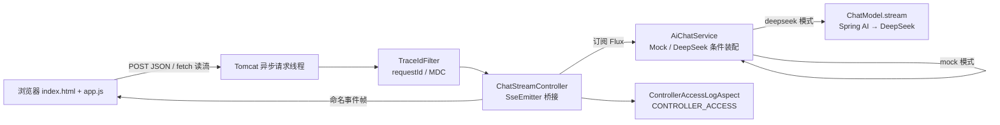
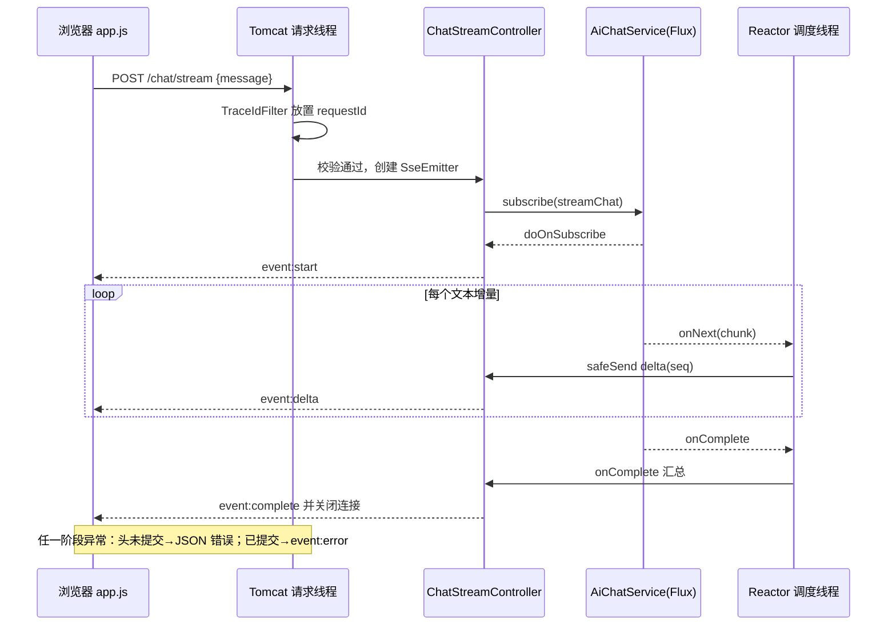

# D14 流式对话接口与前端页面适配 · 技术说明与实践指南

> 模块：`D14/D14_SSE_RMT`
> 适用基线：JDK 21、Spring Boot 3.5.16、Spring AI 1.1.8、Tomcat + Spring MVC 6.2.19、Reactor Core 3.7.19（传递依赖）
> 阅读建议：先读第一至三章建立协议与架构认知，再按第四至六章对照源码，最后用第八章步骤在本机复现。
> 配套文档：《D14-流式对话接口与前端页面适配-项目迭代全量记录.md》（过程记录、变更清单与验证台账）。

---

## 第一章 功能概述

### 1.1 是什么

在既有同步 AI 对话能力之上，新增一条基于 SSE（Server-Sent Events，服务器发送事件）的流式对话通道：客户端发起一次 POST 请求后，连接保持打开，服务器把模型输出拆成多个命名事件持续推送，浏览器随收随渲染，形成“打字机”效果；同时交付一个零依赖的原生前端页面用于演示与联调。

### 1.2 为什么需要它

- **体验**：同步接口需等待整句生成，首字节延迟（TTFB，Time To First Byte）体感差；流式输出首块可达即展示；
- **可取消**：长连接允许客户端随时中断，服务端通过订阅释放及时停止上游模型消费，避免无效计费；
- **协议轻量**：SSE 基于纯 HTTP 长连接，天然穿透常规网关/代理，浏览器端解析规则简单，无需 WebSocket 的双向能力与额外握手。

### 1.3 能力边界

单轮问答、无服务端会话存储；mock 模式离线确定性输出，deepseek 模式透传 Spring AI 模型流；不替代同步接口，两者并存。

---

## 第二章 核心概念与架构定位

### 2.1 关键概念辨析

| 概念（英文全称 / 中文） | 本项目中的角色 |
|---|---|
| SSE（Server-Sent Events，服务器发送事件） | 一种 HTTP 长连接文本协议，服务端用 `event:`/`data:`/空行帧单向推送 |
| SseEmitter（Spring MVC 异步响应载体） | MVC 在 Servlet 栈上实现 SSE 的官方返回值类型，内部驱动 Tomcat 异步请求 |
| Flux（Reactor 反应式流，Reactive Streams 发布者） | 业务层的流式数据管道，仅被订阅消费，**不代表运行在 WebFlux/Netty 上** |
| MDC（Mapped Diagnostic Context，映射诊断上下文） | SLF4J 的线程级日志上下文，存放 requestId；跨线程不会自动继承 |
| ReadableStream（WHATWG 可读流） | 浏览器 fetch 响应体的字节流接口，配合 TextDecoder 增量解码 |

### 2.2 为什么不是 WebFlux

模块 pom 锚定 `spring-boot-starter-web`，依赖树证实服务端只有 Tomcat + spring-webmvc，没有 Netty；`spring-webflux` 与 `reactor-core` 只是 Spring AI 的传递依赖。Spring MVC 原生支持反应式返回值与异步请求处理，`SseEmitter` 足以在不改容器的前提下完成 SSE。切换 WebFlux 会牵动 D13 的 Servlet Filter（`HttpServletRequest`/内容缓存包装器）等整套体系，违背最小改动原则。

### 2.3 组件关系图



---

## 第三章 SSE 协议契约

### 3.1 接口定义

| 项 | 内容 |
|---|---|
| 路径与方法 | `POST /api/v1/ai/chat` 同级新增 `POST /api/v1/ai/chat/stream` |
| 请求体 | `{"message":"..."}`，`message` 为必填、非空白、最长 2000 字符 |
| 响应类型 | `text/event-stream;charset=UTF-8` |
| 关键响应头 | `Cache-Control: no-cache`、`X-Accel-Buffering: no`（关闭 Nginx/代理缓冲）、`X-Request-Id`（链路标识） |
| 超时 | `app.ai.stream-timeout-ms`，默认 60000ms，环境变量 `AI_STREAM_TIMEOUT_MS` 覆盖 |

### 3.2 命名事件与载荷（定义于 `SsePayloads`，全部 Jackson 序列化）

| 事件 | 载荷字段 | 语义 |
|---|---|---|
| `start` | `requestId, mode, model` | 流建立，恰好一次 |
| `delta` | `seq, content` | 文本增量，`seq` 从 0 连续递增 |
| `complete` | `seq, mode, model, mocked, totalChars` | 正常结束，此后无内容事件，恰好一次 |
| `error` | `code, message` | 流开始后异常，随后关闭连接，不含堆栈/密钥/上游原文 |

### 3.3 真实帧样例（节选自真机抓帧 `D14-sse-raw.txt`）

```text
event:start
data:{"requestId":"d4dfa08616d54f2c9e8fd1bc7d2b327a","mode":"mock","model":"offline-mock"}

event:delta
data:{"seq":0,"content":"[MOCK:"}

event:delta
data:{"seq":1,"content":"D01] 当"}
```

帧规则：每个事件由若干行组成，`event:` 指定名称、`data:` 指定 JSON 数据，事件之间以**空行**分隔；兼容 `\n` 与 `\r\n`。后端统一使用 `SseEmitter.event().name(...).data(payload, MediaType.APPLICATION_JSON)`，由框架负责换行与 JSON 转义，代码中不手工拼帧。

### 3.4 异常分期与错误码

| 发生时机 | 表现形式 | 口径 |
|---|---|---|
| 响应头提交前（参数校验失败、密钥占位拦截） | 普通 JSON 错误响应，HTTP 200 + 统一 `Result` | 4001 参数错误 / 5001 配置或鉴权错误 |
| 响应头提交后（模型流异常） | SSE `error` 事件后关闭 | `NonTransientAiException`/配置异常→5001，`TransientAiException`→5002，其余→5000 |

---

## 第四章 后端核心实现解析

### 4.1 服务层：同一契约，两套实现

`AiChatService` 新增 `Flux<String> streamChat(String message)`，与同步 `chat` 并存。

- **MockAiChatService（默认，零字段无参构造）**：同步文案方法 `buildMockContent` 被两种接口共用，保证流式拼接结果与同步返回**逐字一致**；流式侧把文案按 6 字符切块，用 `Flux.fromIterable(chunks).delayElements(Duration.ofMillis(15))` 制造真实的分段到达节奏。类中不声明任何字段——既有 `MockNoExternalApiTest` 通过反射断言其结构上无法持有 ChatModel/HTTP 客户端，分块参数因此内联为方法局部值。
- **DeepSeekAiChatService（`app.ai.mode=deepseek` 装配）**：调用前先 `validateCredential()` 快速失败；随后 `chatModel.stream(new Prompt(new UserMessage(message)))` 得到 `Flux<ChatResponse>`，经 `map` 抽取 `getResult().getOutput().getText()`、`filter(StringUtils::hasText)` 过滤空块；`doOnComplete/doOnError` 只记录模型名与异常类型，不打印 prompt 全文与密钥。

### 4.2 控制器：Flux 到 SseEmitter 的桥接（`ChatStreamController`）

核心机制按生命周期组织：

1. **提交响应头之前**执行长度校验，失败直接抛异常走 `GlobalExceptionHandler`，此时客户端拿到的是普通 JSON；
2. 设置防缓冲头，构造 `SseEmitter`；其容器超时取 `stream-timeout-ms + 5000ms` 兜底余量，并在**请求线程**抓取 `MDC.get("requestId")` 存入局部变量——reactor 回调线程不保证继承 MDC，后续日志显式携带该字符串；
3. 订阅前对 Flux 加 `.timeout(Duration.ofMillis(streamTimeoutMs))`：应用层超时是主路径，触发时 Reactor 取消上游并下发 `TimeoutException`，在连接仍健康时经 onError 通道发送 5000 超时 error 事件；`doOnSubscribe` 发 `start`，失败则立即 `cancel`；三个订阅回调分别产出 `delta`、`error`、`complete`；
4. 注册容器三回调：`onCompletion`/`onTimeout`/`onError` 均 `dispose()` 上游订阅，杜绝连接结束后继续消费模型；`onTimeout` 作为兜底在 synchronized 块内“先发 error 再置 finished 再 complete”（初版先置位导致 error 发不出的缺陷已修复，详见整改文档）；
5. `AtomicInteger seq/totalChars` 维护序号与累计长度，`AtomicBoolean finished` 标记终态。

线程安全发送的关键方法（真实代码摘录）：

```java
private boolean safeSend(SseEmitter emitter, AtomicBoolean finished, String eventName, Object payload) {
    synchronized (emitter) {
        if (finished.get()) {
            return false;
        }
        try {
            emitter.send(SseEmitter.event().name(eventName)
                    .data(payload, MediaType.APPLICATION_JSON));
            return true;
        } catch (IOException | IllegalStateException e) {
            finished.set(true);
            return false;
        }
    }
}
```

为什么需要锁：reactor 调度线程触发 `onNext` 与容器线程触发 `onTimeout/onError` 可能并发，对同一 emitter 并发 `send` 会抛 `IllegalStateException`；加锁 + finished 幂等保证“最多一次终态、失效后零写入”。delta 发送失败时还会反向 `dispose()` 订阅，客户端断网即停止拉取上游数据。

### 4.3 与 D13 日志体系的协同与冲突修复

- **切点修复**：复制模块中 AOP 切点残留 D01 包名导致切面在 D14 完全不命中，已改为 `com.zl.d14.controller..*`；
- **异步载体占位**：控制器返回值是 `SseEmitter`（属于 `ResponseBodyEmitter`），持有容器回调、不可按 POJO 序列化，切面识别后只记录 `<async-emitter:SseEmitter>`；
- **正文缓存让路**：`CachedBodyAccessLogFilter` 的 `ContentCachingResponseWrapper` 设计目标是“缓冲完整正文、过滤器退出时统一回写”，与 SSE 异步增量互斥——异步开启后过滤器链立即返回，`finally` 提前收尾会截断后续帧。方案是把流式路径加入 `app.access-log.exclude-paths`（Ant 匹配，`shouldNotFilter` 仅跳过缓存过滤器）；`TraceIdFilter` 为独立注册，requestId 生成、MDC 放置与响应头回写不受影响。

### 4.4 端到端时序



---

## 第五章 前端实现解析（原生三件套）

### 5.1 为什么用 fetch 而不是 EventSource

浏览器内置 `EventSource` 只能发起 GET、不能设置请求体与自定义请求头；本接口是 POST JSON，且未来可能携带 Authorization 头。`fetch` 返回的响应体是 `ReadableStream`，可以边读字节边按 SSE 规则切帧，能力完全覆盖且不增加任何依赖。

### 5.2 分帧解析（`static/js/sse-parser.js` + `static/js/app.js`）

> 2026-10-28 验收整改：分帧逻辑已从 app.js 抽取为无 DOM 依赖的 `sse-parser.js`，并修复初版只识别 `\n\n`、不兼容 CRLF/CR 的缺陷。

- `TextDecoder('utf-8')` 配合 `decoder.decode(value, {stream:true})` 处理跨 chunk 的多字节中文，避免乱码；
- `sse-parser.js` 维护字符串 buffer，统一兼容 WHATWG SSE 标准允许的三种行结束符 LF（`\n`）、CR（`\r`）、CRLF（`\r\n`），按归一化后的空行切出完整帧块；末尾孤立 `\r` 会暂存到下一次 feed，避免被切块切开的 CRLF 被误判为空行；块内逐行解析 `event:` 与 `data:`，`data:` 去除一个可选前导空格后交 app.js 执行 `JSON.parse`；
- app.js 只保留 JSON 解析与事件分发：`start` 刷新状态行，`delta` 追加文本，`complete` 收尾，`error` 渲染错误气泡；流结束调用 `parser.flush()` 处理尾块，若既无 complete 也无 error，判定为连接中断；
- 解析器配有独立 Node 测试 `src/test/node/sse-parser.test.js`（9 个用例，零 npm 依赖），覆盖三种换行、逐字符切块、CRLF 跨块、UTF-8 中文跨字节边界等场景。

### 5.3 安全与交互细节

- **XSS 防护**：模型输出与用户输入一律 `appendChild(document.createTextNode(...))` / `textContent` 渲染，全程不使用 `innerHTML`，无法注入可执行 HTML；
- **可中止**：每个请求绑定一个 `AbortController`，“停止”按钮调用 `abort()`，捕获 `AbortError` 后按用户中断提示而非系统错误处理；
- **状态机**：`isStreaming` 期间禁用发送/输入、启用停止；异常红条、成功状态、空输入与 2000 字符上限在前端先拦一次，最终以后端 `@Valid` 为准；
- **新对话**：仅清空页面节点与状态，不发起任何服务端会话请求；
- **模式探测**：页面加载即请求 `/api/v1/ai/health` 展示当前 mock/deepseek 模式，探测失败不阻塞使用。

---

## 第六章 配置项说明

| 配置键 | 默认值 | 环境变量 | 作用 |
|---|---|---|---|
| `app.ai.mode` | `mock` | `AI_MODE` | 条件装配离线模拟或真实 DeepSeek 服务 |
| `app.ai.max-message-length` | 2000 | `AI_CHAT_MAX_LENGTH` | 入参长度上限，同步/流式共用 |
| `app.ai.stream-timeout-ms` | 60000 | `AI_STREAM_TIMEOUT_MS` | 应用层 Reactor 超时阈值，到时取消上游并发超时 error 事件；SseEmitter 容器兜底超时为该值 +5000ms |
| `app.access-log.exclude-paths` | `/error`、`/favicon.ico`、流式端点 | 无 | 跳过正文缓存/访问日志的 Ant 路径，requestId 仍透传 |
| `spring.ai.deepseek.api-key` | 无效占位串 | `DEEPSEEK_API_KEY` | 真实密钥只走环境变量，占位串会在调用前被拦截 |
| `spring.ai.deepseek.chat.options.model` | `deepseek-flash` | `DEEPSEEK_MODEL` | 模型名外置 |

---

## 第七章 测试体系

| 层级 | 测试类 | 覆盖点 |
|---|---|---|
| 纯单元 | `MockAiChatServiceStreamTest` | 多块、无空块、拼接文案与同步接口完全一致 |
| 真实容器集成 | `ChatStreamIntegrationTest`（RANDOM_PORT） | 响应头、帧顺序、seq 连续、UTF-8 中文、totalChars 校验、空白入参 JSON 回落、静态首页可达 |
| 异常路径 | `ChatStreamErrorEventTest`（`@MockitoBean` + `Flux.error`） | error 事件 code=5000、无 complete、原始异常消息不外泄 |
| 既有回归 | D13 迁移来的 9 个测试类 | 上下文加载、参数校验、密钥保护、脱敏、访问日志、零外网保证 |

全量结果：36 用例，0 失败，0 错误，1 跳过（无密钥时在线冒烟按设计禁用）。

---

## 第八章 实操指南

### 8.1 离线 mock 联调（推荐首选）

```powershell
# 在 D14 聚合目录启动（默认 AI_MODE=mock，无需任何密钥与外网）
mvn -pl D14_SSE_RMT spring-boot:run
```

启动后浏览器打开 `http://127.0.0.1:8080/` 即为对话页面；接口自检：

```powershell
$body = '{"message":"你好，SSE"}'
Invoke-WebRequest -Uri 'http://127.0.0.1:8080/api/v1/ai/chat/stream' `
  -Method Post -ContentType 'application/json; charset=utf-8' -Body $body
```

非交互 Shell 中若 Invoke-WebRequest 报宿主提示错误，先执行 `$ProgressPreference='SilentlyContinue'`。

### 8.2 切换真实 DeepSeek

```powershell
$env:AI_MODE='deepseek'
$env:DEEPSEEK_API_KEY='你的真实密钥'      # 仅存在于当前进程环境，禁止写入 yml
$env:DEEPSEEK_MODEL='deepseek-flash'      # 可选
mvn -pl D14_SSE_RMT spring-boot:run
```

未设置有效密钥时，流式调用会在发起外网请求前被拦截，客户端收到 `error` 事件 code=5001。

### 8.3 全量验证命令

```powershell
mvn -pl D14_SSE_RMT test
```

### 8.4 前端手工验证清单

1. 打开首页，右上角徽标显示当前模式；
2. 输入问题回车，观察 AI 气泡逐段出现文字与闪烁光标，结束后状态行提示完成；
3. 流式输出过程中点“停止”，请求立即中断且可再次发送；
4. 空输入/超长输入被前端拦截；断网或停服后发送，出现红色错误气泡而非白屏；
5. 点“新对话”，页面清空且不产生任何网络请求；
6. 打开开发者工具 Network，检查该请求类型为 event-stream，响应帧为 `event/data` 结构。

---

## 第九章 常见问题与排查

| 现象 | 根因 | 处理 |
|---|---|---|
| 只收到 start，没有后续帧 | 响应被缓冲层/代理缓存；本项目曾因 `ContentCachingResponseWrapper` 截断 | 确认流式端点在 `exclude-paths`；网关层关闭 proxy_buffering 或信任 `X-Accel-Buffering: no` |
| 中文乱码 | 字节流跨块解码方式错误 | 前端用 `TextDecoder` 且 `stream:true`；后端 produces 显式带 `charset=UTF-8` |
| 页面内容被当作 HTML 执行 | 使用 innerHTML 拼接模型输出 | 一律 textContent/createTextNode 纯文本渲染 |
| 日志里同一请求出现别人的 requestId | 异步线程复用继承了旧 MDC | 不依赖线程继承，请求线程抓取 requestId 显式传递；任务结束清理上下文 |
| 客户端关闭后服务端仍在跑模型 | 未取消上游订阅 | onCompletion/onError/onTimeout 与发送失败路径都必须 `dispose()` |
| 参数错误返回了 event-stream | 校验发生在响应头提交之后 | 头提交前的校验直接抛异常走 JSON 全局处理，只有头提交后才用 error 事件 |
| 真实模式启动即报 5001 | 密钥缺失或仍是占位串 | 注入有效 `DEEPSEEK_API_KEY`，切勿把密钥写进配置文件 |

---

## 第十章 层级树与记忆简语

```text
流式对话知识树
├─ 协议层
│  ├─ SSE：HTTP 长连接、单向、event/data/空行
│  ├─ 四事件：start → delta* → complete / error
│  └─ 错误分期：头前 JSON，头后 error 帧
├─ 服务端（MVC/Tomcat）
│  ├─ SseEmitter：异步载体 + 超时/完成/错误回调
│  ├─ Flux：仅做流式管道，订阅需显式释放
│  ├─ safeSend：锁 + finished 幂等
│  └─ MDC：跨线程不继承，requestId 显式带
├─ 前端（原生静态页）
│  ├─ fetch POST + ReadableStream（非 EventSource）
│  ├─ TextDecoder stream 模式防中文乱码
│  ├─ textContent 纯文本防 XSS
│  └─ AbortController 支持停止
└─ 协同
   └─ 缓存过滤器为异步流让路，TraceId 照常透传
```

**记忆简语**

> 1. **选型**：MVC 能用 Emitter，就不为 Flux 换 Netty。
> 2. **协议**：头前错误走 JSON，头后错误只能发帧。
> 3. **并发**：一锁一标记，终态只一次，断线即取消。
> 4. **前端**：POST 不能 EventSource，读流纯文本才安全。
> 5. **日志**：缓存让路、链路不断，requestId 贯穿前后端。

---

## 参考资料

1. 《Spring AI Chat Client API | Spring AI 聊天客户端 API 参考》：https://docs.spring.io/spring-ai/reference/1.1/api/chatclient.html
2. 《Spring AI Chat Model API | Spring AI 聊天模型 API 参考》：https://docs.spring.io/spring-ai/reference/1.1/api/chatmodel.html
3. 《Spring Web MVC Async and Streaming | Spring MVC 异步与流式处理参考》：https://docs.spring.io/spring-framework/reference/6.2/web/webmvc/mvc-ann-async.html
4. 《Spring WebFlux Reactive Types | WebFlux 反应式返回类型参考》：https://docs.spring.io/spring-framework/reference/6.2/web/webflux/controller/ann-methods/return-types.html
5. 《Spring Boot Logging Reference | Spring Boot 日志参考》：https://docs.spring.io/spring-boot/reference/features/logging.html
