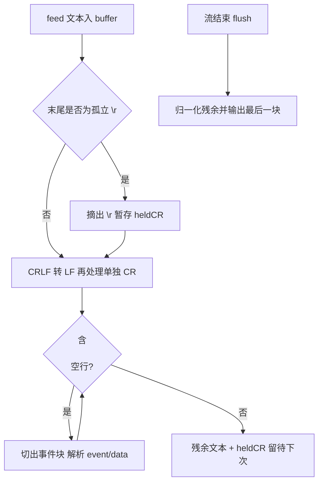

# D14 验收问题整改 · 技术说明与实践指南

> 适用模块：`D14/D14_SSE_RMT`
> 技术基线：JDK 21、Spring Boot 3.5.16、Spring AI 1.1.8、spring-web(MVC) 6.2.19、Reactor 3.7.19、Tomcat 内嵌容器
> 阅读前提：已阅读首版《D14-流式对话接口与前端页面适配-技术说明与实践指南》，本文只讲整改涉及的机制与代码

---

## 第一章 缺陷一：SSE 超时错误事件为什么发不出去

### 1.1 初版代码的逻辑死结

初版 `onTimeout` 回调（已废弃的写法）：

```java
emitter.onTimeout(() -> {
    finished.set(true);      // ① 先宣告终态
    safeSend(emitter, finished, "error", ...); // ② 再发送
    subscription.dispose();
    emitter.complete();
});
```

而统一发送方法第一道关卡就是终态判断：

```java
private boolean safeSend(SseEmitter emitter, AtomicBoolean finished, String eventName, Object payload) {
    synchronized (emitter) {
        if (finished.get()) {
            return false;    // 终态后一切写入被拒绝
        }
        ...
    }
}
```

执行到 ② 时 `finished` 已为 true，error 事件必然被拒发。这是一个纯顺序错误：**终态标记必须晚于最后一次合法发送**。

### 1.2 仅调整顺序为什么还不够

容器异步超时（Servlet `AsyncContext` 超时）触发时机由 Tomcat 掌控：超时发生后，响应输出通道可能已被容器标记为结束，此时即便先发送再置位，`emitter.send(...)` 也可能抛 `IllegalStateException`/IOException，事件仍然到不了客户端。首次整改测试中实测响应体只有 `start`、没有 `error`，证实了这一点。

结论：**不能把“向客户端送达超时事件”的希望寄托在容器超时回调上**，必须在连接仍健康时主动产生超时信号。

### 1.3 双层超时设计（最终实现）

| 层级 | 触发者 | 阈值 | 职责 | 触发时连接状态 |
|---|---|---|---|---|
| 应用层（主路径） | Reactor `Flux.timeout(Duration)` | `app.ai.stream-timeout-ms`（默认 60000ms） | 取消上游、下发 `TimeoutException`、走 onError 发 5000 error 事件并 complete | 健康，可正常写 |
| 容器层（兜底） | `SseEmitter` onTimeout | 应用阈值 + `CONTAINER_TIMEOUT_GRACE_MS`（5000ms 常量） | 响应线程被异常卡死等极端场景下的最后回收手段 | 不保证可写，发送失败仅 warn |

关键源码（以仓库 `ChatStreamController` 实际代码为准）：

```java
private static final long CONTAINER_TIMEOUT_GRACE_MS = 5000L;

SseEmitter emitter = new SseEmitter(streamTimeoutMs + CONTAINER_TIMEOUT_GRACE_MS);

Disposable subscription = aiChatService.streamChat(message)
        .timeout(Duration.ofMillis(streamTimeoutMs))   // 应用层主超时
        .doOnSubscribe(s -> { /* 发送 start，失败即 cancel */ })
        .subscribe(
                chunk -> onDelta(...),
                error -> {
                    Disposable current = subscriptionRef.get();
                    if (current != null) { current.dispose(); }
                    onStreamError(emitter, finished, requestId, error);
                },
                () -> onComplete(...));
```

`onStreamError` 对超时做专门映射，对外只给固定安全文案：

```java
boolean timeout = error instanceof TimeoutException;
String clientMessage = timeout ? "流式响应超时，连接已关闭" : resultCode.getMsg();
```

兜底回调与终态收口方法：

```java
emitter.onTimeout(() -> {
    subscription.dispose();          // 先停止上游模型消费/计费
    handleTimeout(emitter, finished);
});

private void handleTimeout(SseEmitter emitter, AtomicBoolean finished) {
    synchronized (emitter) {
        if (finished.get()) { return; }     // 正常/异常终态已落地则幂等返回
        try { emitter.send(...error...); }  // 先发
        catch (IOException | IllegalStateException e) { log.warn(...); }
        finished.set(true);                 // 再置位
        try { emitter.complete(); } catch (IllegalStateException ignored) {}
    }
}
```

### 1.4 并发正确性要点

- **一把锁**：所有 `send/complete` 都在 `synchronized(emitter)` 内，reactor 调度线程与容器回调线程不可能并发写同一个 emitter；
- **一个终态**：`AtomicBoolean finished` 保证 complete、stream error、timeout、connection error 四条终态路径最多一条落地；
- **上游必释放**：应用层 timeout 自动 cancel 源 Flux，error 回调与三个容器回调再各自幂等 `dispose()`；
- **赋值表达式约束**：`subscribe()` 的 error lambda 内不能引用尚未完成赋值的局部变量 `subscription`（Java 明确赋值规则会编译报错），因此通过提前声明的 `subscriptionRef` 获取并做空值保护。

---

## 第二章 缺陷二：SSE 分行为什么必须兼容三种行结束符

### 2.1 标准事实

WHATWG HTML 标准的事件流解析规则规定，行结束符可以是 LF（`\n`）、CR（`\r`）或 CRLF（`\r\n`），事件之间以一个空行分隔，即三种等价形式：`\n\n`、`\r\r`、`\r\n\r\n`。初版只用 `buffer.indexOf('\n\n')`：

- LF 流：可分帧（自己的服务端恰好输出 LF，所以首版自测通过）；
- CRLF 流：字节序列是 `...\r\n\r\n...`，内部不存在连续两个 `\n`，永远匹配不到分隔符；
- CR 流：同理完全无法分帧。

### 2.2 新解析器算法（`sse-parser.js`）



两个容易写错的边界：

1. **不能在每次 feed 立刻归一化末尾 `\r`**：若该 `\r` 是被网络切块切开的 CRLF 前半段，提前转成 `\n` 会在下次收到 `\n` 时凑出错误空行。做法是把末尾 `\r` 摘出暂存，与下一块拼回后再判定；
2. **UTF-8 多字节边界不在本组件解决**：解析器只处理解码后的字符串，字节级完整性由调用方 `TextDecoder.decode(bytes, {stream:true})` 保证，两者职责分离，Node 测试中用逐字节喂入验证了这条组合链路。

事件块解析规则同样遵循标准：`data:` 后仅移除一个前导空格；同一事件多行 data 以 LF 拼接；无 data 的块忽略。UMD 封装让同一份代码在浏览器挂 `window.SseParser`、在 Node 走 `module.exports`，因此前端生产代码可被 Node 原生测试直接 require。

### 2.3 前端接线变化

`app.js` 的 `consumeStream` 现在只剩三件事：`TextDecoder(stream:true)` 解码 → `parser.feed()` → `chunk.done` 时 `parser.flush()`；JSON.parse 与 `dispatchEvent` 维持原样，模型文本仍走 `createTextNode/textContent`，XSS 防护面没有变化。

---

## 第三章 测试设计与复现实验

### 3.1 Java 超时专项测试

`ChatStreamTimeoutTest` 使用 RANDOM_PORT 真实 Tomcat，测试属性把超时压缩到 150ms，Mock Bean 返回永不结束的流：

```java
@SpringBootTest(webEnvironment = RANDOM_PORT, properties = "app.ai.stream-timeout-ms=150")
when(aiChatService.streamChat(anyString())).thenReturn(
        Flux.never().doOnCancel(upstreamCanceled::countDown).cast(String.class));
```

三条断言对应评审要求的三个验证点：

| 验证点 | 断言 |
|---|---|
| 超时事件可达 | 响应体含 `event:error`、`"code":5000`、“流式响应超时”，且不含 `event:complete` |
| 上游订阅取消 | `CountDownLatch` 最长等 10s，验证 `doOnCancel` 放行（timeout 运算符必然 cancel 源 Flux） |
| 连接正常收尾 | 阻塞式 exchange 能正常返回而非挂死，HTTP 状态仍为 200（SSE 错误走协议内事件） |

### 3.2 Node 分帧测试矩阵

| 用例 | 覆盖意图 |
|---|---|
| LF / CRLF / CR 整流 | 三种空行分隔均得到 3 个有序事件 |
| 逐字符 feed（三种换行） | 任意单字符到达节奏下结果稳定 |
| CRLF 全切点遍历 | 对每个可能的切块位置双次 feed，事件数恒为 3，专治“CRLF 被切开” |
| 多行 data + 前导空格 | 多行 LF 拼接、仅移除一个空格的标准规则 |
| flush 尾块 | 服务端未以空行结尾时最后一块不丢失 |
| UTF-8 逐字节 + TextDecoder(stream) | 中文跨字节边界无损还原 |
| reset | 缓存与事件可清空复用 |

### 3.3 本地复现命令

```powershell
# 1. Java 全量测试（在 D14_SSE_RMT 目录）
& 'D:\SoftwareInstall\Apache\Maven\apache-maven-3.9.16\bin\mvn.cmd' test

# 2. 前端解析器测试（零依赖，Node 22 内置 test runner）
node --test src/test/node/sse-parser.test.js

# 3. 打包并以默认配置启动，抓正常帧
& 'D:\SoftwareInstall\JDK\JDK21\bin\java.exe' -jar target\D14_SSE_RMT-1.0-SNAPSHOT.jar

# 4. 另起进程以 1ms 超时启动，抓超时 error 帧
$env:AI_STREAM_TIMEOUT_MS='1'
& 'D:\SoftwareInstall\JDK\JDK21\bin\java.exe' -jar target\D14_SSE_RMT-1.0-SNAPSHOT.jar
```

请求方式：POST `http://127.0.0.1:8080/api/v1/ai/chat/stream`，头 `Content-Type: application/json`、`Accept: text/event-stream`，体 `{"message":"ping"}`。

---

## 第四章 概念勘误口径（笔记与口述稿同步）

评审要求把“协议保证、框架行为、当前代码实际做到的事”分开，本次统一口径如下，两份学习材料已按此修订：

1. **ChatClient 调用时机**：`call()` 返回 `CallResponseSpec`、`stream()` 返回 `StreamResponseSpec`，二者都不发请求；`call().content()`/`call().chatResponse()` 终端操作才执行模型调用，`stream().content()` 得到的 `Flux<String>` 被订阅后才发起流式调用；
2. **三层传输概念**：SSE 是应用层事件协议（空行分帧）；HTTP/1.1 常用 `Transfer-Encoding: chunked` 承载；HTTP/2 没有 chunked，改用 DATA 帧。事件边界由 SSE 规则决定，与 Token、TCP 段、HTTP 块都不一一对应；
3. **MVC 与 WebFlux 边界**：WebFlux 控制器可直接返回 `Flux`/`ServerSentEvent`；Spring MVC（本项目）必须返回 `SseEmitter` 并手工桥接；
4. **背压**：Reactive Streams 规范提供需求信号机制，但手工 `subscribe→SseEmitter` 桥接是否形成端到端背压取决于实现，不能因使用 Flux 就宣称背压已解决。

---

## 第五章 常见问题与排障入口

| 现象 | 根因入口 | 处置 |
|---|---|---|
| 超时后前端只收到 start | 先确认应用层 `.timeout()` 是否生效，再查容器 onTimeout 是否抢先 | 以双层超时设计为准，查 `ChatStreamController` 日志线程名（应用层为 reactor `parallel-*`） |
| CRLF 流页面无增量 | 解析器是否被正确加载（Network 面板 sse-parser.js 200） | 运行 Node 测试定位分帧问题，不在浏览器里盲调 |
| 测试里 CR 用例少最后一个事件 | 流结束未调 `flush()`，末尾暂存 CR 未落地 | 对照 app.js 在 `chunk.done` 调 flush 的生产行为 |
| 编译报“变量 subscription 未初始化” | lambda 在赋值表达式内引用自身结果变量 | 改用提前声明的 `AtomicReference` 获取并判空 |
| 证据文件 GitHub 上看不到 | `.gitignore` 忽略 temp_docs 与 `*.log` | 精选证据放 `docs/evidence/`，扩展名用 .txt/.md |

---

## 第六章 记忆简语与层级树

### 6.1 记忆简语

> **“call 只选路，终端才打话；Flux 不订阅，模型不发话。SSE 管分帧，chunked 管打包，HTTP2 换 DATA 帧来拉。MVC 靠 Emitter，WebFlux 直接 Flux；背压是能力不是免死金牌，桥接写法看水位。”**

### 6.2 知识层级树

```text
流式对话整改
├─ 超时体系
│  ├─ 应用层 Flux.timeout（主，健康连接发 error）
│  ├─ 容器 SseEmitter timeout（兜底，+5s 余量）
│  └─ 并发底座：synchronized(emitter) + finished 幂等
├─ 分帧体系
│  ├─ 行结束：LF / CR / CRLF（WHATWG）
│  ├─ 关键技巧：尾 CR 暂存，归一化后排水
│  └─ 编解码分工：TextDecoder 管字节，Parser 管字符
├─ 测试体系
│  ├─ Java：150ms 超时三断言（事件/取消/收尾）
│  └─ Node：9 用例含跨块与中文跨字节
└─ 概念边界
   ├─ call/stream 规格对象 vs 终端操作
   ├─ SSE 协议 vs HTTP/1.1 chunked vs HTTP/2 DATA
   └─ Reactor 背压能力 vs 手工桥接的实际程度
```

---

## 参考资料

1. 《Chat Client API | 聊天客户端 API》：https://docs.spring.io/spring-ai/reference/1.1/api/chatclient.html
2. 《Parsing an event stream | 事件流解析标准（WHATWG）》：https://html.spec.whatwg.org/multipage/server-sent-events.html
3. 《RFC 9113 - HTTP/2》：https://www.rfc-editor.org/rfc/rfc9113
4. 《Reactor Reference Documentation | Reactor 参考文档（timeout 运算符与取消语义）》：https://projectreactor.io/docs/core/release/reference/
5. 《Spring Web MVC Async and Streaming | Spring MVC 异步与流式处理》：https://docs.spring.io/spring-framework/reference/6.2/web/webmvc/mvc-ann-async.html
