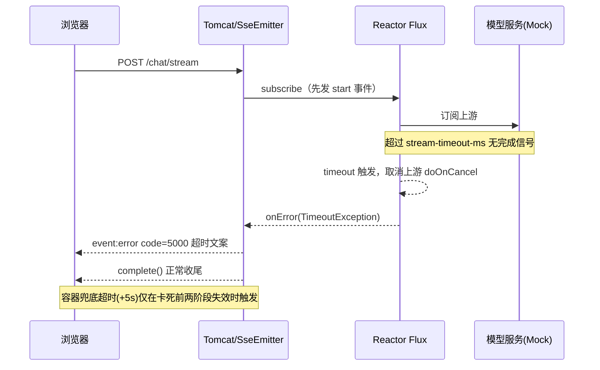
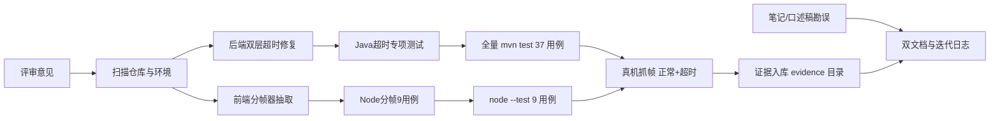

# D14 验收问题整改 · 项目迭代全量记录

> 模块：`M2-Java/D14/D14_SSE_RMT`（SSE 流式对话，Spring Boot 3.5.16 / JDK 21 / Spring AI 1.1.8，Servlet/Tomcat + Spring MVC）
> 迭代类型：验收问题整改（修复两处代码缺陷、补齐测试、勘误学习材料、重建可入库证据链）
> 执行日期：2026-10-28
> 关联仓库：https://github.com/storyzhangli/M2-Java.git
> 证据目录：`docs/evidence/D14-remediation/`（Git 可跟踪）；过程文件：`docs/temp_docs/`（按项目约定不自动删除，且被 `.gitignore` 忽略）

---

## 第一章 迭代背景与评审结论

首版 D14 已交付 SSE 流式对话接口（start/delta/complete/error 四类事件）、Mock/DeepSeek 双服务与原生前端页面。外部验收结论为**项目主体已实现但未完全通过（2.7/4）**，要求闭合三类问题，本次迭代只处理评审列出的闭环，不扩大范围。

### 1.1 评审指出的问题与本次处置对照

| 编号 | 评审问题 | 严重度 | 本次处置 |
|---|---|---|---|
| P1 | `ChatStreamController.onTimeout` 先置 `finished=true` 再发 error 事件，`safeSend` 终态拦截导致超时事件必然丢失，文档与代码不一致 | 关键缺陷 | 重构为双层超时（应用层 Reactor `timeout` 主路径 + 容器超时兜底），兜底回调修正发送顺序并加并发保护，新增超时专项测试 |
2 | 前端仅按 `\n\n` 分帧，不兼容标准允许的 CRLF（`\r\n\r\n`）与 CR（`\r\r`） | 关键缺陷 | 抽取独立 `sse-parser.js`，兼容 LF/CR/CRLF 与跨块、跨 UTF-8 字节边界，新增 9 个 Node 测试 |
| P3 | 知识笔记与费曼口述稿存在概念错误：`ChatClient.call()` 执行时机、HTTP chunked 与 HTTP/2 帧及 SSE 协议混淆、Flux 背压绝对化 | 知识准确性 | 两份材料逐处修订并加修订记录与权威参考链接 |
| P4 | 原始测试日志在 GitHub 不可查证（`docs/temp_docs/` 与 `*.log` 被忽略）；DeepSeek 真实联网调用未实证 | 证据可信边界 | 新建 `docs/evidence/D14-remediation/` 存放可跟踪精选证据（.txt/.md）；DeepSeek 无 Key 限制继续如实标注 |

### 1.2 明确不做的事

- 不升级任何依赖、不改变既有事件协议与错误码、不重构无关代码；
- 不执行 git commit / push（提交由用户自行决定）；
- 不删除 `docs/temp_docs/` 内任何历史文件；
- 不把 mock 链路验证表述为 DeepSeek 厂商链路验证。

---

## 第二章 扫描事实与依据

### 2.1 仓库与提交事实

| 验收提交（全哈希） | 内容 |
|---|---|
| `ee10b2ebf583521883727ad84ccc032ccc13ed53` | 知识笔记单文件 |
| `3d1dd423ec504231e1f1d0d0713155197ef2b383` | 首版两份 D14 文档、prompt、迭代日志 |
| `718d8122f3f80b8dff07e473bf18982a0dc85dc4` | D14 全部代码与测试 |
| `36f7e6ca6f4f84e2fb84f67b77a4cf2022f3f2ce` | 费曼口述稿单文件 |

扫描时工作区 `git status --short` 为空，首版内容均已提交；本机 git 可执行文件为 `D:\SoftwareInstall\Git\cmd\git.exe`（未加入 PATH）。

### 2.2 环境事实

| 工具 | 路径 / 版本 |
|---|---|
| JDK | `D:\SoftwareInstall\JDK\JDK21`，21.0.7 |
| Maven | `D:\SoftwareInstall\Apache\Maven\apache-maven-3.9.16\bin\mvn.cmd`，3.9.16 |
| 本地仓库 | `D:\SoftwareInstall\Apache\repository`（全局与用户级 settings 一致） |
| Node | v22.23.2（Doubao sandbox_runtime 自带，支持内置 `node:test`，无需 npm install） |

### 2.3 证据不可查的根因

`.gitignore` 中 `/docs/temp_docs/` 整体忽略，且存在全局 `*.log` 规则，首版原始证据 `D14-mvn-test-raw.log`、`D14-sse-raw.txt` 因此无法进入仓库。本次折中：过程文件仍留 `temp_docs`（遵守固定约定），**最终精选证据复制到新建的 `docs/evidence/D14-remediation/`，全部使用 `.txt/.md` 扩展名**，并逐文件通过 `git check-ignore` 确认可跟踪。

---

## 第三章 整改方案与执行流程

### 3.1 缺陷 P1 的修复路径

初版问题链：`onTimeout` 回调内先 `finished.set(true)`，随后调用的 `safeSend` 第一行即检查终态并拒绝发送 → 超时 error 事件永远发不出。进一步实测发现，Servlet 容器触发异步超时后，底层连接可能已不允许写入，仅调整语句顺序仍不能保证事件可达。

最终方案为**双层超时**：

1. 应用层（主路径）：Flux 链路增加 `.timeout(Duration.ofMillis(streamTimeoutMs))`，超时由 Reactor 取消上游并下发 `TimeoutException`，在连接健康时经既有 onError 通道发送 code=5000 的 error 事件后正常 `complete()`；
2. 容器层（兜底）：`SseEmitter` 超时设为 `配置值 + 5000ms` 余量，仅在响应线程异常卡死等极端场景触发；`handleTimeout` 在 `synchronized(emitter)` 内按“先发 error、再置 finished、再 complete”执行，终态竞争幂等。



### 3.2 缺陷 P2 的修复路径

- 新建 `static/js/sse-parser.js`：UMD 双环境封装（浏览器挂全局 `SseParser`，Node 走 `module.exports`），零 DOM 依赖；
- 算法关键：每次 feed 先摘出末尾孤立 `\r` 暂存（它可能属于被切块切开的 CRLF），其余文本按 CRLF→LF、遗留 CR→LF 归一化后按空行排水，流结束由 `flush()` 落地尾块；
- `app.js` 删除内联 `indexOf('\n\n')` 逻辑，只保留 TextDecoder 流式解码、`parser.feed/flush`、JSON.parse 与事件分发；`index.html` 在 app.js 前引入解析器。

### 3.3 整体整改流程



---

## 第四章 文件变更全量清单

### 4.1 修改的主代码/资源（3 个）

| 路径 | 变更性质 | 内容 |
|---|---|---|
| `src/main/java/com/zl/d14/controller/ChatStreamController.java` | 修改 | 新增 `.timeout()` 应用层超时与 `CONTAINER_TIMEOUT_GRACE_MS=5000`；新增 `handleTimeout` 兜底方法（锁内先发后置位再收尾）；onError 增加幂等 dispose；`TimeoutException` 映射 5000 与超时文案；类 Javadoc 补充双层超时说明 |
| `src/main/resources/static/js/app.js` | 修改 | 删除内联分帧，改用 `SseParser.feed/flush`；文件头注释更新；XSS 防护、AbortController 等既有逻辑不变 |
| `src/main/resources/static/index.html` | 修改 | app.js 前新增 `<script src="/js/sse-parser.js"></script>` |

### 4.2 新增文件（3 个）

| 路径 | 职责 |
|---|---|
| `src/main/resources/static/js/sse-parser.js` | 无 DOM 依赖 SSE 分帧器，兼容 LF/CR/CRLF、跨块与跨 UTF-8 字节边界，浏览器/Node 共用 |
| `src/test/java/com/zl/d14/springai/stream/ChatStreamTimeoutTest.java` | RANDOM_PORT + 150ms 超时属性，`Flux.never().doOnCancel` 验证上游取消；断言 error(5000)、超时文案、无 complete、连接收尾 |
| `src/test/node/sse-parser.test.js` | node:test 9 用例：三种换行、逐字符 feed、CRLF 任意切点、多行 data、前导空格、flush 尾块、UTF-8 逐字节解码、reset |

### 4.3 修订的文档（4 份既有 + 3 份新增）

| 路径 | 处理 |
|---|---|
| `docs/proj_docs/D14-模型API  聊天接口、流式输出、温度Token参数.md` | 勘误 call() 时机表、生命周期、时序图、stream 懒执行、MVC/WebFlux 分栈示例、HTTP 分层表述；新增修订记录与 WHATWG/RFC9113 参考 |
| `docs/proj_docs/D14-费曼口述-AI大模型API  流式输出和普通响应的区别.md` | 修订问题二/三/四/八/九/十/十四共 7 处表述，新增整改说明与参考资料 |
| `docs/proj_docs/D14-流式对话接口与前端页面适配-项目迭代全量记录.md` | 文件清单补录新文件，新增“第十一章 验收整改补充” |
| `docs/proj_docs/D14-流式对话接口与前端页面适配-技术说明与实践指南.md` | 5.2 分帧章节重写，超时机制与配置项说明同步为双层设计 |
| `docs/evidence/D14-remediation/README.md` 及 7 个证据文件 | 新增，Git 可跟踪证据链 |
| 本文档与《D14-验收问题整改-技术说明与实践指南.md》、`logs/D14-验收整改-迭代日志.md` | 本次双交付文档与迭代日志 |

### 4.4 未触碰内容

pom 依赖、application.yml 配置键、事件载荷 record、错误码枚举、Mock/DeepSeek 服务实现、CSS、D13 及其他模块代码均未修改。

---

## 第五章 真实验证记录

区分“已实际验证通过 / 已执行失败并修复 / 未执行”。以下结果均可在 `docs/evidence/D14-remediation/` 复核。

### 5.1 已通过：Java 全量测试

- 命令：`mvn test`（Maven 3.9.16，JDK 21）
- 结果：**BUILD SUCCESS；13 个测试类、37 用例，Failures=0、Errors=0、Skipped=1**
- 唯一跳过为 `DeepSeekLiveSmokeTest`（无 API Key 的设计性跳过，首版即如此）；较首版 36 用例净增 1 个超时专项用例。
- 证据：`01-mvn-full-test-output.txt`、`02-surefire-per-class-summary.txt`

### 5.2 已通过：Node 分帧测试

- 命令：`node --test src/test/node/sse-parser.test.js`
- 结果：**tests=9，pass=9，fail=0**
- 过程中真实发生两次失败并修复：首次 require 相对路径少一层（模块找不到），修正后 CR 用例失败——根因是测试未在整流后调用 `flush()`（末尾暂存 `\r` 按设计需 flush 落地，与前端 `chunk.done` 行为一致），补齐 flush 后全绿。解析器生产代码因此未做无意义改动。
- 证据：`03-node-sse-parser-test-output.txt`

### 5.3 已通过：真机启动与抓帧（mock 模式）

| 场景 | 启动方式 | 实测结果 |
|---|---|---|
| 正常链路 | `java -jar` 默认配置 | 响应头含 `Content-Type: text/event-stream`、`Transfer-Encoding: chunked`（HTTP/1.1 实证）、`X-Request-ID`；帧序列 start + 25 个 delta + complete，totalChars=150 |
| 超时链路 | `AI_STREAM_TIMEOUT_MS=1 java -jar` | start 后仅一个 `event:error`，载荷 `{"code":5000,"message":"流式响应超时，连接已关闭"}`，无 complete，连接正常结束；应用日志在 reactor `parallel` 线程打印“应用层超时结束，超时阈值=1ms” |
| 静态资源 | 默认配置 | `/index.html` 200 且含 sse-parser.js 引用；`/js/sse-parser.js` 200（4389 字节） |

两次验证后应用进程均已停止，8080 端口确认释放。证据：`04`～`07` 号文件。

### 5.4 未执行项（如实标注）

- DeepSeek 真实联网流式调用：本机无 `DEEPSEEK_API_KEY`，未实证，继续沿用 mock 验证结论；
- HTTP/2 下的真机抓帧：本地 Tomcat 默认 HTTP/1.1，文档中 HTTP/2 表述为协议规范层面结论，未做本地 h2 抓包。

---

## 第六章 风险、限制与后续建议

| 项 | 说明 | 建议 |
|---|---|---|
| 手工桥接的背压边界 | `SseEmitter` 与 `subscribe` 之间为手工桥接，Reactor 的需求信号不会自动等价为端到端背压 | 高并发场景补发送队列水位监控与并发连接上限，勿宣称“天然背压” |
| 容器兜底超时 | 5 秒余量为类内常量，极端卡死时才介入 | 如未来需要可调，可提升为配置项 |
| 超时测试时效敏感性 | 150ms 阈值基于本机调度，断言等待上限 10s | CI 高负载机如出现抖动可适度调大阈值，不建议缩小 |
| DeepSeek 链路 | 未经联网实证 | 注入 Key 后按首版 `DeepSeekLiveSmokeTest` 设计补跑 |

---

## 第七章 层级树与记忆简语

### 7.1 本次整改产物层级树（竖屏阅读）

```text
M2-Java
├─ D14/D14_SSE_RMT
│  ├─ src/main
│  │  ├─ java/com/zl/d14/controller
│  │  │  └─ ChatStreamController.java〔改：双层超时+handleTimeout〕
│  │  └─ resources/static
│  │     ├─ index.html〔改：引入解析器〕
│  │     └─ js
│  │        ├─ app.js〔改：消费 SseParser〕
│  │        └─ sse-parser.js〔新：LF/CR/CRLF 分帧〕
│  └─ src/test
│     ├─ java/.../stream/ChatStreamTimeoutTest.java〔新〕
│     └─ node/sse-parser.test.js〔新：9 用例〕
├─ docs
│  ├─ proj_docs
│  │  ├─ D14-验收问题整改-项目迭代全量记录.md〔本文〕
│  │  ├─ D14-验收问题整改-技术说明与实践指南.md
│  │  ├─ D14-模型API……md〔勘误〕
│  │  ├─ D14-费曼口述……md〔勘误〕
│  │  └─ D14-流式对话……两份〔同步补注〕
│  └─ evidence/D14-remediation〔新：README+7 个可跟踪证据〕
└─ logs/D14-验收整改-迭代日志.md〔新〕
```

### 7.2 记忆简语

> **“超时两层：Reactor 先发帧，容器兜底五秒整；终态顺序锁内定，先发 error 再置位。分帧三姓 LF/CR/CRLF，尾 CR 暂存防切块；证据不进 temp 门，evidence 目录可追根。”**

---

## 参考资料

1. 《Chat Client API | 聊天客户端 API》：https://docs.spring.io/spring-ai/reference/1.1/api/chatclient.html
2. 《Parsing an event stream | 事件流解析标准（WHATWG）》：https://html.spec.whatwg.org/multipage/server-sent-events.html
3. 《RFC 9113 - HTTP/2》：https://www.rfc-editor.org/rfc/rfc9113
4. 《Spring Web MVC Async and Streaming | Spring MVC 异步与流式处理》：https://docs.spring.io/spring-framework/reference/6.2/web/webmvc/mvc-ann-async.html
