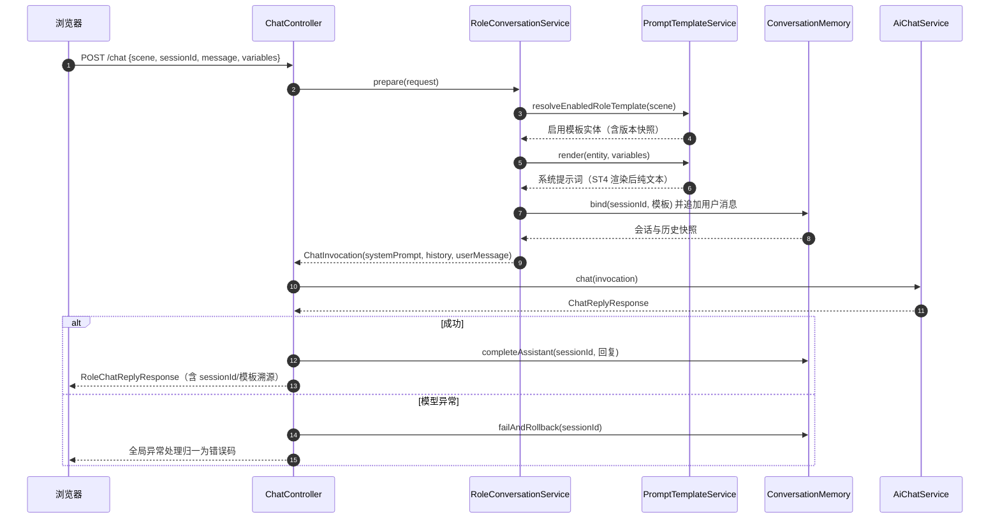
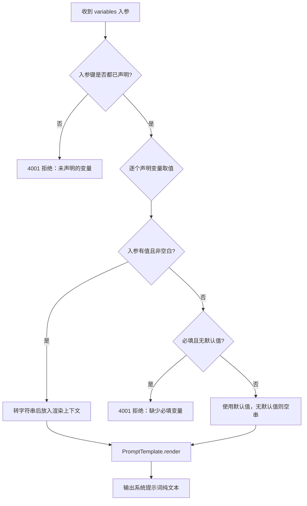
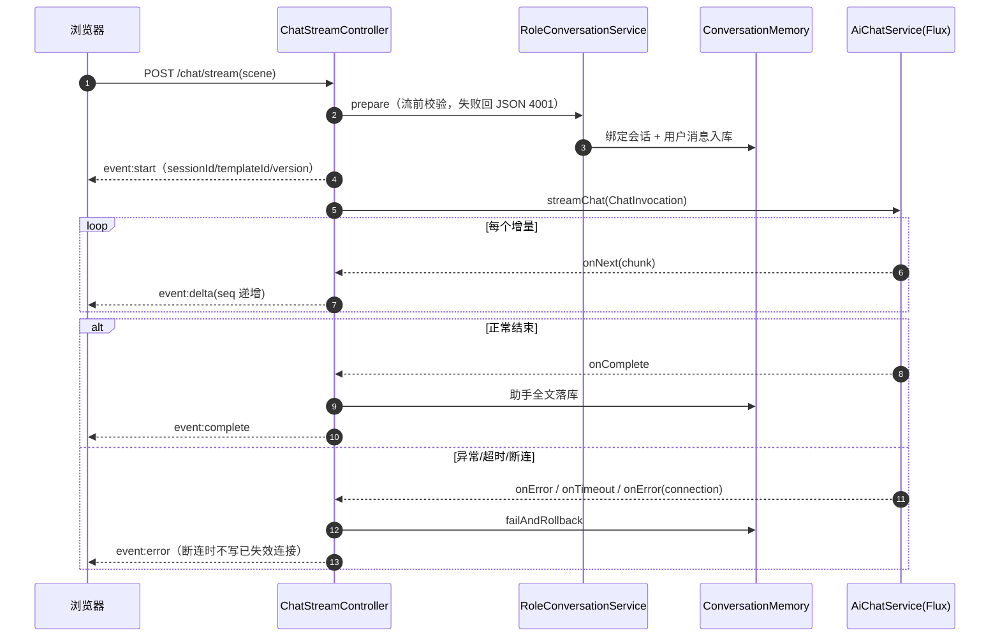

# D15-02 Prompt 模板管理与双角色对话：技术说明与操作实践指南

> 阅读对象：需要理解本模块设计原理、二次开发或排查问题的 Java 后端工程师。
>
> 版本基线：Spring Boot 3.5.16、Spring AI 1.1.8（底层 StringTemplate 4 / ST4 4.0.8）、JDK 21、Servlet 栈 Spring MVC + Tomcat。
>
> 配套文档：实现清单与真机证据见《D15-01 项目迭代全量记录》。

---

## 1. 整体架构

### 1.1 分层与依赖方向

```text
浏览器（index.html / templates.html，原生 JS + textContent）
        │  JSON over HTTP（SSE 走 text/event-stream）
        ▼
controller 层
  PromptTemplateController（/prompts、/roles）
  ChatController（同步角色分支）   ChatStreamController（SSE 角色分支）
        │
        ├─ prompt 域：Validator → Service → Repository(接口) → InMemory(ConcurrentHashMap + 种子 JSON)
        └─ conversation 域：RoleConversationService → ConversationMemory（LRU + FIFO）
                │
                ▼
service 模型适配：AiChatService（ChatInvocation 重载）
                ├─ MockAiChatService（确定性回显）
                └─ DeepSeekAiChatService（System/Assistant/User Message 组装）
```

依赖方向只能向下：控制器依赖领域服务，`RoleConversationService` 依赖模板服务与会话存储，但**不依赖具体模型实现**——它产出 `ChatInvocation`，由 `AiChatService` 决定走 Mock 还是 DeepSeek，使“提示词规则”和“厂商适配”两个变化方向解耦。

### 1.2 一次角色同步对话的时序



### 1.3 为什么系统提示词、历史、用户消息必须分三段

大语言模型的消息数组中，SystemMessage 是角色规则位，UserMessage 是数据位。若把用户输入字符串拼进系统提示词，用户一句“忽略之前所有指令”就可能改写角色行为（提示词注入，Prompt Injection）。本实现的组装顺序固定为：

1. `SystemMessage(render 后的系统提示词)`；
2. 历史中的 `UserMessage / AssistantMessage`；
3. 当前 `UserMessage(用户原文)`。

用户数据永远进不了 SystemMessage 位置；变量入参还要通过“已声明变量”白名单校验，堵住借变量位注入规则的路径。

---

## 2. Prompt 模板与 ST4 渲染机制

### 2.1 是什么

Spring AI 1.1.8 的 `PromptTemplate` 位于 `spring-ai-model` 构件，渲染引擎是 `StTemplateRenderer`（`spring-ai-template-st`），底层为 ANTLR 的 StringTemplate 4（ST4 4.0.8）。默认分隔符是**单大括号**：`{varName}`。

### 2.2 为什么保存前要做三层校验

| 层级 | 校验内容 | 失败表现 |
| --- | --- | --- |
| Bean Validation | 非空、长度、templateId/变量名正则 | 框架校验，归一 4001 |
| 业务一致性 | 正文占位符必须全部声明；入参键必须全部已声明；必填变量缺失拒绝 | 抛 IllegalArgumentException，归一 4001 |
| 引擎试渲染 | 用桩值实际执行一次 `new PromptTemplate(content).render(stub)` | ST4 语法错误在保存期暴露，而非对话期 |

### 2.3 裸大括号陷阱（本模块最容易踩的坑）

ST4 把 `{ }` 当作语法分隔符。模板正文若需要输出字面 JSON，例如 `{"defects":[]}`，直接写裸括号会导致引擎抛出 `IllegalArgumentException: The template string is not valid`。

规则（在本机用独立 Java 程序实测确认，证据留存于 `docs/temp_docs/D15-st-probe-out.txt`）：

- 占位符：`{变量名}`，且变量名必须在 variables 中声明；
- 字面大括号：必须转义为 `\{` 与 `\}`，渲染后输出普通的 `{` `}`；
- 校验器先把 `\{` `\}` 掩码，再识别合法占位符，残留的任何 `{` 都判为“未转义或非法大括号”，错误信息直接提示转义写法。

`code_review` 种子模板中的 JSON 输出示例即按此规则书写：

```text
审查摘要（花括号为模板字面量，已做 ST4 转义）：
\{
  "defects": ["缺陷摘要"],
  "risks": [],
  "suggestions": []
\}
```

### 2.4 渲染时的变量安全规则



注意默认值只对“可选变量”兜底；`required=true` 且无默认值的变量（如 summarization 的 `source_text`）缺失必须失败，不能静默用空串生成一份错误总结。

---

## 3. 多轮会话与角色隔离

### 3.1 数据结构选型

- `ConversationMemory` 用访问有序的 `LinkedHashMap(initialCapacity, loadFactor, accessOrder=true)` 重写 `removeEldestEntry`，容量超过 500 自动淘汰最久未访问会话；所有方法 synchronized，适配并发请求。
- `ConversationSession` 内部用 `ArrayList` 存消息，追加时超过 20 条就从头移除（FIFO），保证送模上下文长度有界，避免长会话 Token 无限增长。
- 模板仓储用 `ConcurrentHashMap`；管理端写操作在 Service 层 synchronized（低频操作，优先正确性与版本号一致性）。

### 3.2 会话绑定与模板版本快照

会话创建时把 `scene + templateId + templateVersion` 一起绑定。之后模板被编辑（版本自增），进行中的会话仍按旧版本渲染，保证一次对话的角色口径前后一致、可追溯。

### 3.3 角色切换为什么强制新会话

同一 sessionId 再次请求时，若 scene 与绑定值不同，直接抛错：

> 会话已绑定角色 X，不能在同一会话切换到 Y，请新建会话后再切换角色。

这是结构性隔离，而不是靠前端隐藏按钮：即便有人绕过页面直接调接口，服务端仍然拒绝，避免客服历史污染编程上下文。

### 3.4 失败轮次回滚

`prepare` 阶段先把用户消息写入会话，再调用模型。模型失败（同步异常、SSE error、超时、客户端断连）都会触发 `failAndRollback` 移除最后一条用户消息，使会话历史只保留成功轮次，防止“问题进了历史、答案却缺失”造成上下文错位。回滚方法对空会话幂等。

---

## 4. SSE 角色链路的接线方式

### 4.1 对 D14 双层超时零侵入

D14 的超时设计保持不动：Reactor `Flux.timeout` 是应用层主路径，`SseEmitter` 超时在配置值上加 5000ms 兜底；`onTimeout` 严格按“先发 error 事件、再置终态、最后 complete”的顺序执行。本次只在三个位置插入角色逻辑：

1. 返回 emitter 之前调用 `prepare`：任何角色/模板/变量错误发生在流开始之前，自然走 `GlobalExceptionHandler` 返回 JSON（而不是发出一个残缺 SSE 流）；
2. start 帧改用 7 参构造携带溯源字段，`@JsonInclude(NON_NULL)` 保证旧链路帧中不出现 null 字段；
3. delta 累积到 `StringBuilder`，complete 时落库助手消息；error/timeout/onError 三条失败路径统一回滚。

### 4.2 角色 SSE 时序



### 4.3 背压口径（避免过度承诺）

本模块在 Reactor `Flux` 与 MVC `SseEmitter` 之间自行桥接。Reactor 原生具备背压机制，但是否能把 Tomcat 连接的下游消费压力完整传回上游，取决于订阅与发送行为；因此文档只承诺“超时取消、断连取消、终态幂等、失败不继续计费式拉取”，不宣称已经实现端到端背压闭环。

---

## 5. 前端设计要点

1. **角色清单服务端下发**：前端 `GET /roles` 拉取选项，只负责展示；能否对话由服务端模板状态决定，停用模板在服务端即被拒绝。
2. **会话标识生命周期**：首轮流式 start 帧回传 sessionId 后保存在页面变量；“新对话”或切换角色时清空并重新生成；页面刷新即视为新会话（内存存储的自然约束）。
3. **XSS 防护**：所有模型文本与模板字段通过 `createTextNode/textContent` 渲染，管理页同样不拼 innerHTML。
4. **SSE 解析复用 D14 修复成果**：`sse-parser.js` 兼容 LF/CRLF/CR 与跨块、UTF-8 跨字节边界，本次未改动，9 个 Node 用例持续回归。
5. **管理页变量编辑**：变量声明用 JSON 文本框编辑，前端先做 JSON 合法性检查，最终以服务端校验为准（前端校验只改善体验，不作为安全边界）。

---

## 6. 工程实践与避坑清单

| 坑点 | 正确做法 |
| --- | --- |
| 正文写裸 JSON 大括号 | 一律 `\{` `\}` 转义；靠校验器试渲染兜底 |
| 新建变量却忘了在正文使用，或正文占位符没声明 | “先声明、后使用”，两侧不一致直接 4001 |
| 前端传一个模板没声明的变量键试图注入内容 | 服务端白名单拒绝，不要依赖前端不传 |
| 同 sessionId 切角色 | 服务端拒绝；前端切换角色同时重置会话 |
| 把用户消息拼进系统提示词 | 保持 System/User Message 分离，用户原文只进 UserMessage |
| 复制模块后忘记改 AOP 切点包名 | 切面/扫描类配置中的包名必须随模块包名同步修改，本次已修复 d14→d15 |
| 请求 SSE 时把 Content-Type 写成 text/event-stream | 请求体仍是 JSON（consumes=application/json），event-stream 只是响应类型 |
| 声称 Flux 天然解决端到端背压 | 自行桥接 SseEmitter 时只承诺已实现的超时/取消/幂等，不夸大机制 |
| 把内存仓库当持久化方案宣传 | 显式标注重启恢复种子；持久化需替换 Repository 实现 |

---

## 7. 后续演进方向（当前未实现，仅作路线）

1. Repository 增加 MySQL/Redis 实现，模板表与唯一约束落地，会话存 Redis 并设置 TTL。
2. 管理接口接入认证鉴权与操作审计日志。
3. 模板渲染增加灰度版本与 A/B 生效能力。
4. 引入真实下游限流与重试预算，区分熔断、超时、重试三个机制的边界，避免叠加放大流量。

---

## 8. 记忆简语与层级树

**记忆简语**：单括号是变量、字面括号要反斜；系统管规则、用户只数据；会话绑角色、换角先换号；流前校验返 JSON、流后失败必回滚。

```text
技术主线
├─ 模板渲染
│  ├─ PromptTemplate（Spring AI 1.1.8）
│  │  ├─ StTemplateRenderer → ST4 4.0.8
│  │  ├─ 占位符 {var} 必须先声明
│  │  └─ 字面括号 \{ \}
│  ├─ 三层校验：Bean Validation / 业务一致性 / 桩值试渲染
│  └─ 变量白名单 + 必填兜底规则
├─ 会话隔离
│  ├─ LRU 500 会话（access-order LinkedHashMap）
│  ├─ FIFO 20 消息（ArrayList 截断）
│  ├─ 绑定 scene+templateId+version 快照
│  └─ 失败回滚最后一条用户消息
├─ 双链路
│  ├─ 同步：prepare → chat → 落库/回滚
│  └─ SSE：流前 JSON 失败 → start 溯源 → delta 累积 → complete 落库
└─ 安全边界
   ├─ System/User Message 分离防注入
   ├─ 变量键白名单
   ├─ 前端 textContent 防 XSS
   └─ 无鉴权与内存存储为已知限制
```

---

## 9. 参考资料

1. 《Prompts | 提示词与 PromptTemplate 官方参考》：https://docs.spring.io/spring-ai/reference/1.1/api/prompt.html
2. 《Chat Client API | 聊天客户端 API 参考》：https://docs.spring.io/spring-ai/reference/1.1/api/chatclient.html
3. 《AI Concepts | Spring AI 概念（StringTemplate 模板引擎说明）》：https://docs.spring.io/spring-ai/reference/1.1/concepts.html
4. 《StringTemplate 4 | ANTLR StringTemplate 官方仓库》：https://github.com/antlr/stringtemplate4
5. 《Parsing an event stream | WHATWG SSE 事件流解析标准》：https://html.spec.whatwg.org/multipage/server-sent-events.html
6. 《Spring Web MVC Async and Streaming | Spring MVC 异步与流式处理参考》：https://docs.spring.io/spring-framework/reference/6.2/web/webmvc/mvc-ann-async.html
