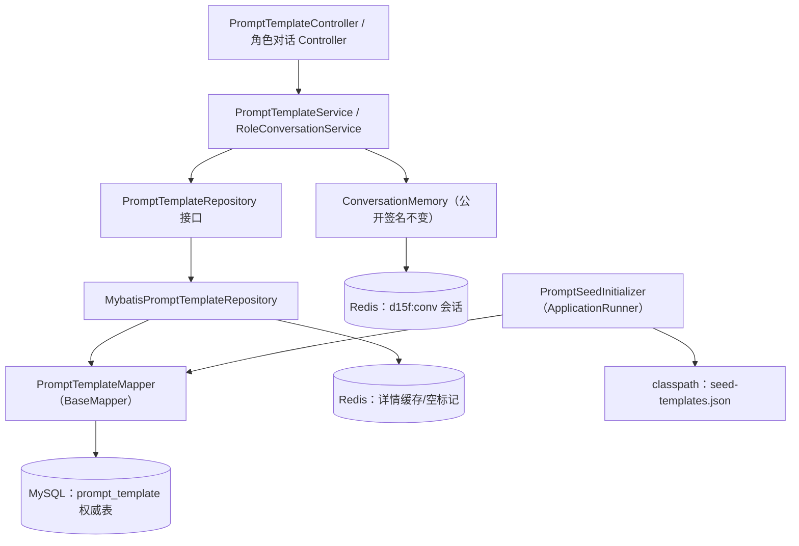
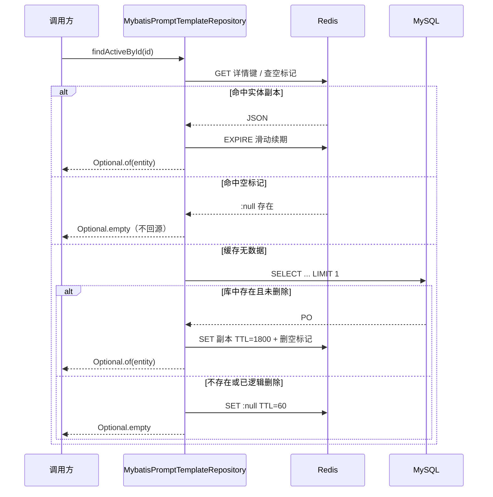
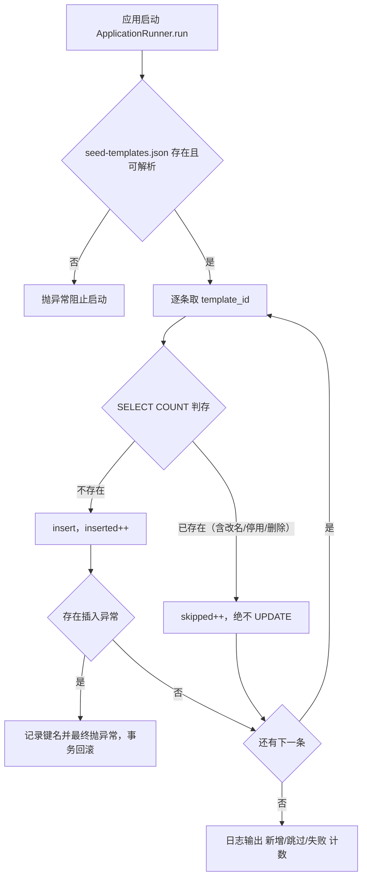

# D15-PLUS-02 MySQL/Redis 持久化改造：技术说明与实践指南

> 文档定位：本文讲清 D15_PLUS“为什么这样设计、底层机制如何运转、工程上怎么验证与避坑”，配套迭代全量记录《D15-PLUS-01》一起阅读。所有机制描述以当前仓库代码为准，版本基线：Spring Boot 3.5.16、Spring AI 1.1.8、MyBatis-Plus 3.5.17、MySQL 9.7、Redis 6.2.12、JDK 21。

---

## 1. 整体架构

### 1.1 分层与依赖方向



关键依赖原则：

1. **领域服务只认识接口**。`PromptTemplateService` 注入的是 `PromptTemplateRepository`，D15 的内存实现与 D15_PLUS 的 MySQL+Redis 实现可以无缝替换，业务层零改动，这是 D15 时期预留接口化的直接收益。
2. **仓储实现内部再分两条腿**：MyBatis Mapper 管权威读写，`StringRedisTemplate` 管缓存，两条腿的故障策略不对称——库失败必抛错，缓存失败可降级。
3. **种子初始化器横切但不越权**：它只在启动期通过 Mapper 做判存插入，不经过缓存、不调用业务服务，避免与运行期写路径互相干扰。

### 1.2 一次模板详情读的时序



---

## 2. Cache-Aside（旁路缓存）模式落地细节

### 2.1 是什么

Cache-Aside，即旁路缓存，指应用代码显式承担缓存编排：读时先查缓存、未命中回源数据库并回填；写时只改数据库，成功后让缓存失效（本项目采用删除而非更新）。缓存本身不具备加载逻辑，它与数据库之间没有框架级自动同步。

### 2.2 为什么写后“删除缓存”而不是“更新缓存”

- 删除是幂等动作，并发写多次删除的结果相同；更新缓存则要保证多次写的顺序与数据库最终值一致，容易出现后写先到的旧值覆盖。
- 模板管理是低频写、读取字段多（含 JSON 变量列），更新缓存要重复做 PO→实体→JSON 转换，删除后等待下次读懒加载更省。
- 删除后到下次读之间最多一次回源，对管理端低频场景成本可忽略。

### 2.3 缓存读的三态模型

`readCache()` 返回值刻意使用三种语义，而不是简单的有无二分：

| 返回 | 含义 | 调用方动作 |
| --- | --- | --- |
| `null` | 缓存层无数据（或缓存被关闭/读取异常） | 必须回源 MySQL |
| `Optional.empty()` | 命中空值标记 | 直接返回不存在，不回源 |
| `Optional.of(entity)` | 命中实体副本 | 滑动续期后返回 |

空值标记把“不存在”也缓存起来，避免恶意或错误流量对同一个不存在的 `template_id` 反复打数据库，这是缓存穿透（Cache Penetration，查询一个数据库里必然不存在的数据导致每次请求都落库）的标准低成本防护；60 秒短 TTL 保证新建同名模板后最多 60 秒自动放开（写路径也会主动删空标记，实际更快）。

### 2.4 滑动 TTL 的意义

固定过期时间会让热点数据在同一时刻集中失效，可能引发缓存雪崩（Cache Avalanche，大量 Key 同时过期导致请求瞬间涌向数据库）。本项目在每次缓存命中时执行 `EXPIRE` 重置 1800 秒：越热的数据越不容易过期，冷数据自然淘汰，过期点被访问行为自然打散。空标记不续期，到点必失效。

### 2.5 为什么列表接口不缓存

`findAllActive()` 直接走 MySQL 的 `idx_scene_status_deleted` 联合索引。列表结果受 scene/status 过滤参数影响、维度组合多，缓存失效需要按维度反查 Key，复杂度与出错面都大于收益；详情键是稳定单键，缓存性价比最高。这是“只缓存确定性高、复用率高的读”的取舍。

---

## 3. 种子幂等初始化机制

### 3.1 执行流程



### 3.2 关键设计点

1. **判存依据是业务唯一键 `template_id`，不是名称或正文**。名称允许人工修改，不能作为身份依据；数据库唯一键 `uk_template_id` 是并发场景的最后防线，冲突异常被全局异常处理归一为 4001。
2. **“已存在即跳过”覆盖任何状态差异**。即使库里的行被停用、逻辑删除或正文改得面目全非，初始化器也不覆盖——数据库是运行期权威，classpath JSON 只负责第一次播种。真机证据 22/23/26 已验证。
3. **失败要响**。资源缺失、JSON 解析失败、单条插入异常都会抛异常让应用启动失败，而不是打一条 warn 假装成功；`@Transactional` 保证部分插入在失败时回滚。
4. **旧内存类的处理**。`InMemoryPromptTemplateRepository` 摘掉 `@Repository`、标 `@Deprecated` 但保留文件，使内存方案可审查、可对照，且不会与新仓储争抢同一个接口的 Bean。

---

## 4. 会话 Redis 存储设计

### 4.1 为什么用显式 Payload 而不是直接序列化领域对象

`ConversationSession` 含 final 字段与不可变快照方法，直接交给 Jackson 反序列化需要依赖隐式构造器与 final 字段反射写入，升级 Jackson 或调整领域模型时行为脆弱。`RedisSessionPayload` 是一个普通 record，字段一一声明，序列化契约独立于领域对象，转换在 `ConversationMemory` 内显式完成，可读性与兼容性都可控。

### 4.2 读写与 TTL 规则

- `bind`：无 sessionId 则生成 32 位无横线 UUID 新建；有 sessionId 但 Redis 无载荷则按新会话处理；已存在则校验场景一致，拒绝同会话切换角色，并刷新 TTL。
- `appendMessage`：先强制加载（不存在直接抛“会话不存在或已过期”），复用领域对象的 20 条 FIFO 截断，再整体写回并续期。
- `rollbackLastMessage`：模型调用失败时移除最后一条用户消息，会话不存在时幂等返回。
- `clear`：直接 DEL，Key 不存在时 DEL 本身就是 0 影响行数，天然幂等。
- `size`：用 `SCAN ... COUNT 200` 游标统计，禁止使用 `KEYS`（单线程 Redis 上 KEYS 会阻塞全部业务命令）；结果声明为近似值，只供观测。

### 4.3 为什么会话不进 MySQL

会话是可丢失的短期状态，价值随时间衰减，而模板是需要长期沉淀、审计与版本管理的配置资产。把会话塞进关系库会带来高频写入、表膨胀与清理调度成本；Redis 的 TTL 机制天然表达“30 分钟不活动即回收”。代价是 Redis 数据丢失会带走未过期会话，这一权衡在迭代记录第 8 章登记，业务上重新发起对话即可恢复。

---

## 5. 故障与一致性边界

### 5.1 Redis 故障时的两类不同策略

| 路径 | Redis 异常时的行为 | 理由 |
| --- | --- | --- |
| 模板读 | 捕获异常、warn 告警、降级回源 MySQL | 权威库在线就必须继续提供服务，缓存只是加速器 |
| 模板写后失效 | 捕获异常、warn 告警，不回滚数据库事务 | 库已成功是事实，缓存残留最多存活到 TTL |
| 会话读写 | 异常包装为 `IllegalStateException` 上抛 | 会话的唯一存储就是 Redis，无法假装成功 |

这种不对称是刻意的：有权威兜底的路径允许降级，没有兜底的路径必须显式失败，交给全局异常处理返回 5000，而不是返回一个看似成功的空会话。

### 5.2 直改数据库的缓存失效纪律（真机踩过的现象）

证据 24 记录了绕过应用执行 SQL 改名后 API 仍读旧值。cache-aside 的失效动作挂在应用写路径上，DBA 直改库不会触发它。运维纪律：

1. 优先通过应用接口修改数据；
2. 必须直改库时，改完手工 `DEL d15f:prompt:tpl:{id}`（及 `:null` 标记），或等待 TTL 自然过期；
3. 批量修数后按前缀 SCAN 删除相关 Key，禁止在生产用 `KEYS` 或无范围 `FLUSHDB`。

### 5.3 当前方案不覆盖的并发写场景

单实例管理端低频写下，“写库→删缓存”足够。它没有处理经典的“读回源与写失效交叉导致旧值回填”极端时序（缓存恰好过期、读请求拿到旧库值、写请求删缓存、读请求再把旧值写回）。多实例高并发写的后续方案是延迟双删或基于订阅 binlog 的缓存失效，当前明确不实现，避免过度设计。

---

## 6. MyBatis-Plus 映射要点

1. **JSON 列映射**：`PromptTemplatePO.variables` 标注 `@TableField(typeHandler = JacksonTypeHandler.class)`，类上开启 `@TableName(autoResultMap = true)`，否则 TypeHandler 在查询结果映射时不生效，这是 MyBatis-Plus 最常见的配置遗漏。
2. **布尔与枚举的存储口径**：`deleted` 在库中是 TINYINT(1)、PO 中是 Integer、领域对象是 boolean，转换集中在仓储层；`status` 存字符串名而非枚举序号，避免后续调整枚举声明顺序导致历史数据语义错乱。
3. **时间戳显式写入**：不依赖 MyBatis-Plus 自动填充插件，新增时统一 `LocalDateTime.now()` 同时写两列，更新时保留 `createdAt`、刷新 `updatedAt`，行为在代码里可直接追。
4. **逻辑删除不用全局逻辑删除插件**：删除标记由领域服务显式置位并走 update，查询处显式判断 `deleted=1`，保留对“包含已删除行的内部判存（`findAnyById`）”的控制力，创建去重因此能看见历史软删行。

---

## 7. 工程避坑清单

| 坑 | 现象 | 正确做法 |
| --- | --- | --- |
| YAML 缩进错位 | 插入顶层配置块后子块被顶出 `spring:` 层级，自动配置读不到属性、上下文启动失败 | 改完 YAML 立刻复核父子层级；本次以全量测试兜底捕获 |
| PowerShell 拆 Maven 参数 | `-Dmaven.repo.local=...` 被切成插件前缀报错 | 依赖 settings.xml 的仓库配置，命令行不传该参数 |
| mysql `-h` 合写 | `-h127.0.0.1` 被解析成主机名 “12” | 用长选项 `--host=127.0.0.1` |
| Windows 路径喂 `source` | 反斜杠触发未知命令、`-e source` 语法错 | `Get-Content -Raw` 后经 stdin 管道执行 SQL |
| 测试数据污染 | 集成测试在真实库/缓存留行留 Key | 统一清理基类按前缀物理删除，测试后零残留纳入证据 |
| 用 KEYS 统计 | 大库上阻塞 Redis 单线程 | SCAN 游标分批遍历，结果按近似值使用 |
| JDK 默认序列化 | Redis 里出现不可读二进制、跨语言无法调试 | StringRedisTemplate + Jackson JSON，人可读可手工排障 |

---

## 8. 后续演进方向（当前未实现，仅作路线）

1. 引入 Testcontainers，让集成测试自带一次性 MySQL/Redis，摆脱对本机中间件状态的依赖。
2. 多实例部署时补延迟双删或 binlog 订阅失效，闭合极端并发写的缓存一致性窗口。
3. 会话需要跨 Redis 重启保留时评估 AOF 持久化或冷热分层，而不是直接把会话搬进关系库。
4. 管理接口接入认证授权与操作审计，当前无鉴权状态不能直接暴露到生产网络。
5. 缓存指标埋点（命中率、回源率、降级告警次数）接入监控，用数据校准 TTL 而不是凭经验定值。

---

## 9. 记忆简语与层级树

### 9.1 记忆简语

- **库为真相源，缓为懒副本**：回源、回填、删失效，缓存不持有真理。
- **三态读、短空锁、热续期**：null 回源、empty 短路、entity 续期，穿透雪崩一起防。
- **播种不覆苗**：初始化只 INSERT MISSING，库里的苗长成什么样都不许拔。
- **能降级才 try，无兜底必抛**：模板读可退库，会话写失败必须响。
- **显式契约胜反射**：Payload record 独立建模，不赌 Jackson 对 final 字段的隐式行为。
- **SCAN 代替 KEYS，JSON 代替原生序列化**：线上可读、不阻塞、可排障。

### 9.2 层级树（竖屏速记）

```text
持久化改造技术树
├─ 缓存模式 Cache-Aside
│  ├─ 读三态：实体副本 / 空标记 / 回源
│  ├─ 写路径：落库 → 删除缓存（非更新）
│  ├─ 保护：空标记防穿透 · 滑动 TTL 防雪崩
│  └─ 降级：Redis 异常回源 MySQL + 告警
├─ 种子初始化
│  ├─ ApplicationRunner + 事务
│  ├─ template_id 判存 · uk 唯一键兜底
│  └─ 已存在跳过 · 失败阻止启动
├─ 会话存储
│  ├─ Payload record 显式 JSON
│  ├─ 滑动 TTL 1800s · 20 条 FIFO
│  └─ SCAN 统计 · 缺失必抛 · 清除幂等
├─ ORM 映射
│  ├─ autoResultMap + JacksonTypeHandler
│  ├─ 状态存字符串 · 删除位显式判断
│  └─ 时间戳显式写入
└─ 纪律
   ├─ 直改库必须手工删缓存
   ├─ 测试统一清场并留证
   └─ 不超前实现分布式一致性
```

---

## 10. 参考资料

- 《Cache-Aside Pattern | 缓存旁路模式（Microsoft Cloud Design Patterns）》：https://learn.microsoft.com/en-us/azure/architecture/patterns/cache-aside
- 《Spring Data Redis Reference | Spring Data Redis 参考文档》：https://docs.spring.io/spring-data/redis/reference/
- 《MyBatis-Plus 指南 | JSON 字段处理器与 CRUD 接口》：https://baomidou.com/guides/
- 《MySQL 9.7 Reference Manual | CREATE TABLE 与索引语法》：https://dev.mysql.com/doc/refman/9.7/en/create-table.html
- 《Redis Commands | SCAN/EXPIRE/DEL 命令规范》：https://redis.io/docs/latest/commands/scan/
- 《Spring Boot Features | Type-safe Configuration Properties》：https://docs.spring.io/spring-boot/3.5.16/reference/features/external-config.html#features.external-config.typesafe-configuration-properties
