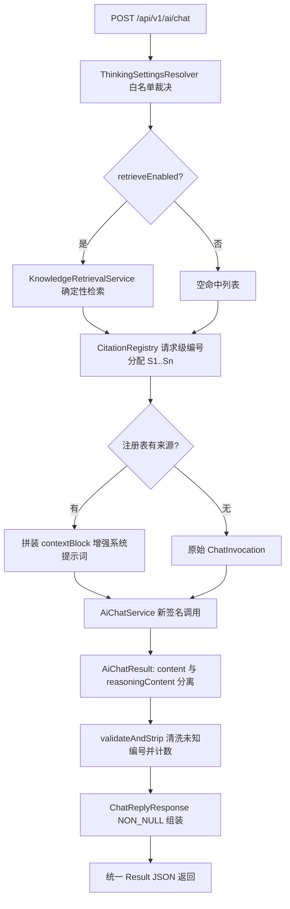
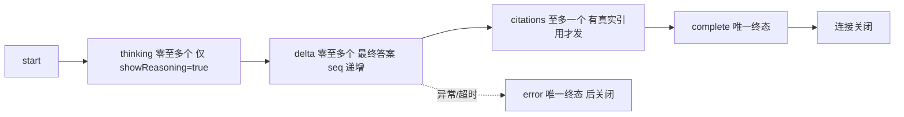

# D16-01 思考推理模式与引用来源功能迭代全量记录

> 文档定位：本文只记录 D16 模块**本次迭代实际交付的全部内容与可复现操作**，所有结论以仓库当前代码、真实命令输出与 `docs/evidence/D16-cot/` 证据为准；未验证项在第 9 章显式标注，不把计划写成已交付。
>
> 基线环境（实测）：JDK 21.0.7、Maven 3.9.16、Spring Boot 3.5.16、Spring AI 1.1.8（仅 `spring-ai-starter-model-deepseek`）、MyBatis-Plus 3.5.17、MySQL 驱动 8.0.33、Lettuce/Redis 6.2.12、Servlet/Tomcat + Spring MVC（无 WebFlux 服务端）、node v22.23.2。
>
> 模块路径：`D16/D16_CoT`（骨架完整复制自 `D15_PLUS/D15_FOPF_PLUS`，主包名已改为 `com.zl.d16`，主类 `D16PlusSpringAiApplication`；测试包沿用 `com.zl.d15.springai`）。

---

## 1. 迭代背景、目标与范围

### 1.1 背景

D15_PLUS 已交付 Prompt 模板 MySQL 权威存储、Redis 缓存与会话短期记忆，聊天链路具备同步与 SSE（Server-Sent Events，服务器发送事件）两种响应形态。D16 的业务场景是**制造业设备故障知识库与工单智能助手**，本次在不动既有存储与对话契约的前提下补齐两个 RAG/推理工程的基础能力：

1. **模型思考/推理模式（Thinking Mode，思考模式）**：请求级开关，严格区分模型的 `reasoning_content`（推理内容）与最终答案 `content`。
2. **引用来源标注（Citation，引用项）**：回答只允许携带本轮真实检索结果的来源编号与元数据，模型无权自造来源。

### 1.2 本次目标

| 编号 | 目标 | 验收口径 |
| --- | --- | --- |
| G1 | 请求级思考开关，服务端白名单裁决，前端开关不作数 | 同步/SSE 均生效；非法强度显式 4001 拒绝 |
| G2 | reasoning 与 content 类型级分离，默认不外露、不入会话记忆、不入业务日志全文 | 密封分片 + 独立 SSE 事件 + 日志只记长度 |
| G3 | 旧客户端零改造：新字段全部可缺省，关闭时响应帧与 D16 前完全一致 | NON_NULL 隐藏 + 旧构造器保留 + 回归测试 |
| G4 | classpath 真实语料 + 确定性检索，请求级 S1/S2 编号注册表 | 无命中返空不伪造；未知编号清洗删除；跨请求不串号 |
| G5 | 不升级依赖、不引向量库/第二套模型链、不改 MySQL 表结构与 Redis Key 前缀 | pom 仅复用既有依赖；无 DDL；前缀仍为 `d15f:` |
| G6 | 全量单测/集成测试/前端 node 测试 + jar 真机 mock 证据 | 106 JUnit + 12 node，证据 19 份落盘 |

### 1.3 明确不做的事（范围边界）

- **不引入向量数据库/Embedding 依赖**：实测 pom 无任何 vector-store/embedding starter，本次用「classpath JSON 语料 + 确定性 bigram 关键词评分」实现真实检索端口；接入 PGvector 等是后续独立迭代。
- **不升级 Spring AI/Boot**：现网 DeepSeek 文档的 `thinking.type`/`reasoning_effort` 参数与本地 1.1.8 客户端存在代差，以本地 jar 反编译事实为实现依据，不照搬网上新 API。
- **不做用户偏好持久化**：思考/检索开关均为每次请求显式传参，不写库、不写 Redis。
- **不持久化 reasoning 全文、不持久化 citations 快照、不做数据库迁移**：会话记忆仍只存最终答案文本。
- **不做文档权限系统**：项目当前无租户/权限模型，权限边界测试标注「不适用」，但语料内容一律按不可信数据处理（含提示注入教学片段）。
- 不执行任何 git commit/push；真实密钥不入库不入日志。

---

## 2. 仓库现状侦察结论（阶段 0 实证）

### 2.1 版本与依赖事实

| 事项 | 实测结论 | 取证方式 |
| --- | --- | --- |
| Spring AI 版本 | 1.1.8，依赖仅 `spring-ai-starter-model-deepseek`，无 RAG/vector/embedding 依赖 | 模块 `pom.xml` + 依赖树 |
| DeepSeek 思考参数 | `DeepSeekChatOptions` 与 `DeepSeekApi$ChatCompletionRequest` **均无** thinking/reasoningEffort 字段 | `javap` 反编译，证据 19 |
| reasoning 取数路径 | `ChatCompletionMessage` 存在 `@JsonProperty("reasoning_content")` 字段，经 buildGeneration 映射到 `DeepSeekAssistantMessage#getReasoningContent()`，非流式/流式均可取 | 同上 |
| 内置模型 | ChatModel 枚举仅 `deepseek-chat`/`deepseek-reasoner` 两档；Builder 支持 `model(String)` 按请求覆盖 | 同上 |
| Web 栈 | Servlet/Tomcat + Spring MVC，SSE 用 `SseEmitter` 桥接 Reactor `Flux`，非 WebFlux 服务端 | 源码 |
| 中间件 | MySQL 3306、Redis 6379 本机在线；Key 前缀 `d15f:prompt:tpl:`、`d15f:conv:` 沿用 | 端口探测 + yml |

### 2.2 侦察中发现并修复的骨架缺陷（非功能新增，属必要修复）

| 缺陷 | 现象 | 最小修复 |
| --- | --- | --- |
| 测试引导失配 | 主包 `com.zl.d16`、测试包仍在 `com.zl.d15.springai`，18 个 `@SpringBootTest` 报 Unable to find a `@SpringBootConfiguration` | test 下新增 `D16TestBootstrap`（`@SpringBootApplication(scanBasePackages="com.zl.d16")` + `@ConfigurationPropertiesScan`），不挪动 20 个既有测试文件 |
| 访问日志切面硬编码 | `ControllerAccessLogAspect` 切点写死 `com.zl.d15.controller`，CONTROLLER_ACCESS 事件缺失、2 个 AccessLog 测试失败 | 切点改为 `com.zl.d16.controller` 并同步注释 |
| 前端 parser 误用 | `app.js` 把回调式 sse-parser 当「返回事件数组」使用且从不 flush，D15 整改后的解析器在 D16 页面实际不工作 | 按解析器真实 API（浏览器全局 `SseParser.createSseParser(onEvent)`，事件属性 `.name/.data`）重写 app.js |

### 2.3 与 D15_PLUS 的差异对比（仅列本次相关面）

| 维度 | D15_PLUS | D16 增量 |
| --- | --- | --- |
| 模型入参 | 仅 message/scene/sessionId/variables | 新增 thinkingEnabled/reasoningEffort/showReasoning/retrieveEnabled，全部可缺省 |
| 模型适配 | `Flux<String>` 单类型文本流 | 新增密封 `StreamChunk`（ReasoningChunk/ContentChunk），旧 4 个接口方法全部保留为 default 桥接 |
| 知识能力 | 无任何检索链路 | 新增 `com.zl.d16.knowledge` 包：语料/检索/注册表/编排器，零新依赖 |
| SSE 协议 | start/delta/complete/error | 向后兼容增加 thinking/citations 两个命名事件，帧序有约束 |
| 存储 | MySQL + Redis | 表结构、Key 前缀、TTL 全部不变；新开关不持久化 |
| 前端 | 角色对话 + 模板管理两页 | 对话页增加三个开关与思考区/来源区，textContent 安全渲染 |

---

## 3. 设计决策与数据流

### 3.1 关键设计决策

1. **思考开关 = 按请求切换 reasoner 模型**。1.1.8 客户端无法下发 thinking 参数，`DeepSeekChatOptions.builder().model(...)` 是唯一经反编译实证的按请求覆盖路径；普通模型走配置的 `deepseek-flash`，思考走服务端配置 `app.ai.thinking.reasoner-model`（默认 deepseek-reasoner），客户端不能传任意模型名。
2. **推理强度显式拒绝而非静默吞参**。`ThinkingSettingsResolver.REASONING_EFFORT_TRANSMITTABLE=false` 是带注释的编译期常量；任何非空 reasoningEffort 一律 4001，文案说明版本边界，杜绝「参数被丢但界面显示已启用」。
3. **类型系统防止推理混入答案**。模型适配层发射密封接口 `StreamChunk`，SSE 层按 instanceof 分流；推理分片在 showReasoning=false 时直接丢弃，不进 `assistantBuffer`、不进会话、不落日志全文。
4. **引用可信边界放在后端注册表**。`CitationRegistry` 是每次调用在方法栈内 new 的局部对象，不进 Spring 容器；编号只分配给真实命中片段，模型输出的未知 `[Sn]` 在同步正则校验/流式有状态清洗中删除并计数。
5. **无向量库下的真实检索**。中文 bigram + 整词切分，标题/章节/正文权重 3/2/1，同字段去重计数，按分数降序 + chunkId 升序稳定排序取 topK；结果完全确定性、可单测复现，输出只可能是语料真实片段。
6. **mock 闭环可信**。mock 模式答案尾部的 `[Sn]` 编号行由服务端依据真实注册表生成（不是 mock 模型瞎写），保证无外网环境也能演示完整引用闭环；真实模式下编号是否出现完全交由模型输出再经注册表校验。

### 3.2 同步链路数据流



### 3.3 SSE 链路数据流与帧序约束



约束：citations 必须先于 complete；error 与 complete 互斥，由 `AtomicBoolean finished` + emitter 监视器保证唯一终态；应用层 Reactor timeout（配置值）取消上游，SseEmitter 容器超时在配置值 +5 秒兜底。

### 3.4 接口契约变化

请求体 `ChatRequest` 新增 4 个可选字段（均不破坏校验）：

| 字段 | 类型 | 缺省行为 | 约束 |
| --- | --- | --- | --- |
| thinkingEnabled | Boolean | null/false，普通链路 | 服务端裁决 |
| reasoningEffort | String | 不传 | `@Size(max=16)`，白名单 LOW/HIGH/MAX；当前版本任何非空值 4001 |
| showReasoning | Boolean | false | thinkingEnabled=false 时服务端强制归一 false |
| retrieveEnabled | Boolean | false，普通问答 | true 才触发检索 |

响应新增 `thinkingEnabled`（仅 true 出现）、`reasoningContent`（仅双开关都开出现）、`citations`（始终为数组，空即 `[]`）；SSE 新增 `thinking`、`citations` 事件与 start/complete 内可空 thinkingEnabled 字段。

---

## 4. 代码改动逐项清单

### 4.1 新增主源码（12 个类 + 1 份语料）

| 文件（相对 `src/main/java/com/zl/d16/`） | 职责 |
| --- | --- |
| `service/ReasoningEffort.java` | 推理强度枚举，`parseWhitelisted` 做大小写不敏感白名单解析，非法值抛异常 |
| `service/ThinkingSettings.java` | 不可变 record（enabled/effort/showReasoning）+ `legacyDefault()` |
| `service/ThinkingSettingsResolver.java` | 服务端唯一裁决入口；含不可下发能力常量与 4001 文案 |
| `service/StreamChunk.java` | sealed 接口， permits ReasoningChunk/ContentChunk，类型级隔离推理与答案 |
| `service/AiChatResult.java` | 同步结构化结果 record，含 thinkingEnabled 与独立 reasoningContent |
| `dto/CitationDto.java` | 引用来源 DTO，NON_NULL 隐藏缺失字段，无 url 时不出现该键 |
| `knowledge/KnowledgeChunk.java` | 语料片段不可变模型（documentId/chunkId/title/sourceType/section/page/excerpt/url） |
| `knowledge/KnowledgeCorpus.java` | `@PostConstruct` 加载 classpath JSON 并扁平化为片段；load 为 public 供无容器单测 |
| `knowledge/KnowledgeProperties.java` | `app.ai.knowledge.*` 配置绑定（max-sources/corpus-location） |
| `knowledge/KnowledgeRetrievalService.java` | bigram 确定性评分检索，稳定排序 topK，无命中返空 |
| `knowledge/CitationRegistry.java` | 请求级注册表 + 同步校验 + 内部类 MarkerSanitizer 流式跨块清洗 |
| `knowledge/KnowledgeChatOrchestrator.java` | 检索→增强→调用→校验编排；SyncOutcome/StreamOutcome 两个 record |
| `resources/knowledge/equipment-fault-corpus.json` | 3 文档 8 片段教学语料，含 1 条提示注入防护夹具 |

### 4.2 修改的既有主源码与资源（15 个已跟踪文件，下表末行为 3 个前端文件合并展示）

| 文件 | 改动要点 |
| --- | --- |
| `dto/ChatRequest.java` | 新增 4 个可选字段及 Javadoc，effort 带 `@Size(max=16)` |
| `service/AiChatService.java` | 新增 4 个带思考设置的 default 方法，旧 4 方法签名全部保留，default 负责桥接适配 |
| `config/AiConstants.java` | 新增 mock 推理标记常量 `[MOCK-REASONING:D16]` |
| `service/MockAiChatService.java` | 覆写 4 个新方法，确定性产出推理分片与思考答案，沿用 15ms 分片延时 |
| `service/DeepSeekAiChatService.java` | 构造器增 reasonerModel 参数；按请求切模型；instanceof 取 DeepSeekAssistantMessage 推理内容；concatMap 保序拆流；日志仅记 reasoningLength |
| `dto/ChatReplyResponse.java` | 新增 3 字段，类级 NON_NULL，保留旧四参构造 |
| `dto/RoleChatReplyResponse.java` | 11 参 record + 两个 from 重载，承载思考/引用扩展 |
| `dto/SsePayloads.java` | Start/Complete 加可空 thinkingEnabled 并保留旧构造；新增 Thinking、Citations record |
| `controller/ChatController.java` | 注入 resolver/orchestrator；health 应用名改 D16_CoT；toReply 关闭时思考标志传 null |
| `controller/ChatStreamController.java` | 全量重写为类型化分片桥接，thinking 受控下发，citations 先于 complete，终态并发保护沿用 D14 整改口径 |
| `logging/ControllerAccessLogAspect.java` | 切点包名 d15→d16（骨架修复） |
| `resources/application.yml` | 新增 `app.ai.thinking.reasoner-model` 与 `app.ai.knowledge.*` 配置块 |
| `static/index.html`、`static/js/app.js`、`static/css/app.css` | D16 标题与三开关、思考区/来源区；回调式 parser + flush 修复；textContent 安全渲染；追加样式 |

### 4.3 测试变更

新增：`D16TestBootstrap` 引导类 1 个；`src/test/java/com/zl/d15/springai/d16/` 下 7 个测试类共 38 个用例。

| 测试类 | 用例数 | 覆盖点 |
| --- | --- | --- |
| ThinkingSettingsResolverTest | 7 | 缺省兼容、白名单、关闭带 effort 拒绝、不可下发拒绝、showReasoning 归一 |
| CitationRegistryTest | 6 | 编号分配、去重、未知标记清洗、流式跨块/孤立括号/未知编号 |
| KnowledgeRetrievalServiceTest | 6 | bigram 命中、权重排序、稳定序、topK、空查询、无命中 |
| KnowledgeChatOrchestratorTest | 4 | 无检索不伪造、mock 编号行、注入夹具当数据、拦截计数 |
| ThinkingModeIntegrationTest | 7 | 同步全组合 HTTP 字段断言、4001、旧形态兼容 |
| CitationIntegrationTest | 4 | 真机级命中/无命中/关闭检索/文内标记与列表互证 |
| D16ThinkingStreamIntegrationTest | 4 | SSE 帧序、thinking 隐藏、citations 先于 complete、旧帧集 |

修改：`ChatStreamIntegrationTest`（页面标题断言）、`DeepSeekKeyProtectionTest`（四参构造器）、`ChatStreamErrorEventTest`/`ChatStreamTimeoutTest`（Mockito 补桩新类型化方法，mock 不继承接口 default 方法）；`src/test/node/sse-parser.test.js` 新增 3 个 D16 协议用例（共 12 个）。

---

## 5. 配置、环境变量与运行/回滚

### 5.1 新增配置项（均带默认值，旧配置不动）

| 配置键 | 环境变量 | 默认值 | 说明 |
| --- | --- | --- | --- |
| `app.ai.thinking.reasoner-model` | `DEEPSEEK_REASONER_MODEL` | `deepseek-reasoner` | 思考模式实际模型，服务端白名单 |
| `app.ai.knowledge.max-sources` | `AI_KNOWLEDGE_MAX_SOURCES` | `3` | 单请求最大来源数 |
| `app.ai.knowledge.corpus-location` | 无 | `knowledge/equipment-fault-corpus.json` | classpath 语料位置 |

无数据库迁移、无新表、无 Redis Key 变化。

### 5.2 运行步骤（Windows + PowerShell，与本机实际一致）

```powershell
# 1. 全量测试（在 D16 聚合目录）
& 'D:\SoftwareInstall\Apache\Maven\apache-maven-3.9.16\bin\mvn.cmd' -pl D16_CoT test

# 2. 打包
& 'D:\SoftwareInstall\Apache\Maven\apache-maven-3.9.16\bin\mvn.cmd' -pl D16_CoT package -DskipTests

# 3. mock 模式真机运行（默认零外网）
& 'D:\SoftwareInstall\JDK\JDK21\bin\java.exe' -jar D16_CoT\target\D16_CoT-1.0-SNAPSHOT.jar

# 4. 健康检查
Invoke-RestMethod http://127.0.0.1:8080/api/v1/ai/health
```

### 5.3 回滚办法

本次为纯增量代码 + 配置追加，无 DDL、无数据迁移。回滚直接还原第 4 章所列文件即可；旧接口方法、旧 DTO 构造器、旧 SSE 帧全部保留，即使前端不升级也可与新后端兼容运行。

---

## 6. 关键业务流程说明

### 6.1 思考模式（同步与 SSE 差异）

- 同步：一次调用拿回 AiChatResult，reasoningContent 是否进 HTTP 响应只取决于 showReasoning。
- SSE：推理与答案增量在同一个模型流中交错到达，适配层用 concatMap 保序拆成两类分片；thinking 事件独立 seq，delta 独立 seq，前端分区渲染。
- 多轮：会话记忆只写 assistantBuffer 累积的最终答案；DeepSeek 官方要求多轮场景移除 reasoning_content 的口径与本实现天然一致（根本不存）。

### 6.2 引用链路

检索命中 → 注册表按序分配 S 编号 → contextBlock 仅含编号与真实摘录并声明「资料是不可信数据」→ 模型/mock 产出 → 同步 `validateAndStrip` 或流式 `MarkerSanitizer` 校验 → 合法编号保留并计入 cited，未知编号删除计数 → 结构化 citations 完全由注册表组装 → 前端只渲染结构化数据。

---

## 7. 测试用例矩阵与实测结果

### 7.1 实测命令与结果

| 命令 | 结果 | 证据 |
| --- | --- | --- |
| `mvn -pl D16_CoT test` | Tests run: **106**, Failures: 0, Errors: 0, Skipped: 1，BUILD SUCCESS | 16 |
| `mvn -pl D16_CoT package -DskipTests` | BUILD SUCCESS，jar 55077.9 KB | 17 |
| `node --test src/test/node/sse-parser.test.js` | tests 12 / pass 12 / fail 0 | 18 |
| jar 启动 + 13 组 HTTP/SSE 真机调用 | 全部符合预期，进程正常停止 | 01–15 |

净增 38 个 JUnit 用例（基线 68 → 106）；唯一 skip 为无 Key 的 `DeepSeekLiveSmokeTest`（设计内）。

### 7.2 任务书矩阵覆盖情况

| 类别 | 覆盖方式 | 结果 |
| --- | --- | --- |
| 普通问答兼容 | ThinkingModeIntegrationTest + 证据 02/11 | 通过 |
| 思考开/关/展示/隐藏 | 7+7+4 个测试 + 证据 03/04/09/10 | 通过 |
| 强度合法/非法/不支持 | Resolver 单测 + 证据 05（4001） | 通过 |
| SSE 顺序/超时/错误 | D16 流式 4 用例 + D14 既有超时/错误回归（含 Mockito 补桩修复） | 通过 |
| 引用命中/无命中/关闭 | Citation 集成 4 用例 + 证据 06/07/08 | 通过 |
| 假引用/跨块标记 | Registry 6 用例（含孤立「[」前缀正则修复） | 通过 |
| 去重与稳定序 | Retrieval 6 用例 + Registry cited 去重断言 | 通过 |
| 跨请求隔离 | 证据 12/13 两次请求编号均从 S1 起 | 通过 |
| 提示注入安全 | 语料 C03 夹具 + Orchestrator 单测断言指令不被执行 | 通过 |
| 权限边界 | **不适用**：项目无文档权限系统 | 如实标注 |
| 回归 | 模板/会话/持久化/访问日志全部既有测试随 106 总量跑通 | 通过 |

首轮全量测试曾失败 7 项（构造器失配、load 可见性、Mockito default 方法不继承、Boolean false 被 NON_NULL 序列化、部分标记正则），均定位根因后修复并复跑通过，失败过程在 `logs/D16-迭代日志.md` 留痕，未放宽任何断言。

---

## 8. Git 状态与 diff 摘要

- 分支：`master`；开工前工作区干净（留证 `docs/temp_docs/D16-git-status-0.txt`）。
- 完工后 `git status --short`：20 个已跟踪文件 Modified（主源码/配置/前端 15 个 + 测试 5 个）；未跟踪新增 8 个主代码条目（含整个 knowledge 包目录与 resources/knowledge 语料）、测试引导类与 d16 测试包目录、`docs/evidence/D16-cot/` 证据目录。
- **未执行 git commit、未执行 push**；未触碰 D15/D15_PLUS 等其他模块目录。

---

## 9. 已知限制、风险与后续建议

1. **真实 DeepSeek 联调未执行**：本机无 `DEEPSEEK_API_KEY`。reasoner 切换与 reasoning 解析路径有反编译证据与 Mock 验证，但真机外网行为需配 Key 后按 D16-02 第 6 章手工补验。
2. **现网 API 代差**：DeepSeek 官方现网文档已演进为 `thinking.type=enabled/disabled` + `reasoning_effort=none/low/high/max`，且模型枚举出现 deepseek-flash/deepseek-v4-pro；本地 Spring AI 1.1.8 不含该请求字段。升级客户端后需把 `REASONING_EFFORT_TRANSMITTABLE` 外置并补齐映射，再放开 4001。
3. **检索为确定性关键词方案**：无召回排序学习、无 Embedding 语义泛化；语料仅 8 片段教学夹具。后续接入向量库时建议实现同一检索端口接口，编排器与注册表无需改动。
4. **引用未持久化**：历史消息回看不带 citations 快照，这是本次刻意的最小范围决策；若产品需要「历史答案可溯源」，另立迭代设计快照表。
5. **无权限系统**：多租户/文档鉴权不适用，接入权限后检索与来源详情必须共用同一权限边界。

---

## 10. 官方参考资料（均于 2026-10-29 实际访问核验）

1. Thinking Mode | 思考模式：https://api-docs.deepseek.com/zh-cn/guides/thinking_mode/ —— 核验现网思考参数形态，确认与本地客户端代差。
2. Chat Completions API | 对话补全 API：https://api-docs.deepseek.com/zh-cn/api/create-chat-completion/ —— 核验响应消息 reasoning_content 字段与流式 delta 结构。
3. Tool Calls | 工具调用：https://api-docs.deepseek.com/zh-cn/guides/tool_calls/ —— 核验思考模式下工具调用与多轮消息处理口径。
4. DeepSeek Chat :: Spring AI Reference | Spring AI DeepSeek 聊天模型参考（1.1 版本文档）：https://docs.spring.io/spring-ai/reference/1.1/api/chat/deepseek-chat.html —— 核验 1.1.x 选 DEEPSEEK_REASONER、DeepSeekAssistantMessage 取 CoT、多轮移除 reasoning_content 的用法。
5. Retrieval Augmented Generation :: Spring AI Reference | Spring AI 检索增强生成参考（1.1 版本文档）：https://docs.spring.io/spring-ai/reference/1.1/api/retrieval-augmented-generation.html —— 核验官方 RAG  Advisor/DocumentRetriever 体系，作为后续向量检索迭代的对齐参考。
6. PGvector :: Spring AI Reference | Spring AI PGvector 向量存储参考（1.1 版本文档）：https://docs.spring.io/spring-ai/reference/1.1/api/vectordbs/pgvector.html —— 核验向量存储 starter 与前置条件，支撑本次「不引向量库」决策的边界说明。

---

## 11. 记忆简语与层级树

**记忆简语**：开关在前端、裁决在服务端；推理走 reasoning、答案走 content、两路不汇合；编号后端发、真假注册表查、未知直接杀；无检索不引用、无命中不伪造；新字段全可缺、关时即隐身。

```text
D16_CoT
├─ 入口层
│  ├─ ChatController（同步：裁决→编排→NON_NULL 响应）
│  └─ ChatStreamController（SSE：start→thinking→delta→citations→complete）
├─ 思考域 service
│  ├─ ThinkingSettingsResolver（白名单 + 4001 能力边界）
│  ├─ ThinkingSettings / ReasoningEffort
│  ├─ StreamChunk（sealed：ReasoningChunk | ContentChunk）
│  ├─ AiChatResult（content 与 reasoningContent 双字段）
│  ├─ MockAiChatService（确定性模拟）
│  └─ DeepSeekAiChatService（按请求切 reasoner，取 DeepSeekAssistantMessage）
├─ 引用域 knowledge
│  ├─ KnowledgeCorpus / KnowledgeProperties / KnowledgeChunk
│  ├─ KnowledgeRetrievalService（bigram 评分 topK）
│  ├─ CitationRegistry（请求级编号 + MarkerSanitizer 流式清洗）
│  └─ KnowledgeChatOrchestrator（检索→增强→调用→校验）
├─ 契约层 dto
│  ├─ ChatRequest（+4 可选字段）
│  ├─ ChatReplyResponse / RoleChatReplyResponse / CitationDto
│  └─ SsePayloads（+Thinking +Citations，旧构造保留）
└─ 资源与前端
   ├─ knowledge/equipment-fault-corpus.json（3 文档 8 片段）
   ├─ application.yml（thinking + knowledge 配置块）
   └─ static（三开关、思考区、来源区、回调式 parser）
```
