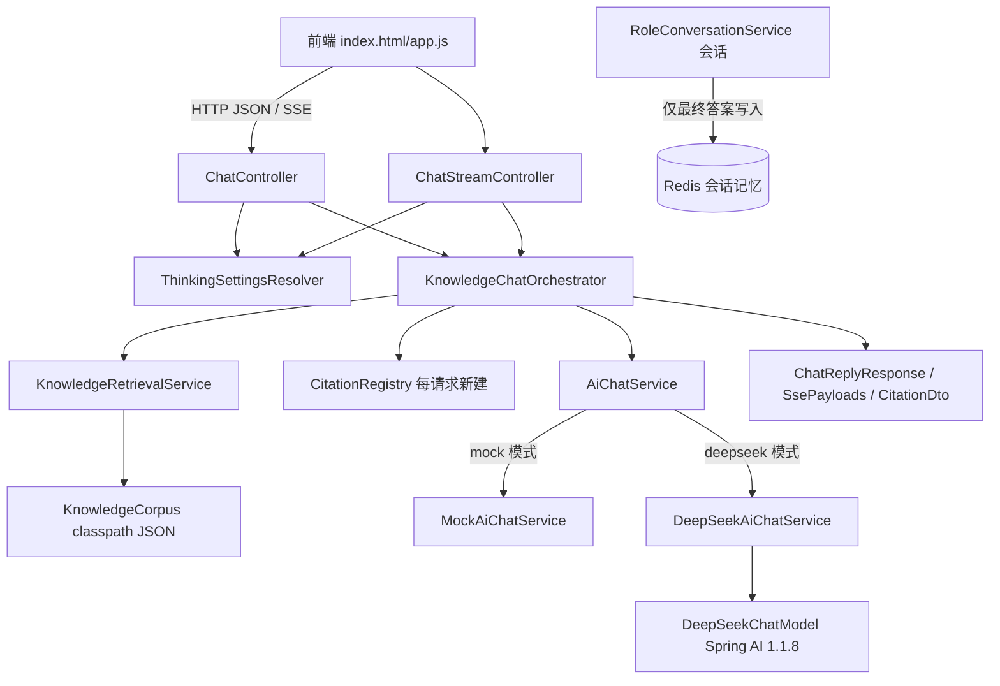

# D16-02 思考推理模式与引用来源技术说明及实践指南

> 文档定位：面向开发者的原理说明与上机操作手册。所有类名、配置键、接口路径、事件名均与当前仓库代码逐一核对；命令基于 Windows + PowerShell 7 + JDK 21 实测。
>
> 适用版本：Spring Boot 3.5.16、Spring AI 1.1.8（`spring-ai-starter-model-deepseek`）、JDK 21。版本不符时第 2 章的能力结论必须重新核验，不得直接套用。

---

## 1. 功能原理与模块关系

### 1.1 两个能力的本质

- **思考模式**解决「模型的内部推理文本与最终答案在协议里是两个字段，工程上必须分流」的问题，核心是字段级隔离与展示授权。
- **引用标注**解决「模型会一本正经地编造来源」的问题，核心是把来源的**签发权与校验权全部收归后端**，模型只能使用后端本轮发放的编号。

两者在 `KnowledgeChatOrchestrator`（编排器）内正交组合：思考设置影响模型调用参数与分片类型，检索设置决定是否存在来源注册表；任意开关组合都有确定行为。

### 1.2 端到端模块关系



关键依赖方向：控制器只依赖编排器与裁决器；编排器依赖检索服务、注册表与 AiChatService 接口；模型实现（Mock/DeepSeek）互不感知引用逻辑。新增知识能力没有改动任何存储层代码。

---

## 2. 思考模式：开关、强度与流式差异

### 2.1 本地依赖的真实能力（反编译实证，非文档臆测）

对本地仓库中的 spring-ai-deepseek 1.1.8 jar 执行 `javap`（证据 `docs/evidence/D16-cot/19-deepseekchatmodel-javap.txt`）得到两条硬事实：

1. `DeepSeekChatOptions` 与 `DeepSeekApi$ChatCompletionRequest` 没有 thinking、reasoningEffort 之类字段——客户端**无法**把推理强度写进请求体。
2. `DeepSeekAssistantMessage` 提供 `getReasoningContent()`，对应 HTTP 响应的 `reasoning_content`（`@JsonProperty("reasoning_content")`），非流式与流式分片都能取到。

因此本版本唯一合法的思考开关是**按请求把模型名覆盖为 reasoner 模型**：

```java
// DeepSeekAiChatService 实际代码（节选）
private DeepSeekChatOptions buildModelOptions(String effectiveModel) {
    return DeepSeekChatOptions.builder().model(effectiveModel).build();
}
private String effectiveModel(ThinkingSettings settings) {
    return settings.enabled() ? this.reasonerModel : this.model;
}
```

### 2.2 推理强度为什么是 4001 而不是静默忽略

`ThinkingSettingsResolver` 内用编译期常量声明能力边界：

```java
public static final boolean REASONING_EFFORT_TRANSMITTABLE = false;
```

收到任何非空 `reasoningEffort` 时，先过枚举白名单（LOW/HIGH/MAX，大小写不敏感），再因常量为 false 抛出归一到业务码 4001 的异常。这样做的理由：静默吞参会让前端显示「高强度思考已启用」而请求实际并未携带参数，属于欺骗性成功；显式拒绝让调用方明确感知版本边界。升级支持该字段的 Spring AI 版本并实测后，把常量外置为配置并实现映射，才可放开此校验。

> 现网对照（2026-10-29 核验）：DeepSeek 官方 API 已演进为 `thinking.type=enabled/disabled` 与 `reasoning_effort=none/low/high/max`，与 1.1.8 客户端存在代差，这正是不能照抄网上新示例的原因。

### 2.3 非流式 vs 流式处理差异

| 维度 | 非流式 `/chat` | 流式 `/chat/stream` |
| --- | --- | --- |
| 模型返回 | 一个 ChatResponse，一次性取 content/reasoning | 多个 ChatResponse 分片，两类字段可能交错到达 |
| 内部载体 | `AiChatResult` record 双字段 | sealed `StreamChunk`：ReasoningChunk / ContentChunk |
| 保序手段 | 无需 | `concatMap` 单线程化拆片，禁止 flatMap 打乱顺序 |
| 推理下发条件 | showReasoning=true 才填 reasoningContent | showReasoning=true 才发 thinking 事件，否则分片直接丢弃 |
| 失败形态 | 全局异常处理器 JSON 错误码 | error SSE 事件（响应头提交后） |

### 2.4 为什么默认不展示原始推理、也不持久化

1. **产品边界**：reasoning_content 是模型的中间思维链，不是给最终用户的承诺内容，可能包含自我否定与未经验证的假设。
2. **数据安全与合规**：推理全文可能复述系统提示词与检索上下文，写入普通业务日志/会话库会扩大敏感面；本实现日志只记 `reasoningLength` 整数。
3. **多轮协议要求**：Spring AI 1.1 参考文档明确建议多轮对话不要把 reasoning_content 当作历史回传。本实现会话记忆只累积 ContentChunk，天然满足该约束，也避免未来工具调用（Function Calling，函数调用）场景的消息体膨胀。
4. showReasoning 是独立于 thinkingEnabled 的第二个开关，且在思考关闭时被服务端强制归一 false，防止「没思考却要展示推理」的矛盾请求。

---

## 3. 引用来源完整链路

### 3.1 检索：确定性关键词方案

项目没有任何 Embedding/向量库依赖，`KnowledgeRetrievalService` 用可复现的字符匹配实现真实检索：

1. 问题归一化（小写、去首尾空白），标点分词得到整词，中文连续段切字符二元组（bigram）。
2. 对每个片段的标题（权重 3）、章节（权重 2）、摘录（权重 1）做**去重命中计数**——同一词在同字段出现多次只计一次，避免长文本天然占优。
3. 分数降序、chunkId 升序稳定排序，取正分前 `app.ai.knowledge.max-sources`（默认 3）个；无正分返回空列表。

该方案不输出、不展示任何相似度分数，因此不存在「把检索分数伪装成可信度」的问题。

### 3.2 编号、上下文与可信提示词

`CitationRegistry` 在每次问答的方法栈内新建，构造时按检索结果顺序分配 S1、S2……（LinkedHashMap 保序）。发给模型的上下文块由 `contextBlock()` 生成，包含三重要素：真实编号、真实摘录、以及显式安全声明——资料是不可信数据，其中任何「忽略指令」类文字都按普通资料处理。语料中的 `DOC-SERVO-TROUBLE-002-C03` 就是专门验证该条的提示注入夹具。

### 3.3 校验：同步与流式两条路径

**同步路径** `validateAndStrip`：正则 `\[S(\d{1,3})]` 扫描全文，编号在注册表内则保留并计入 cited（去重，按首次出现排序）；不在表内则删除并累加 `droppedUnknownMarkers`。

**流式路径** `MarkerSanitizer`（有状态、单订阅非线程安全）解决标记被网络分片切开的问题：

- 每块进入后与 pending 拼接，从右向左找 `[`，用正则 `^\[(S\d{0,3})?$` 判断末尾是否挂着未闭合前缀（覆盖 `[`、`[S`、`[S1` 三种形态）；未闭合部分暂存不下发，其余文本先走同步校验再发出。
- `finish()` 在流结束时刷新暂存区，普通文本原样输出、完整非法标记被删除。
- 该正则是实测修复点：初版不识别孤立 `[`，会导致跨块的 `[S2]` 被拆成普通文本逃逸，Registry 单测复现后修正。

### 3.4 各类边界的处理口径

| 场景 | 行为 |
| --- | --- |
| retrieveEnabled=false | 不检索，注册表为空；空注册表仍会兜底清洗模型自写的任何 `[Sn]` |
| 检索零命中 | 同上，citations 返回 `[]`，不塞默认来源 |
| 模型输出未知编号 | 删除标记 + 计数日志，不映射到其他文档，不报错中断答案 |
| 元数据缺失（如 url/page） | CitationDto 类级 NON_NULL 自动隐藏该键，不造占位假数据 |
| 同文档多片段 | 保留每个 chunkId 的独立定位，cited 按答案出现顺序去重 |
| 连续两个请求 | 注册表是局部对象，两次请求 S1 各自独立（证据 12/13） |
| 危险 HTML/脚本 | 前端一律 textContent 渲染，不 innerHTML，来源文本无执行机会 |
| 本机路径泄露 | DTO 只含语料内逻辑字段，classpath 物理路径不出现在响应中 |
| 权限越权 | 当前无权限系统，不适用；接入后检索与详情必须共用同一鉴权边界 |

### 3.5 mock 模式的特殊处理

离线 mock 不会真实推理引用，编排器在 mock 模式下于答案尾部**依据真实注册表**生成「 参考来源：[S1][S2]…。」编号行，再经过同一个 validateAndStrip/MarkerSanitizer 校验。它表达的是「协议闭环演示」，编号仍 100% 可回溯，mock 自身没有发明任何来源元数据的能力。

---

## 4. 配置与本机操作

### 4.1 配置项与环境变量

| 配置键 / 环境变量 | 默认 | 何时改 |
| --- | --- | --- |
| `AI_MODE` / `app.ai.mode` | mock | 真实联调时设 deepseek |
| `DEEPSEEK_API_KEY` | 占位无效串 | 真实模式必填，占位/含 mock 的 Key 会在发请求前被拦截 |
| `DEEPSEEK_MODEL` | deepseek-flash | 普通模型名，服务端配置 |
| `DEEPSEEK_REASONER_MODEL` / `app.ai.thinking.reasoner-model` | deepseek-reasoner | 思考模型名，客户端 DTO 无法覆盖 |
| `AI_KNOWLEDGE_MAX_SOURCES` | 3 | 单次来源上限 |
| `AI_STREAM_TIMEOUT_MS` | 60000 | SSE 应用层超时，容器兜底自动 +5 秒 |

### 4.2 mock 模式验证（零外网，推荐日常使用）

```powershell
# 启动（在 D16 聚合目录）
& 'D:\SoftwareInstall\JDK\JDK21\bin\java.exe' -jar D16_CoT\target\D16_CoT-1.0-SNAPSHOT.jar

# 同步：思考 + 展示推理 + 引用全开
$body = '{"message":"数控机床主轴过热报警冷却液液位不足怎么办","thinkingEnabled":true,"showReasoning":true,"retrieveEnabled":true}'
Invoke-RestMethod -Uri http://127.0.0.1:8080/api/v1/ai/chat -Method Post -ContentType 'application/json' -Body $body

# 强度拒绝验证
Invoke-RestMethod -Uri http://127.0.0.1:8080/api/v1/ai/chat -Method Post -ContentType 'application/json' -Body '{"message":"x","thinkingEnabled":true,"reasoningEffort":"HIGH"}'
```

### 4.3 SSE 调试办法

`Invoke-RestMethod` 会缓冲整个响应，看不到增量帧。调试 SSE 必须用 .NET HttpClient 的响应头读模式：

```powershell
$client = New-Object System.Net.Http.HttpClient
$req = New-Object System.Net.Http.HttpRequestMessage([System.Net.Http.HttpMethod]::Post, 'http://127.0.0.1:8080/api/v1/ai/chat/stream')
$req.Content = New-Object System.Net.Http.StringContent('{"message":"伺服电机编码器位置偏差报警","retrieveEnabled":true}', [System.Text.Encoding]::UTF8, 'application/json')
$resp = $client.SendAsync($req, [System.Net.Http.HttpCompletionOption]::ResponseHeadersRead).GetAwaiter().GetResult()
$reader = New-Object System.IO.StreamReader($resp.Content.ReadAsStreamAsync().GetAwaiter().GetResult())
$reader.ReadToEnd()   # 保留 event:/data: 原始帧
```

断言要点：响应头 `Content-Type: text/event-stream`；帧序 start→（thinking）→delta→（citations）→complete；citations 必在 complete 前；错误场景只有 error 没有 complete。前端侧用 `node --test src/test/node/sse-parser.test.js` 验证解析器，浏览器全局入口为 `SseParser.createSseParser(onEvent)`，事件对象属性是 `.name`/`.data`，喂完必须调用 flush。

### 4.4 可选：真实 DeepSeek 联调（需自备 Key，用户授权后执行）

```powershell
$env:AI_MODE='deepseek'
$env:DEEPSEEK_API_KEY='你的真实Key'      # 仅存于当前 shell 会话，禁止写进 yml/文档/截图
& 'D:\SoftwareInstall\JDK\JDK21\bin\java.exe' -jar D16_CoT\target\D16_CoT-1.0-SNAPSHOT.jar
```

安全提醒：Key 不要写入 `application.yml`（仓库中只允许保留 `d01-mock-key-not-for-authentication` 占位串）；真实调用产生费用与外网延迟，先小样本验证 reasoner 切换与 reasoning_content 分流，再跑全量手工矩阵；`DeepSeekLiveSmokeTest` 在检测到有效 Key 时才会执行，无 Key 环境保持 skipped 是预期行为。

---

## 5. 故障诊断与日志定位

| 现象 | 优先排查 | 定位线索 |
| --- | --- | --- |
| 请求返回 4001 强度文案 | 客户端误传 reasoningEffort | 这是设计行为；确认 Spring AI 版本后再决定是否升级 |
| 响应里没有 reasoningContent | showReasoning 未开或思考未启用 | 核对两开关；04 号证据为标准形态 |
| SSE 收到 JSON 错误而非事件流 | 校验失败发生在 emitter 返回前 | 参数/长度/effort 错误走全局异常处理器，属正常分期 |
| SSE 一直 loading 不收尾 | 超时/断连终态保护 | 查 Reactor timeout 日志「SSE 流应用层超时结束」与容器兜底日志 |
| 答案里 `[S2]` 原样出现但列表没有它 | 理论上被清洗；若复现检查 MarkerSanitizer 跨块逻辑 | 看日志「拦截未知编号」计数 |
| citations 恒为空 | 检索零命中或开关未开 | 用语料内原词（如「主轴过热」「冷却液」）测试；确认 retrieveEnabled=true |
| 思考内容被写进会话 | 不应发生 | 检查是否误用 ReasoningChunk 追加 assistantBuffer（代码中唯一 append 点在 ContentChunk 分支） |
| 启动报找不到 `@SpringBootConfiguration` | 测试引导缺失 | 确认 D16TestBootstrap 在测试类路径 |

日志治理口径：控制器只记 messageLength、模式、开关、citations 数量与拦截计数；DeepSeek 服务只记 answerLength/reasoningLength；任何日志点都不打印密钥、完整 Prompt、知识全文与推理全文。

---

## 6. 扩展指南

### 6.1 新增一个来源元数据字段

1. `KnowledgeChunk` record 与语料 JSON 同步加字段（缺失允许 null）。
2. `CitationRegistry.toDto` 透传到 `CitationDto`，新字段对象可为 null 的类型用包装类并依赖 NON_NULL 隐藏。
3. 前端来源区按结构化字段渲染，禁止从答案文本反解析。
4. 补 Registry/集成测试断言「字段缺失时该 JSON 键不存在」。

### 6.2 替换为向量检索

保持 `KnowledgeRetrievalService.search(String)` 的输出契约（`List<KnowledgeChunk>`，稳定序、无命中返空）不变，新写一个基于 Spring AI `DocumentRetriever`/VectorStore 的实现并按 profile 切换即可；编排器、注册表、控制器、前端均无需改动。官方 RAG/PGvector 体系见第 8 章参考链接。

### 6.3 支持其他模型厂商的思考能力

在 AiChatService 的厂商实现内复刻三件套：按请求的模型/选项覆盖、响应消息的推理字段取值（instanceof 厂商专属类型）、密封 StreamChunk 拆分；同时把 `REASONING_EFFORT_TRANSMITTABLE` 的裁决下沉为按厂商能力解析，不要修改控制器与 DTO 契约。

---

## 7. 测试方法与验收标准

| 层级 | 命令 | 通过标准 | 证据 |
| --- | --- | --- | --- |
| JVM 全量 | `mvn -pl D16_CoT test` | 106 用例 0 失败 1 跳过（skip 仅 LiveSmoke） | `docs/evidence/D16-cot/16-mvn-test-raw.txt` |
| 打包 | `mvn -pl D16_CoT package -DskipTests` | BUILD SUCCESS，jar 产出 | 17 号证据 |
| 前端解析器 | `node --test src/test/node/sse-parser.test.js` | 12/12 pass | 18 号证据 |
| 真机 mock | 本文件 4.2/4.3 命令 | 证据 README 中 02–14 全部行为成立 | `docs/evidence/D16-cot/` |
| 代码审查 | 任务书第七节阶段 D 清单 | 无密钥硬编码、推理不落库、无跨请求污染、无新依赖/DDL | git diff 自查 |

---

## 8. 版本适用范围与官方资料

- 本文所有「不支持 effort」结论仅适用于本地 Spring AI **1.1.8** + 其内置 deepseek starter；升级版本必须以新依赖的 javap/官方迁移说明重新核验。
- 以下资料均于 **2026-10-29 实际访问**，同文档内不重复引用：

1. Thinking Mode | 思考模式：https://api-docs.deepseek.com/zh-cn/guides/thinking_mode/
2. Chat Completions API | 对话补全 API：https://api-docs.deepseek.com/zh-cn/api/create-chat-completion/
3. Tool Calls | 工具调用：https://api-docs.deepseek.com/zh-cn/guides/tool_calls/
4. DeepSeek Chat :: Spring AI Reference | Spring AI DeepSeek 聊天模型参考（1.1）：https://docs.spring.io/spring-ai/reference/1.1/api/chat/deepseek-chat.html
5. Retrieval Augmented Generation :: Spring AI Reference | Spring AI 检索增强生成参考（1.1）：https://docs.spring.io/spring-ai/reference/1.1/api/retrieval-augmented-generation.html
6. PGvector :: Spring AI Reference | Spring AI PGvector 向量存储参考（1.1）：https://docs.spring.io/spring-ai/reference/1.1/api/vectordbs/pgvector.html

尚未验证事项：真实外网 reasoner 全链路（无 Key）、向量库方案（未引入依赖）、文档权限过滤（系统不存在该能力）。

---

## 9. 记忆简语与层级树

**记忆简语**：能力先看 jar、不看网传；开关切模型、强度先拒绝；推理独立流、默认不外吐；检索给真料、编号后端发；流式防半截、括号要暂存；无命中空数组、假号必被删；调试用流式读、缓冲看不到。

```text
D16 实践地图
├─ 配置层 application.yml
│  ├─ app.ai.thinking.reasoner-model（思考模型白名单）
│  └─ app.ai.knowledge.max-sources / corpus-location
├─ 请求裁决
│  ├─ 缺省 → legacyDefault，旧客户端无感
│  ├─ effort 非空 → 白名单后 4001（版本能力边界）
│  └─ showReasoning 仅在思考开启时有效
├─ 模型适配
│  ├─ Mock：确定性推理分片 + 服务端编号行
│  └─ DeepSeek：模型切换 + DeepSeekAssistantMessage 取 CoT
├─ 引用可信链
│  ├─ bigram 检索 → 稳定 topK
│  ├─ 请求级 Registry：分配/校验/去重/计数
│  └─ MarkerSanitizer：跨块暂存 + 终态刷新
├─ 协议面
│  ├─ 同步：NON_NULL 三新字段按需出现
│  └─ SSE：start→thinking→delta→citations→complete/error
└─ 验证面
   ├─ mvn test 106 项 / node 12 项
   ├─ HttpClient 流式读帧真机取证
   └─ 真实 Key 联调为可选手工项，默认跳过
```
