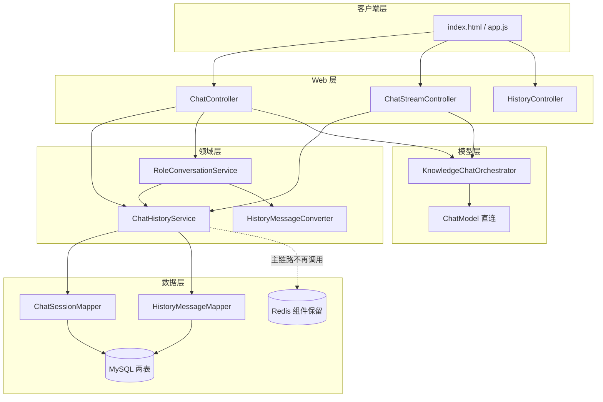
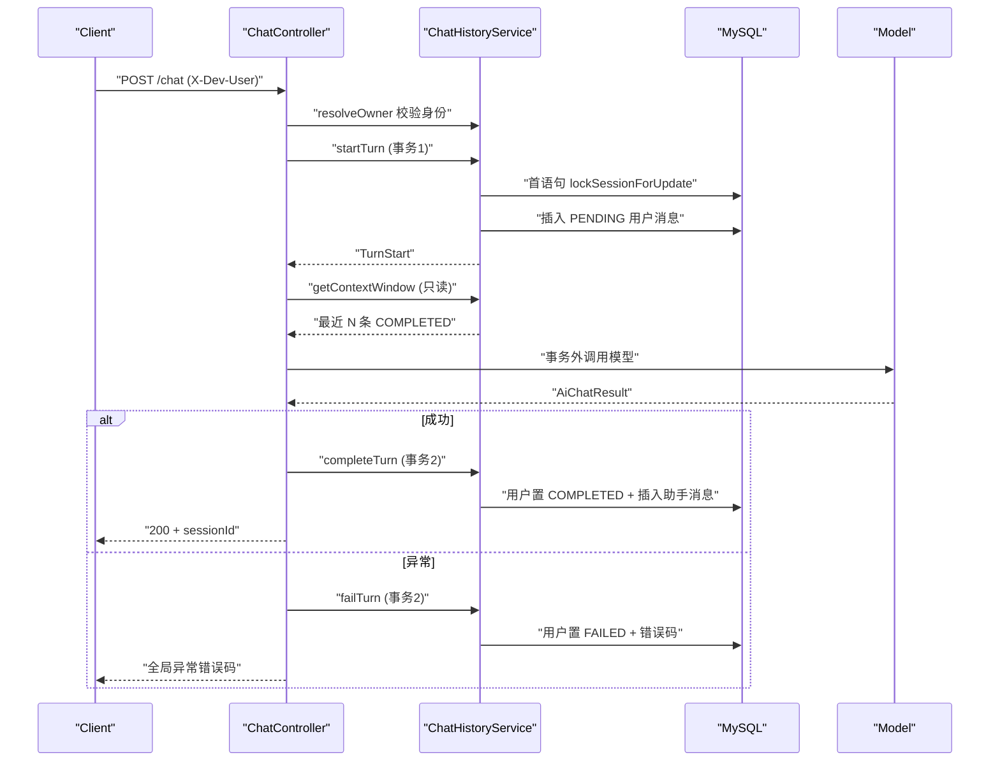
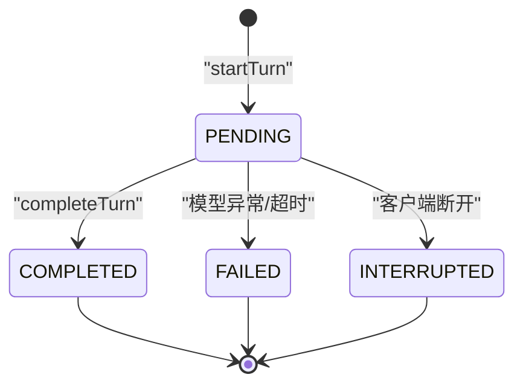

# D17 对话历史存储与多轮对话上下文关联 · 技术原理与实践指南

> 文档定位：讲清 D17 的技术原理、关键代码、配置操作与排障路径，面向开发者上手与二次迭代。
> 配套文档：《D17-对话历史存储与多轮对话上下文关联-项目迭代全量记录.md》（记录过程与证据）。
> 适用版本：Spring Boot 3.5.16、Spring AI 1.1.8、JDK 21、MyBatis-Plus 3.5.17、MySQL 9.x / 8.x。

---

## 1. 功能原理与模块关系

### 1.1 四个核心概念的精确边界

| 概念 | 英文 / 全称 | 本质 | D17 载体 |
|---|---|---|---|
| Chat History | 对话历史 | 完整、可持久化、可审计的消息全集 | 表 `chat_message` |
| Chat Memory | 对话记忆 | 仅为本次模型调用选取的有限上下文 | 应用层窗口，内存态临时组装 |
| Conversation | 会话 | 聚合一组消息、带归属与状态的业务实体 | 表 `chat_session` |
| Message | 消息 | 单条 user/assistant 内容及其状态 | 表 `chat_message` 一行 |

关键认知：**History 是「账本」，Memory 是「本次要念给模型的摘要」**。D17 把二者物理分离——全量写账本，每次调用前从账本现取窗口，避免「只存最近 N 条」导致的历史丢失。

### 1.2 端到端模块关系



---

## 2. Spring AI 1.1.x 实际使用的 API 与调用链

### 2.1 真实依赖事实（javap 反编译实证，非文档臆测）

- 模块清单（14 个）中**不存在 jdbc-memory 构件**，无法直接用官方 JDBC 记忆。
- 模型调用链全程为 `ChatModel` 直连，工程内没有 ChatClient Bean。
- 已核验 `ChatMemory`、`MessageWindowChatMemory`、`MessageChatMemoryAdvisor` 的方法签名（证据 temp_docs/D17/D17-javap-*.txt）。

### 2.2 为什么不选 ChatMemory / Advisor

| 方案 | 阻断点 |
|---|---|
| MessageChatMemoryAdvisor | 其 after 回调自动写记忆，与业务手动落库形成双写；Advisor 无法表达 PENDING/COMPLETED/FAILED/INTERRUPTED 四态 |
| InMemory 实现 | 重启即失，违背持久化目标 |
| 改造为 ChatClient | 需重写全部既有调用链，违反最小增量 |

结论：**业务层手动持久化**，写入路径唯一、状态机完整、零新依赖。

### 2.3 内部调用入参：ChatInvocation

模型层不直接吃持久化对象，而是通过内部记录类：

```java
// 第三参是历史轮次列表；record Turn(role, content)
ChatInvocation invocation = new ChatInvocation(
        null,                                  // 普通链路无 system 提示词
        message,                               // 当前用户输入
        HistoryMessageConverter.toTurns(       // 窗口历史转换
                historyService.getContextWindow(turn.session().getSessionId())));
```

转换器规则（`HistoryMessageConverter`）：user/assistant 角色原样映射，保持序号正序；进入转换的消息均为 COMPLETED。

---

## 3. 持久化数据模型、字段、索引与关系

### 3.1 表关系

- 一对多：一个 `chat_session` 对应多条 `chat_message`，通过 `session_id` 业务键关联（不建物理外键，与项目既有规范一致，降低批量写入与删表耦合）。
- `chat_message.owner_id` 冗余存储，便于归属校验与按归属清理。

### 3.2 字段要点

| 表 | 关键列 | 设计意图 |
|---|---|---|
| chat_session | session_id（UUID 去横线，唯一）、owner_id（默认 dev-user）、scene、title、template_id/version、status、created/updated/last_message_at | 标题取首条用户消息并安全截断（默认 50 字符） |
| chat_message | sequence_no（会话内从 1 单调递增）、role、content（TEXT）、status、model_name、error_code、error_message、两个时间戳 | 错误信息只存类型与摘要，不含堆栈与密钥 |

### 3.3 索引与约束

```text
chat_session:  PRIMARY KEY(id)
               UNIQUE KEY uk_session_id(session_id)
               KEY idx_owner_status(owner_id, status, last_message_at)
chat_message:  PRIMARY KEY(id)
               UNIQUE KEY uk_session_sequence(session_id, sequence_no)
               KEY idx_session_status(session_id, status, sequence_no)
```

`uk_session_sequence` 是序号正确性的最后兜底：即使上层取号有缺陷，数据库也会拒绝重复序号而不是静默产生重复行。

---

## 4. 一轮请求的完整时序

### 4.1 同步链路时序（含事务边界）



要点：**模型 HTTP 调用落在两个短事务之间**，数据库连接与行锁不会在等待外部响应期间被长时间占用。

### 4.2 消息状态机



只有 COMPLETED 进入上下文窗口；FAILED/INTERRUPTED 保留现场用于排查，但不污染下一轮。

---

## 5. 多轮上下文读取、顺序与窗口策略

### 5.1 窗口选取算法（`getContextWindow`）

```java
// 1. 取最近 N 条 COMPLETED，倒序取再反转为正序
List<HistoryMessagePO> rows = messageMapper.selectList(
        new LambdaQueryWrapper<HistoryMessagePO>()
                .eq(HistoryMessagePO::getSessionId, sessionId)
                .eq(HistoryMessagePO::getStatus, "COMPLETED")
                .orderByDesc(HistoryMessagePO::getSequenceNo)
                .last("LIMIT " + limit));
// 2. 若首条为孤立 assistant，向前补一条 user 保轮次完整
if (ROLE_ASSISTANT.equals(window.get(0).getRole())) { /* 前补 user */ }
```

### 5.2 为什么按消息条数而非 Token

- 工程内没有 Token 计数能力，强行声称「Token 预算」属于虚假能力；按条数控制可预测、可配置、可验证。
- 默认 10 条 ≈ 5 个问答轮次；环境变量 `AI_CONTEXT_WINDOW_MESSAGES` 可调整。
- 代价：不感知单条消息长度，超长文本场景需后续接入 Tokenizer 扩展（见第 9 节）。

### 5.3 组装顺序（禁止当前问题重复）

```text
SystemMessage（角色模板实时渲染，普通链路为空）
  → 窗口历史（user/assistant 交替，序号正序）
  → 当前 UserMessage（仅一次）
```

---

## 6. 会话隔离、权限、并发、幂等与失败恢复

### 6.1 归属隔离与开发身份

```java
// 白名单：字母数字、下划线、连字符，长度 ≤64
if (value.length() > 64 || !value.matches("[A-Za-z0-9_-]+")) {
    throw new IllegalArgumentException("开发身份标识非法...");
}
```

- 查询接口先 `requireOwnedSession` 校验归属；不存在与无权访问返回**同一错误**（4001「会话不存在或无权访问」），不泄露资源是否存在，防范 IDOR（Insecure Direct Object Reference，不安全的直接对象引用）。
- 该身份是开发隔离手段，**不是生产鉴权**。

### 6.2 并发串行化：父行 X 锁（核心难点）

**问题演进（真实失败留痕）：**

1. 消息表 `SELECT MAX ... FOR UPDATE`：在 `uk_session_sequence` 索引上产生间隙锁，与并发插入的插入意向锁互斥，InnoDB 报 1213 死锁。
2. 改为父表 `chat_session` 记录锁后，死锁消失却出现序号重复键。
3. 根因定位：REPEATABLE READ 隔离级别下，事务内**第一条普通 SELECT 会建立一致性读视图（Read View）**；原代码先普通查会话、再 `FOR UPDATE`，锁等待结束后同事务的普通 MAX 仍基于锁前旧视图，读不到并发已提交的新序号。

**最终方案（锁先于任何读）：**

```java
if (openingExisting) {
    // 已有会话：锁必须是事务首语句，先于一致性读
    sessionMapper.lockSessionForUpdate(requestedSessionId);
}
// ... 新会话先 insert 父行再锁（INSERT 不建立读视图）
```

对应 SQL 只锁已存在的唯一记录，不产生间隙锁：

```sql
SELECT id FROM chat_session WHERE session_id = ? FOR UPDATE;
```

验证证据：裸 JDBC LockProbe（T2 阻塞 3003ms）、SpringLockDiagnosticTest（编程式 5002ms / 声明式 5026ms）、修复后并发测试 10.39s 通过。

### 6.3 幂等口径

- 无客户端幂等键：相同内容重复请求按新消息处理（符合聊天语义，文档明示）。
- 同事务内重试受 `uk_session_sequence` 保护，不会产生重复行。
- 流式终态用 `AtomicBoolean persisted` + `compareAndSet` 保证 Reactor 回调与容器回调只落库一次。

### 6.4 失败恢复

- 同步失败：用户消息 FAILED + 错误码（异常类名），不伪造助手成功消息。
- 流式中断：有部分正文保留 INTERRUPTED 助手消息，无正文按 FAILED。
- 重启恢复：状态落库后，重启可识别未完成消息；完整历史不受影响。

---

## 7. 关键类、方法与配置解释

### 7.1 配置类 HistoryProperties

| 属性 | 默认 | 含义 |
|---|---|---|
| contextWindowMessages | 10 | 窗口消息条数 |
| defaultPageSize | 20 | 查询默认分页（硬上限 100） |
| devUserHeader | X-Dev-User | 身份请求头名 |
| defaultOwner | dev-user | 无身份头时的默认归属 |
| titleMaxLength | 50 | 会话标题截断长度 |

### 7.2 MybatisPlusConfig

注册 `MybatisPlusInterceptor` 并加入 `PaginationInnerInterceptor(DbType.MYSQL)`，分页查询才能正确生成 COUNT 与 LIMIT。

### 7.3 主键回写（易踩坑）

MyBatis-Plus 的 insert 默认不会把数据库自增 id 自动反映到手动 new 的领域对象，必须显式回写：

```java
messageMapper.insert(userPO);
user.setId(userPO.getId());   // 否则后续 updateById 因 id=null 影响 0 行
```

---

## 8. 本机操作与排障

### 8.1 环境准备与启动

```powershell
# 1. 全量测试（模块目录）
mvn test
# 2. 打包
mvn package -DskipTests
# 3. 启动（默认 mock，零外网）
java -jar target\D17_DHSA_MTDCA-1.0-SNAPSHOT.jar
```

### 8.2 接口调用示例（PowerShell，无 curl 环境）

```powershell
$base = 'http://127.0.0.1:8080/api/v1/ai'
# 首轮（新建会话）
$r1 = Invoke-RestMethod "$base/chat" -Method Post -ContentType 'application/json' `
      -Headers @{ 'X-Dev-User' = 'ut_smoke' } `
      -Body (@{ message = '第一轮问题' } | ConvertTo-Json)
# 后续轮次（带上 sessionId）
Invoke-RestMethod "$base/chat" -Method Post -ContentType 'application/json' `
      -Headers @{ 'X-Dev-User' = 'ut_smoke' } `
      -Body (@{ message = '第二轮问题'; sessionId = $r1.data.sessionId } | ConvertTo-Json)
# 历史查询
Invoke-RestMethod "$base/sessions/$($r1.data.sessionId)/messages" `
      -Headers @{ 'X-Dev-User' = 'ut_smoke' }
```

### 8.3 常见故障与排查路径

| 现象 | 可能原因 | 排查 / 处理 |
|---|---|---|
| 启动报连接失败 | MySQL/Redis 未启动 | 确认 3306、6379 监听；核对 `MYSQL_PASSWORD` |
| updateById 不生效、无异常 | 自增主键未回写 | insert 后 `setId(po.getId())` |
| 并发序号重复键 | 锁不是事务首语句，旧读视图 | 把 `lockSessionForUpdate` 提前到任何 SELECT 之前 |
| 1213 死锁 | 消息表间隙锁 | 改用父行记录锁，去掉消息表 FOR UPDATE |
| AOP 访问日志缺失 | 切点包名仍是旧包 | 检查 `ControllerAccessLogAspect` 切点为 com.zl.d17 |
| 测试 profile 不生效 | 循环导入配置 | 用 application-test.yml + surefire systemPropertyVariables |
| 看不到 SQL 日志 | 系统属性方式无效 | 临时开 general_log（TABLE），用完即关 |

### 8.4 测试方法（按场景区分）

| 类型 | 测试类 | 验证点 |
|---|---|---|
| 正常 | HistoryPersistenceTest、MockChatControllerTest | 落库、序号、回复 |
| 边界 | ContextWindowTest | 窗口裁剪、孤立 assistant 补 user |
| 失败 | HistoryFailureTest、ChatStreamErrorEventTest | FAILED 状态与错误码 |
| 并发 | HistoryConcurrencyTest、SpringLockDiagnosticTest | 父行锁串行化、阻塞时长 |
| 隔离 | SessionIsolationTest、HistoryControllerWebTest | 跨归属拒绝、分页字段 |
| 真实链路 | DeepSeekLiveSmokeTest | 无 Key 自动 skip，有 Key 才执行 |

---

## 9. 已知限制与可扩展方向

### 9.1 已知限制

1. 无 Token 级预算，仅按消息条数控制窗口。
2. 无真实鉴权，开发身份不可用于生产。
3. 未做软删除/归档与历史保留策略。
4. 单实例视角的 Redis 组件虽保留，主链路已不依赖，多实例部署以 MySQL 共享存储为准。

### 9.2 扩展指南

| 方向 | 做法要点 |
|---|---|
| Token 预算窗口 | 引入 Tokenizer 对窗口累计 Token 计数，超限再裁剪，保留补 user 逻辑 |
| 生产鉴权 | 接入 Spring Security，用真实用户主体替换 X-Dev-User，保留归属校验切面 |
| 向量检索记忆 | 消息写入时同步生成 Embedding（嵌入向量），历史检索从关键词扩展为语义召回 |
| 软删除/归档 | 增加 deleted 字段与归档表，查询默认过滤，替代物理 DROP 回滚 |
| 接入 ChatClient | 待全链路统一升级时再迁移，并用单一路径写入避免双写 |

---

## 10. 记忆简语与层级树

### 10.1 记忆简语

- **History 是账本，Memory 是现取的摘要；两职责分离，历史不丢。**
- **锁在首句、读在其后；可重复读下，先读就锁死旧视图。**
- **父行记录锁无间隙，消息表别加 FOR UPDATE。**
- **成功才进窗，失败只留痕；当前问题只进一次。**

### 10.2 竖屏层级树

```text
D17 技术原理
├─ 边界
│  ├─ History（chat_message 全量）
│  ├─ Memory（窗口实时选取）
│  └─ Conversation（chat_session 聚合）
├─ 调用链
│  ├─ ChatModel 直连（无 ChatClient）
│  ├─ ChatInvocation(system, current, turns)
│  └─ HistoryMessageConverter 角色映射
├─ 模型
│  ├─ 两表一对多（业务键关联）
│  ├─ uk_session_sequence 兜底
│  └─ 错误信息脱敏截断
├─ 时序
│  ├─ 事务1 startTurn（PENDING）
│  ├─ 事务外模型调用
│  └─ 事务2 complete/fail/interrupt
├─ 窗口
│  ├─ 最近 N 条 COMPLETED 正序
│  ├─ 孤立 assistant 前补 user
│  └─ 条数控制（非 Token）
├─ 并发
│  ├─ 父行 X 锁（无间隙锁）
│  ├─ 锁为事务首语句
│  └─ 旧读视图是重复键根因
└─ 扩展
   ├─ Tokenizer 预算
   ├─ 真实鉴权
   └─ Embedding 语义记忆
```
