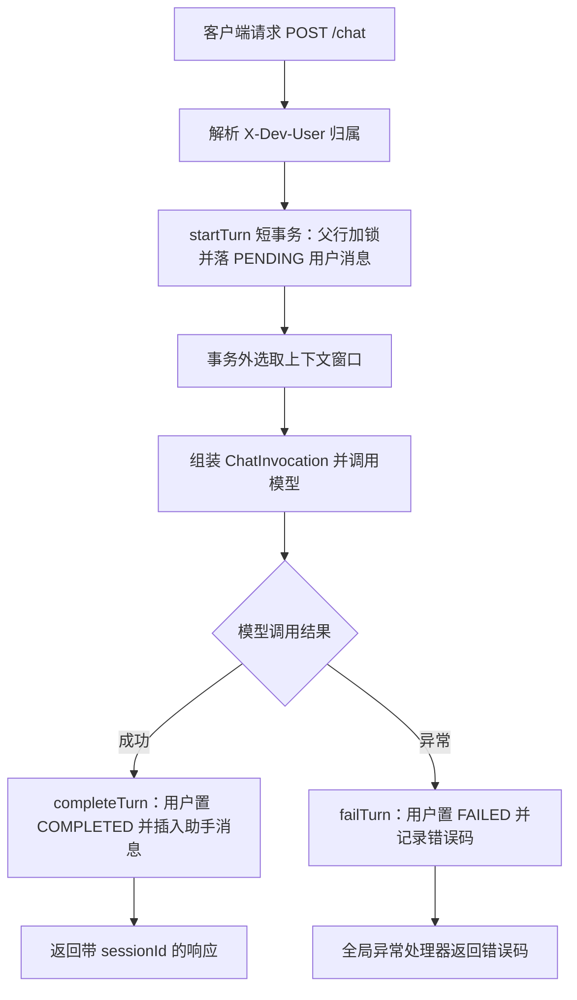

# D17 对话历史存储与多轮对话上下文关联 · 项目迭代全量记录

> 文档定位：记录 D17 迭代从需求、分析、设计、实现到测试、验证、交付的完整过程与证据，面向项目归档与复盘。
> 配套文档：《D17-对话历史存储与多轮对话上下文关联-技术原理与实践指南.md》（讲原理与操作，本文不重复其代码级讲解）。
> 迭代基线：聚合根 `E:\AI\project\AI-Learning-one\M2-Java\D17`；模块 `D17_DHSA_MTDCA`；主包 `com.zl.d17`；主类 `D17SpringAiApplication`；端口 8080。
> 全程未执行 Git commit / push。

---

## 1. 项目及技术基线

### 1.1 工程坐标

| 项 | 值 |
|---|---|
| 聚合 POM | `D17\pom.xml`，groupId `org.ai.m2`，artifactId `D17`，version `1.0-SNAPSHOT` |
| 业务模块 | `D17_DHSA_MTDCA`（DHSA = Dialog History Storage & Association，MTDCA = Multi-Turn Dialog Context Association） |
| 主包 / 主类 | `com.zl.d17` / `D17SpringAiApplication` |
| 服务端口 | 8080 |
| 数据库 | MySQL 9.7.0-commercial，库 `ai_db`，连接 `jdbc:mysql://127.0.0.1:3306/ai_db`，隔离级别 REPEATABLE-READ（可重复读） |
| 缓存 | Redis 6379 |
| 构建工具 | Maven 3.9.16，本地仓库 `D:\SoftwareInstall\Apache\repository` |
| JDK | 21.0.7 |

### 1.2 技术栈版本（以模块 POM 实际解析为准，未升级任何依赖）

| 技术 | 版本 | 说明 |
|---|---|---|
| Spring Boot | 3.5.16 | 父 POM 管理 |
| Spring AI | 1.1.8 | BOM 锁定，禁止升 2.x；模型走 ChatModel 直连 |
| MyBatis-Plus | 3.5.17 | 单表 CRUD + 分页插件 |
| MySQL Connector/J | 8.0.33 | 新坐标 `com.mysql:mysql-connector-j` |
| Apache Velocity | 2.3 | 模板渲染 |
| 其他 | spring-boot-starter-data-redis、validation、aop、lombok | 沿用基线 |

### 1.3 运行模式

- `AI_MODE=mock`（默认）：离线模拟，零外网请求，mock 回显「历史消息条数」等内部参数，是本次验证的主力模式。
- 真实模式：配置 `DEEPSEEK_API_KEY` 后启用；本机无 Key，`DeepSeekLiveSmokeTest` 按设计跳过（skip），不视为失败。
- 占位密钥 `d01-mock-key-not-for-authentication` 仅用于配置校验，不具备任何认证效力。

---

## 2. D16/D16_CoT 现状和复用证据

### 2.1 继承关系（阶段 A 实证）

D17_DHSA_MTDCA 是 D16_CoT 的**纯包名改写副本**，改写内容仅三处：

1. 包名 `com.zl.d16` → `com.zl.d17`；
2. 启动类 `D16SpringAiApplication` → `D17SpringAiApplication`；
3. `application.yml` 中 `spring.application.name` 改为 `D17_SpringAI`。

基线 `mvn clean compile` 退出码 0，证据：`docs\temp_docs\D17\D17-baseline-compile.txt`。

### 2.2 复用的既有能力（不重复造轮子）

| 能力 | 来源 | D17 复用方式 |
|---|---|---|
| 知识库检索与引用 | D16 知识编排器 `KnowledgeChatOrchestrator` | 调用方式不变，仅入参改为带窗口 |
| 思考模式（Thinking Mode） | D16 `ThinkingSettingsResolver` | 原样复用，推理内容仍不持久化 |
| Prompt 模板与 Velocity 渲染 | D15_PLUS `PromptTemplateService` | 角色链路继续使用，方法名 `resolveEnabledRoleTemplate`、`render` |
| TraceId 与访问日志 | D13 `TraceIdFilter`、`ControllerAccessLogAspect` | 复用，仅修正切点包名（见 5.2） |
| Redis 会话记忆 | D15 `ConversationMemory` | 类与 Bean 保留，主链路不再调用（见 7.3） |

### 2.3 基线暴露的两个核心缺口

1. **普通同步链路无历史**：`new ChatInvocation(null, message, List.of())` 第三参固定空列表，每轮都是「失忆」调用。
2. **角色链路历史只存 Redis**：Key 前缀 `d15f:conv:`，TTL 1800 秒、仅保留 20 条 FIFO，既不完整也会随过期/重启丢失，不满足「完整持久化、跨重启查询」。

全工程未使用 ChatMemory / ChatClient / Advisor，模型层为 ChatModel 直连——这是本次选型的关键前提。

---

## 3. 本次需求、范围和非目标

### 3.1 两大核心需求

1. **对话历史完整持久化**：用户与助手消息全量落 MySQL，应用重启后历史仍可查询。
2. **多轮上下文按窗口关联**：同一会话的最近 N 条历史按序进入模型请求；会话、角色、归属三者隔离。

### 3.2 范围边界（明确不做）

| 非目标 | 原因 |
|---|---|
| 不引入 ChatMemory / Advisor / ChatClient 改造 | 1.1.8 字节码核验后确认成本与双写风险，详见第 7 节 |
| 不升级 Spring AI / Spring Boot 任何版本 | 最小增量硬约束 |
| 不引入新中间件、不新增第二套模型链 | 保持架构单一 |
| 不改 Redis 前缀与既有 9 张表结构 | 新增表走独立迁移脚本并提供回滚 |
| 不做 Token（词元）预算控制 | 工程无 Token 计数能力，不虚假声称；窗口按消息条数控制 |
| 不做软删除 / 归档 / 生产级鉴权 | 项目为本地学习环境；开发身份显式标注「非生产鉴权」 |
| 不做 system 消息持久化 | 系统提示词由模板实时渲染，落库的是业务消息（user/assistant） |

---

## 4. 知识覆盖和关键原理

### 4.1 五个核心概念的边界（对应任务书 4.1.1）

| 概念 | 英文全称 / 含义 | D17 落点 |
|---|---|---|
| Chat History | 对话历史：完整、可持久化查询的消息记录，用于展示、审计、恢复 | `chat_message` 表全量保存 |
| Chat Memory | 对话记忆：为本次模型调用选取的有限上下文，不等于完整历史 | 应用层从 History 实时选取窗口，不另建表 |
| Conversation | 会话：组织多条消息的业务实体，含归属、状态、时间 | `chat_session` 表 |
| Conversation ID | 会话标识：定位会话用，本身不是鉴权凭据 | `session_id`，UUID 去横线 |
| Context Window | 上下文窗口：允许进入模型请求的历史范围 | 默认 10 条，`AI_CONTEXT_WINDOW_MESSAGES` 可调 |

核心纪律：**不得把「只存最近 N 条」的内存窗口误当完整历史；History 与 Memory 必须显式分离。**

### 4.2 LLM 无状态性与上下文组装

- 大语言模型（LLM，Large Language Model）本身无状态：每次 HTTP 调用都是独立的，服务端不天然记住上一轮。
- 多轮能力由应用层实现：把历史消息按角色（user/assistant）顺序拼进本次 Prompt，模型才能「接着聊」。
- 组装顺序固定为：SystemMessage（系统提示词，角色模板实时渲染）→ 窗口历史（user/assistant 交替）→ 当前 UserMessage（仅加入一次，禁止重复）。

### 4.3 知识映射表（真实代码位置，阶段扫描后填写）

| 知识点 | 技术原理 | D17 设计约束 | 真实代码位置 | 验证方式 |
|---|---|---|---|---|
| 历史/记忆分离 | 全量存储与有限窗口职责不同 | MySQL 权威存储，窗口实时选取 | `history\ChatHistoryService.java` | HistoryPersistenceTest |
| 会话生命周期 | 父行聚合消息，含归属状态 | 一对多，UUID 标识 | `history\model\ChatSession.java` | SessionIsolationTest |
| 消息状态机 | PENDING→COMPLETED/FAILED/INTERRUPTED | 失败留痕不伪造成功 | `history\model\MessageStatus.java` | HistoryFailureTest |
| 上下文窗口 | 最近 N 条 COMPLETED，正序 | 默认 10，孤立 assistant 前补 user | `ChatHistoryService.getContextWindow` | ContextWindowTest |
| 并发串行化 | 父行 X 锁，锁先于读视图 | 事务首语句加锁 | `history\mapper\ChatSessionMapper.java` | HistoryConcurrencyTest |
| 归属隔离 | 显式开发身份，白名单校验 | 非生产鉴权 | `ChatHistoryService.resolveOwner` | HistoryControllerWebTest |
| 流式终态 | 仅终态落库，单次写入 | AtomicBoolean 防重复 | `controller\ChatStreamController.java` | ChatStreamIntegrationTest |

---

## 5. 现状调查报告

### 5.1 扫描范围与顺序

严格按任务书要求：D17 根目录 → 根 POM → 模块目录树/POM/源码/资源/测试 → D16 真实实现 → 配置/Git/README。阶段 A 原始清单落盘于 `docs\temp_docs\`（D17-file-tree.txt、D17-services.txt 等）。

### 5.2 扫描中发现并修复的骨架缺陷（必要修复，非功能新增）

| # | 缺陷 | 证据 / 修复 |
|---|---|---|
| 1 | MyBatis-Plus insert 后自增主键未回写领域对象，导致 `id` 恒为 null、后续 `updateById` 影响 0 行且静默失败 | `startTurn`、`openOrCreateSession` 两处 insert 后 `setId(po.getId())` |
| 2 | `ControllerAccessLogAspect` 切点写死 `com.zl.d16.controller`，D17 集成链路 AOP 不织入 | 改为 `com.zl.d17.controller` 并同步 Javadoc；修复后主代码 grep 无 d16/d15 残留 |
| 3 | 测试配置首版用 `application.yml` + `spring.config.import` 自引用导致循环导入失败 | 改为 `application-test.yml` + 模块 POM surefire `systemPropertyVariables` 指定 profile，勿回退 |

### 5.3 依赖核验结论

- Spring AI 1.1.8 共 14 个模块，**无 jdbc-memory 构件**（证据 D17-ai-all-modules.txt）。
- 经 `javap` 反编译核验（D17-javap-memory.txt、D17-javap-advisor.txt）确认 ChatMemory、Advisor 的真实方法签名，选型结论见第 7 节。

---

## 6. 需求、API、数据结构和业务流程设计

### 6.1 接口契约（统一 `Result` 包装，码：200/4001/5000/5001/5002）

| 方法 | 路径 | 说明 |
|---|---|---|
| POST | `/api/v1/ai/chat` | 同步对话，普通/角色统一落库 |
| POST | `/api/v1/ai/chat/stream` | SSE 流式对话 |
| GET | `/api/v1/ai/health` | 健康检查，返回应用标识与窗口配置 |
| GET | `/api/v1/ai/sessions` | 当前归属会话分页（字段 records/total/page/size） |
| GET | `/api/v1/ai/sessions/{sessionId}/messages` | 指定会话消息分页，先校验归属 |

响应增量：`ChatReplyResponse` 新增 `sessionId`（`@JsonInclude(NON_NULL)`，旧客户端向后兼容）；SSE start 事件普通链路也回传 sessionId（前端 app.js 依赖）。

### 6.2 数据模型（两张新表，既有表不动）

- `chat_session`（11 列）：代理主键 id、业务 session_id（唯一）、owner_id（默认 dev-user）、scene、title、template_id、template_version、status（ACTIVE/CLOSED）、三个时间戳。
- `chat_message`（12 列）：id、session_id、owner_id（冗余便于隔离）、sequence_no、role、content（TEXT）、status、model_name、error_code、error_message、两个时间戳。
- 约束：`uk_session_id`、`uk_session_sequence(session_id, sequence_no)`、`idx_owner_status`、`idx_session_status`。

### 6.3 同步一轮的业务流程



### 6.4 流式持久化规则

- 流开始前 PENDING 用户消息落库；流过程中助手内容仅内存累积，**不逐 chunk 写库**。
- 正常 complete：全文一次性 COMPLETED 落库；应用层异常/超时：FAILED；客户端断开且有部分正文：INTERRUPTED 保留部分内容，无正文按 FAILED。
- 独立 `persisted`（AtomicBoolean）保证终态只落库一次，防止 Reactor 回调与容器 onError/onTimeout 重复写入。

---

## 7. 关键技术选型及备选方案

### 7.1 决策：业务层手动持久化，不引入 ChatMemory/Advisor

| 候选 | 核验结论 | 取舍 |
|---|---|---|
| ChatModel 直连改 ChatClient | 需重写全部调用链，改动面大，偏离最小增量 | 不采用 |
| MessageChatMemoryAdvisor | Advisor 的 after() 自动写入记忆，与业务落库**双写**；且无法表达 PENDING/FAILED/INTERRUPTED 状态机 | 不采用 |
| InMemory ChatMemory | 内存态，重启即失，不满足持久化 | 不采用 |
| JDBC 记忆构件 | 1.1.8 依赖中不存在该构件 | 不可用 |
| **业务层手动持久化** | 写入路径唯一、状态机可控、无新依赖、无双写 | **采用** |

### 7.2 上下文窗口策略

- 按消息条数（非 Token）：默认 10 条（约 5 个问答轮次），`AI_CONTEXT_WINDOW_MESSAGES` 覆盖。
- 取数：`status='COMPLETED'` 按 sequence_no DESC LIMIT N，再反转为正序。
- 轮次完整性：窗口首条若为孤立 assistant，向前补一条 user，避免截断破坏问答配对。
- 非成功状态消息一律不进窗口，避免失败/中断内容污染下一轮。

### 7.3 Redis 的定位

- `ConversationMemory`（Redis，`d15f:conv:`）类与 Bean **保留不删**，但主链路不再调用，权威存储统一 MySQL。
- 模板缓存前缀 `d15f:prompt:tpl:` 保持不变。
- 事务边界：模型 HTTP 调用在事务外；startTurn/completeTurn/failTurn/interruptTurn 各为独立短事务，不持数据库连接等待外部响应。

### 7.4 开发身份（无认证项目的显式标注）

- 请求头 `X-Dev-User`，缺省 `dev-user`；白名单正则 `[A-Za-z0-9_-]+`、长度 ≤64，非法即 4001。
- 文档与健康检查均显式标注「开发身份，非生产鉴权」，不伪装成安全机制。

---

## 8. 修改文件清单和实现说明

### 8.1 新增主源码（`history` 包 + 转换器 + DDL）

| 文件 | 职责 |
|---|---|
| `resources\db\schema-chat-history.sql` | 两表 IF NOT EXISTS 迁移脚本，已真实执行 |
| `history\config\HistoryProperties.java` | 窗口/分页/请求头/默认归属/标题长度配置 |
| `history\config\MybatisPlusConfig.java` | 拦截器 + 分页插件（DbType.MYSQL） |
| `history\model\ChatSession.java`、`HistoryMessage.java` | 领域模型（11/12 字段） |
| `history\model\MessageStatus.java`、`SessionStatus.java` | 状态枚举 |
| `history\po\ChatSessionPO.java`、`HistoryMessagePO.java` | 持久化对象，`@TableId(IdType.AUTO)` |
| `history\mapper\ChatSessionMapper.java` | 含 `lockSessionForUpdate`（FOR UPDATE 记录锁） |
| `history\mapper\HistoryMessageMapper.java` | `selectMaxSequence`（无 FOR UPDATE） |
| `history\ChatHistoryService.java` | 核心服务：轮次/状态机/窗口/分页/隔离 |
| `history\dto\SessionView.java`、`MessageView.java`、`PageView.java` | 对外视图 |
| `history\HistoryController.java` | 两个 GET 查询接口 |
| `conversation\HistoryMessageConverter.java` | 领域消息转 ChatInvocation.Turn |

### 8.2 修改的既有文件

| 文件 | 修改要点 |
|---|---|
| `controller\ChatController.java` | 普通/角色统一落库与窗口；health 改 D17 标识并返回窗口/身份信息 |
| `controller\ChatStreamController.java` | 终态单次落库；FAILED/INTERRUPTED 收口；start 带 sessionId |
| `conversation\RoleConversationService.java` | 精简为模板校验+渲染，会话委托历史服务 |
| `dto\ChatReplyResponse.java` | 增量 sessionId，NON_NULL 向后兼容 |
| `logging\ControllerAccessLogAspect.java` | 切点 d16→d17 |
| `resources\application.yml` | 新增 `app.ai.history` 段与 Redis 定位注释 |
| `static\index.html`、`templates.html`、`js\app.js` | 标题改 D17，health 字段改 contextWindowMessages |

### 8.3 测试代码

- 移植 D16 的 29 个 Java 测试 + 1 个 Node 测试并改包名；引导类 `D17TestBootstrap`。
- 清理基类 `AbstractPersistenceCleanupTest`：先删 chat_message 再删 chat_session（`LEFT(owner_id,3)='ut_'`），保留 ut_ 模板与 Redis 清理。
- 新增 6 个测试类（HistoryPersistenceTest、ContextWindowTest、SessionIsolationTest、HistoryFailureTest、HistoryControllerWebTest 等）+ 1 个并发诊断类 SpringLockDiagnosticTest。
- 测试配置：`application-test.yml`（仅 ut-default 覆盖）+ 模块 POM surefire systemPropertyVariables。

---

## 9. 配置、数据库迁移和 IDEA 操作步骤

### 9.1 新增配置项（均带默认值，旧配置不动）

```yaml
app:
  ai:
    history:
      context-window-messages: ${AI_CONTEXT_WINDOW_MESSAGES:10}
      default-page-size: ${AI_HISTORY_PAGE_SIZE:20}
      dev-user-header: X-Dev-User
      default-owner: dev-user
      title-max-length: 50
```

### 9.2 数据库迁移

- 执行 `schema-chat-history.sql`（可重复执行，IF NOT EXISTS 不覆盖数据），真实执行证据 D17-ddl-exec.txt，迁移后 11 张表、24 列、12 行索引核验通过。
- 回滚：`DROP TABLE IF EXISTS chat_message; DROP TABLE IF EXISTS chat_session;`（两表均为本次新增，不影响既有 9 表）。

### 9.3 IDEA 2024.1 操作步骤

1. `File → Open` 打开 `D17` 聚合目录，等待 Maven 导入（JDK 选 21）。
2. 确认 MySQL 与 Redis 已启动；运行迁移脚本建表。
3. 运行 `D17SpringAiApplication`，控制台出现 8080 端口与 `Started D17SpringAiApplication`。
4. 浏览器访问 `http://127.0.0.1:8080/`，标题应显示「D17 对话历史与多轮上下文关联演示」。
5. 可选：Run Configuration → Environment Variables 设 `AI_CONTEXT_WINDOW_MESSAGES=4` 验证窗口裁剪。

---

## 10. 测试用例、真实执行命令和结果

### 10.1 缺陷收敛时间线（全部真实留痕，失败不隐藏）

| 轮次 | 命令 | 结果 | 暴露问题 |
|---|---|---|---|
| test2 | `mvn test` | 120 用例，17 失败 1 跳过 | 主键回写、AOP 切点、契约断言等 |
| test3 | `mvn test` | 120 用例，2 失败 1 跳过 | InnoDB 1213 死锁 + 索引断言 |
| test4 | `mvn test` | 120 用例，1 失败 1 跳过 | seq3 重复键（读视图根因） |
| **test5** | `mvn test` | **121 用例，0 失败 1 跳过，BUILD SUCCESS** | 全部收敛 |

### 10.2 最终全量结果（D17-full-test5.txt 原文）

```
[INFO] Tests run: 121, Failures: 0, Errors: 0, Skipped: 1
[INFO] BUILD SUCCESS
```

121 = 120 个功能用例 + 1 个并发诊断类；跳过的 1 个为无 Key 的 LiveSmoke（设计行为）。

### 10.3 并发问题的三轮演进（真机定位，详见配套指南与设计记录 4.4）

1. **消息表 `SELECT MAX ... FOR UPDATE` → 1213 死锁**：唯一索引间隙锁与插入意向锁互斥。
2. **改父行 X 锁后 seq3 重复键**：LockProbe（裸 JDBC，T2 阻塞 3003ms）与 SpringLockDiagnosticTest（编程式 5002ms、声明式 5026ms）证明锁本身正常。
3. **根因**：REPEATABLE READ 下，先于 FOR UPDATE 的普通 SELECT 已建立一致性读视图，锁等待结束后普通 MAX 仍读旧视图。
4. **修复**：父行锁提前为写事务首条语句（已有会话先锁后查；新会话先 insert 再锁），未改隔离级别。修复后并发测试 10.39s 通过。

---

## 11. 运行验证、已知问题、风险与回滚说明

### 11.1 真机验证结果（jar 56,438,351 字节，两次启动）

| 验证项 | 真实结果 | 证据 |
|---|---|---|
| 健康检查 | application=D17_DHSA_MTDCA，mode=mock，窗口=10 | D17-真机验证-输出.txt |
| 同会话三轮 | mock 回显历史条数 0→2→4，直接证明窗口送入模型 | 同上 |
| 历史查询 | 6 条 COMPLETED，seq1–6 | 同上 |
| 归属隔离 | ut_smoke_b 跨读返回 4001 | 同上 |
| 非法入参/身份 | 空白消息、非法 X-Dev-User 均 4001 | 同上 |
| 重启持久化 | 重启后 6 条存活，第四轮历史=6，序号连续到 8 | D17-重启持久化验证-输出.txt |
| SSE 流式 | text/event-stream，start 带 sessionId、17 delta、complete totalChars=101 | D17-流式冒烟-输出.txt |
| 静态首页 | 200，title 为 D17 演示 | D17-静态首页-输出.txt |
| DB 层核验 | ut_smoke 2 个 ACTIVE 会话，5 user+5 assistant 全 COMPLETED | D17-db-smoke-verify2.txt |

### 11.2 已知限制

1. 窗口按消息条数而非 Token，超长单条消息可能逼近模型上下文上限，工程未做 Token 级熔断。
2. 开发身份非鉴权，不可直接用于生产；生产需接入真实认证与授权。
3. 无客户端幂等键，重复提交按新消息处理（语义现实，已在文档明示）。
4. 诊断期开启过 MySQL general_log（TABLE 类型），验证后已确认关闭，不影响后续性能。

### 11.3 风险与回滚

- 数据风险：仅新增两表，回滚 DROP 两表即可，不触碰既有数据。
- 配置风险：所有新配置带默认值，删除配置段即恢复基线行为。
- 代码风险：主链路改动集中在控制器与历史服务，未改公共方法签名与既有 API 返回格式（仅增量字段）。

---

## 12. AC 验收矩阵和最终结论

| AC | 验收项 | 验证方式 / 证据位置 | 结论 |
|---|---|---|---|
| AC-01 | 模块依赖与启动 | 基线编译退出码 0；jar 两次启动成功 | 通过 |
| AC-02 | 新会话首轮消息持久化 | HistoryPersistenceTest；真机 seq1 PENDING→COMPLETED | 通过 |
| AC-03 | assistant 回复持久化 | 真机 seq2/4/6 COMPLETED，model_name=offline-mock | 通过 |
| AC-04 | 同会话多轮上下文关联 | mock 历史条数 0→2→4；重启后=6 | 通过 |
| AC-05 | 会话间上下文隔离 | SessionIsolationTest；不同 session 不共享 | 通过 |
| AC-06 | 用户/会话访问权限 | 跨归属 4001；身份白名单校验 | 通过 |
| AC-07 | 历史查询、排序、分页 | HistoryControllerWebTest；records/total/page/size | 通过 |
| AC-08 | 失败、超时、重复、并发 | HistoryFailureTest + HistoryConcurrencyTest（父行锁） | 通过 |
| AC-09 | 上下文窗口与消息顺序 | ContextWindowTest（窗口=4）；孤立 assistant 补 user | 通过 |
| AC-10 | D16 回归、文档、安全检查 | 全量 121 用例 0 失败；双文档+日志+证据齐备 | 通过 |

**最终结论：AC-01 至 AC-10 全部通过，两大需求（完整持久化、窗口化多轮上下文）均有真实运行证据支撑，迭代可交付。**

---

## 13. Git 分支、diff 摘要和 Commit ID

- 仓库根：`E:\AI\project\AI-Learning-one\M2-Java`，分支 `master`。
| 项 | 值 |
|---|---|
| 当前 HEAD | `e1fa45a2bef83b71d7c6f6fc9e7491acb518d26c`（D17 之前的既有提交） |
| 本次新增 Commit | **无**（按要求未 commit、未 push） |
| 工作区改动 | 16 个 D17 相关条目：10 个已跟踪文件修改（M），history 包、测试、DDL、转换器、证据目录为未跟踪（??） |
| 改动范围 | 全部限定在 D17 模块与 docs 下，未触碰其他模块 |

---

## 14. 记忆简语与层级树

### 14.1 记忆简语

- **历史全量落库，记忆窗口现取；一条写入路径，状态四态留痕。**
- **模型调用在事务外，短事务只管状态；父行锁先于读视图，串行取号不撞键。**
- **系统提示打头，历史居中，当前问题只进一次。**
- **窗口首条若是助手，前补用户保配对；非成功消息不进窗。**

### 14.2 竖屏层级树（归档速览）

```text
D17 对话历史与多轮上下文
├─ 概念边界
│  ├─ Chat History（完整历史 → chat_message）
│  ├─ Chat Memory（有限窗口 → 实时选取）
│  ├─ Conversation（会话 → chat_session）
│  └─ Context Window（默认 10 条）
├─ 存储设计
│  ├─ chat_session（11 列，归属/状态/时间）
│  ├─ chat_message（12 列，序号/角色/状态）
│  └─ 约束：uk_session_id、uk_session_sequence
├─ 核心服务 ChatHistoryService
│  ├─ startTurn（PENDING）
│  ├─ completeTurn（COMPLETED）
│  ├─ failTurn（FAILED）
│  ├─ interruptTurn（INTERRUPTED）
│  ├─ getContextWindow（窗口 + 补 user）
│  └─ resolveOwner（身份白名单）
├─ 并发控制
│  ├─ 父行 X 锁（记录锁，无间隙锁）
│  ├─ 锁为事务首语句（避开旧读视图）
│  └─ 普通 MAX 取号 + 唯一约束兜底
├─ 链路
│  ├─ 同步 ChatController
│  ├─ 流式 ChatStreamController（终态单次落库）
│  └─ 角色 RoleConversationService
└─ 验证
   ├─ 全量 121 用例 0 失败 1 跳过
   ├─ 真机 + 重启 + SSE + 静态页
   └─ AC-01 ~ AC-10 全通过
```
