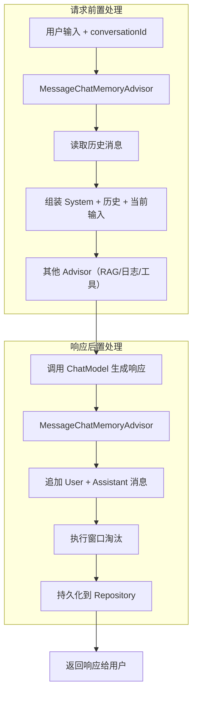
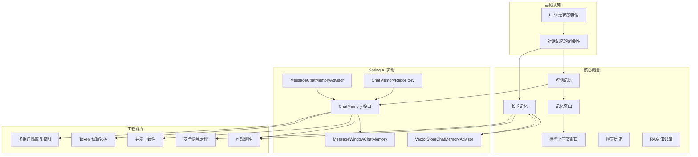

# Spring AI 知识笔记：对话记忆——短期记忆、长期记忆与记忆窗口

## 0. 学习目标、前置知识与版本基线

### 0.1 学习目标

学完本章你将能够：

1. 解释 LLM 无状态特性与应用侧对话记忆的必要性
2. 准确区分聊天记录、短期记忆、长期记忆、RAG 知识库、模型上下文窗口等核心概念
3. 使用 Spring AI 1.1.x 的 `ChatMemory` 体系实现生产级多轮对话
4. 设计可持久化、可隔离、可观测的对话记忆系统
5. 基于 Token 预算管控上下文，解决窗口溢出与成本问题
6. 规避记忆污染、数据越权、并发冲突等生产风险

### 0.2 前置知识

- JDK 21 语法基础、Spring Boot 3.x 开发经验
- Spring AI `ChatClient` 基础用法、Prompt 工程基础
- MySQL / Redis 基础使用经验
- 对大模型 Token、上下文窗口有基础认知

### 0.3 技术基线

| 技术        | 版本                              | 说明                                                         |
| ----------- | --------------------------------- | ------------------------------------------------------------ |
| JDK         | 21 LTS                            | 代码示例均使用 JDK 21 语法                                   |
| Spring Boot | 3.5.16                            | 自动配置基于此版本                                           |
| Spring AI   | 1.1.x                             | 所有 API 均基于 1.1.x 官方文档核验，落地前请对照项目实际补丁版本确认 |
| Maven       | 3.9.16                            | 依赖管理规范                                                 |
| 存储        | 内存 / JDBC / Redis / VectorStore | 不同存储方案前置条件单独说明                                 |

>
> ⚠️ 版本说明：本文所有 API、默认值、行为均基于 Spring AI 1.1.x 官方文档整理。Spring AI 不同补丁版本间存在细微差异，生产落地前请务必对照项目 `pom.xml` 中的实际 BOM 版本核验。

---

## 1. 为什么 LLM 应用需要对话记忆

### 1.1 LLM 的无状态本质

大语言模型 API 本质是**单次请求-响应的无状态服务**：

- 每一次调用都是独立的，模型不会天然记住上一轮对话内容
- 所有上下文信息必须通过本次请求的 Prompt 完整传入
- 所谓“多轮对话”，本质是应用层每次把历史消息重新拼接到 Prompt 中，再提交给模型

这和传统 Web 会话类似：HTTP 本身无状态，通过 Cookie/Session 实现会话连续性；LLM 对话本身无状态，通过对话记忆实现上下文连续性。

### 1.2 多轮对话的完整数据流

一次典型的多轮对话执行流程：

1. 用户发送第 N 轮输入
2. 应用根据会话 ID 读取历史消息
3. 按窗口策略筛选需要注入的上下文
4. 组装 System + 历史消息 + 当前用户输入，构造 Prompt
5. 调用模型生成响应
6. 将本轮用户消息与助手响应追加到记忆存储
7. 裁剪/压缩超出窗口的历史
8. 返回响应给用户

### 1.3 两轮对话示例

**第一轮**

```
用户：设备 PUMP-001 报 E101 错误
模型：E101 代表入口压力过低，请先检查进水阀门是否全开。
```

此时应用保存两条消息：用户提问 + 助手回答。

**第二轮**

```
用户：那怎么排查阀门故障？
```

如果不带记忆直接调用，模型不知道“阀门”对应哪台设备、什么故障。应用会自动把第一轮消息拼入 Prompt：

```
System: 你是设备维修助手
User: 设备 PUMP-001 报 E101 错误
Assistant: E101 代表入口压力过低，请先检查进水阀门是否全开。
User: 那怎么排查阀门故障？
```

模型基于完整上下文给出针对性回答，形成“连续对话”的体感。

### 1.4 为什么不能只存在单机内存

- 多实例部署时，请求可能落到不同节点，记忆会丢失
- 服务重启、发布后内存数据全部清空
- 无法跨会话、跨天复用用户信息
- 无法做持久化审计、回溯和治理

生产环境必须使用共享持久化存储管理对话记忆。

---

## 2. 核心术语与概念边界

### 2.1 术语对照表

| 概念                                | 解决的问题                          | 典型数据                        | 存储位置             | 进入模型上下文的方式     | 是否要求完整保存       |
| ----------------------------------- | ----------------------------------- | ------------------------------- | -------------------- | ------------------------ | ---------------------- |
| Conversation 会话                   | 一次独立对话任务的生命周期          | 会话ID、创建时间、状态          | 持久化存储           | 不直接进入，作为寻址单元 | 是                     |
| Turn 对话轮次                       | 一次用户输入+一次模型响应的完整交互 | 用户消息+助手消息对             | 记忆/历史存储        | 按策略选择部分进入       | 否                     |
| Message 消息                        | 单条角色化文本内容                  | System/User/Assistant/Tool 消息 | 记忆/历史存储        | 选择性注入               | 否                     |
| Chat History 聊天历史               | 完整留存、审计、回放、业务查询      | 全量消息、时间、元数据          | 数据库/对象存储      | 否，仅按需查询           | 是                     |
| Chat Memory 对话记忆                | 为当前生成提供上下文                | 筛选后的历史消息、摘要          | 内存/持久化存储      | 选择性注入 Prompt        | 否，只保留有效部分     |
| Short-term Memory 短期记忆          | 维持当前会话内的上下文连续性        | 最近N条消息、会话内状态         | 内存/Repository      | 窗口策略筛选后进入       | 否，随会话生命周期淘汰 |
| Long-term Memory 长期记忆           | 跨会话保留用户事实、偏好、任务状态  | 用户事实、偏好、摘要、重要事件  | 结构化存储/向量库    | 按需检索后选择性进入     | 否，经筛选治理后留存   |
| Memory Window 记忆窗口              | 从历史中选择当前请求上下文的策略    | 固定条数/Token量/相关性片段     | 逻辑概念，无独立存储 | 按策略截取后进入         | -                      |
| Model Context Window 模型上下文窗口 | 模型单次可处理的最大 Token 量       | 所有输入+输出 Token 总和        | 模型侧限制           | 总量不能超过上限         | -                      |
| Token Budget Token 预算             | 人为分配的可用输入 Token 额度       | 系统/历史/检索/当前输入分配     | 应用侧配置           | 受模型窗口约束           | -                      |
| ChatMemoryRepository                | 记忆消息的存储抽象                  | 消息读写接口                    | 各存储实现           | 不直接进入               | 依实现而定             |
| Advisor 顾问链                      | 请求前后的增强处理机制              | 记忆注入、RAG 检索、日志        | 应用内存             | 前置处理时注入           | -                      |

### 2.2 必须明确的 7 个概念边界

#### 1. 聊天记录 ≠ 对话记忆

- 聊天历史追求**完整留存**，用于审计、回放、用户查看
- 对话记忆追求**有效上下文**，只把对当前请求有价值的信息送入模型
- 二者可共用底层存储，但目的、查询方式、裁剪规则完全不同，不能混为一谈

#### 2. 短期记忆 ≠ 只存内存

- “短期”描述的是**作用周期**：服务于当前会话内的连续性
- 短期记忆完全可以持久化到数据库，只是它的生命周期通常与会话绑定
- 内存存储只是短期记忆的一种实现方式，不是定义

#### 3. 长期记忆 ≠ 无限聊天记录

- 长期记忆是**经过筛选、提取、归纳、去重**的结构化信息
- 直接把几千条历史全塞进 Prompt 成本高、噪声大、效果差，不是高质量长期记忆
- 长期记忆讲究“按需检索、精准注入”，而不是“越多越好”

#### 4. 长期记忆 ≠ RAG 知识库

| 维度     | 长期记忆                 | RAG 知识库               |
| -------- | ------------------------ | ------------------------ |
| 数据来源 | 用户交互产生的个性化信息 | 外部权威文档、制度、手册 |
| 所有权   | 用户个人/租户所有        | 组织公共知识             |
| 更新频率 | 随对话动态更新           | 相对稳定，定期发布       |
| 语义定位 | 用户事实、偏好、任务状态 | 领域知识、操作规范       |
| 权限粒度 | 用户级隔离               | 角色/部门级共享          |

二者可以共用向量检索基础设施，但数据治理、权限、更新策略完全不同。

#### 5. `maxMessages` ≠ 模型 Token 上下文窗口

- `maxMessages` 是**消息条数**限制，一条消息可能几百也可能几千 Token
- 模型上下文窗口是**Token 总数**限制，二者度量单位完全不同
- 只按条数控制窗口，长消息场景仍可能触发上下文溢出

#### 6. 记忆存储 ≠ 模型永久记住

- 模型本身是无状态的，不会“记住”任何用户
- 连续性完全依赖应用每次请求时主动把记忆注入 Prompt
- 不注入，模型就完全不知道相关历史

#### 7. Conversation ID ≠ 身份认证

- Conversation ID 仅用于**寻址和分组**，定位某段会话记忆
- 它不是访问控制凭据，服务端必须校验当前用户是否有权操作该会话
- 前端传入的 conversationId 必须做权限校验，不能直接信任

---

## 3. 短期记忆：原理、生命周期与策略

### 3.1 定义与目标

短期记忆（工作记忆）服务于**单个会话内**的上下文连续性，目标是让模型理解当前对话的来龙去脉，给出连贯、不脱节的回答。

典型生命周期：会话创建 → 多轮交互追加消息 → 超出窗口淘汰旧消息 → 会话结束/过期清理。

### 3.2 常见短期记忆策略

| 策略                | 说明                               | 优点             | 缺点                                 |
| ------------------- | ---------------------------------- | ---------------- | ------------------------------------ |
| 全量保留            | 保存会话所有消息，全部注入         | 上下文最完整     | 成本高、延迟高、易溢出，仅适合短会话 |
| 固定消息数窗口      | 保留最近 N 条消息                  | 实现简单、可预测 | 长消息易超 Token，关键历史可能被裁掉 |
| 完整轮次窗口        | 按 User+Assistant 完整轮次裁剪     | 不会裁断半轮对话 | 粒度较粗                             |
| Token 感知窗口      | 按 Token 量反向裁剪，控制总输入    | 精准控制预算     | 实现复杂，需 Token 估算              |
| 会话摘要 + 近期消息 | 旧消息压缩为摘要，保留近期详细消息 | 兼顾上下文与预算 | 摘要可能丢失细节                     |
| 相关性检索          | 从历史中检索与当前问题相关的片段   | 精准、噪声低     | 实现复杂，可能丢失连贯上下文         |

### 3.3 不同角色消息的处理原则

- **System 消息**：通常始终保留，作为全局规则；新的 System 消息会替换旧的
- **User 消息**：用户输入，按窗口策略淘汰
- **Assistant 消息**：模型响应，与对应用户消息成对处理
- **Tool Call + Tool Response**：必须成对保留/淘汰，不能只留一半，否则模型上下文错乱

### 3.4 单次请求的执行生命周期

```
conversationId 
  → 读取记忆存储
  → 应用窗口策略筛选消息
  → 组装 Prompt 消息列表
  → 调用模型生成响应
  → 追加本轮 User + Assistant 消息
  → 执行淘汰/压缩
  → 持久化存储
```

### 3.5 短期记忆与业务状态的边界

- 短期记忆只管对话上下文，不负责业务状态持久化
- 订单、工单、审批等业务状态应存业务表，不要依赖对话记忆传递
- 记忆中的业务信息只能作为参考，最终以业务库为准

---

## 4. Spring AI Chat Memory 核心 API

### 4.1 核心接口分层

Spring AI 的记忆体系采用**策略与存储分离**的设计，三层架构清晰：

| 层级       | 核心类/接口                | 职责                                 |
| ---------- | -------------------------- | ------------------------------------ |
| 策略层     | `ChatMemory`               | 管理消息列表、窗口淘汰、读写逻辑     |
| 存储抽象层 | `ChatMemoryRepository`     | 消息持久化读写，屏蔽底层存储差异     |
| 注入层     | `MessageChatMemoryAdvisor` | 接入 ChatClient 调用链，自动读写记忆 |

>
> 设计价值：策略与存储解耦。更换窗口策略不改存储；更换存储介质（内存→JDBC→Redis）不改业务逻辑。

### 4.2 ChatMemory 接口

`ChatMemory` 是对话记忆的核心业务接口，定义了消息的读写、追加、清理能力。

- 按 `conversationId` 隔离不同会话
- 提供消息的追加、查询、清空操作
- 内置窗口淘汰逻辑

### 4.3 ChatMemoryRepository 接口

`ChatMemoryRepository` 是存储抽象，负责消息的持久化读写。

- 内置 `InMemoryChatMemoryRepository`：基于内存 Map 实现，适合开发测试
- 官方扩展实现：`JdbcChatMemoryRepository`、`CassandraChatMemoryRepository`、`Neo4jChatMemoryRepository` 等
- 可自定义实现，对接任意存储

>
> 官方参考：Chat Client API | Spring AI 聊天客户端 API：[](https://docs.spring.io/spring-ai/reference/1.1/api/chatclient.html)[https://docs.spring.io/spring-ai/reference/1.1/api/chatclient.html](https://docs.spring.io/spring-ai/reference/1.1/api/chatclient.html)

### 4.4 MessageWindowChatMemory

这是 Spring AI 内置最常用的短期记忆实现，基于固定消息数量的滑动窗口策略。

#### 核心特性（Spring AI 1.1.x）

1. **默认 maxMessages = 20**：最多保留 20 条消息，超出后淘汰最旧的
2. **System 消息特殊处理**：System 消息不计入窗口计数，始终保留；如果追加新的 System 消息，会替换之前的 System 消息
3. **淘汰策略**：FIFO，超出上限后删除最早的非 System 消息
4. **边界行为**：以单条消息为单位裁剪，不保证完整轮次；工具调用消息可能出现半轮残留
5. **会话隔离**：完全基于 conversationId 隔离，不同会话互不影响

>
> ⚠️ 重要提醒：`maxMessages` 是消息条数，不是 Token 数。长文本场景下 20 条消息很容易超过模型上下文窗口，需配合 Token 预算二次管控。

### 4.5 MessageChatMemoryAdvisor

将记忆能力无缝接入 `ChatClient` 调用链的 Advisor，自动完成“读历史 → 拼 Prompt → 存新消息”全流程。

#### 工作机制

- **请求前置**：从 `ChatMemory` 读取历史消息，追加到当前 Prompt 的消息列表
- **响应后置**：将本轮用户消息与助手响应追加到 `ChatMemory` 并持久化
- **必填参数**：每次请求必须通过 `.param(ChatMemory.CONVERSATION_ID, xxx)` 传入会话 ID，否则抛出 `IllegalArgumentException`

### 4.6 VectorStoreChatMemoryAdvisor（语义记忆检索）

Spring AI 1.1.x 提供的增强型记忆 Advisor，基于向量相似度从历史中检索相关片段，而非简单滑动窗口。

- 适合长会话、跨会话的相关历史召回
- 属于“相关性优先”策略，可能丢失对话时序连贯性
- 通常与滑动窗口配合使用：近期消息用窗口，远期相关用检索
- 不是完整的长期记忆解决方案，只是检索型记忆组件

---

## 5. Spring AI 短期记忆代码实践

>
> 说明：以下代码基于 Spring AI 1.1.x API 编写，为示例实现，未在真实环境编译运行，落地前请对照项目实际版本核验。

### 5.1 基础依赖

```
<!-- Spring AI BOM 管理版本 -->
<dependency>
    <groupId>org.springframework.ai</groupId>
    <artifactId>spring-ai-bom</artifactId>
    <version>1.1.x</version>
    <type>pom</type>
    <scope>import</scope>
</dependency>

<!-- 对应模型 Starter，以 DeepSeek 兼容实现为例 -->
<dependency>
    <groupId>org.springframework.ai</groupId>
    <artifactId>spring-ai-openai-spring-boot-starter</artifactId>
</dependency>
```

### 5.2 方式一：直接使用 ChatMemory

适合需要精细控制记忆读写的场景。

```
import org.springframework.ai.chat.memory.ChatMemory;
import org.springframework.ai.chat.memory.MessageWindowChatMemory;
import org.springframework.ai.chat.memory.InMemoryChatMemoryRepository;
import org.springframework.ai.chat.messages.Message;
import org.springframework.ai.chat.messages.UserMessage;
import org.springframework.ai.chat.messages.AssistantMessage;
import org.springframework.stereotype.Service;
import java.util.List;

@Service
public class DirectMemoryService {

    private final ChatMemory chatMemory;

    public DirectMemoryService() {
        // 构建 10 条消息窗口的短期记忆，使用内存存储
        this.chatMemory = MessageWindowChatMemory.builder()
                .maxMessages(10)
                .chatMemoryRepository(new InMemoryChatMemoryRepository())
                .build();
    }

    /**
     * 发送消息并获取历史上下文
     */
    public List<Message> getContextMessages(String conversationId, String userInput) {
        // 1. 先读取当前历史
        List<Message> history = chatMemory.get(conversationId);

        // 2. 追加本轮用户消息
        chatMemory.add(conversationId, new UserMessage(userInput));

        // 3. 返回用于模型调用的完整消息列表
        return history;
    }

    /**
     * 保存模型响应
     */
    public void saveAssistantResponse(String conversationId, String response) {
        chatMemory.add(conversationId, new AssistantMessage(response));
    }

    /**
     * 清空会话记忆
     */
    public void clearConversation(String conversationId) {
        chatMemory.clear(conversationId);
    }
}
```

### 5.3 方式二：ChatClient + MessageChatMemoryAdvisor（推荐）

生产环境推荐方式，Advisor 自动接管记忆读写，业务代码无感知。

```
import org.springframework.ai.chat.client.ChatClient;
import org.springframework.ai.chat.client.advisor.MessageChatMemoryAdvisor;
import org.springframework.ai.chat.memory.ChatMemory;
import org.springframework.ai.chat.memory.MessageWindowChatMemory;
import org.springframework.ai.chat.memory.InMemoryChatMemoryRepository;
import org.springframework.context.annotation.Bean;
import org.springframework.context.annotation.Configuration;

@Configuration
public class ChatMemoryConfig {

    /**
     * 配置短期记忆 Bean
     * 窗口大小 15 条消息，内存存储
     */
    @Bean
    public ChatMemory chatMemory() {
        return MessageWindowChatMemory.builder()
                .maxMessages(15)
                .chatMemoryRepository(new InMemoryChatMemoryRepository())
                .build();
    }

    /**
     * 配置带记忆能力的 ChatClient
     */
    @Bean
    public ChatClient memoryChatClient(ChatClient.Builder builder, ChatMemory chatMemory) {
        return builder
                .defaultSystem("你是制造业设备维修助手，回答简洁专业。")
                .defaultAdvisors(
                        MessageChatMemoryAdvisor.builder(chatMemory).build()
                )
                .build();
    }
}
```

业务调用代码：

```
import org.springframework.ai.chat.client.ChatClient;
import org.springframework.ai.chat.memory.ChatMemory;
import org.springframework.stereotype.Service;

@Service
public class ConversationService {

    private final ChatClient memoryChatClient;
    private final ChatMemory chatMemory;

    public ConversationService(ChatClient memoryChatClient, ChatMemory chatMemory) {
        this.memoryChatClient = memoryChatClient;
        this.chatMemory = chatMemory;
    }

    /**
     * 带记忆的对话
     * @param conversationId 会话ID，必须由服务端校验权限
     * @param userInput 用户输入
     */
    public String chat(String conversationId, String userInput) {
        return memoryChatClient.prompt()
                .user(userInput)
                // 传入会话 ID，Advisor 自动读写记忆
                .advisors(a -> a.param(ChatMemory.CONVERSATION_ID, conversationId))
                .call()
                .content();
    }

    /**
     * 结束会话，清理记忆
     */
    public void endConversation(String conversationId) {
        chatMemory.clear(conversationId);
    }
}
```

### 5.4 会话隔离验证

```
// 验证：两个不同会话互不影响
String convA = "conv-user1-001";
String convB = "conv-user2-001";

// 会话 A 输入
conversationService.chat(convA, "我负责 A 产线的水泵设备");
// 会话 B 输入
conversationService.chat(convB, "我负责 B 产线的空压机");

// 会话 A 提问，应能回忆 A 产线
String answerA = conversationService.chat(convA, "我负责哪条产线？");
// 会话 B 提问，应能回忆 B 产线，且不知道 A 产线信息
String answerB = conversationService.chat(convB, "我负责哪条产线？");
```

### 5.5 权限校验与安全实践

>
> ❌ 错误做法：直接使用前端传入的 conversationId 读写记忆
> ✅ 正确做法：服务端校验用户是否拥有该会话权限

```
public String chatWithAuth(Long userId, String conversationId, String userInput) {
    // 1. 权限校验：查询会话归属，确认当前用户有权访问
    if (!conversationService.isOwner(userId, conversationId)) {
        throw new SecurityException("无权访问该会话");
    }

    // 2. 校验通过再执行对话
    return chat(conversationId, userInput);
}
```

---

## 6. 长期记忆：应用级架构与实现机制

### 6.1 核心认知

**长期记忆是应用级设计领域，不是 Spring AI 某个内置类就能完整解决的。**
Spring AI 提供了向量检索、消息存储等基础构件，但记忆提取、去重、更新、权限、治理等业务逻辑需要应用自行实现。

### 6.2 长期记忆的数据类型

| 类型           | 说明                             | 更新频率 | 可信度       | 推荐存储            |
| -------------- | -------------------------------- | -------- | ------------ | ------------------- |
| 用户稳定事实   | 岗位、负责产线、技术栈、长期目标 | 低       | 高（需确认） | 关系型数据库        |
| 用户偏好       | 回答风格、语言、工具偏好         | 中       | 中           | 关系型数据库        |
| 长期任务状态   | 项目进度、未决事项、跟进计划     | 高       | 中           | 关系型数据库        |
| 重要决策事件   | 关键结论、方案选择、处理结果     | 中       | 高           | 关系型数据库 + 审计 |
| 历史聊天摘要   | 多轮/多会话压缩后的要点          | 中       | 中           | 文档存储 + 向量索引 |
| 可检索历史片段 | 可能复用的历史对话片段           | 高       | 中           | VectorStore         |

### 6.3 长期记忆完整生命周期

```
graph TD
    A["对话消息产生"] --> B["候选记忆提取"]
    B --> C["重要性 / 可信度判定"]
    C --> D["去重与冲突检测"]
    D --> E["用户确认（高风险信息）"]
    E --> F["结构化持久化"]
    F --> G["建立向量索引（可选）"]
    G --> H["按当前问题相关性检索"]
    H --> I["权限过滤"]
    I --> J["注入 Prompt 上下文"]
    J --> K["模型生成回答"]
    K --> L["反馈：修正/确认/删除记忆"]
    L --> F
```

#### 关键机制说明

1. **记忆提取**：从对话中识别值得长期保存的事实、偏好、决策，不是所有内容都存
2. **摘要压缩**：长对话提炼为要点，降低存储与 Token 成本
3. **事实归一化**：统一格式、去重，避免同一事实多条矛盾记录
4. **冲突处理**：新记忆与旧记忆冲突时，按时间、来源、置信度决定更新或保留
5. **时间衰减**：越久远的记忆权重越低，优先召回近期信息
6. **TTL 过期**：不同类型记忆设置不同有效期，定期清理
7. **用户可控**：用户可查看、修正、删除自己的记忆，符合合规要求

### 6.4 存储方案对比

| 方案                  | 适合场景                       | 优点                         | 缺点                             | 前置条件                             |
| --------------------- | ------------------------------ | ---------------------------- | -------------------------------- | ------------------------------------ |
| 关系型数据库（MySQL） | 结构化用户事实、偏好、任务状态 | 事务一致、权限易控、查询可靠 | 语义检索能力弱                   | 常规 MySQL 服务即可                  |
| 文档存储              | 完整聊天历史、长摘要           | 容量大、结构灵活             | 查询性能一般                     | MongoDB / PostgreSQL JSON            |
| VectorStore 向量库    | 语义检索历史片段、摘要         | 支持语义召回                 | 不适合结构化精确查询             | 向量数据库 / Redis Stack / PG Vector |
| Redis                 | 热点短期记忆、缓存、会话状态   | 性能高、TTL 原生支持         | 持久化能力有限，普通版无向量能力 | Redis 6.x 常规版仅支持 KV            |

>
> ⚠️ 重要提醒：Spring AI 的 Redis 相关记忆/向量能力，通常依赖 **Redis Stack** 的 RedisJSON、RedisSearch、RedisVector 等模块。普通 Redis 6.x 发行版不具备这些能力，不能直接使用。生产环境使用前必须核验服务端模块支持情况。

### 6.5 Spring AI 的能力边界

Spring AI 提供的可复用构件：

- `ChatMemoryRepository`：消息持久化抽象
- `VectorStoreChatMemoryAdvisor`：基于向量的历史检索
- `VectorStore` 抽象：向量读写与检索

需要应用自行实现的部分：

- 用户事实的自动提取与结构化
- 记忆的重要性评估、去重、冲突处理
- 用户级/租户级数据权限控制
- 记忆的确认、修正、删除、导出治理流程
- 记忆质量评估与持续优化

>
> 结论：`VectorStoreChatMemoryAdvisor` 是检索工具，不是完整的企业级长期记忆平台。

---

## 7. 记忆窗口：大小、淘汰与上下文连续性

### 7.1 主流窗口策略对比

| 策略           | 选择依据                   | 优点             | 缺点             | 适用场景             | 实现复杂度 |
| -------------- | -------------------------- | ---------------- | ---------------- | -------------------- | ---------- |
| 固定消息数窗口 | 消息条数                   | 简单直观、易预测 | 长消息易超 Token | 短对话、消息长度均匀 | 低         |
| 完整轮次淘汰   | User+Assistant 成对        | 不会割裂对话轮次 | 粒度粗           | 标准问答对话         | 中         |
| Token 感知裁剪 | Token 估算值               | 精准控制预算     | 需 Token 计算    | 长对话、预算严格     | 中高       |
| 最近优先       | 时间倒序                   | 保留最新上下文   | 丢失早期关键信息 | 大多数场景默认       | 低         |
| 相关性优先     | 与当前问题相似度           | 精准、噪声低     | 丢失时序连贯性   | 长会话、知识库问答   | 高         |
| 时间衰减       | 时间 + 重要性              | 符合记忆规律     | 实现复杂         | 长期记忆召回         | 高         |
| 分层混合       | 近期详细+远期摘要+长期事实 | 兼顾完整与效率   | 架构复杂         | 生产级长周期助手     | 高         |

### 7.2 窗口大小的权衡

- **窗口太小**：上下文丢失，模型记不住前面的信息，问答脱节
- **窗口太大**：Token 成本高、延迟高、噪声信息稀释核心指令，易触发上下文溢出
- **最佳实践**：从 10~20 条开始，根据业务对话平均长度、Token 预算逐步调优；不要盲目追求大窗口

### 7.3 特殊消息的边界处理

- **System 消息**：始终保留，不计入窗口计数
- **Tool Call + Tool Response**：必须成对处理，禁止只删一半，否则模型上下文错乱
- **长消息拆分**：单条超长消息建议摘要后再存入记忆，避免一条消息占满整个窗口

---

## 8. 模型 Context Window 与 Token Budget

### 8.1 基础概念

- **Token**：模型处理文本的基本单位。中文约 1 字 ≈ 1.5 Token，英文约 0.75 词 ≈ 1 Token；不是字符数，也不是消息条数
- **模型上下文窗口**：模型单次请求能处理的最大 Token 总量（输入 + 输出）。不同模型差异极大，从 4K 到 1M 不等
- **Token 预算**：应用侧人为分配的输入 Token 额度，用于管控成本、防止溢出

### 8.2 一次请求的上下文组成

一次请求的输入 Token 通常包含以下部分：

1. System Prompt（系统规则）
2. 历史对话消息（短期记忆窗口）
3. RAG 检索到的文档片段
4. 长期记忆片段
5. 工具描述与函数定义
6. 当前用户输入
7. 其他元数据、多模态内容

输出 Token 需要单独预留，不能占满全部窗口。

### 8.3 Token 预算计算公式（示例）

>
> 以下数值为假设示例，不同模型请替换为实际值

```
可用输入预算 = 模型总上下文 - 输出预留 - 安全余量
```

假设模型总窗口 128K：

```
总窗口：128,000 Token
- 输出预留：8,000 Token（保证生成长度）
- 安全余量：8,000 Token（应对估算误差）
= 可用输入预算：112,000 Token
```

输入预算分配示例：

```
graph TD
    subgraph 总上下文窗口 128K Token
        A["输出预留 8K"]
        B["安全余量 8K"]
        subgraph 可用输入 112K
            C["System Prompt 2K"]
            D["近期对话窗口 30K"]
            E["RAG 检索文档 60K"]
            F["长期记忆片段 10K"]
            G["当前用户输入 10K"]
        end
    end
```

>
> 标注：以上数值均为假设示例，实际需根据模型规格、业务场景调整。

### 8.4 为什么消息窗口安全不代表 Token 安全

- 每条消息长度差异极大：短的几个字，长的几千字
- 10 条短消息可能只有几百 Token，10 条长消息可能几万 Token
- 只靠 `maxMessages` 控制，长文本场景必然溢出
- 生产环境必须叠加 Token 预算校验

### 8.5 上下文管理策略对比

| 策略             | 原理                                 | 优点           | 缺点                         |
| ---------------- | ------------------------------------ | -------------- | ---------------------------- |
| 直接截断         | 超出后从头部硬截断                   | 最简单         | 丢失关键上下文，可能截断半轮 |
| 滑动消息窗口     | 保留最近 N 条                        | 简单、时序完整 | 粒度粗，Token 不可控         |
| Token-aware 裁剪 | 从后往前累加 Token，超预算则裁剪最早 | Token 精准     | 需估算器，实现稍复杂         |
| 历史摘要         | 旧消息压缩为摘要保留                 | 保留核心信息   | 摘要丢失细节，有额外成本     |
| 语义检索         | 只召回相关历史片段                   | 精准、噪声低   | 丢失时序连贯性               |
| 混合策略         | 近期详细 + 中期摘要 + 远期检索       | 效果最优       | 架构最复杂                   |

### 8.6 Token 估算与校准

- 开发阶段：使用对应模型的 Tokenizer 精确计算
- 运行阶段：通过模型返回的 `usage` 字段获取真实 Token 数，校准估算偏差
- 估算永远有误差，必须留安全余量
- 禁止把估算值当精确值使用

---

## 9. Chat History、短期记忆、长期记忆与 RAG 的关系

### 9.1 四者对比表

| 类型                       | 主要目的                       | 数据完整性要求           | 典型检索方式              | 是否直接全部进入 Prompt |
| -------------------------- | ------------------------------ | ------------------------ | ------------------------- | ----------------------- |
| Chat History 聊天历史      | 回放、审计、用户查看、业务追溯 | 要求完整留存             | 按会话、时间、消息ID      | 否                      |
| Short-term Memory 短期记忆 | 维持当前会话上下文连续性       | 只保留当前任务所需部分   | conversationId + 窗口策略 | 选择性进入              |
| Long-term Memory 长期记忆  | 跨会话个性化、事实与任务连续性 | 经筛选治理后留存         | 结构化查询 + 语义检索     | 选择性进入              |
| RAG Knowledge 知识库       | 提供外部权威领域知识           | 以知识源为准，版本化管理 | 向量/关键词/混合检索      | 选择性进入              |

### 9.2 典型场景对应

| 用户问题                          | 对应能力                | 说明                       |
| --------------------------------- | ----------------------- | -------------------------- |
| “我刚才说的设备编号是什么？”      | 短期记忆 / 完整会话记录 | 当前会话内最近信息         |
| “记住我负责 A 产线，以后优先考虑” | 长期记忆（用户事实）    | 跨会话生效，需确认授权     |
| “查一下设备手册中 E101 故障码”    | RAG 外部知识库          | 公共权威知识，非用户个性化 |
| “展示上周所有对话记录”            | 完整聊天历史查询        | 审计回放，不进入模型       |

---

## 10. Advisor 链与完整请求执行流程

### 10.1 Advisor 的定位

Advisor 是 ChatClient 的请求拦截增强机制，类似 Spring MVC 的 Interceptor，可以在请求调用模型前、响应返回后插入自定义逻辑。
记忆、RAG、日志、工具调用等能力都通过 Advisor 接入调用链。

### 10.2 带记忆的完整执行数据流



### 10.3 多 Advisor 执行顺序

Advisor 的执行顺序非常重要，存在依赖关系：

1. 先执行记忆 Advisor：补充对话历史
2. 再执行 RAG Advisor：基于完整问题+上下文检索资料
3. 再执行日志 Advisor：记录最终发送给模型的完整 Prompt
4. 最后执行工具调用相关 Advisor

>
> 顺序错误会导致：RAG 检索缺少历史上下文、日志记录不完整、记忆读取异常。

---

## 11. 制造业设备故障助手的工程设计

### 11.1 贯穿案例背景

面向制造业的设备故障工单助手，支持：

- 多轮故障排查对话
- 记住本次排查的设备、现象、已尝试操作
- 跨会话记住用户负责的产线、维修等级、偏好风格
- 检索设备手册、维修规范等知识库
- 完整聊天记录用于工单追溯与审计

### 11.2 信息归属决策表

| 信息类型                   | 存储位置               | 是否进入模型     | 生命周期               |
| -------------------------- | ---------------------- | ---------------- | ---------------------- |
| 当前对话的设备、现象、操作 | 短期记忆（消息窗口）   | 是，全部进入     | 会话内有效             |
| 用户负责产线、维修等级     | 长期记忆（用户事实表） | 是，按需注入     | 长期有效，用户可修改   |
| 设备手册、故障码说明       | RAG 知识库             | 是，检索相关片段 | 版本化更新             |
| 完整对话全文               | 聊天历史表             | 否，仅审计回放   | 永久留存（按合规要求） |
| 工单编号、状态             | 业务工单表             | 否，业务逻辑处理 | 工单生命周期           |
| 系统提示词、通用规则       | 配置文件               | 是，每次都进入   | 全局配置               |

### 11.3 核心数据结构设计

#### 会话表

```sql
CREATE TABLE ai_conversation (
    id BIGINT PRIMARY KEY AUTO_INCREMENT,
    conversation_id VARCHAR(64) NOT NULL UNIQUE COMMENT '会话唯一ID',
    user_id BIGINT NOT NULL COMMENT '所属用户',
    tenant_id BIGINT NOT NULL COMMENT '租户ID',
    title VARCHAR(255) COMMENT '会话标题',
    status TINYINT DEFAULT 1 COMMENT '1进行中 2已结束',
    created_at DATETIME NOT NULL,
    updated_at DATETIME NOT NULL,
    expired_at DATETIME COMMENT '过期时间',
    INDEX idx_user (user_id),
    INDEX idx_expired (expired_at)
) COMMENT 'AI会话主表';
```

#### 长期用户事实表

```sql
CREATE TABLE ai_user_memory_fact (
    id BIGINT PRIMARY KEY AUTO_INCREMENT,
    user_id BIGINT NOT NULL,
    fact_type VARCHAR(32) NOT NULL COMMENT '事实类型：position/line/preference等',
    fact_key VARCHAR(64) NOT NULL,
    fact_value TEXT NOT NULL,
    confidence DECIMAL(3,2) DEFAULT 1.0 COMMENT '置信度',
    source VARCHAR(64) COMMENT '来源：manual/extract/confirm',
    is_confirmed TINYINT DEFAULT 0 COMMENT '是否用户确认',
    created_at DATETIME NOT NULL,
    updated_at DATETIME NOT NULL,
    UNIQUE KEY uk_user_key (user_id, fact_type, fact_key)
) COMMENT '用户长期事实记忆表';
```

### 11.4 短期窗口配置

- 策略：`MessageWindowChatMemory` + Token 二次校验
- `maxMessages`：15 条
- Token 预算：输入总 Token 不超过 16K
- 存储：生产环境使用 JDBC Repository，共享持久化
- 过期：会话 7 天无活动自动归档清理

### 11.5 权限校验流程

1. 前端传入 conversationId
2. 服务端从 Token 中解析 userId、tenantId
3. 查询会话表校验归属，不匹配直接拒绝
4. 校验通过后再读写记忆数据

---

## 12. 多用户隔离、并发和数据一致性

### 12.1 三级隔离体系

```
租户级隔离（tenant_id）
    ↓
用户级隔离（user_id）
    ↓
会话级隔离（conversation_id）
```

- 不同租户数据完全隔离，查询强制带 tenant_id
- 用户只能访问自己的会话
- 同一用户可拥有多个独立会话

### 12.2 并发写入问题与风险

同一会话并发请求可能导致：

- 消息顺序错乱
- 重复追加
- 读写竞态导致历史丢失
- 窗口淘汰计算错误

### 12.3 解决方案与取舍

| 方案         | 原理                           | 优点       | 缺点               | 适用场景         |
| ------------ | ------------------------------ | ---------- | ------------------ | ---------------- |
| 分布式锁     | 同一会话同一时间只允许一个请求 | 一致性最强 | 性能损耗大，易阻塞 | 强一致要求场景   |
| 数据库乐观锁 | 版本号控制，冲突则重试         | 无锁等待   | 冲突时需重试       | 中低并发         |
| 串行化队列   | 同会话请求排队执行             | 顺序有保障 | 增加延迟           | 对话类可接受延迟 |
| 幂等设计     | 消息带唯一 ID，去重写入        | 防重复     | 不保顺序           | 防重复为主场景   |

>
> 工程建议：对话类业务对实时性要求不极端，优先采用**幂等 + 乐观锁**方案；极端并发场景引入分布式锁，锁粒度为 conversationId。

### 12.4 多实例部署要求

- 必须使用共享持久化 Repository（JDBC/Redis 等）
- 禁止使用单机内存存储，否则节点间记忆不互通
- 会话创建、ID 生成必须全局唯一

---

## 13. 安全、隐私与记忆治理

### 13.1 核心风险

- 记忆越权：用户 A 访问用户 B 的会话记忆
- 记忆污染：恶意输入注入虚假事实，影响后续对话
- 隐私泄露：聊天记录中包含密码、身份证、API Key 等敏感信息
- 合规风险：超期留存、用户无法删除数据
- 提示注入：检索到的记忆文本包含恶意指令，篡改系统规则

### 13.2 5 个典型反例与正确做法

| 反例 ❌                             | 问题             | 正确做法 ✅                              |
| ---------------------------------- | ---------------- | --------------------------------------- |
| 前端传什么 conversationId 就直接用 | 越权访问他人会话 | 服务端校验会话归属权限                  |
| 所有对话内容原样写入长期记忆       | 敏感信息永久留存 | 写入前做敏感信息脱敏/过滤               |
| 把检索到的记忆内容当系统指令       | 提示注入风险     | 记忆内容放在 user 角色，不提升为 system |
| 日志打印完整 Prompt 和记忆         | 敏感信息泄露     | 仅记录指标和脱敏摘要，不打印全文        |
| 永久保存所有聊天记录               | 合规风险         | 按法规设置保留期，定期清理/匿名化       |

### 13.3 记忆污染防护

- 高价值事实必须经过用户确认才能写入长期记忆
- 自动提取的记忆标注置信度与来源，区分“系统提取”与“用户确认”
- 定期巡检记忆质量，清理错误、过期、矛盾记录
- 外部输入的记忆内容永远作为“用户提供的信息”，不得提升为系统规则

### 13.4 合规要求

- 用户有权查看、导出、删除自己的记忆数据
- 不同类型数据设置不同保留期限
- 敏感信息做脱敏或不存储
- 记忆数据的使用需用户知情同意

---

## 14. 可观测性、成本和性能

### 14.1 核心观测指标

| 指标类别   | 具体指标                         | 作用                     |
| ---------- | -------------------------------- | ------------------------ |
| 记忆读取   | 历史消息数、读取耗时             | 判断窗口大小、存储性能   |
| 记忆写入   | 写入成功率、写入耗时             | 判断存储稳定性           |
| 淘汰裁剪   | 淘汰消息数、裁剪 Token 量        | 判断窗口是否偏小         |
| Token 消耗 | 输入 Token、输出 Token、总 Token | 成本核算、预算管控       |
| 长期记忆   | 召回条数、平均相似度、过滤后条数 | 评估检索质量             |
| 错误异常   | 读取失败、写入失败、上下文溢出   | 故障告警                 |
| 业务维度   | 按用户/租户/会话统计             | 成本分摊（注意隐私边界） |

### 14.2 通过指标判断问题

- **历史消息少但回答脱节**：窗口太小，关键信息被裁掉 → 调大窗口
- **Token 持续接近上限**：窗口太大或检索过多 → 缩减预算
- **存储耗时高**：Repository 层性能瓶颈 → 优化索引/加缓存
- **召回多但相关性差**：检索质量低 → 优化分片/嵌入模型
- **并发下偶发丢消息**：写入竞态 → 加锁/幂等处理

### 14.3 日志规范

- 禁止打印完整 Prompt 和记忆全文
- 只记录数量、长度、耗时、状态等元数据
- 敏感信息必须脱敏
- 采样记录，避免全量日志打爆存储

---

## 15. 单元测试、集成测试与验收用例

### 15.1 测试分层

- **单元测试**：测试记忆策略、裁剪逻辑、权限校验，使用 Mock，不调用真实模型
- **集成测试**：测试完整调用链，对接测试存储，使用测试模型或 Mock
- **模型联调测试**：真实模型环境验证效果，控制用量，避免不必要费用

### 15.2 必测用例清单

1. ✅ 第一轮保存、第二轮能正确读取并使用上下文
2. ✅ 同一用户两个会话互不串记忆
3. ✅ 两个不同用户记忆完全隔离
4. ✅ 不传 conversationId 时抛出预期异常
5. ✅ 读取不存在的 conversationId 返回空
6. ✅ 超过 maxMessages 后旧消息被正确淘汰
7. ✅ System 消息始终保留，不被淘汰
8. ✅ 清理会话后历史不再进入 Prompt
9. ✅ 服务重启后持久化记忆仍然存在
10. ✅ 长期记忆新增、更新、去重、过期、删除逻辑正确
11. ✅ 越权访问会话被拦截
12. ✅ Token 接近上限时触发裁剪/摘要
13. ✅ 并发写入同一会话不出现乱序/丢失
14. ✅ 存储服务不可用时降级与报错符合预期
15. ✅ 工具调用消息成对保留/淘汰，不出现半轮

---

## 16. 常见错误、故障诊断与排查方法

| 现象                   | 可能原因                              | 核查方向                                    | 解决方向                                |
| ---------------------- | ------------------------------------- | ------------------------------------------- | --------------------------------------- |
| 模型记不住前面说过的话 | 窗口太小；消息被裁掉；会话 ID 错了    | 查实际注入的历史消息数；核对 conversationId | 调大窗口；检查会话 ID 传递              |
| 不同用户串记忆了       | conversationId 全局共用；权限校验缺失 | 检查会话 ID 生成逻辑；检查权限校验代码      | 每个会话独立 ID；强制归属校验           |
| 调用报上下文溢出错误   | 消息太长；窗口太大；检索内容太多      | 计算实际 Token 量；核对模型窗口限制         | 缩小窗口/检索量；加 Token 预算控制      |
| 服务重启后记忆全没了   | 使用了 InMemory 实现，未持久化        | 检查 ChatMemoryRepository 实现类            | 切换为持久化 Repository                 |
| 记忆里出现奇怪内容     | 记忆污染；提示注入；越权写入          | 检查记忆来源；审计写入日志                  | 增加写入校验；敏感记忆需确认            |
| 并发下消息顺序乱了     | 无锁控制，竞态写入                    | 压测复现；检查写入时序                      | 加分布式锁/乐观锁；串行化               |
| 窗口没超但 Token 超了  | 单条消息过长；条数≠Token              | 计算单条消息 Token                          | 增加 Token-aware 裁剪                   |
| 工具调用后对话错乱     | 工具消息只存了一半，不成对            | 检查 Repository 对 Tool 消息的支持          | 确保 Tool Call + Tool Response 成对写入 |

---

## 17. 学习练习与动手实践任务

### 17.1 基础实践

**任务1：实现基于 MessageWindowChatMemory 的多轮对话**

- 目标：跑通最基础的带记忆对话
- 前置：Spring Boot 3.5.x + Spring AI 1.1.x 环境
- 步骤：
  1. 引入对应模型 Starter
  2. 配置 MessageWindowChatMemory + InMemoryRepository
  3. 通过 ChatClient + MessageChatMemoryAdvisor 实现对话
  4. 固定 conversationId 连续发两轮，验证第二轮能引用第一轮信息
  5. 更换 conversationId，验证会话隔离
  6. 发送超过 maxMessages 数量的对话，验证淘汰规则
- 验收：第二轮回答正确引用第一轮信息；换会话后无上下文；超窗口后旧信息丢失
- 提交证据：运行日志、两轮对话截图、核心代码片段

### 17.2 工程实践

**任务2：持久化记忆 + 权限校验**

- 目标：生产级可用的记忆方案
- 步骤：
  1. 将 InMemoryRepository 替换为 JDBC 或自定义持久化实现
  2. 重启应用，验证记忆仍然存在
  3. 增加 conversationId 归属校验，拦截越权访问
  4. 拆分聊天历史表与短期记忆窗口
  5. 设计用户长期事实记忆的 CRUD 流程
- 验收：重启记忆不丢；越权被拦截；长期记忆可增删改查
- 提交证据：表结构设计、权限校验代码、重启验证日志

**任务3：Token 预算管控**

- 目标：实现 Token 感知的上下文组装
- 步骤：
  1. 引入对应模型 Token 估算工具
  2. 实现上下文组装时的 Token 预算校验
  3. 超预算时从头部裁剪历史消息
  4. 预留输出 Token 和安全余量
- 验收：长消息场景不再触发上下文溢出错误；总输入 Token 稳定在预算内
- 提交证据：预算分配配置、裁剪逻辑代码、测试验证日志

---

## 18. 面试高频问题与技术表达

### 1. LLM 为什么需要应用侧管理 Chat Memory？

**答题要点**：
大语言模型 API 本质是无状态的，每次调用独立，不会天然记住历史对话。多轮对话的连续性依赖应用层把历史消息重新组装进 Prompt，再提交给模型。记忆系统就是负责历史的存储、筛选、注入、淘汰的组件，是实现对话连续性的基础。

### 2. Chat History 和 Chat Memory 有什么区别？

**答题要点**：

- Chat History 是完整聊天记录，目标是留存、审计、回放，追求完整性
- Chat Memory 是对话记忆，目标是为当前生成提供有效上下文，追求精准性
- 二者可共用存储，但目的、查询方式、裁剪规则完全不同；不能把全量历史直接当记忆用

### 3. ChatMemory 和 ChatMemoryRepository 职责边界是什么？

**答题要点**：

- `ChatMemory` 是业务策略层，负责消息管理、窗口淘汰、读写逻辑，决定哪些消息进入上下文
- `ChatMemoryRepository` 是存储抽象层，负责消息的持久化读写，屏蔽底层存储差异
- 二者分离是典型的策略模式 + 仓库模式，换窗口策略不改存储，换存储不改业务逻辑

### 4. MessageWindowChatMemory 是怎么工作的？

**答题要点**：

- 基于固定消息条数的滑动窗口策略，默认 20 条
- 按 FIFO 淘汰，超出上限删除最早的非 System 消息
- System 消息特殊处理：不计入计数，始终保留；新 System 消息替换旧的
- 按条数控制，不是 Token 控制；长消息场景仍可能超上下文窗口

### 5. MessageChatMemoryAdvisor 工作原理是什么？

**答题要点**：

- 是 Spring AI 的请求增强组件，接入 ChatClient 调用链
- 请求前置：根据 conversationId 从 ChatMemory 读取历史，拼入 Prompt
- 响应后置：把本轮 User + Assistant 消息追加到记忆并持久化
- 每次请求必须传 `ChatMemory.CONVERSATION_ID`，否则抛异常
- 业务代码无感知，自动完成记忆读写

### 6. conversationId 为什么必须做隔离与校验？

**答题要点**：

- conversationId 只是寻址标识，不是身份凭证
- 如果直接信任前端传入的 ID，用户可以遍历/猜测 ID 访问他人会话，造成数据泄露
- 服务端必须校验当前用户与会话的归属关系，通过才允许读写

### 7. 怎么实现跨会话的长期记忆？

**答题要点**：
长期记忆是应用级设计，不是框架某个类直接搞定：

1. 从对话中提取值得长期保留的事实、偏好、状态
2. 经去重、校验、用户确认后结构化存储
3. 每次对话时，根据当前问题检索相关长期记忆
4. 经过权限过滤后，注入到 Prompt 中
5. 框架只提供向量检索、存储抽象等基础构件，业务逻辑需自行实现

### 8. 为什么长期记忆不能等于全量历史消息？

**答题要点**：

- 全量历史 Token 成本极高，延迟大、费用高
- 大量无关信息会稀释核心指令，引入噪声，降低回答质量
- 长期记忆讲究精准、按需召回，不是越多越好
- 全量历史适合做审计回放，不适合直接作为模型上下文

### 9. 向量检索记忆和 RAG 知识库有什么区别？

**答题要点**：

- 数据来源不同：记忆来自用户交互，是个性化的；知识库来自外部权威文档，是公共知识
- 所有权不同：记忆是用户个人的；知识库是组织共享的
- 更新频率不同：记忆随对话动态更新；知识库相对稳定，版本化发布
- 基础设施可以共用，但数据治理、权限、更新策略完全不同

### 10. maxMessages 和模型 Context Window 有什么区别？

**答题要点**：

- 度量单位不同：maxMessages 是消息条数，Context Window 是 Token 总数
- 一条消息可能几十也可能几千 Token，只靠条数控制不能保证不超 Token
- maxMessages 是应用侧的窗口策略，Context Window 是模型侧的硬限制
- 生产环境必须叠加 Token 预算管控，不能只靠消息数

### 11. Token 预算怎么估算和分配？

**答题要点**：

- 公式：可用输入 = 总窗口 - 输出预留 - 安全余量
- 分配给：系统提示、历史对话、RAG 检索、长期记忆、当前输入
- 估算有误差，必须留安全余量
- 运行时用模型返回的 usage 真实数据校准估算偏差
- 不同模型窗口不同，不能一套数值通用

### 12. 多实例部署怎么解决记忆共享问题？

**答题要点**：

- 不能用单机内存存储，必须使用共享持久化存储
- 选择 JDBC、Redis、Cassandra 等共享 Repository 实现
- 会话 ID 全局唯一生成
- 并发场景考虑锁或幂等机制保证一致性

### 13. 如何防止用户之间的记忆泄露？

**答题要点**：

1. 三级隔离：租户、用户、会话，每层都有独立 ID
2. 所有记忆查询强制带上用户/租户条件，禁止只查 conversationId
3. 前端传入的会话 ID 必须做归属校验，不能直接信任
4. 敏感数据脱敏存储
5. 最小权限原则，用户只能操作自己的数据

### 14. 如何应对记忆污染和错误事实？

**答题要点**：

- 自动提取的记忆标注置信度和来源，不直接作为可信事实
- 高价值事实必须用户确认后才正式生效
- 记忆内容永远放在 user 角色，不提升为系统指令，防范注入
- 定期巡检、清理错误和过期记忆
- 建立反馈机制，用户可以修正错误记忆

### 15. 怎么测试窗口淘汰、摘要与并发写入？

**答题要点**：

- 窗口淘汰：构造 N+1 条消息，验证最早的非 System 消息被移除
- 摘要：对比摘要前后的信息保留率与 Token 压缩率
- 并发：多线程同时写入同一会话，检查消息数量、顺序、是否丢失
- 优先单元测试验证逻辑，集成测试验证存储交互，少量真实模型测试验证效果

---

## 19. 本章总结与知识关系图

### 19.1 核心结论

1. LLM 天然无状态，对话连续性完全靠应用侧记忆系统实现
2. 聊天记录 ≠ 对话记忆，短期 ≠ 内存，长期 ≠ 全量，条数 ≠ Token
3. Spring AI 提供了分层的记忆 API，策略与存储解耦，扩展性强
4. 短期记忆靠窗口策略，长期记忆靠应用级设计，框架只提供基础构件
5. 生产环境必须考虑：持久化、隔离、权限、Token 预算、并发、安全、可观测

### 19.2 知识体系关系



---

## 20. 官方参考资料与版本说明

### 20.1 官方资料

1. Chat Client API | Spring AI 聊天客户端 API：[](https://docs.spring.io/spring-ai/reference/1.1/api/chatclient.html)[https://docs.spring.io/spring-ai/reference/1.1/api/chatclient.html](https://docs.spring.io/spring-ai/reference/1.1/api/chatclient.html)
2. Prompts | Spring AI 提示词 API：[](https://docs.spring.io/spring-ai/reference/1.1/api/prompt.html)[https://docs.spring.io/spring-ai/reference/1.1/api/prompt.html](https://docs.spring.io/spring-ai/reference/1.1/api/prompt.html)
3. Advisors | Spring AI 顾问链 API：[](https://docs.spring.io/spring-ai/reference/1.1/api/advisors.html)[https://docs.spring.io/spring-ai/reference/1.1/api/advisors.html](https://docs.spring.io/spring-ai/reference/1.1/api/advisors.html)
4. MessageWindowChatMemory (1.1.0 API 参考) | 消息窗口式对话记忆：[](https://docs.spring.io/spring-ai/docs/1.1.0/api/org/springframework/ai/chat/memory/MessageWindowChatMemory.html)[https://docs.spring.io/spring-ai/docs/1.1.0/api/org/springframework/ai/chat/memory/MessageWindowChatMemory.html](https://docs.spring.io/spring-ai/docs/1.1.0/api/org/springframework/ai/chat/memory/MessageWindowChatMemory.html)
5. Spring AI Official Repository | Spring AI 官方 GitHub 仓库：[](https://github.com/spring-projects/spring-ai)[https://github.com/spring-projects/spring-ai](https://github.com/spring-projects/spring-ai)

### 20.2 版本说明

- 全文基于 Spring AI 1.1.x 官方文档整理
- 不同补丁版本间默认值、行为、API 可能存在细微差异
- 生产落地前，请务必对照项目实际依赖的 BOM 版本核验
- Redis 相关的持久化与向量能力，请先核验服务端是否具备对应模块支持

---

