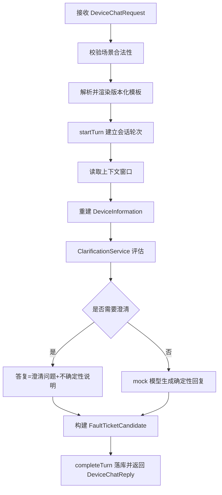
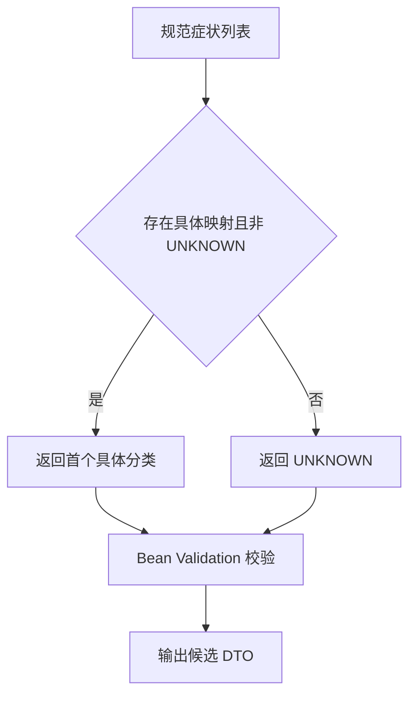

# D18 设备场景 Prompt 模板与会话澄清及工单候选提取 · 技术原理与实践指南

> 文档定位：讲清「底层原理、关键代码、执行流程与可复现操作」，面向工程实践与后续维护。
> 配套文档：《D18 设备场景 Prompt 模板与会话澄清及工单候选提取 · 项目迭代全量记录》。
> 技术基线：JDK 21、Spring Boot 3.5.16、Spring AI 1.1.8、MyBatis-Plus 3.5.17、Velocity（ST4）2.3、JUnit 5。

---

## 1. 概述：是什么，解决什么问题

本迭代在 D17 通用对话能力之上，新增面向设备运维的垂直对话链路，解决四类工程问题：

1. **Prompt（提示词）资产化**：把设备客服/技术工程师的系统提示词纳入版本化模板管理，而非散落在业务方法中硬编码。
2. **缺失信息澄清**：当用户未提供设备型号、故障码等关键信息时，确定性地逐轮追问，并诚实表达不确定性。
3. **会话与多轮上下文**：以会话 ID（Session ID，会话标识）串联多轮对话，复用既有历史持久化与上下文窗口。
4. **结构化候选提取**：把故障现象摘要、工单分类等结构化为候选数据传输对象（DTO，Data Transfer Object，数据传输对象），但不触发正式工单写入。

> 核心设计原则：**确定性优先、Mock（模拟）优先、最小增量、边界显式**。

---

## 2. 技术基线与版本口径

| 组件 | 版本 | 说明 |
|---|---|---|
| Java Development Kit（JDK，Java 开发工具包） | 21 | 主类 D18SpringAiApplication |
| Spring Boot | 3.5.16 | Web、Validation、AOP、Data Redis |
| Spring AI | 1.1.8 | BOM 锁定，禁止升 2.x；DeepSeek starter |
| MyBatis-Plus | 3.5.17 | 下划线自动映射驼峰 |
| StringTemplate（ST4） | 2.3 | 模板变量渲染与字面大括号转义 |
| Bean Validation（Jakarta Validation） | 随 Boot | 记录字段约束校验 |
| JUnit | 5 | 配合 Spring Test、Mockito、AssertJ |

参考资料：
- 《Spring AI Reference | Spring AI 参考文档》：https://docs.spring.io/spring-ai/reference/1.1/index.html
- 《Spring Boot Reference | Spring Boot 参考文档》：https://docs.spring.io/spring-boot/3.5/
- 《Jakarta Bean Validation | Bean 校验规范》：https://beanvalidation.org/

---

## 3. 核心原理剖析

### 3.1 版本化 Prompt 模板原理

模板以稳定业务键 `templateId` 标识，每次更新 `version` 自增并刷新 `updatedAt`；渲染时通过 ST4 把声明过的变量替换进正文，未声明占位符在保存期即被拒绝。

- 设备两新模板均为 `version=1`，变量分别为可选 `device_context`、`engineering_scope`。
- 种子初始化器只在 id 缺失时插入，保证重启幂等、不覆盖既有数据。

### 3.2 确定性信息提取原理

`DeviceInformationExtractor` 不调用模型、不产生网络请求，仅用正则（Regular Expression，正则表达式）与关键词匹配：

- 显式型号：`型号/机型/model` 后接编码；独立型号：CNC/EQ/SV/SP 等前缀编码。
- 故障码：显式 `故障码/报警代码` 或独立 `E/F + 数字`。
- 症状关键词按保序规则映射为 10 个规范症状名（如「发烫/温度高」→「过热/温度异常」）。

### 3.3 澄清与不确定性原理

`ClarificationService` 按固定优先级收集缺失项，**每轮只取缺失清单第一项**生成单问，避免一次问全。置信度仅用 HIGH/MEDIUM/LOW 三档定性，并显式标注「非概率」，杜绝把主观判断伪装成精确百分比。

置信等级判定：

| 条件 | 等级 |
|---|---|
| 型号 + 故障码 + 症状三者齐备 | HIGH |
| 仅有型号 | MEDIUM |
| 其余（无型号） | LOW |

### 3.4 上下文窗口与多轮原理

历史完整落 MySQL，模型请求只携带上下文窗口内最近 N 条 COMPLETED 消息；窗口按消息条数而非 Token（词元）预算，因为本项目无 Token 计数能力，不声称精确 Token 控制。设备档案每轮由窗口历史与当前消息重建，服务本身无状态。

### 3.5 结构化解析与容错原理

`StructuredCandidateParser` 处理「模型输出不是可信输入」的边界：

- 先剥离 Markdown 代码围栏，再反序列化。
- 非法 JSON 抛 `StructuredParseException`，不吞异常、不伪造候选。
- 原始对象 `RawCandidatePayload` 用 `@JsonIgnoreProperties(ignoreUnknown=true)` 忽略多余字段；枚举字符串经 `@JsonCreator` 容错，未知分类归 UNKNOWN。
- 字段缺失/超长由 Bean Validation 明确指出具体字段。

### 3.6 端口与防误写原理

正式工单写入收敛到 `FormalTicketPort` 单一接口，默认实现 `DisabledFormalTicketPort` 被调用即抛 `UnsupportedOperationException`。更关键的是 `DeviceChatService` 的构造器**不注入该端口**，从依赖结构上保证候选提取链路无法触发正式写入，属于「编译期/装配期即可约束」的边界设计。

---

## 4. 关键执行流程

### 4.1 一次设备对话时序（Typora 兼容 Mermaid）



### 4.2 候选分类决策流程



---

## 5. 关键代码导读

### 5.1 设备场景集合（PromptScenes）

```java
public static final String DEVICE_CUSTOMER_SERVICE = "device_customer_service";
public static final String TECHNICAL_ENGINEER = "technical_engineer";

public static final Set<String> CHAT_ROLE_SCENES = Set.of(
        CUSTOMER_SERVICE, PROGRAMMING,
        DEVICE_CUSTOMER_SERVICE, TECHNICAL_ENGINEER);
```

### 5.2 每轮单问澄清（ClarificationService）

```java
boolean needClarify = !missing.isEmpty();
String question = needClarify ? buildQuestion(missing.get(0)) : null;
```

### 5.3 候选校验（FaultTicketCandidateService）

```java
Set<ConstraintViolation<FaultTicketCandidate>> violations = validator.validate(candidate);
if (!violations.isEmpty()) {
    throw new IllegalArgumentException("工单候选字段校验失败: " + detail);
}
```

### 5.4 受控解析异常（StructuredCandidateParser）

```java
try {
    payload = objectMapper.readValue(json, RawCandidatePayload.class);
} catch (JsonProcessingException e) {
    throw new StructuredParseException("模型输出不是合法 JSON，无法生成候选", e);
}
```

---

## 6. 配置说明

| 配置项 | 默认值 | 含义 |
|---|---|---|
| `app.ai.mode`（AI_MODE） | mock | 离线确定性返回，零外网 |
| `app.ai.history.context-window-messages` | 10 | 窗口最近消息条数 |
| `app.ai.history.dev-user-header` | X-Dev-User | 开发归属请求头（非鉴权凭据） |
| `app.ai.prompt.cache.key-prefix` | d15f:prompt:tpl: | 模板缓存前缀（勿改） |
| `spring.ai.deepseek.api-key` | `${DEEPSEEK_API_KEY:...占位...}` | 真实 Key 仅经环境变量注入 |

---

## 7. 操作实践（可复现）

### 7.1 启动应用（mock 模式）

```powershell
& 'D:\SoftwareInstall\Apache\Maven\apache-maven-3.9.16\bin\mvn.cmd' `
  -f 'E:\AI\project\AI-Learning-one\M2-Java\D18\D18_CbProjD15D16D17\pom.xml' spring-boot:run
```

### 7.2 调用设备对话（首轮）

```powershell
$body = @{ scene='device_customer_service'; sessionId=$null;
           message='设备一直报警停了，今天出现的'; variables=$null } | ConvertTo-Json
Invoke-RestMethod -Uri 'http://127.0.0.1:8080/api/v1/device/chat' `
  -Method Post -Headers @{ 'X-Dev-User'='ut_real_device' } `
  -ContentType 'application/json; charset=utf-8' -Body $body
```

### 7.3 多轮续接

取首轮响应的 `data.sessionId`，次轮把它填入 `sessionId`，并补充型号/编号/故障码即可，服务端自动关联历史并关闭澄清。

### 7.4 验证命令

```powershell
# 全量测试
mvn -f <模块 pom> test
# 端口检查（本机无 netstat 时）
Get-NetTCPConnection -State Listen | Where-Object LocalPort -eq 8080
```

---

## 8. 常见问题与误区

| 问题 | 误区 | 正确口径 |
|---|---|---|
| 置信度能否给百分比 | 输出「80% 可能」显得精确 | 只给 HIGH/MEDIUM/LOW 并标注非概率 |
| 无知识来源怎么办 | 编一个文档编号让答复可信 | 固定声明无来源，不引用未确认资料 |
| 模型返回带代码围栏 | 直接反序列化导致失败 | 先剥离围栏再解析 |
| 候选是否等于工单 | 候选即建单 | 仅候选 DTO，正式端口禁用且不被注入 |
| 多轮状态存哪 | 在服务里用成员变量缓存 | 每轮由历史重建，服务无状态 |

记忆简语：**「模型输出不是可信输入，候选不是正式工单，定性不是概率，澄清不是堆砌」**。

---

## 9. 工程实践与注意事项

- **最小增量**：不改公共方法签名、表结构、Redis 前缀与既有返回格式；新增表须走迁移脚本并附回滚。
- **安全红线**：真实 Key 不进配置/日志/版本库，仅经环境变量注入；真实联调须当轮显式授权且独立执行。
- **可验证性**：退出码 0 不等于正确，须回读真实响应与数据库状态，断言业务字段而非仅看进程成功。
- **可维护性**：新增口语化表达时同步扩充症状规则与测试，保持「规则—测试—文档」三者一致。
- **后续演进**：接入真实工单系统时提供自定义 `FormalTicketPort` Bean 覆盖禁用实现，并补齐人工确认与审计流程。

---

## 10. 知识树（竖屏速记）

```text
D18 设备对话链路
├── 模板层
│   ├── 两新场景 device_customer_service / technical_engineer
│   ├── 版本 version + 更新时间 updatedAt
│   └── ST4 变量渲染，未声明占位拒绝
├── 档案层
│   ├── DeviceInformation 每轮重建
│   ├── 正则/关键词提取 型号/故障码/编号/症状
│   └── 定性等级 HIGH/MEDIUM/LOW
├── 澄清层
│   ├── 优先级 型号→故障码→现象→时间→编号
│   ├── 每轮单问
│   └── 无来源固定声明
├── 候选层
│   ├── 症状→分类确定性映射
│   ├── 围栏剥离 + 非法 JSON 受控异常
│   └── Bean Validation 字段校验
└── 边界层
    ├── FormalTicketPort 单一入口
    ├── Disabled 实现调用即抛异常
    └── 编排不注入端口，结构防误写
```
