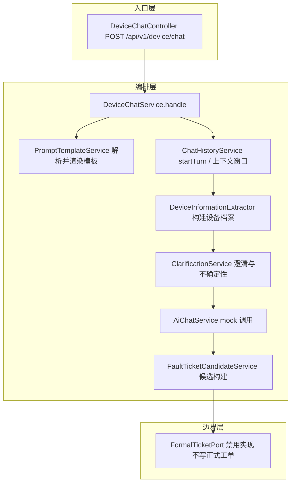

# D18 设备场景 Prompt 模板与会话澄清及工单候选提取 · 项目迭代全量记录

> 文档定位：记录本迭代「做了什么、为什么做、改了哪些文件、如何验证」的全量过程信息。
> 配套文档：《D18 设备场景 Prompt 模板与会话澄清及工单候选提取 · 技术原理与实践指南》。
> 聚合根：`E:\AI\project\AI-Learning-one\M2-Java\D18`；模块：`D18_CbProjD15D16D17`。
> 物理包名：`com.zl.d17`（沿用 D17 包名，未改 d18）；主类：`D18SpringAiApplication`。

---

## 1. 迭代背景与目标

D18 是长主线 D03 → D18 的最新一环，骨架完全复制自 D17。D17 已具备版本化 Prompt 模板、对话历史 MySQL 持久化、Redis 会话组件、知识检索与 Mock/DeepSeek 双模型链路。本阶段在此基础上，把通用对话能力扩展到「设备客服 / 技术工程师」垂直场景，并补齐缺失信息澄清与故障工单候选的结构化提取。

四项核心目标：

| 编号 | 目标 | 关键约束 |
|---|---|---|
| 需求① | 设备客服/技术工程师场景版本化 Prompt 模板 | 含 templateId/version/scene/variables/updatedAt，禁止散落硬编码 |
| 需求② | 缺设备型号/故障码时的澄清策略与不确定性表达 | 本阶段不伪造知识库引用 |
| 需求③ | 会话 ID 与多轮对话 | 先明确会话存储接口，仅在需要持久化时才接 MySQL/Redis |
| 需求④ | 故障现象摘要/工单分类结构化提取 | 只生成候选 DTO，不写正式业务表/不建单/不派单 |

---

## 2. 范围与边界

### 2.1 本次纳入范围

- 新增两个设备场景常量与两个版本化种子模板。
- 新增 `com.zl.d17.device` 子包，承载设备信息提取、澄清、候选构建、结构化解析与正式工单边界。
- 新增设备对话端点 `POST /api/v1/device/chat` 及对应测试。

### 2.2 明确排除项（硬约束）

- 不升级任何依赖，不引入第二套模型链或新中间件。
- 不重复建设会话表或模板系统，不改 Redis 前缀与既有表结构。
- 不新增正式工单表，不执行建单/派单/写库动作。
- 不执行 git commit/push，工作区改动保持未提交。
- 真实 DeepSeek 密钥不写入任何磁盘文件，仅允许经环境变量注入。

---

## 3. 现状盘点与复用决策

阶段 A 对 D17 骨架做了真实侦察，结论汇总为六行决策表：

| 能力域 | 现状 | 本阶段决策 |
|---|---|---|
| Prompt 模板基础设施 | 已满足（版本化、变量、ST4 渲染、管理 API） | 复用，仅新增两场景常量与种子 |
| 会话/历史持久化 | 已满足（chat_session/chat_message 两表 + 上下文窗口） | 复用，不新增会话表 |
| Redis 会话组件 | 已满足但不在主链路 | 保留学习资产，不接线 |
| Mock 与 Key 安全 | 已满足（默认 mock、占位密钥、Key 保护测试） | 复用，不硬编码真实 Key |
| 设备信息澄清 | 尚未实现 | 新建确定性规则服务 |
| 结构化候选提取 | 尚未实现 | 新建候选构建与解析服务 |

> 决策要点：真实缺口只有「设备信息澄清」与「结构化候选提取」，均以确定性规则/关键词在 mock 落地，不新增表/中间件。

---

## 4. 总体架构与执行链路

### 4.1 设备对话处理链路（Typora 兼容 Mermaid）



### 4.2 device 子包层级树

```text
com.zl.d17.device
├── DeviceChatController.java          # 设备对话入口
├── DeviceChatService.java             # 应用编排（不注入正式工单端口）
├── DeviceInformationExtractor.java    # 正则/关键词确定性提取
├── ClarificationService.java          # 缺失信息澄清与不确定性
├── FaultTicketCandidateService.java   # 症状→分类映射，候选构建
├── StructuredCandidateParser.java     # 模型原始文本结构化解析
├── FormalTicketPort.java              # 正式工单写入端口（接口）
├── DisabledFormalTicketPort.java      # 默认禁用实现
├── FormalTicketCommand.java           # 正式工单命令（本阶段不构造）
├── model
│   ├── DeviceInformation.java         # 设备信息档案（每轮重建）
│   ├── ConfidenceLevel.java           # HIGH/MEDIUM/LOW 定性等级
│   ├── TicketCategory.java            # 工单分类枚举
│   ├── CandidateStatus.java           # CANDIDATE/NEEDS_CLARIFICATION
│   └── InformationSource.java         # 信息来源类型
└── dto
    ├── DeviceChatRequest.java         # 设备对话请求
    ├── DeviceChatReply.java           # 设备对话响应
    ├── FaultTicketCandidate.java       # 故障工单候选 DTO
    └── RawCandidatePayload.java       # 模型原始结构化映射对象
```

---

## 5. 需求实现要点

### 5.1 需求①：版本化 Prompt 模板

- `PromptScenes` 新增常量：`DEVICE_CUSTOMER_SERVICE = "device_customer_service"`、`TECHNICAL_ENGINEER = "technical_engineer"`。
- `CHAT_ROLE_SCENES` 由 2 扩为 4，`ALL_SCENES` 由 6 扩为 8。
- 种子文件 `seed-templates.json` 新增两个 `version=1` 模板：
  - 设备客服受理：可选变量 `device_context`（默认「无额外设备背景」）。
  - 技术工程师分析：可选变量 `engineering_scope`（默认「通用设备范围」）。
- 种子初始化器只插入缺失 id，不覆盖既有 6 行，保证幂等。

记忆简语：**「模板进仓库，版本随更新，变量先声明，渲染不硬写」**。

### 5.2 需求②：澄清策略与不确定性

- 澄清优先级（每轮只问一个最高价值问题）：设备型号 → 故障码 → 具体现象 → 时间频率 → 编号产线。
- 不确定性只用定性等级 HIGH/MEDIUM/LOW，明确标注「内部定性判断，非概率、非百分比」。
- 无来源时固定声明：「当前未检索到可核验的知识来源，以下为基于已提供信息的澄清，不引用未确认资料。」
- 命中冒烟/异味等高危症状时附加安全提示，不臆造处置步骤。

记忆简语：**「一轮只问一件事，定性等级不称概率，无来源不编引用」**。

### 5.3 需求③：会话 ID 与多轮对话

- 会话存储接口先行：直接复用既有 `ChatHistoryService`，不新建会话抽象。
- 首轮 `sessionId` 为空由服务端生成，后续轮次回传；同会话历史经上下文窗口关联。
- 持久化复用既有 `chat_session`/`chat_message` 两表，未新增表、未改 Redis 前缀。
- 设备信息档案每轮由「历史用户消息 + 当前消息」重建，服务无状态，单一事实来源仍是会话历史。

### 5.4 需求④：工单候选结构化提取

- 症状→分类确定性映射（仅列代表项）：

| 规范症状 | 工单分类 |
|---|---|
| 冒烟/异味 | SAFETY |
| 泄漏、压力异常 | COOLING |
| 过热/温度异常 | SENSOR |
| 过载 | CONTROL |
| 异常振动、异响、机械卡滞 | MECHANICAL |
| 停机/无法启动、报警 | UNKNOWN |

- 候选经 Bean Validation 校验：摘要必填最长 500、型号最长 128、故障码最长 64、不确定性说明最长 1000。
- 结构化解析器覆盖代码围栏剥离、非法 JSON 受控异常、未知枚举容错、字段缺失/超长报错。
- 正式工单端口默认禁用，且 `DeviceChatService` 结构上不注入该端口，从依赖关系保证不会写正式工单。

---

## 6. 代码改动清单

### 6.1 新增主代码（18 文件，均在 `src\main\java\com\zl\d17\device\`）

| 分组 | 文件 |
|---|---|
| 根（9） | DeviceChatController、DeviceChatService、DeviceInformationExtractor、ClarificationService、FaultTicketCandidateService、StructuredCandidateParser、FormalTicketPort、DisabledFormalTicketPort、FormalTicketCommand |
| model（5） | DeviceInformation、ConfidenceLevel、TicketCategory、CandidateStatus、InformationSource |
| dto（4） | DeviceChatRequest、DeviceChatReply、FaultTicketCandidate、RawCandidatePayload |

### 6.2 修改主代码（2 文件）

- `src\main\java\com\zl\d17\prompt\model\PromptScenes.java`：新增 2 常量，角色/全量集合扩容。
- `src\main\resources\prompt-templates\seed-templates.json`：新增两个设备模板。

### 6.3 新增测试代码（8 文件，均在 `src\test\java\com\zl\d17\springai\device\`）

DeviceTemplateSelectionTest、ClarificationServiceTest、DeviceMultiTurnFlowTest、DeviceSessionIsolationTest、DeviceContextWindowTest、FaultTicketCandidateServiceTest、StructuredCandidateParserTest、FormalTicketBoundaryTest。

### 6.4 遗留测试维护（2 文件）

- `PromptTemplateServiceTest`：角色清单与关键词过滤断言更新为 4 角色/双匹配。
- `PromptTemplateControllerWebTest`：角色端点长度更新为 4，去除顺序依赖。

---

## 7. 验证结果（真实执行，非虚构）

### 7.1 编译验证

- 命令：`mvn compile`；结果：退出码 0，证据 `D18-compile.txt`。

### 7.2 全量测试

- 最终结果：`Tests run: 142, Failures: 0, Errors: 0, Skipped: 1`，BUILD SUCCESS，EXIT=0。
- 唯一跳过项为 `DeepSeekLiveSmokeTest`（真实联调默认不执行）。
- device 包 8 个新测试类全部通过，覆盖 T01–T16；T17–T19 由既有安全测试覆盖。

### 7.3 真机 HTTP 验证（AI_MODE=mock）

| 场景 | 关键真实结果 |
|---|---|
| 设备客服首轮 | 澄清开启，缺型号/故障码/编号，候选 NEEDS_CLARIFICATION |
| 设备客服次轮 | 同会话补齐信息，澄清关闭，候选 CANDIDATE，分类 SENSOR |
| 技术工程师 | 异常振动→MECHANICAL，仅缺发生时间 |
| 非法场景/空消息 | 均返回 4001 |
| 数据库核验 | 两条会话 ACTIVE，消息全部 COMPLETED，无 fault_ticket 表 |

---

## 8. 安全与密钥管理

- 真实 DeepSeek Key 仅允许经运行进程环境变量 `DEEPSEEK_API_KEY` 注入；配置文件只保留 `${DEEPSEEK_API_KEY:}` 占位。
- 默认全链路 mock，零外网；真实 API 联调须用户当轮显式授权、独立手动执行、使用脱敏虚构输入。
- T20 密钥扫描：源码、配置、日志、临时文件及 git 工作区/暂存区真实密钥命中 0。
- 扫描只报告文件位置与布尔结论，不回显任何疑似密钥内容。

---

## 9. 交付物清单

| 类型 | 路径 | 名称 |
|---|---|---|
| 项目全量记录 | docs/proj_docs | D18-设备场景Prompt模板与会话澄清及工单候选提取-项目迭代全量记录.md |
| 技术原理指南 | docs/proj_docs | D18-设备场景Prompt模板与会话澄清及工单候选提取-技术原理与实践指南.md |
| 迭代日志 | logs | D18-迭代日志.md |
| 证据与索引 | docs/evidence/D18 | 12 证据文件 + D18-证据索引.md |
| 临时资料 | docs/temp_docs/D18 | 盘点/设计/编译/测试/HTTP/DB 等过程文件（保留不删） |

---

## 10. 风险与后续建议

- 本阶段设备信息提取基于关键词/正则，对未覆盖的口语化表达可能漏判，后续可扩充词表或引入真实结构化模型输出。
- 正式工单端口虽已禁用且不被注入，接入真实工单系统时仍需补充迁移脚本（含回滚）与人工确认流程。
- 若后续启用知识库检索，需保证引用真实可核验，延续「无来源不引用」的口径。
- 当前所有改动未提交，确认无误后由用户决定是否执行 git commit。
