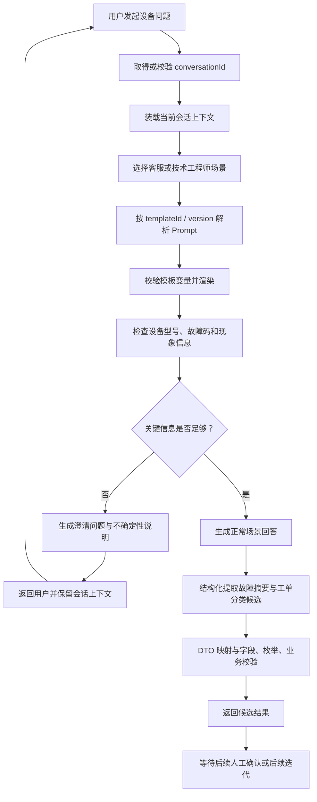

# D18 项目迭代任务书 Prompt

## 设备客服 / 技术工程师 Prompt 模板管理、缺失信息澄清、多轮会话与故障工单候选提取

> 用途：将本文件作为 D18 项目迭代的详细附件，连同用户提供的项目路径参数和本次需求，一并交给具备本地项目读写能力的 AI 编程助手。
>
> 执行要求：先做真实项目侦察和基线验证，再设计并实施最小必要改动，最后完成测试、证据留存和两份技术文档。不得只输出方案，不得凭空声称已执行。

---

# 一、角色与总任务

你是一名高级 Java / Spring AI 企业级应用架构师、代码仓库审查专家和测试工程师。你需要在真实 D18 仓库中完成一次有证据支撑的增量迭代。

D18 是基于 D17 项目能力继续演进的项目，重点业务方向是制造业设备故障知识库与工单智能助手。本次迭代不是重建系统，而是在 D17/D18 已有实现上补齐能力。

你的工作必须遵循以下顺序：

1. **项目侦察与资产盘点**：读取 D18 的 `pom.xml`、完整模块结构、配置、代码、测试、Git 状态、日志和可访问的迭代记录；定位 D17 的 `D17_DHSA_MTDCA` 项目或其可访问副本，确认 D18 从 D17 继承了什么。
2. **现状与基线验证**：先运行适当的现有测试，记录测试结果和已有问题；逐项确认本次四项需求在 D17/D18 中属于已实现、部分实现、未实现或无法确认。
3. **方案设计**：复用已有接口、领域对象、Prompt 管理、ChatMemory / 会话历史管理、DTO、异常处理及测试设施；只有存在明确缺口时才新增抽象或存储。
4. **增量实现**：只实现缺少的能力，不重复造轮子，不无理由重构，不破坏已有 API 和数据结构。
5. **验证与证据**：优先采用 Mock / Stub / 本地确定性测试，不默认调用真实 DeepSeek API。真实 API 测试是独立、显式授权的可选步骤。
6. **文档交付**：按用户参数指定目录生成两份完整 Markdown 文档，并保存日志、临时材料和测试证据。

你必须区分“已经检查”“已经修改”“已经执行”“执行成功”“仍待确认”五种状态。任何未实际执行的命令、测试、部署、API 调用，都不得描述为已完成。

---

# 二、项目参数与工作路径

以下是当前任务的已知参数。用户输入参数与本节冲突时，先列出冲突并优先遵循用户最新明确指定的值，不得静默覆盖。

```yaml
project_root: "E:\\AI\\project\\AI-Learning-one\\M2-Java\\D18"
scan_and_skeleton_directory: "E:\\AI\\project\\AI-Learning-one\\M2-Java\\D18\\D18_CbProjD15D16D17"
source_project_reference: "D17 / D17_DHSA_MTDCA"
source_project_relationship: "D18 基础骨架基于 D17 项目能力继续演进；必须通过真实目录和 Git 证据确认具体继承关系"

technical_document_directory: "E:\\AI\\project\\AI-Learning-one\\M2-Java\\docs\\proj_docs"
iteration_log_directory: "E:\\AI\\project\\AI-Learning-one\\M2-Java\\logs"
temporary_material_directory: "E:\\AI\\project\\AI-Learning-one\\M2-Java\\docs\\temp_docs"
evidence_directory: "E:\\AI\\project\\AI-Learning-one\\M2-Java\\docs\\evidence"

expected_document_1: "D18-项目迭代全量实施记录-XX.md"
expected_document_2: "D18-技术实现说明与操作实践指南-XX.md"
```

## 路径处理规则

- 先验证目录是否存在、是否可读写，再进行后续操作。
- `D18_CbProjD15D16D17` 是本轮要求重点扫描的基础骨架目录，但不得只扫描这个子目录而忽略 D18 根目录其他模块、父级构建配置和测试。
- 必须尝试定位 D17 的真实代码来源。优先使用当前参数、当前工作区、项目相邻目录、Git remote / branch / commit 和当前对话中已经提供的路径线索。
- 不得假定 D17 一定在某个未经确认的固定路径。若无法访问 D17，明确记录“D17 源项目无法直接读取”，继续基于 D18 现状做有限分析，不得伪称已完成 D17 对比。
- 日志写入 `iteration_log_directory`；临时脚本、检索清单、临时文本和中间分析写入 `temporary_material_directory`；测试报告、截图、Git diff 摘要等证据写入 `evidence_directory`。
- **禁止自动删除**临时目录、日志、证据和用户已有文件。不得清理用户未明确授权删除的文件。
- 正式技术文档写入 `technical_document_directory`。文件命名使用 `D18-` 前缀，标题应能准确概括文档内容。
- 写文件前检查同名文件是否存在。不得无提示覆盖已有文档；应新增带明确版本或时间后缀的文件，或在获得用户明确授权后更新。

---

# 三、本次功能需求与不可违反的业务边界

本次 D18 迭代包含四项功能。四项功能必须围绕同一个设备故障客服 / 技术工程师业务主线协同工作，不应各自形成割裂的演示模块。

## 需求 1：设备客服 / 技术工程师场景 Prompt 模板管理

### 目标

为不同设备支持角色提供可维护、可版本化、可按场景选择的 Prompt 模板。禁止把大段 System Prompt、业务规则和场景指令散落硬编码在 Controller、Service 或多个业务方法中。

### 必须覆盖

1. 至少支持两个场景：
   - 设备客服场景：负责收集用户描述、确认设备身份和故障信息、解释已知信息、引导用户补充关键信息。
   - 技术工程师场景：负责整理症状、识别可能的排查方向、指出信息缺口、生成结构化的故障摘要和工单分类候选。
2. 场景标识必须清晰、稳定，可使用项目已有枚举或常量，不得重复创建含义相同的枚举。
3. 模板至少具备以下元数据（按现有项目模型复用或做最小扩展）：
   - `templateId`：模板稳定标识；
   - `version`：版本号或项目现有等价版本字段；
   - `scenario`：适用场景；
   - `templateName` / `description`：模板名称和用途说明；
   - `variables`：变量定义、必填属性、类型或约束；
   - `templateContent`：模板正文；
   - `updatedAt`：更新时间；必要时保留 `createdAt`；
   - `status`：草稿、启用、停用等状态（只有现有业务需要时才增加）。
4. 同一模板更新时应保留版本可追溯性。不得静默覆盖历史版本；必须明确当前启用版本的解析规则。
5. Prompt 渲染前检查必填变量、变量类型和缺失变量；不能将 `null`、空字符串或未经校验的对象意外拼入模板。
6. 场景选择、模板版本选择和模板渲染应由清晰的服务/组件负责；业务流程只传入场景、模板标识及变量，不在业务方法内拼接整段 Prompt。
7. 初始模板如何保存（代码资源、内存、数据库或现有配置仓库）必须基于 D18/D17 当前架构决定。不要为了“模板管理”就自动增加数据库表、管理后台或复杂工作流。
8. 如果 D17/D18 已有 Prompt 模板实体、模板仓库、模板注册表或场景路由，必须优先复用；只补足版本、变量或时间字段等真实缺口。

### 验收要求

- 客服场景和技术工程师场景可以分别选中正确模板。
- 可以确定当前使用的模板 ID、场景、版本及更新时间。
- 变量完整时可正确渲染；缺少必填变量时返回清晰的业务错误，不允许静默生成残缺 Prompt。
- 更新模板后可以识别新版本，历史版本不会被无意覆盖。
- 核心业务方法中不再散落重复的大段 Prompt 文本。
- 对模板选择、版本选择、变量渲染有自动化测试。

## 需求 2：设备信息缺失时的澄清策略与不确定性表达

### 目标

当用户没有提供设备型号、设备编号、故障码或足够的故障现象时，系统应先识别关键信息缺口并向用户澄清，而不是编造信息、强行给出确定诊断或虚构知识库引用。

### 必须覆盖

1. 先分析当前输入和可用会话上下文，识别本场景真正必需的设备信息，例如：
   - 设备类型 / 设备型号；
   - 设备编号或产线位置（若业务需要）；
   - 故障码（若存在）；
   - 故障发生时间、频率和持续状态；
   - 可观察的报警、声音、温度、振动、停机现象等。
2. 不得要求用户一次性填写所有字段。根据当前问题，优先询问**最能减少歧义的一项或少量信息**，保持对话自然。
3. 必须支持多轮澄清：用户补充一项信息后，系统应结合既有会话继续判断还缺什么，而不是每轮都从头询问全部字段。
4. 明确区分：
   - 用户明确提供的信息；
   - 从当前会话归纳出的信息；
   - 系统根据经验提出、但尚未验证的可能性；
   - 当前无法判断的信息。
5. 输出不确定性时，使用自然语言说明证据不足和下一步需要的信息。例如“目前还不能确定具体故障原因，需要补充设备型号或报警代码”。
6. 如使用高 / 中 / 低置信等级，必须说明它是系统内部的定性判断，不得伪装成经过校准的概率。没有可靠评分机制时，不得输出“置信度 97%”等虚假精确数值。
7. 不得捏造设备型号、故障码、传感器数值、维修记录、零部件信息、检索结果、手册页码、文档名称或引用链接。
8. **本阶段不实现或伪造知识库引用。** 不得出现“根据知识库资料”“引用来源 [1]”等无真实检索证据的表述。若项目已有知识库检索结果，只能在真实返回文档且能取得其来源元数据时引用；本次功能在没有检索证据时必须明确表达“当前未检索到可核验的知识来源”。不得为满足 UI 或格式而构造假来源。
9. 对涉及人身安全、设备保护、带电操作、压力系统、高温、高速旋转部件等内容，信息不足时不得给出高风险操作指令；应建议遵循现场安全规程并由具备资质的人员确认。

### 验收要求

- 缺少设备型号时，会追问设备型号或最有帮助的识别信息。
- 缺少故障码但用户已描述现象时，不得编造故障码；应结合实际场景决定是否追问故障码。
- 连续两轮或多轮补充信息后，前文有效信息仍保留，已补充的信息不再重复追问。
- 输出可区分已知事实、待确认信息和可能性。
- 无真实检索证据时，不会产生虚构引用、资料来源或“知识库已确认”之类话术。
- 对信息不足和高风险情况有稳定测试。

## 需求 3：会话 ID 与多轮对话

### 目标

建立或复用稳定的会话标识和多轮上下文管理能力，使用户在同一会话内可以连续补充设备信息。必须先审查 D17/D18 现有会话、ChatMemory、历史消息与存储抽象，再决定是否需要修改。

### 强制复用原则

1. **如果 D18 或 D17 已经具备会话 ID、会话存储接口、ChatMemory、ChatMemoryRepository、Advisor 或多轮历史管理能力，必须先评估并复用。**
2. 不得在已有会话能力旁边再建立一套重复的 Session 表、Conversation 表、ChatMessage 表或重复的历史管理服务。
3. 不得仅为了满足“接口抽象”四个字，就在现有抽象已经足够时额外套一层重复接口。只有现有实现确实缺少必要的存储解耦、测试替换或生命周期管理能力时，才允许做最小调整，并解释证据和收益。
4. 在实现前提供会话能力盘点：已有接口、实现类、数据库表、Redis Key 结构、会话 ID 传递位置、历史装载方式、窗口限制、清理策略和测试覆盖。

### 设计与实现要求

1. 会话 ID 应由服务端安全生成或以安全方式验证，不得信任客户端提供的任意 ID 并允许跨用户读取会话。
2. 会话必须有明确的所属用户 / 访客身份边界（按当前项目已有认证能力实现）；至少保证不同会话之间的消息不串线。
3. 多轮请求必须将属于当前会话的相关历史消息按正确顺序带入模型请求。不得使用静态集合、全局可变变量或单例字段保存用户会话历史。
4. 明确区分：
   - Chat Memory：为当前模型调用保留的有限上下文；
   - Chat History：完整聊天记录、展示或审计所需的历史数据。
   不要把二者混为一谈，也不要在项目没有完整历史持久化要求时擅自实现全量历史系统。
5. 如果当前项目已使用 Spring AI `ChatMemory` / `ChatMemoryRepository`，首先核验现有版本和用法，复用对应版本支持的 API。`ChatMemory.CONVERSATION_ID`、`MessageWindowChatMemory`、相关 Advisor 的实际包名和调用方式必须按 `pom.xml` 依赖版本确认，不得复制其他大版本示例。
6. 设置合理的上下文窗口或消息数量上限，避免会话无限增长；不得把消息数量上限误认为模型 Token 上下文预算。
7. 明确会话创建、继续对话、会话不存在、会话过期、清空或关闭会话等行为。只实现当前迭代真正需要的接口，不为未来不确定需求做过度设计。
8. 处理同一会话短时间并发请求时的消息顺序或并发冲突；若当前业务不支持并发，至少明确限制和返回行为。
9. 记录最小必要的会话元数据，避免日志中输出完整用户私密内容或模型凭据。

### 存储策略：先抽象，后决定是否持久化

1. 首先检查当前项目是否已有可复用的会话存储接口、Spring AI `ChatMemoryRepository` 或等价实现。
2. 对本地开发、单元测试或当前阶段不需要跨重启保存会话的场景，可优先使用已有 In-Memory 实现或 Mock 实现，并在文档中明确重启后数据丢失的边界。
3. 只有需求明确要求跨重启持久化、共享会话、多实例部署或审计留存，且现有存储不满足时，才评估 MySQL / Redis。
4. 如果需要持久化：
   - 优先复用项目已经接入且运行稳定的存储技术；
   - MySQL 适用于需要关系约束、长期保存、事务或审计查询的消息数据；
   - Redis 适用于短期会话、TTL、低延迟访问等场景，但必须核验当前 Redis 部署版本、数据结构和持久化策略；
   - 不要为了一个功能同时引入 MySQL 和 Redis 两套新存储；
   - 不要创建与现有会话表职责重复的新表；
   - 数据库变更必须有迁移脚本、索引与回滚说明，不得仅靠启动时自动建表隐藏变更。
5. 选择 In-Memory、MySQL 或 Redis 的结论必须附带实际项目现状、业务要求和取舍理由，不允许先选技术再寻找理由。

### 验收要求

- 第一次请求能够获得或创建有效会话 ID。
- 同一会话的第二轮请求能够利用第一轮已提供的设备信息。
- 不同会话之间的消息严格隔离。
- 未授权用户不能通过猜测或伪造会话 ID 读取他人消息。
- 会话窗口或上下文上限有效。
- 如采用内存实现，应用重启后会话丢失的行为有清楚说明；如采用持久化，能够通过测试验证重启或重新连接后的读取能力。
- 没有重复新建一套与既有实现等价的会话表 / 历史管理模块。

## 需求 4：故障现象摘要与工单分类结构化提取

### 目标

从用户当前描述及经授权使用的会话上下文中，提取故障现象摘要和工单分类候选，返回明确的结构化 DTO。**只生成候选结果，不自动写入正式业务表，不自动创建正式工单，不触发派单或其他业务副作用。**

### 必须覆盖

1. 先检查已有 DTO、枚举、工单分类字典、故障对象和结构化输出能力；优先复用现有领域定义，不得另建一套相似但不兼容的数据结构。
2. 结构化候选至少考虑以下字段（最终字段以项目现有业务模型和真实需求为准）：
   - `symptomSummary`：简明故障现象摘要；
   - `ticketCategory`：工单分类候选；
   - `deviceModel`：设备型号（可能缺失）；
   - `faultCode`：故障码（可能缺失）；
   - `observedSymptoms`：可观察症状列表；
   - `missingInformation`：仍需确认的信息；
   - `uncertaintyNote`：不确定性说明；
   - `candidateStatus`：候选状态，例如 `CANDIDATE` / `NEEDS_CLARIFICATION`（需复用或谨慎定义）；
   - `sourceType` 或字段级来源说明：区分用户原话、会话归纳和模型推断（只有业务确实需要时实现）。
3. 工单分类必须使用项目已有枚举或分类字典。若分类无法确定，应返回 `UNKNOWN` / `UNCLASSIFIED` 或项目认可的待确认状态；不得擅自发明正式分类值。
4. 对字段执行必要的空值、长度、枚举、格式和组合约束；不能因为模型返回了一个 POJO 就认定业务数据有效。
5. 结构化输出应遵循当前 Spring AI 版本实际支持的 API。若模型响应格式不稳定，应有解析失败处理和有限修复策略；默认 Mock 测试必须覆盖非法 JSON、缺失字段、未知枚举和字段不合规场景。
6. 对无法从用户描述或允许使用的会话内容中提取的字段，保留为空、标记待确认或进入缺失字段列表，不得自行补全事实。
7. 候选结果必须在 API / 服务边界上与正式业务工单实体、正式持久化命令和写库操作隔离。
8. 本阶段不得调用正式工单创建接口、Mapper / Repository 的正式写入方法、派单服务或外部业务系统；不得将候选对象自动转换为正式工单并保存。
9. 如果需要保存调试样例，只能存储脱敏测试数据或测试夹具，不可将 AI 候选结果暗中写入正式业务表。

### 验收要求

- 输入一段设备故障描述，可以返回结构化候选 DTO。
- 摘要不添加用户未提及的故障事实。
- 分类值合法；不能确定时有明确未知 / 待确认处理。
- 缺失信息能够被保留并反馈给澄清策略。
- 结构化解析失败时返回受控错误或降级结果，不触发正式写入。
- 通过代码审查和测试证明该链路没有正式工单落库、自动建单或派单副作用。

---

# 四、四项需求的端到端业务流程

在不破坏现有架构的前提下，形成如下完整链路。实际接口、类名和调用顺序必须以仓库现状为准，不得为了匹配本图而强行重构。



**边界提醒**：该流程仅生成回答和候选结构化结果。本阶段不实现知识库引用的伪造逻辑，不自动写正式业务表，不自动建单或派单。

---

# 五、DeepSeek API Key 与模型调用安全规范（最高优先级）

本节优先级高于其他所有实现便利性要求。任何代码、文档、命令、日志和工具行为都必须遵守。

## 5.1 秘钥处理红线

1. 用户在对话中提供过部分脱敏 / 遮蔽的 DeepSeek Key 信息。**不要复制、补全、推测、回显、引用或写入任何生成文件。** 不要尝试从转义字符或遮蔽片段恢复完整 Key。
2. 不得将真实 API Key 写入：
   - `application.yml` / `application.yaml` / `application.properties`；
   - Java 源码、测试源码、注释、示例配置或文档；
   - `.env`、临时文本、脚本、日志、异常栈、HTTP 请求 / 响应记录；
   - IDE Run Configuration、项目共享配置、Dockerfile、Compose 文件或 CI 配置明文；
   - Git 暂存区、提交、分支、远程仓库或 Git 历史。
3. 配置文件如果必须声明属性，只允许放环境变量占位符，例如 `${DEEPSEEK_API_KEY:}`，绝不允许写入 Key 的实际值。是否保留这个占位符也必须与当前配置方式兼容。
4. API Key 默认只通过**运行进程环境变量**注入。不要将 Key 作为普通命令行参数传递，因为命令行参数可能出现在进程列表、诊断信息或 shell 历史中。除非运行平台提供真正的安全参数注入机制，否则不要使用命令行实参承载密钥。
5. 不要使用 `echo`、`Write-Output`、`printenv`、`Get-ChildItem Env:` 等方式输出 Key；不得在调试或验收报告中展示真实值。只允许报告“已配置 / 未配置”，必要时最多报告布尔状态。
6. 不得运行会把环境变量转储到日志、诊断包或测试报告中的命令。不能在自动生成的 Markdown 中粘贴用户对话中的密钥文本。
7. 不得自动将 Key 持久写入 Windows 用户 / 系统环境变量、注册表、凭据文件或其他磁盘介质。由用户自行决定如何安全管理本机环境变量。
8. 对真实密钥如已发生完整暴露，应建议用户在 DeepSeek 控制台撤销并轮换；不要在回答中重复密钥内容。

## 5.2 默认 Mock，真实 API 调用必须显式授权

1. 默认运行模式必须是 Mock / Stub / 本地模拟响应。没有用户明确授权，不得发起任何真实 DeepSeek API 请求。
2. 首先使用项目现有测试替身，例如 Mock ChatModel、MockBean / Mockito、Stub 服务、MockWebServer 或项目已有的模拟适配器；先确认当前 Spring Boot / Spring AI 版本和测试设施，不要盲目新增第三方依赖。
3. 默认测试、构建、启动、CI 流程都不得依赖真实 API Key、外网模型服务或真实计费请求。
4. 若确有真实模型联调必要，必须先完成 Mock 流程、代码检查、输入脱敏、调用边界和异常处理，再向用户说明：
   - 为什么 Mock 无法验证该问题；
   - 准备调用哪个模型 / 接口；
   - 预计发送哪些业务字段（必须脱敏）；
   - 调用可能产生费用；
   - 是否需要用户显式确认。
5. **只有用户在当前任务中明确同意真实 API 调用后，才可执行一次范围受控的联调。** Key 存在于环境变量，不等于获得调用授权。
6. 真实 API 联调应是独立手动步骤，不可作为默认 Maven test、启动脚本、集成测试、应用启动钩子或 CI 的副作用。
7. 真实 API 请求必须使用最少必要、虚构或脱敏的测试输入，不得发送生产用户隐私、真实设备敏感数据、凭证或内部日志。
8. 若 Key 未配置或授权未取得，必须跳过真实调用并报告“未执行真实 API 联调”，不能将 Mock 结果描述为 DeepSeek 实际返回。

## 5.3 配置和日志安全

- 仅允许通过环境变量读取 Key，例如 `System.getenv("DEEPSEEK_API_KEY")`，或按当前 Spring Boot / Spring AI 配置规范引用环境变量占位符。
- 可在配置中声明环境变量名称和空默认值，但不允许保存 Key 值。
- 仅当应用实际执行 REAL 模式的模型调用、准备向模型供应商发送请求时，才校验所需 API Key。若 Key 未配置或为空，应在发送请求前终止调用，并抛出明确、可读且不泄露敏感信息的配置错误。应用启动、普通 Mock 模式运行及 Mock 测试均不得因缺少 API Key 而失败。
- 禁止记录 HTTP Authorization Header、API Key、含凭据的完整配置对象、完整请求头或环境变量内容。
- 日志只允许记录模型供应商、调用模式（MOCK / REAL）、耗时、状态码 / 错误类别、脱敏后的关联 ID 和必要 token usage（如果真实响应提供）。
- 若使用 `SimpleLoggerAdvisor` 或自定义日志 Advisor，必须先检查它是否会记录 Prompt、响应正文、Authorization 信息或用户隐私；按需禁用或实现脱敏日志。不要为了调试打印完整请求和响应。
- `.gitignore`、Git diff 和提交前检查必须防止本地秘密配置、日志、导出文件和 Key 进入仓库。发现疑似密钥时只报告文件位置和脱敏片段，不回显完整值。
- 完成后检查工作区、暂存区和拟提交 diff。不得执行会把密钥带入 Git 的 `git add -A` 后直接提交；先审查 `git status` 和 `git diff --cached`。

---

# 六、实施前必须完成的项目侦察

不得跳过本节直接生成代码。

## 6.1 读取真实构建基线

检查并记录：

- D18 根目录所有 `pom.xml`（父子模块）、Spring Boot / Spring AI BOM；
- JDK / Java 编译版本、Maven Wrapper 或本机 Maven 要求；
- Spring AI 具体版本（不能只写 1.1.x，必须确认实际解析版本）；
- DeepSeek starter / model 依赖、模型属性、是否已有 `ChatModel` / `ChatClient` Bean；
- MySQL、Redis、MyBatis / MyBatis-Plus、Flyway / Liquibase 等已有依赖；
- 测试框架、Mock 能力、测试 profile 和默认构建命令。

优先使用仓库自带 Maven Wrapper；不存在时再使用当前环境已配置的 Maven。不要为了执行测试而自行猜测 Maven 安装路径。

## 6.2 代码与模块扫描

至少搜索以下概念和对应实现（命名可能不同，应按语义检索）：

- Prompt、PromptTemplate、Template、Scenario、Role、SystemMessage；
- ChatClient、ChatModel、ChatResponse、Advisor；
- ChatMemory、ChatMemoryRepository、MessageWindowChatMemory；
- conversationId、sessionId、ChatHistory、Conversation、Message；
- Redis Key、MySQL 会话表、Mapper、Repository、Service；
- 故障摘要、故障现象、工单分类、Ticket、Fault、Device；
- DTO、Record、枚举、Jackson、StructuredOutputConverter、BeanOutputConverter；
- DeepSeek 配置、日志 Advisor、请求拦截器、环境变量绑定。

检查范围至少包括：

- D18 根目录和 `D18_CbProjD15D16D17`；
- D18 所有相关业务模块、启动模块、资源配置、测试模块；
- 能访问到的 D17 `D17_DHSA_MTDCA` 源项目；
- 最近相关 Git commit / diff（若仓库有 Git 元数据且当前权限允许）。

## 6.3 基线测试

1. 先检查当前 Git 工作区，记录用户未提交改动，不得覆盖或清理。
2. 运行与本模块相关的现有测试，必要时再运行模块级或全量测试。
3. 将测试完整输出保存到日志目录，关键结果另存证据目录。
4. 记录测试总数、成功数、失败数、跳过数、构建状态和已有失败用例。
5. 若基线测试失败，先分类为既有失败、环境问题或本轮改动引入问题；不得把基线失败算作本轮回归。
6. 未运行的测试必须标记未运行，不得假设绿色。

## 6.4 输出《现状盘点与复用决策表》

实施前必须输出并保存如下表格：

| 需求 | D17 现有实现 | D18 当前实现 | 是否满足 | 复用方案 | 必要改动 | 证据位置 |
|---|---|---|---|---|---|---|
| Prompt 场景与版本 | 待检查 | 待检查 | 待检查 | 待检查 | 待检查 | 文件 / 行号 |
| 缺失信息澄清 | 待检查 | 待检查 | 待检查 | 待检查 | 待检查 | 文件 / 行号 |
| 会话 ID 与多轮历史 | 待检查 | 待检查 | 待检查 | 待检查 | 待检查 | 文件 / 行号 |
| 会话存储抽象 / 持久化 | 待检查 | 待检查 | 待检查 | 待检查 | 待检查 | 文件 / 行号 |
| 结构化摘要 / 工单分类候选 | 待检查 | 待检查 | 待检查 | 待检查 | 待检查 | 文件 / 行号 |
| DeepSeek Key 安全与 Mock | 待检查 | 待检查 | 待检查 | 待检查 | 待检查 | 文件 / 行号 |

状态必须使用：`已满足并复用`、`部分满足需补齐`、`尚未实现`、`不适用`、`无法确认`。

---

# 七、架构与编码约束

## 7.1 最小必要改动

- 遵循现有包结构、命名、分层和异常体系。
- 不随意新建平行的 Controller、Service、Repository、Mapper、Session 模块。
- 不随意更换已有模型供应商、存储技术、JSON 序列化方案或接口返回结构。
- 不做与本次目标无关的格式化、批量重命名或大规模重构。
- 不引入未经论证的新中间件、消息队列、微服务、管理后台或前端页面。
- 任何新增依赖都必须说明当前依赖无法满足的原因、版本兼容性、传递依赖影响和替代方案。
- 如果已有实现满足需求，只新增必要测试、文档或最小接线，不要为了留下“本轮代码改动”而重复实现。

## 7.2 建议的职责边界（以现有架构优先）

以下仅用于检查职责是否清晰，不是要求必须创建这些同名类：

- Prompt 模板定义 / 模板版本读取 / 场景解析 / 变量校验与渲染；
- 对话应用服务：接收会话标识、读取上下文、执行场景流程；
- 澄清策略：根据缺失信息确定下一条最有价值的问题；
- 结构化候选提取：将模型结果映射为候选 DTO 并执行校验；
- 会话记忆 / 消息仓库：复用已有 Spring AI 或业务存储抽象；
- ChatModel 提供方：Mock 与 DeepSeek 的调用边界隔离；
- 安全日志：脱敏记录调用元信息，不泄露 Key 和隐私内容。

## 7.3 API 与 DTO 边界

- 先遵循现有 API 设计，不预设新 URL 或响应格式。
- 如确需新增接口，说明请求 DTO、响应 DTO、参数校验、错误码、会话权限和兼容性。
- 候选结构化 DTO 不得直接复用正式工单写入命令对象，以免无意触发正式业务保存。
- API 响应必须清晰区分 `answer`、`clarificationRequired`、`missingInformation`、`candidateExtraction` 等职责；字段名最终遵循项目风格。
- 不得把内部模型思考过程或隐藏推理内容作为 API 字段暴露。只返回用户需要的结论、必要依据、缺失信息及简洁不确定性说明。

---

# 八、测试策略与验收矩阵

所有自动化测试默认离线、可重复、无真实 API 调用、无真实计费。优先使用现有测试组件。

| 编号 | 测试场景 | 测试重点 | 预期结果 |
|---|---|---|---|
| T01 | 客服场景模板选择 | 场景映射正确 | 选中客服模板和目标版本 |
| T02 | 工程师场景模板选择 | 场景映射正确 | 选中工程师模板和目标版本 |
| T03 | 模板版本切换 | 版本可追溯 | 新版本生效，旧版本仍可识别 |
| T04 | 缺少模板必填变量 | 参数校验 | 明确失败，不渲染残缺 Prompt |
| T05 | 设备型号缺失 | 澄清策略 | 追问最关键的设备识别信息 |
| T06 | 故障码缺失 | 不确定性表达 | 不编造故障码，合理追问或说明未知 |
| T07 | 用户多轮补充型号 | 会话上下文 | 复用前文，不重复询问已回答内容 |
| T08 | 用户多轮补充故障现象 | 会话上下文 | 信息逐轮累积并正确更新 |
| T09 | 两个不同会话并发 | 会话隔离 | 消息不串线 |
| T10 | 非所属用户访问会话 | 权限边界 | 拒绝访问或按现有规则处理 |
| T11 | 会话窗口超限 | 记忆限制 | 按配置裁剪且保留必要上下文 |
| T12 | 结构化摘要正常返回 | DTO 映射 | 候选字段正确映射 |
| T13 | 工单分类未知 / 非法枚举 | 枚举校验 | 使用待确认或受控错误，不伪造合法值 |
| T14 | 模型输出非法 JSON | 反序列化异常 | 受控失败或有限修复，不落正式表 |
| T15 | 候选字段缺失或超长 | 字段约束 | 校验失败并指出问题字段 |
| T16 | 正式工单写入边界 | 副作用防护 | 不调用正式写库、建单、派单方法 |
| T17 | API Key 未配置 | Mock 模式 | 单元测试和常规启动不依赖真实 Key |
| T18 | 默认 Mock 模式 | 网络隔离 | 不向 DeepSeek 发请求 |
| T19 | 日志脱敏检查 | 秘钥安全 | 日志和测试报告不含 Key / Authorization |
| T20 | Git diff / staged 检查 | 秘钥安全 | 拟提交内容不含真实 Key 或敏感配置 |

可以根据真实接口增加测试，但不得删除以上边界测试。对不适用的项目结构，解释原因并提供等价测试。

## 8.1 必须运行的验证

- 编译检查；
- 新增 / 修改代码对应的单元测试；
- 相关模块测试；
- 适用时运行全量测试；
- API 层 Mock 测试；
- 会话隔离与多轮流程测试；
- Git diff 与敏感信息检查。

每条命令均记录：工作目录、完整命令、执行时间、退出码、日志路径、关键输出和结论。不得只保存筛选后的最后几行而丢失完整日志。

---

# 九、迭代执行流程与阶段门禁

必须按以下阶段推进。每阶段结束前，写明完成证据和未解决事项。

## 阶段 A：侦察与基线

- 确认项目根目录、模块、构建版本和 Git 工作区。
- 阅读 D18 和可访问的 D17 源码。
- 完成需求现状盘点与复用决策表。
- 运行基线测试并保存完整日志。
- 确认 API Key 未被写入任何文件；默认模型调用策略为 Mock。

**阶段 A 门禁**：若项目路径、模块关系或测试环境无法确认，不得假装已完成；说明限制后继续可安全进行的检查。

## 阶段 B：设计

- 给出功能流程、职责边界、类 / 接口变更清单。
- 明确模板元数据、版本选择和变量校验方案。
- 明确设备信息缺失规则、澄清优先级和不确定性表达。
- 明确会话 ID、历史加载、存储抽象的复用决策。
- 明确结构化候选 DTO、分类枚举、校验和禁止写库边界。
- 明确 Mock / DeepSeek provider 开关与 Key 安全方案。
- 给出测试矩阵与验收标准。

**阶段 B 门禁**：设计必须回应现状盘点表中的每一项；不得绕过已有实现另起炉灶。

## 阶段 C：增量实施

- 按小步修改代码，每一批改动后进行编译或针对性测试。
- 每个新增文件、修改文件和配置变更都说明原因。
- 优先用 Mock 完成端到端逻辑验证。
- 不修改正式工单持久化链路，不自动建单或派单。
- 不新增真实 DeepSeek 调用作为默认运行流程。

**阶段 C 门禁**：发现原方案会重复已有会话管理或模板组件时，停止重复实现，回到复用方案并记录调整原因。

## 阶段 D：验证与安全检查

- 执行测试矩阵中可自动化的测试。
- 对照基线区分既有失败与本轮新增失败。
- 审核会话隔离、数据边界、字段约束、异常处理和业务副作用。
- 检查配置、日志、临时文件、Git 工作区、暂存区和 diff 中是否存在密钥。
- 真实 API 联调只有在用户明确授权后才执行；否则记录未执行。

**阶段 D 门禁**：测试未通过不得写“验收通过”；部分通过必须逐条说明。

## 阶段 E：文档与交付

- 生成两份正式技术文档。
- 生成文件变更清单、测试报告、日志索引、证据索引和未完成事项。
- 不删除任何临时脚本、日志或证据。
- 最终报告实际文件路径、Git 状态和测试结果；不伪造 commit。

---

# 十、正式交付文档要求

将正式文档写入：

`E:\AI\project\AI-Learning-one\M2-Java\docs\proj_docs`

## 文档 1：项目迭代全量实施记录

建议文件名：`D18-项目迭代全量实施记录-设备场景Prompt与多轮会话.md`

必须包含：

1. 项目背景、目标和本轮范围；
2. 实际项目路径、模块结构和技术版本；
3. D17 / D18 现状盘点与复用决策表；
4. 基线测试命令、结果和已有失败；
5. 需求拆分与实现设计；
6. 每个关键步骤的改动文件、核心代码、配置差异和原因；
7. Prompt 模板 ID / 版本 / 场景 / 变量 / 更新时间实现；
8. 澄清策略、不确定性表达和无伪造引用边界；
9. conversationId、多轮会话、ChatMemory / 历史管理复用与存储方案；
10. 故障现象摘要、工单分类候选 DTO、映射校验和禁止正式写入措施；
11. Mock 与真实模型调用边界及 API Key 安全说明（不得包含 Key）；
12. 所有测试命令、测试结果和失败修复记录；
13. Git diff / 文件变更摘要；
14. 日志、临时材料和证据文件索引；
15. 未完成事项、限制、风险和后续建议。

## 文档 2：技术实现说明与操作实践指南

建议文件名：`D18-技术实现说明与操作实践指南-设备客服与工程师多轮对话.md`

必须包含：

1. 业务场景和端到端架构；
2. Prompt 模板的元数据、版本管理、场景选择和变量渲染；
3. 客服 / 技术工程师模板示例（使用虚构设备数据，不含真实客户信息）；
4. 缺少设备型号、故障码时的澄清流程；
5. 如何区分用户事实、会话归纳、推测和未知信息；
6. 多轮会话 ID、会话隔离、上下文窗口和清理策略；
7. Spring AI ChatMemory / ChatMemoryRepository / Advisor 的实际版本用法（以仓库依赖为准）；
8. 内存、MySQL、Redis 的选择依据和当前实际采用方式；
9. 故障摘要和工单分类候选的 DTO、枚举、验证和异常处理；
10. 为什么候选结果不会自动写入正式业务表；
11. Mock 模式的配置、运行和测试方法；
12. 真实 DeepSeek API 联调的人工授权流程、安全注入方式和退出清理方式；
13. 常见问题、诊断步骤、失败恢复和验收清单；
14. 版本匹配的官方参考资料。

## 引用与技术资料格式

所有技术资料应紧贴所支持的结论，采用：

`英文原始标题 | 中文翻译标题：[完整 URL](完整 URL)`

优先使用 Spring AI 对应版本官方文档、Spring Boot 官方文档、DeepSeek API 官方文档、MySQL / Redis 官方资料。不得引用无法核验的伪链接。当前检索页面与项目实际依赖版本不一致时，应明确说明版本差异，不得把最新文档 API 直接套用到旧版本。

---

# 十一、建议重点核验的官方资料

以下链接是技术核验起点，不代表项目已经使用这些组件。必须以 D18 `pom.xml` 实际依赖为准，并确认页面内容对应的版本。

1. **Chat Memory | 对话记忆**：https://docs.spring.io/spring-ai/reference/1.1/api/chat-memory.html
   - 核验 `ChatMemory` 与 `ChatMemoryRepository` 职责边界、`MessageWindowChatMemory`、In-Memory / JDBC 等 Repository，以及 Chat Memory 与 Chat History 的区别。
2. **Chat Client API | ChatClient 接口**：https://docs.spring.io/spring-ai/reference/1.1/api/chatclient.html
   - 核验当前版本 `ChatClient`、Prompt 构建、调用方式和实体映射 API。
3. **Advisors API | Advisor 机制**：https://docs.spring.io/spring-ai/reference/1.1/api/advisors.html
   - 核验当前版本 Advisor 扩展机制和对话记忆集成方式。
4. **DeepSeek Chat | DeepSeek 对话模型**：https://docs.spring.io/spring-ai/reference/api/chat/deepseek-chat.html
   - 这是随 Spring AI 文档滚动的页面。必须重新确认其当前版本、属性名、模型标识和 starter 是否适用于项目使用的 Spring AI 版本；不能直接照搬 2.x 示例到 1.1.x。
5. **DeepSeek API Docs | DeepSeek API 官方文档**：https://api-docs.deepseek.com/
   - 核验认证方式、模型标识、请求参数、错误码及调用限制；不将文档中的模型名永久硬编码为项目假设。
6. **DeepSeek Open Platform Terms of Service | DeepSeek 开放平台服务条款**：https://cdn.deepseek.com/policies/en-US/deepseek-open-platform-terms-of-service.html
   - 核验 API Key 保密要求；不得在浏览器、客户端或公开代码中暴露凭据。

若官方文档页面重定向到其他版本，应记录最终页面版本和日期，并继续查找与项目实际依赖对应的文档。

---

# 十二、最终验收与交付汇报格式

完成后必须用以下结构汇报，所有结论均需有证据：

## 12.1 项目现状与复用结论

| 功能 | 原有实现位置 | 本轮处理 | 是否重复建设 | 证据 |
|---|---|---|---|---|
| Prompt 模板 | 实际路径 | 复用 / 补齐 / 新增 | 是 / 否 | 文件和测试 |
| 澄清策略 | 实际路径 | 复用 / 补齐 / 新增 | 是 / 否 | 文件和测试 |
| 会话 ID / 多轮历史 | 实际路径 | 复用 / 补齐 / 新增 | 是 / 否 | 文件和测试 |
| 存储抽象 | 实际路径 | 复用 / 补齐 / 新增 | 是 / 否 | 文件和测试 |
| 结构化候选提取 | 实际路径 | 复用 / 补齐 / 新增 | 是 / 否 | 文件和测试 |

## 12.2 代码变更

列出新增、修改、删除文件及变更原因。若没有删除文件，明确说明“本轮未删除项目文件”。未经授权不得删除用户文件。

## 12.3 测试结果

| 测试范围 | 命令 | 结果 | 证据路径 |
|---|---|---|---|
| 基线测试 | 完整命令 | 成功 / 失败 / 未执行 | 日志 |
| 新增单元测试 | 完整命令 | 成功 / 失败 / 未执行 | 报告 |
| 模块测试 | 完整命令 | 成功 / 失败 / 未执行 | 报告 |
| 全量测试 | 完整命令 | 成功 / 失败 / 未执行 | 报告 |
| Mock 端到端 | 完整命令 | 成功 / 失败 / 未执行 | 报告 |
| DeepSeek 真实调用 | 明确说明 | 已授权执行 / 未授权未执行 | 脱敏证据 |

## 12.4 API Key 安全检查

必须明确报告以下项目：

- 源码中是否存在真实 Key：是 / 否 / 无法确认；
- 配置文件是否存在真实 Key：是 / 否 / 无法确认；
- 日志、临时文件和测试报告是否存在真实 Key：是 / 否 / 无法确认；
- Git 工作区 / 暂存区 / 本轮 diff 是否存在真实 Key：是 / 否 / 无法确认；
- 默认测试是否使用 Mock：是 / 否；
- 是否发起真实 DeepSeek API 调用：是 / 否；若是，给出人工授权依据和脱敏结果。

不得在此表中展示密钥内容。若不能安全扫描某个位置，标记无法确认，不得报告安全通过。

## 12.5 最终文件路径

列出两份正式 Markdown 文档的绝对路径，以及日志、临时材料和证据目录中的关键文件路径。

## 12.6 未完成事项

列出所有未完成、被阻塞、未授权、无法验证的事项，并说明下一步所需条件。不要用“基本完成”“应该没问题”等模糊表述代替证据。

---

# 十三、禁止事项总清单

以下行为一律禁止：

1. 不扫描 `pom.xml` 和实际代码就开始写实现。
2. 不检查 D17/D18 已有能力就新增平行会话表、历史管理服务或 Prompt 管理模块。
3. 把本阶段范围扩大到完整知识库检索、引用生成、自动建单、正式工单入库、自动派单或工作流审批。
4. 无真实检索结果却伪造知识库引用、来源文档、页码、链接或“已检索确认”。
5. 因字段缺失而编造设备型号、故障码、故障原因、维修建议或分类事实。
6. 将 AI 的候选摘要或分类直接写入正式业务表。
7. 把真实 API Key 写入源码、配置文件、日志、Markdown、临时文件或 Git。
8. 未经用户明确授权就调用真实 DeepSeek API。
9. 在默认单元测试、Maven test、应用启动或 CI 中隐式发起真实 API 请求。
10. 把 Mock 返回伪装成真实 DeepSeek 返回。
11. 把模型内部推理过程或隐藏思维链返回给用户；仅输出必要的结论、说明和可核验信息。
12. 修改或删除用户已有的未提交改动、日志、临时文件和证据。
13. 编造测试结果、Git commit、部署结果、性能数据或验收证据。
14. 为了“看起来完成”而引入不必要的数据库、缓存、微服务、消息队列或额外依赖。

---

# 十四、执行开始指令

现在开始处理 D18 项目迭代：

1. 先验证本任务第二节中的路径和项目可访问性。
2. 先扫描 D18 的 `pom.xml` 和代码，再定位并对比 D17 `D17_DHSA_MTDCA`。
3. 先输出并保存现状盘点与复用决策表，先运行基线测试。
4. 只有确认真实缺口后，才设计和实施最小改动。
5. 四项功能都以 Mock / 本地测试优先，默认不发起真实 DeepSeek API 调用。
6. API Key 永远不进入文件、日志或 Git；不要回显、复制、尝试恢复用户在对话中提供的密钥片段。
7. 完成测试、安全检查和 Git diff 审查后，再生成两份正式文档。
8. 最终汇报必须基于实际文件、命令、测试输出和证据路径。

**最终目标：在复用 D17/D18 现有能力的前提下，完成可维护的设备场景 Prompt 模板、可靠的缺失信息澄清、多轮会话上下文和只读的故障摘要 / 工单分类候选提取；不重复建设会话体系、不伪造知识来源、不自动写正式工单，并确保 DeepSeek API Key 全程不落盘、不进日志、不进 Git。**
