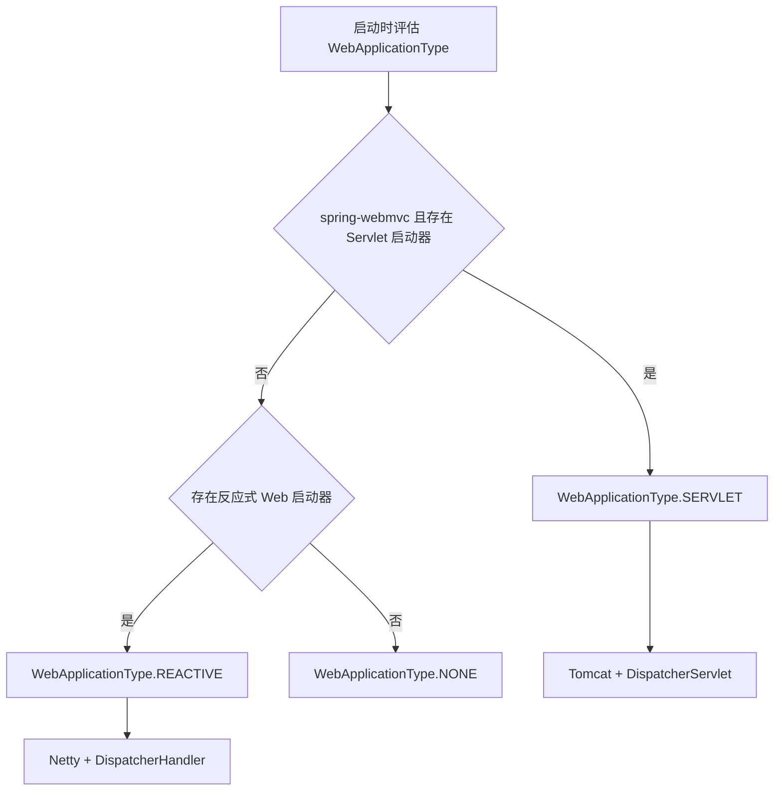
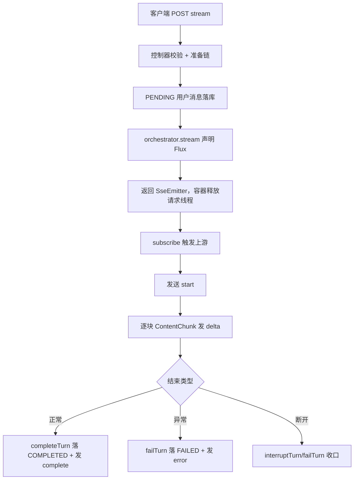

# D19 MVC 与 WebFlux 流式聊天技术说明及实践指南

> 适用模块：D19_SCI（物理包 `com.zl.d19`）
> 技术基线：Spring Boot 3.5.16、Spring MVC 6.2.19、Spring AI 1.1.8、Reactor 3.7.19、Tomcat 10.1.55、JDK 21
> 阅读方式：先概念、再原理、再流程、再代码、再实践与避坑。

---

## 1. 概念辨析

### 1.1 名词表（首次出现给全称与中文）

| 缩写 | 英文全称 | 中文 |
|---|---|---|
| MVC | Model-View-Controller | 模型-视图-控制器（Servlet 同步/异步 Web 框架） |
| SSE | Server-Sent Events | 服务器发送事件（基于 HTTP 的单向流式协议） |
| HTTP | HyperText Transfer Protocol | 超文本传输协议 |
| JDK | Java Development Kit | Java 开发工具包 |
| DTO | Data Transfer Object | 数据传输对象 |
| API | Application Programming Interface | 应用程序编程接口 |
| I/O | Input/Output | 输入/输出 |

### 1.2 Spring MVC 与 WebFlux 的本质区别

| 维度 | Spring MVC | Spring WebFlux |
|---|---|---|
| 基础规范 | Servlet（阻塞 I/O 模型） | Reactive Streams（反应式流规范） |
| 默认服务器 | 嵌入式 Tomcat | 嵌入式 Netty（也可 Tomcat） |
| 编程模型 | 阻塞方法 + 异步请求支持 | 函数式/注解式，返回 Mono/Flux |
| 适配场景 | 阻塞 JDBC、传统业务 | 高并发、非阻塞 I/O |

**关键点**：Spring MVC 并非只能「一个请求占一个线程到结束」，它支持异步请求（Servlet 3.0+）与响应式返回值适配，因此可以在 MVC 内承载 `SseEmitter` 与反应式桥接。

### 1.3 记忆简语

- **「MVC 是 Servlet 家，WebFlux 是 Reactor 家」**。
- **「SSE 是 HTTP 长连接里的单向推」**。
- **「Flux 是 0..N 异步序列，Mono 是 0..1」**。

---

## 2. 为什么「有 webflux 库」不等于「应用是 WebFlux」

### 2.1 依赖与运行时的分层

1. **构建期类路径**：Spring AI 模型层为了表达流式结果，依赖 `reactor-core`，并传递引入 `spring-webflux` 这个**框架 jar**。
2. **运行期装配**：Spring Boot 根据 `WebApplicationType` 决定创建哪种 Web 容器。判定依据是是否存在反应式 Web 启动器（`spring-boot-starter-webflux`）与 Servlet 启动器。
3. 本模块只有 `spring-boot-starter-web`、没有 `spring-boot-starter-webflux`，因此 `WebApplicationType = SERVLET`，创建 Tomcat 与 `DispatcherServlet`。

### 2.2 判定决策树



### 2.3 证据链（可复核）

- POM：`spring-boot-starter-web` 存在，`spring-boot-starter-webflux` 不存在。
- 依赖树：无 `reactor-netty`，无 Netty HTTP 服务器；Netty 其他包来自 Lettuce。
- 启动日志：`Starting Servlet engine: Apache Tomcat/10.1.55`。
- 运行时：上下文为 `AnnotationConfigServletWebServerApplicationContext`，Servlet 工厂是 `TomcatServletWebServerFactory`，无 `ReactiveWebServerFactory` Bean。

---

## 3. 底层原理

### 3.1 Servlet 异步请求与 SseEmitter

- 控制器返回 `SseEmitter` 后，Servlet 容器释放当前请求线程，连接保持打开。
- 应用在任意线程（此处为 Reactor 调度线程）调用 `emitter.send(...)` 写事件，完成后 `emitter.complete()`。
- 容器侧通过 `onCompletion / onTimeout / onError` 回调把生命周期交回应用。

### 3.2 Reactor Flux：冷流与订阅

- `Flux` 是**冷流**：仅在被 `subscribe` 时才向上游发起请求，未订阅时不产生 I/O。
- 模型层 `chatModel.stream(prompt)` 只声明数据流，真正的上游 HTTP 调用在控制器订阅后启动。
- `Disposable` 是订阅句柄，`dispose()` 取消上游，停止后续分片。

### 3.3 背压（Backpressure）口径

- Reactor 操作符链可向上游传递需求；但 SSE 的实际字节写出在 Servlet 容器内。
- 本实现不做逐条请求式背压控制器；当客户端写出失败（断连/异常），`safeSend` 返回 false 并立即 `dispose` 上游，以此收敛资源。

### 3.4 非阻塞边界（如实说明）

- 模型层（Flux 管道）与请求线程占用是非阻塞/异步的。
- `emitter.send` 的字节写出在 Servlet 容器内仍可能阻塞，因此**不是端到端完全非阻塞**，不应宣称全链路 reactive。

---

## 4. 执行流程

### 4.1 端到端时序



### 4.2 SSE 帧格式（标准）

```
event:delta
data:{"seq":0,"content":"[MOCK:"}

```

- 每个事件由 `event:` 与 `data:` 行组成，事件之间以空行分隔。
- 多行 `data:` 按规范以换行拼接；本项目 data 均为单行 JSON。

---

## 5. 核心代码解读

### 5.1 模型层（Spring AI 1.1.8 接口，javap 实证）

- `ChatModel` 同时继承同步 `Model` 与 `StreamingChatModel`：
  - `ChatResponse call(Prompt)`（抽象）
  - `Flux<ChatResponse> stream(Prompt)`（默认）
- `ChatClient` 的等价 fluent 链路（本项目未使用，仅核验）：
  - 同步：`prompt() → call() → content()`
  - 流式：`prompt() → stream() → content()` 返回 `Flux<String>`
- 本项目选择更底层、可移植的 `ChatModel`，`ChatClient` 本质也是对它的封装。

### 5.2 控制器桥接（关键约束）

- 生产代码内不使用 `block()`、`collectList()` 把流重新聚合。
- 不启动脱离请求生命周期的 `subscribe`。
- `safeSend` 用 `synchronized` 保护，失败即置 finished 并取消上游。
- 双层超时：`Flux.timeout(streamTimeoutMs)` + `SseEmitter` 容器超时（+5000ms 宽限）。

### 5.3 终态单次保证

- `persisted` 为 `AtomicBoolean`，`compareAndSet(false,true)` 保证 Reactor 回调与容器回调不会重复写终态。

---

## 6. 实践指南

### 6.1 调用流式接口（Java HttpClient 示例）

```java
HttpClient client = HttpClient.newBuilder().connectTimeout(Duration.ofSeconds(5)).build();
HttpRequest request = HttpRequest.newBuilder()
        .uri(URI.create("http://127.0.0.1:8080/api/v1/ai/chat/stream"))
        .header("Content-Type", "application/json")
        .header("Accept", "text/event-stream")
        .POST(HttpRequest.BodyPublishers.ofString("{\"message\":\"设备无法开机\"}"))
        .build();

HttpResponse<Stream<String>> response = client.send(request, HttpResponse.BodyHandlers.ofLines());
response.body().forEach(System.out::println); // 逐行读取，事件随到达出现
```

### 6.2 前端接入要点

- 使用 `fetch` + `ReadableStream` 的 reader，配合独立 `sse-parser`，兼容 LF/CR/CRLF 与跨块边界。
- 文本一律 `textContent/createTextNode` 渲染，不拼 `innerHTML`，防止脚本注入。
- `thinking` 渲染到独立区域，绝不追加进答案正文。
- 用 `AbortController` 实现「停止接收」。

### 6.3 反向代理缓冲处理

- Nginx 默认可能缓冲 SSE，导致客户端收到「一次性大包」。
- 服务端已下发 `X-Accel-Buffering:no`；代理侧建议：

```nginx
proxy_buffering off;
proxy_cache off;
proxy_http_version 1.1;
proxy_set_header Connection "";
proxy_read_timeout 3600s;
```

### 6.4 真机验证口径

- 结构性证据：抓包统计独立 `event:delta` 块数量（本项目实测 17 个），而非只看是否 200。
- 响应头：`Content-Type` 以 `text/event-stream` 开头，含 `X-Accel-Buffering:no`、`Cache-Control:no-cache`。
- 时序性证据：用 `ofLines` 等惰性读取，确认事件随到达逐个出现。

---

## 7. 常见问题与避坑（FAQ）

| 问题 | 根因 | 正确做法 |
|---|---|---|
| 把 webflux jar 当成应用已切换 | 混淆「类库」与「容器类型」 | 看 starter、WebApplicationType、服务器工厂 |
| 客户端收到一次性大包 | 代理或客户端缓冲 | 关闭代理缓冲，用非缓冲读取 |
| 在流里 block 导致线程占用 | 冷流被强行聚合 | 生产代码保持响应式，block 仅用于测试 |
| 终态重复写库 | 多路回调竞争 | AtomicBoolean compareAndSet |
| 断开后数据状态不一致 | 未区分有无部分正文 | 有正文 INTERRUPTED，无正文 FAILED |
| 误把 chunk 当 token | 分片口径误解 | 声明为「片段」，按顺序追加 |

---

## 8. 工程结论与扩展边界

- 推荐组合：**Spring MVC/Tomcat 主栈 + Reactor 模型层流 + SseEmitter 桥接 SSE**，满足当前需求且改动最小。
- 何时才考虑整体 WebFlux：阻塞 JDBC 被反应式数据访问替代、全链路需要非阻塞、且团队接受 Servlet 体系迁移成本时再评估。
- 本迭代不升级依赖、不引第二套模型链/中间件、不迁移主栈、不改表结构与 Redis 前缀。

---

## 9. 层级树（知识归档）

```
D19 流式技术
├─ 运行时
│  ├─ Servlet 容器 Tomcat
│  ├─ DispatcherServlet
│  └─ SseEmitter 异步响应
├─ 反应式（仅模型层）
│  ├─ reactor-core Flux
│  ├─ ChatModel.stream
│  └─ Disposable 取消
├─ 事件协议
│  ├─ start / delta / complete
│  ├─ thinking / citations
│  └─ error
└─ 持久化状态
   ├─ PENDING / COMPLETED
   └─ FAILED / INTERRUPTED
```

> 官方溯源：
> 《Spring AI Reference 1.1 | Spring AI 1.1 参考文档》：https://docs.spring.io/spring-ai/reference/1.1/
> 《Spring Framework Web MVC | Spring MVC 参考》：https://docs.spring.io/spring-framework/reference/6.2/web/webmvc.html
> 《HTML Standard Server-sent events | HTML 标准 SSE 章节》：https://html.spec.whatwg.org/multipage/server-sent-events.html
> 《Reactor Reference | Reactor 参考文档》：https://projectreactor.io/docs/core/3.7.19/reference/
