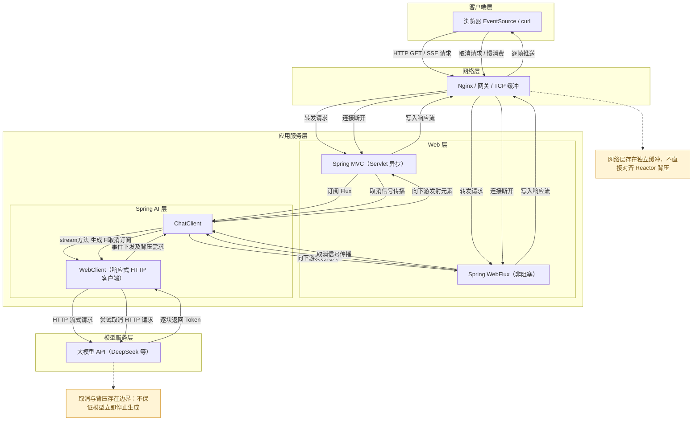
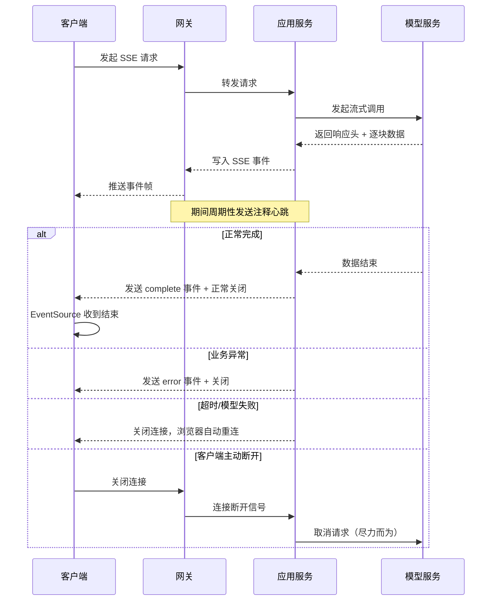

# Spring-AI-SSE事件连接生命周期背压与同步响应式边界

## 1. 学习目标与版本基线

### 1.1 学习目标

围绕 Spring AI 流式响应场景，系统性掌握四层核心知识：

1. SSE 协议本质、事件格式、连接全生命周期与浏览器行为
2. Reactor 背压机制、需求传播、取消信号与跨层边界
3. 同步/异步/响应式/流式的概念边界，避免术语混淆
4. Spring AI 1.1.x 流式 API 用法、MVC/WebFlux 选型与最小实践

### 1.2 版本基线（已核验）

| 组件         | 版本   | 说明                           |
| ------------ | ------ | ------------------------------ |
| JDK          | 21 LTS | 语言基线                       |
| Spring Boot  | 3.5.16 | 对应 Spring Framework 6.2.x    |
| Spring AI    | 1.1.x  | 流式 API 以 1.1.8 官方文档为准 |
| Reactor Core | 3.7.x  | 随 Spring Boot 3.5 传递依赖    |
| Servlet      | 6.0    | Spring MVC 异步请求基础        |

>
> 核验说明：所有 API、行为描述均匹配上述版本；若实际项目依赖版本不同，以项目 `pom.xml` 与对应版本文档为准。

---

## 2. 一页式全链路图



---

## 3. SSE 协议与原始事件示例

### 3.1 协议本质

**SSE（Server-Sent Events）** 是基于 HTTP 1.1 的**服务器到客户端单向事件流协议**，不是 WebSocket，也不支持双向通信。

- 本质：长连接 HTTP 响应，分批次推送文本事件
- 媒体类型：`Content-Type: text/event-stream`
- 编码：强制 UTF-8
- 适用场景：服务端主动推送、实时通知、流式输出、AI 对话回复
- 不适用场景：需要客户端频繁向服务端发消息、双向实时交互（用 WebSocket）

### 3.2 核心字段详解

| 字段    | 语法             | 作用                                                         |
| ------- | ---------------- | ------------------------------------------------------------ |
| `data`  | `data: 内容文本` | 事件数据主体，可多行，同事件连续 data 会自动拼接             |
| `event` | `event: 事件名`  | 自定义事件类型，不写默认是 `message` 事件                    |
| `id`    | `id: 事件ID`     | 事件唯一标识，浏览器自动保存，重连时通过 `Last-Event-ID` 回传 |
| `retry` | `retry: 3000`    | 告知浏览器断开后自动重连的间隔（毫秒）                       |
| 注释行  | `: 注释内容`     | 以冒号开头，客户端忽略，常用于心跳保活                       |

>
> 事件分隔：两个事件之间必须用**一个空行**（`\n\n`）分隔，浏览器以此作为事件边界。

### 3.3 完整原始报文示例

以下是一段合法的 SSE 原始响应流，逐行解释：

```http
HTTP/1.1 200 OK
Content-Type: text/event-stream;charset=UTF-8
Cache-Control: no-cache
Connection: keep-alive
Transfer-Encoding: chunked

: heartbeat  ① 注释行心跳，防止网关超时
retry: 3000  ② 断连后3秒自动重连

id: msg-001  ③ 事件ID
event: delta  ④ 自定义事件名
data: 你好，  ⑤ 事件数据

data: 我是  ⑥ 同事件多行data，最终拼接为"你好，我是AI助手"
data: AI助手

event: complete  ⑦ 结束事件
data: {"status":"done"}

  ⑧ 空行表示事件结束
```

① 注释心跳：不携带业务数据，用于维持长连接，避免网关空闲超时断开
② 重连配置：浏览器默认断连后自动重连，可通过 retry 调整间隔
③ 事件ID：用于断点续传，幂等消费
④ 命名事件：可自定义事件类型，前端通过 `addEventListener` 监听不同事件
⑤ 数据字段：单行或多行，最终拼接为完整内容
⑦ 结束事件：业务自定义结束标识，告知客户端流已完成

### 3.4 易混淆层级区分

**一个 SSE 事件 ≠ 一次 HTTP 写入 ≠ 一个网络数据包 ≠ 一个模型 Token/Chunk**

- 模型侧：一次生成多个 Token，按内部缓冲策略下发 Chunk
- 应用侧：可对多个 Chunk 聚合后再发送一个 SSE 事件
- 网络侧：TCP 分片、Nagle 算法、网关缓冲会拆分/合并数据包
- 浏览器侧：EventSource 按空行解析事件，与网络分片无关

>
> 核心结论：四者不存在一一对应关系，不能通过事件数量反推 Token 数量。

### 3.5 浏览器 EventSource 行为

- 三种状态：`CONNECTING`（连接中）、`OPEN`（已连接）、`CLOSED`（已关闭）
- 默认事件：未指定 event 名的事件触发 `message` 事件
- 自动重连：网络断开后默认按 retry 间隔自动重连，并携带 `Last-Event-ID`
- 主动关闭：前端调用 `eventSource.close()` 后彻底终止，不再重连

### 3.6 重连、事件ID与幂等性

- `Last-Event-ID` 只是协议层机制，**不代表业务天然幂等**
- 服务端是否支持续传、从哪里续传，需要业务逻辑实现
- 自动重连可能导致重复请求、重复消费，必须由业务侧保证幂等
- 不能认为“有了事件ID就不会丢数据”，网络中断期间服务端数据可能已丢弃

### 3.7 同类技术对比

| 技术         | 通信方向           | 协议基础       | 数据格式      | 适用场景                     |
| ------------ | ------------------ | -------------- | ------------- | ---------------------------- |
| SSE          | 服务端→客户端 单向 | HTTP 长连接    | 文本事件      | 消息推送、流式输出、AI 回复  |
| 普通分块响应 | 服务端→客户端 单向 | HTTP 分块编码  | 二进制/文本   | 文件下载、大文件传输         |
| NDJSON       | 服务端→客户端 单向 | HTTP 长连接    | 每行一个 JSON | 结构化流式数据、日志流       |
| WebSocket    | 双向全双工         | WebSocket 协议 | 二进制/文本   | 即时通讯、协同编辑、实时游戏 |

---

## 4. 连接生命周期与断连/重连

### 4.1 完整生命周期时序



### 4.2 各阶段关键行为

1. **连接建立**
   - 客户端发送 GET 请求，携带 `Accept: text/event-stream`
   - 服务端返回 200 响应，设置正确的 Content-Type、禁用缓存、保持长连接
   - 响应头写入后即建立逻辑连接，开始事件推送
2. **持续推送**
   - 服务端按业务节奏发送数据事件
   - 空闲期发送注释心跳，避免网关、负载均衡的空闲超时断开
   - 心跳间隔通常小于网关超时时间（如 30 秒一次）
3. **正常终止**
   - 业务数据全部发送完毕，服务端可发送自定义结束事件
   - 关闭响应流，TCP 连接正常关闭
   - 浏览器 EventSource 进入 CLOSED 状态（若服务端正常关闭，部分浏览器不会自动重连）
4. **异常终止**
   - 模型调用失败、业务异常、超时：服务端可发送错误事件后关闭
   - 未捕获异常导致连接断开：浏览器触发 error 事件并自动重连
5. **客户端断连**
   - 页面关闭、网络中断、前端调用 `close()`
   - 服务端会收到连接断开信号（IOException），触发取消传播
6. **自动重连**
   - 非主动关闭的断连，浏览器按 retry 间隔自动发起重连
   - 重连请求自动携带 `Last-Event-ID`
   - 重连是浏览器行为，服务端无状态，必须业务侧处理重复请求

### 4.3 资源管理要点

- **超时设置**：配置合理的请求超时、模型调用超时，避免僵尸连接
- **取消传播**：客户端断开后，应用应尽快取消上游模型请求，避免无效 Token 消耗
- **连接数限制**：SSE 是长连接，需控制并发连接数，避免资源耗尽
- **并发隔离**：流式请求单独配置线程池/连接池，与普通接口隔离
- **日志追踪**：全链路携带 traceId，将同一连接的所有事件日志关联

### 4.4 状态一致性边界

必须区分三种不同的完成状态，不可混淆：

1. **服务端已完成**：服务端所有数据已写入响应缓冲区 ≠ 客户端已收到
2. **客户端已收到全部数据**：浏览器已接收所有事件 ≠ 业务已处理完成
3. **业务已持久化**：客户端处理完数据并落地存储 ≠ 服务端知晓

>
> 核心认知：SSE 是单向协议，服务端无法知道客户端是否成功接收、处理了数据。需要可靠交付时，必须由客户端主动回执。

---

## 5. Reactor 背压与取消传播

### 5.1 响应式流核心契约

Reactor 遵循 Reactive Streams 规范，核心四个接口：

- `Publisher`：数据发布者，产生 0~N 个元素
- `Subscriber`：数据订阅者，消费元素
- `Subscription`：订阅凭证，连接发布者与订阅者
- 核心方法：
  - `request(n)`：下游向上游请求 n 个元素，表达消费能力
  - `cancel()`：下游取消订阅，通知上游停止生产

### 5.2 需求传播与无界请求

- 背压的本质：**下游反向控制上游的生产速率**，需求从下往上逐层传播
- 无界请求：下游调用 `request(Long.MAX_VALUE)` 表示“能消费无限多”，上游会全速生产，等同于关闭背压
- 浏览器 EventSource、普通 HTTP 客户端通常表现为无界需求，不会反向限流

### 5.3 背压策略对比

| 策略         | 行为                       | 适用场景               |
| ------------ | -------------------------- | ---------------------- |
| 背压（正压） | 上游按需生产，速率匹配下游 | 全链路响应式、速率可控 |
| 缓冲         | 超出需求的数据存入队列     | 短期突发、峰值不高     |
| 丢弃         | 超出部分直接丢弃           | 非关键数据、实时性优先 |
| 限速         | 强制降低上游生产速率       | 稳定性优先、可接受延迟 |
| 取消         | 直接终止整个流             | 错误、超时、客户端断开 |

### 5.4 常见操作符的作用边界

- `onBackpressureBuffer`：在当前操作符位置增加缓冲队列，只解决当前节点的速率不匹配，不影响更上游
- `limitRate`：限制上游请求速率，主动拆分 request 数量
- 注意：操作符只改变它所在位置的背压行为，不能跨层解决网络、网关、模型侧的缓冲问题

### 5.5 阻塞操作的风险

- `block()`、`blockFirst()`、`blockLast()`：阻塞当前线程等待结果，**破坏响应式非阻塞特性**，禁止在 WebFlux 异步线程中直接调用
- 普通 `subscribe()`：默认发起无界请求（`Long.MAX_VALUE`），可能导致上游全速生产、内存溢出
- 风险场景：在 MVC 接口中错误使用阻塞操作，耗尽线程池；在 WebFlux 中阻塞导致事件循环卡死

### 5.6 慢客户端与内存压力

- 生产速度 > 消费速度 → 缓冲队列持续增长 → 内存占用升高 → OOM
- 典型场景：服务端生成很快，客户端网络慢、处理慢，数据堆积在服务端缓冲区
- 应对方案：设置合理的缓冲区上限、超出后丢弃或报错、主动断开慢连接

### 5.7 取消传播的真实边界

**Reactor 背压 ≠ 端到端全链路背压**，取消信号存在多层边界：

1. ✅ 应用内 Reactor 流内：cancel() 可立即终止流内处理
2. ⚠️ HTTP 客户端层：WebClient 可取消 HTTP 请求，但依赖底层网络实现
3. ❌ 模型服务层：**不保证远端模型立即停止生成**
   - 部分模型 API 不支持中途取消
   - 请求已发出、模型已开始计算，取消信号到达时可能已生成完毕
   - 即使 HTTP 连接断开，模型侧可能仍在计算并消耗 Token

>
> 核心结论：不能认为“前端断开了模型就会立刻停、就不会扣费”，必须以模型服务商的实际行为为准。

### 5.8 最小示例：需求与取消演示

```java
import reactor.core.publisher.Flux;
import reactor.core.scheduler.Schedulers;

public class BackpressureDemo {
    public static void main(String[] args) throws InterruptedException {
        // 每秒生成1个元素的流
        Flux<Long> flux = Flux.interval(java.time.Duration.ofSeconds(1))
                .doOnRequest(n -> System.out.println("下游请求数量: " + n))
                .doOnCancel(() -> System.out.println("收到取消信号，停止生产"));

        // 订阅：只请求3个元素，然后取消
        flux.subscribe(new org.reactivestreams.Subscriber<>() {
            private org.reactivestreams.Subscription s;
            private int count = 0;

            @Override
            public void onSubscribe(org.reactivestreams.Subscription s) {
                this.s = s;
                s.request(3); // 只请求3个元素
            }

            @Override
            public void onNext(Long item) {
                count++;
                System.out.println("收到元素: " + item);
                if (count >= 3) {
                    s.cancel(); // 消费完3个就取消
                }
            }

            @Override
            public void onError(Throwable t) {}
            @Override
            public void onComplete() {}
        });

        Thread.sleep(5000);
    }
}
```

**预期输出**：

1. 先打印 `下游请求数量: 3`
2. 每秒收到1个元素，共3个
3. 收到第3个后触发取消，打印 `收到取消信号，停止生产`
4. 不再产生新元素

---

## 6. 同步、异步、响应式、流式的区别

### 6.1 核心定义

- **同步调用**：调用线程阻塞等待结果返回，期间不做其他事
- **异步执行**：任务提交后立即返回，结果在未来某个时间点通过回调、Future 等方式获取；调用线程不必一直阻塞
- **响应式**：基于 Reactive Streams 规范的编程范式，用 Publisher 描述数据流，支持背压、取消、异步非阻塞；核心是“数据流 + 需求传播”
- **流式**：数据逐步可用、逐步传输的交互模式；可以是同步阻塞的，也可以是异步响应式的

>
> 关键澄清：
>
>
> - 异步 ≠ 响应式：`CompletableFuture` 是异步，但不是响应式（无背压）
> - 流式 ≠ 非阻塞：逐段读取文件、逐段输出也叫流式，但可以是阻塞 IO
> - 响应式 ≠ 自动多线程：很多响应式操作在同一线程内执行，不是自动并发

### 6.2 概念对比总表

| 维度     | 同步           | 异步（Future/回调）          | 响应式（Reactor）      |
| -------- | -------------- | ---------------------------- | ---------------------- |
| 线程行为 | 阻塞等待       | 提交后释放线程，结果异步通知 | 订阅后非阻塞，事件驱动 |
| 数据量   | 单个结果       | 单个结果                     | 0~N 个元素序列         |
| 背压控制 | 无             | 无                           | 原生支持 request(n)    |
| 取消能力 | 弱（中断线程） | 弱（cancel 不一定生效）      | 原生支持 cancel()      |
| 错误处理 | 异常抛出       | 异常封装到 Future            | 统一错误信号           |
| 组合能力 | 差             | 一般（链式组合有限）         | 强大（丰富的操作符）   |

### 6.3 常见误区澄清

1. ❌ 误区：用了 Flux 就是非阻塞
✅ 纠正：Flux 只是描述数据流，里面如果有阻塞调用，本质还是阻塞的
2. ❌ 误区：流式接口一定比同步接口快
✅ 纠正：流式只是逐段返回，总耗时通常不会更短，优势是首字节响应快、用户体验好
3. ❌ 误区：异步 = 响应式
✅ 纠正：响应式是异步的子集，异步范围更广；响应式增加了背压、取消、流处理能力

---

## 7. Spring AI 1.1.x ChatClient 流式 API

### 7.1 call() vs stream() 核心差异

| 维度       | `ChatClient.call()`          | `ChatClient.stream()`              |
| ---------- | ---------------------------- | ---------------------------------- |
| 调用模式   | 同步阻塞，等待完整响应       | 响应式流式，逐块返回               |
| 返回类型   | 完成后返回完整字符串/对象    | 返回 `Flux`，订阅后逐元素发射      |
| 内存占用   | 完整响应加载到内存           | 逐块处理，内存占用低               |
| 首字节延迟 | 等全部生成完才返回           | 生成第一块就返回，首字节快         |
| 适用场景   | 短文本、结构化输出、内部调用 | 长文本生成、对话界面、前端实时展示 |

### 7.2 stream() 的返回类型

Spring AI 1.1.x 中，`stream()` 后有两种常用返回形式：

1. `stream().content()` → `Flux<String>`
   - 只返回文本内容流，每个元素是一段生成的文本片段
   - 最常用，适合前端展示打字机效果
2. `stream().chatResponse()` → `Flux<ChatResponse>`
   - 返回完整响应对象流，包含 Token 用量、元数据、生成信息
   - 适合需要统计用量、处理元数据的场景

### 7.3 执行时机：惰性求值

- `chatClient.prompt().user(...).stream()` **只是构造 Flux，不会真正发起模型调用**
- 只有当 Flux 被订阅（subscribe）时，才会真正发起请求
- 这是响应式的惰性特性：“没有订阅就没有执行”

### 7.4 依赖注意事项

- Spring AI 流式能力底层基于 WebClient（响应式 HTTP 客户端），依赖 Reactor 与 Spring WebFlux 组件
- **Spring MVC 项目使用流式能力**：需要引入 `spring-boot-starter-webflux` 依赖（提供 WebClient 与 Reactor 支持），项目仍以 MVC 为主，不会自动变成 WebFlux
- 若只使用 `call()` 同步调用，不需要额外引入 webflux 依赖

>
> 引用：Chat Client API | 聊天客户端 API：[https://docs.spring.io/spring-ai/reference/1.1/api/chatclient.html](https://docs.spring.io/spring-ai/reference/1.1/api/chatclient.html)

---

## 8. Spring MVC 与 WebFlux 边界对比

### 8.1 核心线程模型差异

| 维度     | Spring MVC                         | Spring WebFlux                   |
| -------- | ---------------------------------- | -------------------------------- |
| 底层     | Servlet 6.0 + 线程池模型           | Reactor Netty / 事件循环         |
| 线程模型 | 每个请求占用一个线程，阻塞 IO 等待 | 少量事件循环线程，非阻塞 IO      |
| 并发能力 | 线程数决定并发上限                 | 少量线程支撑高并发               |
| 阻塞影响 | 阻塞操作占用线程，降低并发         | 阻塞操作会卡死事件循环，危害更大 |

### 8.2 对 SSE 与响应式返回值的支持

- **Spring MVC 完全支持 SSE 与 Flux 返回值**
  - 支持直接返回 `Flux<String>` 并自动映射为 `text/event-stream`
  - 底层基于 Servlet 3.1+ 异步请求机制
  - 响应写入仍通过 Servlet 输出流，IO 模型是阻塞式的，由异步线程池承担
  - 结论：MVC 可以做 SSE 流式输出，不是只有 WebFlux 才能做
- **Spring WebFlux 原生支持响应式**
  - 全链路非阻塞 IO，背压可以传递到网络层
  - 更适合高并发、长连接多的流式场景
  - 但业务代码、数据库驱动、第三方调用如果是阻塞的，全链路还是会堵

### 8.3 选型决策依据

选择方案的核心依据，不是“流式就必须上 WebFlux”，而是：

1. 现有技术栈：已有 MVC 项目，直接用 MVC 做 SSE 即可，不必整体改造
2. 阻塞组件：项目大量使用阻塞 IO（JDBC、阻塞客户端），WebFlux 收益有限
3. 团队熟悉度：团队对响应式编程、Reactor 的掌握程度
4. 负载模式：长连接非常多、高并发低计算 → WebFlux 收益大；常规业务接口为主 → MVC 足够
5. 生态兼容：第三方组件、中间件对响应式的支持程度

### 8.4 常见误区纠正

1. ❌ 误区：MVC 不支持 SSE / 不支持 Flux
✅ 纠正：Spring MVC 从 5.0 开始就支持响应式返回值与 SSE
2. ❌ 误区：返回 Flux 就是 WebFlux 项目
✅ 纠正：MVC 也能返回 Flux，WebFlux 的核心是非阻塞全链路，不是 Flux 这个类型
3. ❌ 误区：WebFlux 一定比 MVC 快
✅ 纠正：阻塞型业务场景下 WebFlux 没有优势，甚至因为响应式开销更慢；优势在高并发长连接场景

>
> 引用：
>
>
> - Asynchronous Requests | 异步请求：[](https://docs.spring.io/spring-framework/reference/6.2/web/webmvc/mvc-ann-async.html)[https://docs.spring.io/spring-framework/reference/6.2/web/webmvc/mvc-ann-async.html](https://docs.spring.io/spring-framework/reference/6.2/web/webmvc/mvc-ann-async.html)
> - Controller Return Types | 控制器返回类型：[](https://docs.spring.io/spring-framework/reference/6.2/web/webflux/controller/ann-methods/return-types.html)[https://docs.spring.io/spring-framework/reference/6.2/web/webflux/controller/ann-methods/return-types.html](https://docs.spring.io/spring-framework/reference/6.2/web/webflux/controller/ann-methods/return-types.html)

---

## 9. 最小模拟流式练习（完整可运行示例）

>
> 说明：本示例不调用真实模型，纯模拟数据流式输出，基于 Spring Boot 3.5.x + Spring MVC，无需额外 AI 依赖。

### 9.1 前置条件

- JDK 21
- Spring Boot 3.5.16，引入 `spring-boot-starter-web`
- 无需 Spring AI、无需真实模型 API Key

### 9.2 文件清单

- `controller/SseDemoController.java`：流式接口
- 无额外配置文件，默认配置即可

### 9.3 核心代码

```
package com.example.demo.controller;

import org.springframework.http.MediaType;
import org.springframework.web.bind.annotation.GetMapping;
import org.springframework.web.bind.annotation.RequestMapping;
import org.springframework.web.bind.annotation.RestController;
import reactor.core.publisher.Flux;
import java.time.Duration;

@RestController
@RequestMapping("/api/sse")
public class SseDemoController {

    /**
     * 模拟流式文本输出，逐字返回
     */
    @GetMapping(value = "/simulate", produces = MediaType.TEXT_EVENT_STREAM_VALUE)
    public Flux<String> simulateStream() {
        // 模拟AI逐段生成文本，每300ms发一段
        String[] chunks = {
                "你好，",
                "我是",
                "智能助手",
                "，很高兴",
                "为你服务。",
                "[DONE]"
        };

        return Flux.fromArray(chunks)
                .delayElements(Duration.ofMillis(300))
                .doOnNext(chunk -> System.out.println("发送片段: " + chunk))
                .doOnCancel(() -> System.out.println("客户端断开，取消流"))
                .doOnComplete(() -> System.out.println("流正常结束"));
    }

    /**
     * 带自定义事件名的结构化流式输出
     */
    @GetMapping(value = "/structured", produces = MediaType.TEXT_EVENT_STREAM_VALUE)
    public Flux<String> structuredStream() {
        return Flux.interval(Duration.ofSeconds(1))
                .take(5)
                .map(i -> "event: delta\ndata: 第" + (i + 1) + "条消息\n\n")
                .concatWithValues("event: complete\ndata: {\"status\":\"ok\"}\n\n");
    }
}
```

### 9.4 启动与请求方式

#### 方式1：curl 验证（推荐调试用）

```shell
# -N 禁用缓冲，逐行显示
curl -N [http://localhost:8080/api/sse/simulate](http://localhost:8080/api/sse/simulate)
```

**预期输出**：每隔 300ms 输出一段文本，最终输出所有片段，连接关闭。

#### 方式2：浏览器 EventSource 验证

新建 HTML 页面，写入以下代码打开即可：

```javascript
<script>
const eventSource = new EventSource('/api/sse/simulate');
eventSource.onmessage = function(e) {
    console.log('收到数据:', e.data);
    if(e.data === '[DONE]'){
        eventSource.close();
        console.log('流结束，关闭连接');
    }
};
eventSource.onerror = function(e) {
    console.error('连接错误', e);
};
</script>
```

### 9.5 验证场景

1. **正常完成**：执行 curl 命令，观察逐段输出，最终打印“流正常结束”，连接正常关闭
2. **客户端取消**：curl 执行中途按 `Ctrl+C` 断开，观察服务端日志是否打印“客户端断开，取消流”
3. **异常终止**：可在代码中模拟异常，观察错误传播与连接关闭

>
> 验收边界：本示例可验证应用内的取消传播与流行为，无法验证远端模型的取消效果。

### 9.6 替换为 Spring AI 真实流式调用

接入真实模型时，替换为如下写法即可（需引入 Spring AI 依赖与配置）：

```
@GetMapping(value = "/chat", produces = MediaType.TEXT_EVENT_STREAM_VALUE)
public Flux<String> chatStream(@RequestParam String question) {
    return chatClient.prompt()
            .user(question)
            .stream()
            .content()
            .doOnCancel(() -> log.info("用户断开连接，取消流式请求"));
}
```

### 9.7 常见故障排查

| 现象                         | 原因                | 解决                                                    |
| ---------------------------- | ------------------- | ------------------------------------------------------- |
| 所有数据一次性返回，不是流式 | 响应被网关/代理缓冲 | 配置网关禁用 SSE 接口缓冲，设置 `X-Accel-Buffering: no` |
| 事件格式不对，前端收不到     | 缺少空行分隔        | 每个事件末尾必须加 `\n\n`                               |
| 过一会儿自动断开             | 网关空闲超时        | 增加心跳注释事件，间隔小于超时时间                      |
| 断开后反复重连               | 服务端异常关闭连接  | 正常结束发送结束标识，前端主动 close                    |

---

## 10. 测试、验收与故障排查

### 10.1 基础功能验收清单

- 响应状态码 200，`Content-Type: text/event-stream;charset=UTF-8` 正确
- 多个事件按顺序到达，没有被聚合成一次性响应
- 事件格式符合 SSE 规范，空行分隔，UTF-8 编码正常
- 流正常结束，连接正确关闭
- 异常场景能识别错误，不会无限挂起
- 客户端取消后，服务端停止产生数据（应用内范围）

### 10.2 背压与慢消费者验证方法

- 验证方式：通过限流工具限制客户端接收速率，观察服务端内存与队列变化
- 为什么本地请求不能证明生产背压能力：
  1. 本地网络无延迟、无丢包，速率完全匹配
  2. 生产环境有网关、CDN、多层网络缓冲
  3. 模型侧的生成速率、缓冲策略无法通过本地模拟验证
  4. 单连接无法验证高并发下的堆积与溢出

### 10.3 常见故障定位

1. **前端收不到事件但服务端日志正常**：中间网关/代理缓冲了响应，关闭缓冲即可
2. **连接几分钟后自动断**：网关空闲超时，增加心跳
3. **断了之后疯狂重连**：服务端异常关闭，前端未处理错误主动 close
4. **中文乱码**：未指定 UTF-8 编码，检查 Content-Type
5. **取消后模型还在扣费**：模型 API 不支持实时取消，属于正常边界，需业务侧接受

---

## 11. 常见误区

1. ❌ SSE 就是 WebSocket 的简化版 → ✅ 本质不同：SSE 单向 HTTP，WebSocket 双向独立协议
2. ❌ 一个 SSE 事件对应一个模型 Token → ✅ 不存在一一对应，多层缓冲会合并拆分
3. ❌ Reactor 背压能控制模型生成速度 → ✅ 背压只在应用内有效，模型侧不受控
4. ❌ 前端断开了模型就立刻停 → ✅ 取消信号不一定能传到模型，可能仍消耗 Token
5. ❌ 用了 Flux 就是非阻塞应用 → ✅ 取决于内部是否有阻塞调用，Flux 只是类型
6. ❌ MVC 不支持 SSE 流式输出 → ✅ MVC 原生支持，基于 Servlet 异步
7. ❌ 流式比同步性能更好、更省资源 → ✅ 总资源消耗通常更高，优势是首字节快、体验好
8. ❌ 有了 Last-Event-ID 就不会丢数据 → ✅ 只是协议机制，续传需要业务实现，不保证不丢
9. ❌ 自动重连 = 可靠交付 → ✅ 重连会重复请求，必须业务幂等
10. ❌ 响应式 = 自动多线程并发 → ✅ 多数操作在同一线程，不是自动并行

---

## 12. 面试/口述自测题

### 基础概念

1. SSE 和 WebSocket 的核心区别是什么？各自适用什么场景？
2. SSE 事件有哪几个标准字段？分别有什么作用？
3. 什么是背压？响应式流的四个核心接口是什么？
4. `request(n)` 和 `cancel()` 分别做什么？

### 原理与边界

5. 为什么说“背压不能保证远端模型立即停止生成”？
6. SSE 连接的完整生命周期包含哪些阶段？
7. 客户端断开连接后，服务端会发生什么？取消信号是如何传播的？
8. 慢客户端会引发什么问题？有哪些应对手段？

### 工程实践

9. Spring MVC 和 Spring WebFlux 都能做 SSE 吗？实现上有什么区别？
10. Spring AI 中 `call()` 和 `stream()` 有什么区别？分别什么时候用？
11. Flux 是一创建就执行吗？什么时候才真正发起请求？
12. 生产环境 SSE 接口为什么要加心跳？心跳用什么字段实现？

### 辨析题

13. 同步、异步、响应式、流式四个概念有什么区别和联系？
14. 为什么“有了事件ID和自动重连不等于可靠消息”？
15. 项目已经是 Spring MVC 了，要做 AI 流式回复必须改成 WebFlux 吗？为什么？

---

## 13. 官方参考资料

1. Chat Client API | 聊天客户端 API：[](https://docs.spring.io/spring-ai/reference/1.1/api/chatclient.html)[https://docs.spring.io/spring-ai/reference/1.1/api/chatclient.html](https://docs.spring.io/spring-ai/reference/1.1/api/chatclient.html)
2. Asynchronous Requests | Spring MVC 异步请求：[](https://docs.spring.io/spring-framework/reference/6.2/web/webmvc/mvc-ann-async.html)[https://docs.spring.io/spring-framework/reference/6.2/web/webmvc/mvc-ann-async.html](https://docs.spring.io/spring-framework/reference/6.2/web/webmvc/mvc-ann-async.html)
3. Controller Return Types | WebFlux 控制器返回类型：[](https://docs.spring.io/spring-framework/reference/6.2/web/webflux/controller/ann-methods/return-types.html)[https://docs.spring.io/spring-framework/reference/6.2/web/webflux/controller/ann-methods/return-types.html](https://docs.spring.io/spring-framework/reference/6.2/web/webflux/controller/ann-methods/return-types.html)
4. Reactor Core Reference Guide | Reactor 核心参考指南：[](https://projectreactor.io/docs/core/release/reference/)[https://projectreactor.io/docs/core/release/reference/](https://projectreactor.io/docs/core/release/reference/)
5. Server-sent events | WHATWG HTML 标准：[](https://html.spec.whatwg.org/multipage/server-sent-events.html)[https://html.spec.whatwg.org/multipage/server-sent-events.html](https://html.spec.whatwg.org/multipage/server-sent-events.html)