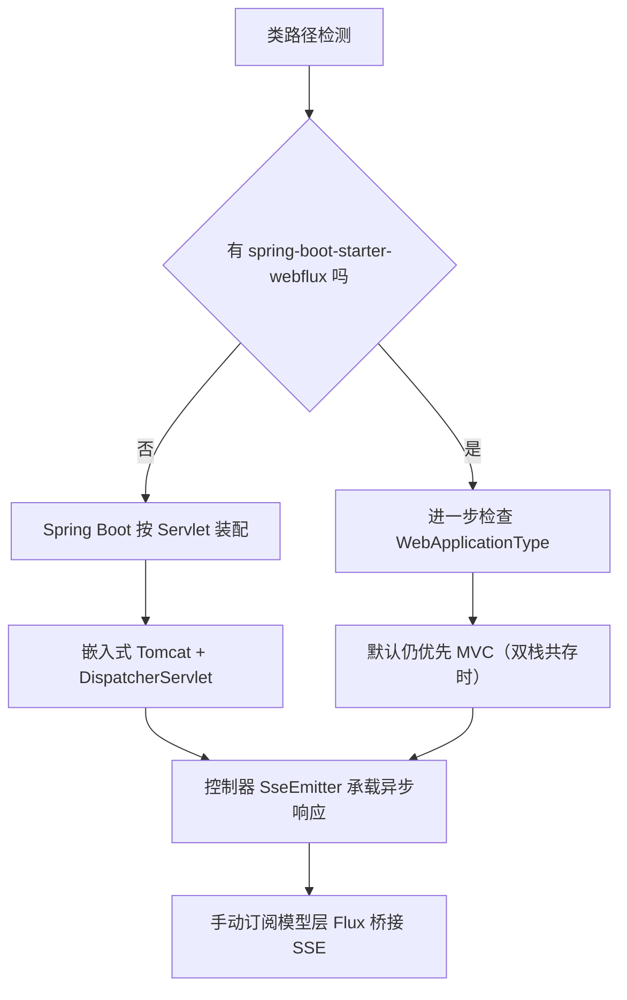
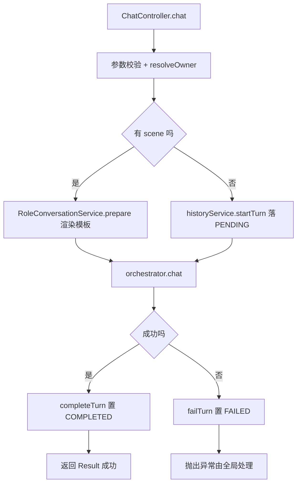
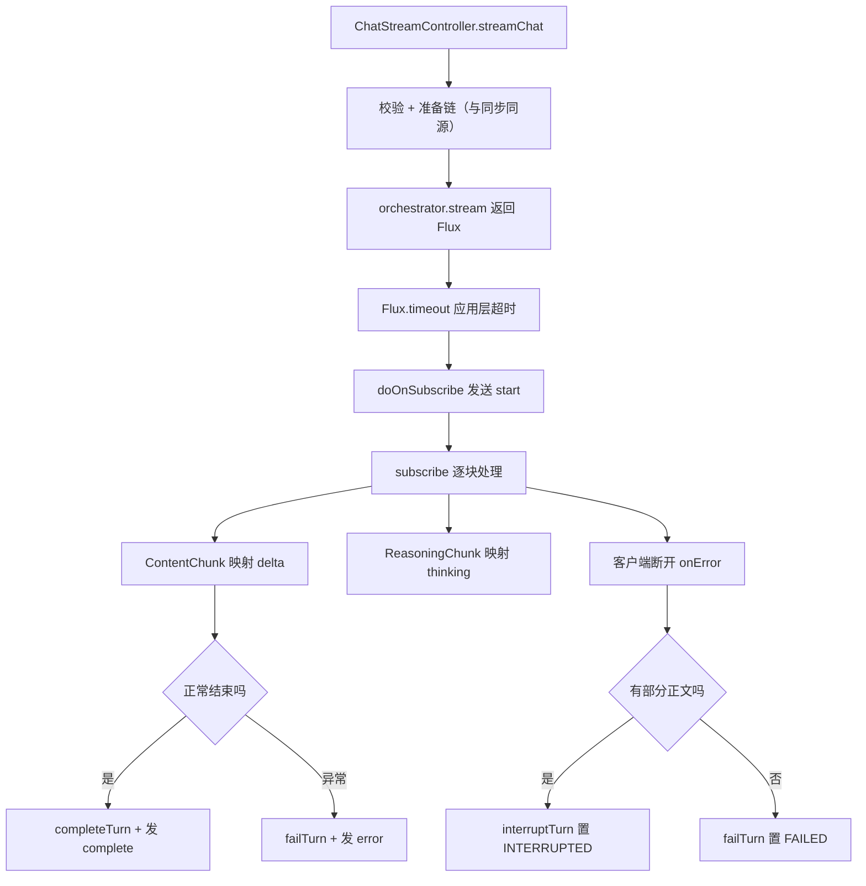

# D19 项目迭代全量信息与操作

> 迭代名称：D19——添加流式聊天接口并保持原同步接口兼容
> 物理包：`com.zl.d19`；模块：`D19_SCI`；聚合根：`M2-Java\D19`
> 技术基线：JDK 21、Spring Boot 3.5.16、Spring AI 1.1.8、Spring MVC（Tomcat 10.1.55）、Reactor 3.7.19、MyBatis-Plus 3.5.17
> 文档约定：首次出现英文缩写给出全称与中文；Mermaid 图兼容 Typora 0.11.18（节点 ID 唯一、无 HTML 标签、节点英文双引号）。

---

## 1. 迭代概述

### 1.1 三个目标

1. **新增独立流式接口**：在不触碰同步接口的前提下，新增 `POST /api/v1/ai/chat/stream`，以 SSE（Server-Sent Events，服务器发送事件）逐段发送模型输出。
2. **同步接口零破坏**：原 `POST /api/v1/ai/chat` 的路径、方法、请求/响应 DTO（Data Transfer Object，数据传输对象）、错误语义与行为保持完全一致。
3. **技术组合核验**：用 POM、依赖树、启动日志、`javap` 等证据确认应用真实类型，以及 Spring AI 1.1.8 的实际调用链，避免把「类路径里有 webflux 库」误判为「应用切换到了 WebFlux」。

### 1.2 关键事实（先给结论）

- 应用是 **Servlet / Spring MVC（嵌入式 Tomcat）**，不是反应式 WebFlux 应用。
- 流式能力由模型层返回 Reactor `Flux`，控制器用 MVC 原生 `SseEmitter` 手动桥接，**不新增依赖、不更换服务器**。
- 本模块骨架已内置完整流式实现；本次迭代的真实增量是补齐 **13 个自动化测试**、真机验证、双文档与证据。

### 1.3 记忆简语

- **「库 ≠ 容器」**：有 spring-webflux 的 jar，不等于跑在 WebFlux 上；看 starter 与服务器工厂。
- **「同源分叉」**：同步与流式共用准备链，只在模型调用与响应适配处分叉。
- **「冷流订阅才动」**：`Flux` 是冷流，`subscribe` 之前不执行任何上游逻辑。
- **「终态落一次」**：`persisted` 标志保证完成/失败/中断只写库一次。

---

## 2. 仓库与模块结构

### 2.1 竖屏层级树（关键部分）

```
D19
├─ pom.xml                         # 聚合 POM，packaging=pom，import spring-ai-bom 1.1.8
└─ D19_SCI
   ├─ pom.xml                      # 模块 POM，显式 spring-boot-starter-web
   ├─ src
   │  ├─ main
   │  │  ├─ java/com/zl/d19
   │  │  │  ├─ D19SpringAiApplication.java
   │  │  │  ├─ common/             # Result、ResultCode、全局异常、配置异常
   │  │  │  ├─ config/             # AiProperties、AiConstants
   │  │  │  ├─ controller/         # ChatController（同步）、ChatStreamController（流式）
   │  │  │  ├─ conversation/       # 角色准备、历史消息转换
   │  │  │  ├─ history/            # 会话/消息持久化、上下文窗口
   │  │  │  ├─ knowledge/          # 编排器、检索、引用注册表
   │  │  │  ├─ service/            # AiChatService、Mock/DeepSeek 实现、StreamChunk
   │  │  │  ├─ device/             # 设备场景与工单候选
   │  │  │  ├─ prompt/             # Prompt 模板管理
   │  │  │  └─ logging/            # TraceId、访问日志
   │  │  └─ resources
   │  │     ├─ application.yml
   │  │     ├─ db/                 # 建表 DDL
   │  │     └─ static/             # 前端页面与 sse-parser
   │  └─ test
   │     ├─ java/com/zl/d19/       # 本次新增 5 个测试类
   │     └─ resources/application-test.yml
   └─ target
```

### 2.2 坐标与版本

| 项 | 值 |
|---|---|
| 聚合根 groupId / artifactId | org.ai.m2.ds / D19 |
| 模块 artifactId | D19_SCI |
| 物理包 | com.zl.d19 |
| 主类 | D19SpringAiApplication |
| 服务端口 | 8080 |
| parent | spring-boot-starter-parent 3.5.16 |
| Spring AI BOM | 1.1.8（锁定，禁止 2.x） |
| JDK | 21 |

---

## 3. 应用类型核验（POM / 依赖树 / 启动日志）

### 3.1 依赖证据表

| 证据 | 内容 | 结论 |
|---|---|---|
| 模块 POM | 显式 `spring-boot-starter-web`，注释「锚定 Tomcat + Spring MVC」 | Servlet 栈 |
| 模块 POM | 无 `spring-boot-starter-webflux` | 无反应式自动装配入口 |
| 依赖树 | tomcat-embed-core 10.1.55 + spring-webmvc 6.2.19 | 容器是 Tomcat |
| 依赖树 | 无 reactor-netty、无 netty-http/handler-server | 无 Netty 服务器 |
| 依赖树 | spring-webflux 6.2.19、reactor-core 3.7.19 由 spring-ai-model 传递 | 仅作模型层库 |
| 依赖树 | 其余 Netty jar 由 lettuce-core（Redis 客户端）引入 | 与 Web 服务器无关 |

### 3.2 启动日志关键行

```
Tomcat initialized with port 8080 (http)
Starting Servlet engine: [Apache Tomcat/10.1.55]
Root WebApplicationContext: initialization completed
Tomcat started on port 8080 (http) with context path '/'
Initializing Spring DispatcherServlet 'dispatcherServlet'
```

- 出现 `ServletWebServerApplicationContext` 与 `DispatcherServlet`，没有任何 Netty 反应式服务器启动记录。
- 运行时上下文类为 `AnnotationConfigServletWebServerApplicationContext`。

### 3.3 技术组合决策（Mermaid）



---

## 4. 同步接口契约（不可破坏项）

### 4.1 接口定义

- 路径/方法：`POST /api/v1/ai/chat`
- 请求体：`ChatRequest`
  - `message`：`@NotBlank`、`@Size(max=2000)`
  - 可选：`scene`、`sessionId`、`variables`、`thinkingEnabled`、`reasoningEffort`、`showReasoning`、`retrieveEnabled`
- 响应：统一 `Result`，HTTP 始终 200，业务码区分结果。

### 4.2 业务码

| 业务码 | 含义 |
|---|---|
| 200 | 成功 |
| 4001 | 请求参数校验失败 |
| 5000 | 系统兜底错误 |
| 5001 | AI 配置/鉴权错误 |
| 5002 | AI 服务暂不可用 |

- 无 `scene` 时 `data` 为 `ChatReplyResponse`；有 `scene` 时为 `RoleChatReplyResponse`。

### 4.3 同步调用链



---

## 5. 流式接口设计与行为

### 5.1 接口定义

- 路径/方法：`POST /api/v1/ai/chat/stream`
- `produces = text/event-stream;charset=UTF-8`
- 响应载体：MVC 原生 `SseEmitter`（非直接返回 `Flux`），手动订阅 `Flux<StreamChunk>`。

### 5.2 SSE 事件协议（data 均为 JSON）

| 事件 | 载荷 | 时机 |
|---|---|---|
| start | requestId、mode、model、sessionId（角色另含 scene/templateId/version/thinking） | 订阅时首个 |
| thinking | seq、content | 仅 showReasoning 且有推理分片 |
| delta | seq 从 0 递增、content | 每个答案片段 |
| citations | 引用列表 | complete 前，有命中才发 |
| complete | seq、mode、model、mocked、totalChars、thinking | 正常结束 |
| error | code、固定文案 | 异常/超时，不含堆栈/密钥 |

### 5.3 流式调用链



### 5.4 持久化与中断语义

- 流开始前：用户消息以 `PENDING` 落库；助手内容内存累积，不逐 chunk 写库。
- 正常 complete：助手全文 `COMPLETED`。
- 异常/超时：`FAILED`。
- 客户端断开：有部分正文走 `INTERRUPTED` 助手消息，无正文按失败。
- 独立 `persisted`（`AtomicBoolean`）`compareAndSet` 保证终态只落库一次。

### 5.5 chunk 口径（避免误解）

- 每次发送的是模型/服务产出的**片段**，不保证等于单个字符、单词或 token。
- Mock 服务按每 6 字符切块、`delayElements` 15ms；真实服务按上游返回分片。
- 前端按到达顺序追加即可。

---

## 6. 关键代码导读

### 6.1 模型层调用（可移植抽象）

- 同步：`ChatResponse call(Prompt)`
- 流式：`Flux<ChatResponse> stream(Prompt)`
- 二者同处一个 `ChatModel` 接口（`javap` 实证），代码走 `ChatModel` 而非 `ChatClient` fluent API。

### 6.2 控制器桥接要点

- 不在 Reactor 流中 `block()` / `collectList()` 重新聚合（生产代码）。
- 不用脱离请求生命周期的 `subscribe` 启动后台任务。
- `safeSend` 加 `synchronized`，发送失败立即置 finished 并取消上游。
- `SseEmitter` 超时 = `streamTimeoutMs + 5000ms` 容器宽限。

---

## 7. 配置说明

### 7.1 关键配置项（application.yml）

| 配置 | 默认值 | 说明 |
|---|---|---|
| app.ai.mode | mock | 运行模式，环境变量 AI_MODE 注入 |
| app.ai.max-message-length | 2000 | 消息长度上限 |
| app.ai.stream-timeout-ms | 60000 | SSE 服务端超时 |
| app.ai.history.context-window-messages | 10 | 上下文窗口条数 |
| app.ai.knowledge.max-sources | 3 | 引用来源上限 |
| app.access-log.exclude-paths | 含 /api/v1/ai/chat/stream | SSE 跳过正文缓存过滤器 |

### 7.2 安全主线（密钥）

- 真实 DeepSeek Key 只允许经运行进程环境变量 `DEEPSEEK_API_KEY` 注入。
- 配置文件只保留 `${DEEPSEEK_API_KEY:}` 占位，不硬编码真实密钥。
- 默认全链路 mock、零外网；真实联调须用户当轮显式授权。
- `DeepSeekAiChatService` 调用前 `validateCredential`，占位/空白/含 mock 的 Key 快速失败。

---

## 8. 验证与操作

### 8.1 编译与测试命令

```powershell
# 基线编译
& 'D:\SoftwareInstall\Apache\Maven\apache-maven-3.9.16\bin\mvn.cmd' -f 'D19_SCI\pom.xml' clean compile

# 全量测试
& 'D:\SoftwareInstall\Apache\Maven\apache-maven-3.9.16\bin\mvn.cmd' -f 'D19_SCI\pom.xml' test
```

### 8.2 真机验证结果

- 全量测试：**Tests run: 13, Failures: 0, Errors: 0, Skipped: 0，BUILD SUCCESS**。
- 真机 SSE：抓包确认 **17 个独立 delta 事件**（seq 0→16），start 首、complete 末，`totalChars=97`，响应头含 `X-Accel-Buffering:no`。
- 同步接口：返回 code=200，结构与历史契约一致。

### 8.3 操作清单（手工复现）

1. 确认 MySQL 3306、Redis 6379 已启动，8080 空闲。
2. 启动应用：`mvn -f D19_SCI\pom.xml spring-boot:run`。
3. 健康检查：访问 `http://127.0.0.1:8080/api/v1/ai/health`。
4. 同步：POST `/api/v1/ai/chat`。
5. 流式：POST `/api/v1/ai/chat/stream`，用非缓冲客户端观察分帧。
6. 结束后停止应用；本迭代全程不执行 git commit。

---

## 9. 边界、风险与注意事项

- **非端到端非阻塞**：`SseEmitter` 在 Servlet 容器内，字节写出仍含阻塞部分；非阻塞体现在模型层 Flux 与容器异步，不夸大为全链路 reactive。
- **伪流式风险**：反向代理默认缓冲会攒包，需 `X-Accel-Buffering:no` 并在网关关闭缓冲；本机直连 Tomcat 无此问题。
- **背压**：本阶段不实现复杂逐条背压控制器，靠发送失败/取消上游收敛。
- **不做项**：不迁移 WebFlux、不引 WebSocket/消息队列/第二套模型链、不改 Redis 前缀与表结构、不重写同步接口。
- 健康检查中的 application 标识为历史标签（D17_DHSA_MTDCA），属既有内容，按最小改动原则未修改。

---

## 10. 交付物清单

| 类型 | 路径 |
|---|---|
| 测试代码 | D19_SCI/src/test/java/com/zl/d19/（5 个测试类、13 个测试方法） |
| 文档一 | docs/proj_docs/D19-项目迭代全量信息与操作.md |
| 文档二 | docs/proj_docs/D19-MVC与WebFlux流式聊天技术说明及实践指南.md |
| 日志 | logs/D19/ |
| 证据 | docs/evidence/D19/ |
| 临时资料 | docs/temp_docs/D19/（不自动删除） |

> 官方溯源：
> 《Spring Boot Reference | Spring Boot 参考文档》：https://docs.spring.io/spring-boot/3.5.16/reference/
> 《Spring AI Reference 1.1 | Spring AI 1.1 参考文档》：https://docs.spring.io/spring-ai/reference/1.1/
> 《Spring Framework Web MVC | Spring MVC 参考》：https://docs.spring.io/spring-framework/reference/6.2/web/webmvc.html
