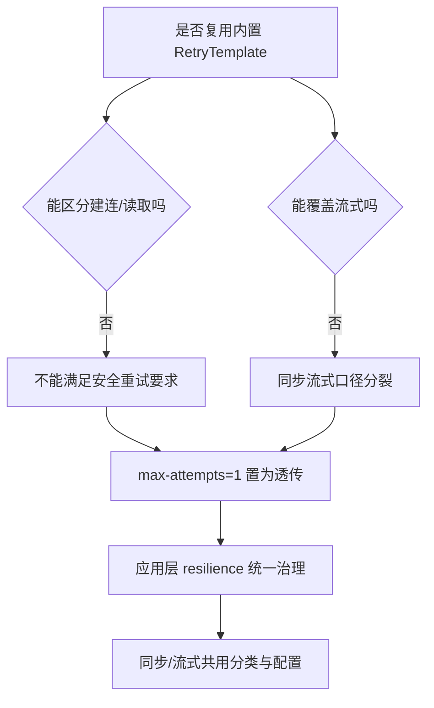
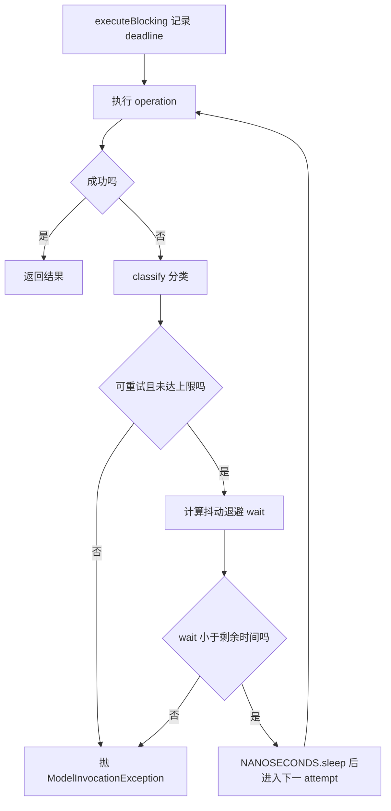
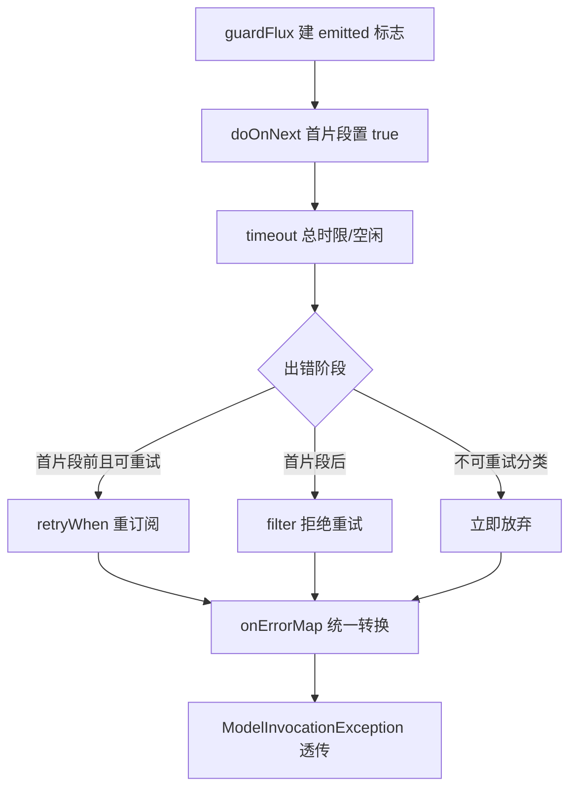
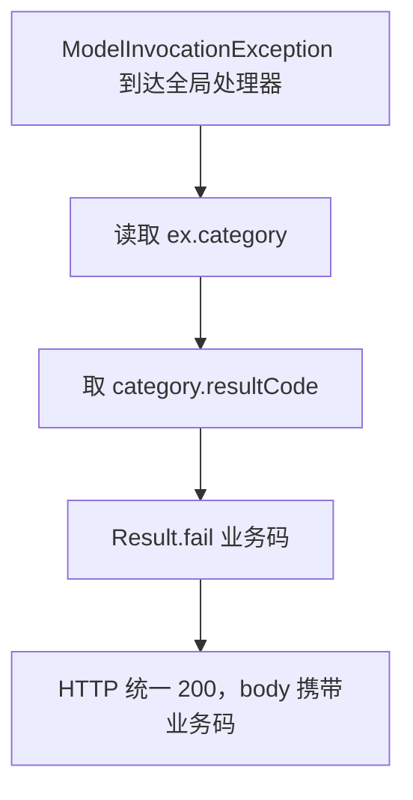

# D20 模型异常超时与有限重试技术说明及实践指南

> 适用模块：D20_UMIEM（物理包 `com.zl.d20`）
> 技术基线：Spring Boot 3.5.16、Spring MVC 6.2.19、Spring AI 1.1.8、spring-retry 2.0.13、Reactor 3.7.19、Tomcat 10.1.55、JDK 21
> 阅读方式：先概念、再原理、再流程、再代码、再实践与避坑。

---

## 1. 概念辨析

### 1.1 名词表（首次出现给全称与中文）

| 缩写 | 英文全称 | 中文 |
|---|---|---|
| HTTP | HyperText Transfer Protocol | 超文本传输协议 |
| JDK | Java Development Kit | Java 开发工具包 |
| DTO | Data Transfer Object | 数据传输对象 |
| I/O | Input/Output | 输入/输出 |
| SSE | Server-Sent Events | 服务器发送事件 |
| TLS | Transport Layer Security | 传输层安全（加密协议） |
| API | Application Programming Interface | 应用程序编程接口 |
| TTL | Time To Live | 存活时间 |
| TPS | Transactions Per Second | 每秒事务数（衡量吞吐） |

### 1.2 四类超时的本质区别

| 超时类型 | 发生阶段 | 请求是否已发出 | 结果是否确定 | 默认可否重试 |
|---|---|---|---|---|
| 建连超时 connect | TCP/TLS 建连阶段 | 否 | 确定（没发出去） | 可以 |
| 读取超时 read | 已建连、等待响应数据 | 是 | 不确定（服务端可能已处理） | 默认不可以 |
| 单次总时限 total deadline | 一次逻辑调用整体 | 取决于发生时刻 | 兜底墙钟 | 作为放弃边界 |
| 流式空闲超时 stream idle | 两个分片之间 | 是（流已开始） | 不确定 | 首片段后不重试 |

**关键点**：能不能安全重试，核心判断不是「有没有异常」，而是「请求是否已经离开客户端、服务端是否可能已经执行」。建连失败请求未发出，天然幂等安全；读取超时结果不确定，盲目重试可能重复计费、重复写入。

### 1.3 记忆简语

- **「连可重试，读默不重试」**。
- **「重试不是次数游戏，是安全边界」**。
- **「一层兜底，不叠罗汉」**。

---

## 2. 为什么要关闭 Spring AI 内置重试

### 2.1 内置机制的三个问题（字节码实证）

1. **无法区分建连/读取**：`RetryUtils` 对 `ResourceAccessException` 做类级 `retryOn`，建连失败与读取超时都会被重试，而后者结果不确定。
2. **只覆盖同步路径**：阻塞 `RetryTemplate` 只作用于 `chatModel.call`，流式 `stream` 走 Reactor `Flux`，不经过它，导致两条链路口径不一致。
3. **无抖动、默认激进**：默认 maxAttempts=10、指数退避（2000ms 起、倍率 5、上限 180000ms），且无 jitter（抖动），高并发下多个客户端容易同步重试形成「惊群」。

### 2.2 关闭而非复用的决策树



### 2.3 为什么不引入 Resilience4j

- spring-retry 已由 spring-ai 传递在类路径（非新增依赖），其能力足以表达「有限次数 + 指数退避 + 抖动 + 条件过滤」。
- 引入 Resilience4j 会带来新的注解、配置命名空间与学习成本，违反「最小增量、不引新框架」约束。
- 本迭代明确不建断路器、限流、Fallback、多模型路由，新框架的大部分能力用不上。

---

## 3. 底层原理

### 3.1 异常归一：为什么需要单一事实来源

- 没有统一分类时，`NonTransientAiException`、`TransientAiException`、`ResourceAccessException`、Reactor `TimeoutException` 等会在不同层被各自判断，容易出现「同步重试、流式不重试」或错误码不一致。
- 引入 `ModelErrorCategory` 作为单一事实来源（Single Source of Truth）：所有异常先归一到 11 个确定分类，再由该分类同时决定「是否重试」与「对外业务码」，两段逻辑天然一致。

### 3.2 cause 链遍历的原理

- 真实异常常被多层包装：例如 JDK 的 `HttpConnectTimeoutException` 被包进 `ResourceAccessException`，再被 Spring AI 包成 `TransientAiException`。
- 分类器从最外层沿 `getCause()` 逐层向下，先用确定的类型匹配（网络/取消信号最可靠），再退而解析消息中的状态码，最后才走默认兜底。
- 类型匹配优先于字符串匹配，避免依赖易变的消息文案。

### 3.3 JDK HttpClient 的超时落点

- `HttpClient.connectTimeout` 控制建连（含 TLS 握手）上限，是连接级时间预算。
- `JdkClientHttpRequestFactory.setReadTimeout` / `JdkClientHttpConnector.setReadTimeout` 控制请求发出后等待数据的读级时间预算。
- 两个 Customizer 由 Spring Boot 自动应用到容器内唯一的构建器；应用自身不直接 new 客户端，因此全局定制不会污染无关组件。

### 3.4 Reactor 冷流与重订阅

- `chatModel.stream(prompt)` 返回冷流 `Flux`，每次订阅才触发一次实际请求。
- `retryWhen` 重试的本质是「重新订阅」，因此重试会重新走一遍上游请求；这也是为什么必须用 `emitted` 标志限制——首片段一旦发出，重订阅会产生重复内容。

---

## 4. 执行流程

### 4.1 同步有限重试流程



### 4.2 流式守卫流程



### 4.3 对外错误映射流程



---

## 5. 核心代码导读

### 5.1 分类器的优先级实现

```java
// 1. cause 链上的确定网络/取消信号（最可靠）
for (Throwable node = throwable; node != null; node = node.getCause()) {
    ModelErrorCategory typed = matchByType(node);
    if (typed != null) { return typed; }
}
// 2. Spring AI 分类异常：按消息中的状态码细分
ModelErrorCategory byStatus = matchByStatusCode(throwable);
if (byStatus != null) { return byStatus; }
// 3. 顶层已知异常/默认兜底
```

### 5.2 抖动退避的计算

```java
long base = (long) (initialNanos * Math.pow(multiplier, attempt - 1));
base = Math.min(base, maxIntervalNanos);
// 抖动因子 jitter：实际等待在 [base*(1-j), base*(1+j)] 区间
double factor = 1.0 - jitter + ThreadLocalRandom.current().nextDouble(2.0 * jitter);
```

- 抖动把多客户端的同步重试打散，降低「惊群」概率。
- 退避同时受 maxInterval 与总 deadline 双重收敛，不会无限等待。

### 5.3 流式重试用 emitted 收口

```java
AtomicBoolean emitted = new AtomicBoolean(false);
Retry retrySpec = Retry.backoff(retryCount, initial)
        .maxBackoff(maxInterval).jitter(jitterFactor)
        .filter(error -> !emitted.get() && isRetryable(classifier.classify(error)));
```

- `doOnNext` 保证首个内容一出现就关闭重试窗口。
- `filter` 同时校验「未发射」与「分类可重试」，两个条件缺一不可。

### 5.4 统一异常的安全消息

- `ModelInvocationException` 消息只写分类描述（如「模型调用重试耗尽，分类=UPSTREAM_UNAVAILABLE」），不携带上游原始报文、请求头、密钥，避免敏感信息随错误外泄。

---

## 6. 配置实践

### 6.1 开发/测试推荐（默认即此）

| 配置 | 推荐值 | 理由 |
|---|---|---|
| max-attempts | 2 | 最多重试 1 次，足够覆盖瞬时建连抖动 |
| connect-timeout | 3s | 内网/常规网络建连足够 |
| read-timeout | 30s | 大模型首 token 可能较慢 |
| retry-on-read-timeout | false | 避免重复计费 |
| jitter-factor | 0.2 | 打散重试，又不至于过度随机 |

### 6.2 环境变量覆盖示例

```powershell
$env:MODEL_MAX_ATTEMPTS = '3'
$env:MODEL_READ_TIMEOUT = '45s'
$env:MODEL_RETRY_ON_READ_TIMEOUT = 'false'
& 'D:\SoftwareInstall\Apache\Maven\apache-maven-3.9.16\bin\mvn.cmd' -f 'D20_UMIEM\pom.xml' spring-boot:run
```

### 6.3 启动期校验（非法配置快速失败）

- max-attempts 必须在 1~5；jitter-factor 必须在 0~1；所有时长必须为正；multiplier 不能小于 1；total-deadline 必须大于 connect-timeout。
- 非法值在 `@PostConstruct validate()` 直接抛 `IllegalArgumentException`，应用启动失败，避免带病运行。

---

## 7. 实践与避坑（Pitfalls）

1. **不要把读取超时当建连失败重试**：结果不确定时重试可能产生重复订单/重复扣费；确需重试，先确认上游接口幂等。
2. **不要在多个层各写一次重试**：本应用已把内置重试置为 1，任何新增 `@Retryable` 或二次 `retryWhen` 都会造成多层叠加，违反设计。
3. **不要在首片段后重试流式调用**：会导致前端收到重复片段；`emitted` 标志是硬性保护，不要移除。
4. **不要依赖异常消息做唯一判断**：消息文案可能随版本变化，类型匹配优先；状态码正则只是补充。
5. **注意子类判断顺序**：`HttpConnectTimeoutException` 是 `HttpTimeoutException` 子类，先判子类，否则建连超时会被误判为读取超时。
6. **反向代理缓冲会破坏流式体验**：代理层需关闭缓冲（如 `X-Accel-Buffering:no`）；本机直连 Tomcat 无此问题。
7. **真实密钥只走环境变量**：配置文件永远只留占位，禁止把真实 Key 写进 yml 或提交 Git。

---

## 8. 验证与覆盖

### 8.1 自动化测试矩阵

| 测试类 | 方法数 | 覆盖 |
|---|---|---|
| ModelExceptionClassifierTest | 16 | 11 状态码（含两种消息格式）、建连/读取 cause 区分、兜底 |
| ModelResilienceSupportTest | 9 | 重试后成功、持续失败次数、不可重试仅 1 次、总时限、退避等待、读取开关、流式首片段前后、空闲超时 |
| ModelResiliencePropertiesTest | 6 | 非法次数/抖动/时长/倍率/总时限校验、默认值核对 |

### 8.2 真实执行结果

- 全量：**Tests run: 44, Failures: 0, Errors: 0, Skipped: 0，BUILD SUCCESS**。
- 真机 mock：同步 code=200 契约完整；流式 1 start + 21 delta + 1 complete、totalChars=123 且拼接长度一致。

### 8.3 已知覆盖边界（诚实说明）

- 流式总时限为单次 attempt 级，重试重订阅时重新计时；跨 attempt 硬边界由 SSE 容器 60s 超时兜底。
- 未对 `ModelInvocationException` 单独构造一条 mock 模式 HTTP 用例，分类→业务码绑定由单元测试保证。

---

## 9. 工程实践小结

- **单一责任**：分类器只管归一、支持类只管重试、配置类只管客户端超时，互不越界。
- **安全优先**：默认口径宁可少重试也不冒险重复执行；读取超时重试需显式授权。
- **可观测**：每次重试记录分类与次数，异常消息不含敏感信息。
- **可回滚**：删除 resilience 包并还原 7 处调用点、移除 yml 两段配置即可回到 D19 行为。

> 官方溯源：
> 《Spring AI Reference 1.1 | Spring AI 1.1 参考文档》：https://docs.spring.io/spring-ai/reference/1.1/
> 《Spring Retry | Spring Retry 参考》：https://docs.spring.io/spring-retry/docs/2.0.13/reference/
> 《Spring Boot Reference | Spring Boot 参考文档》：https://docs.spring.io/spring-boot/3.5.16/reference/
> 《Reactor Reference | Project Reactor 参考》：https://projectreactor.io/docs/core/3.7.19/reference/
