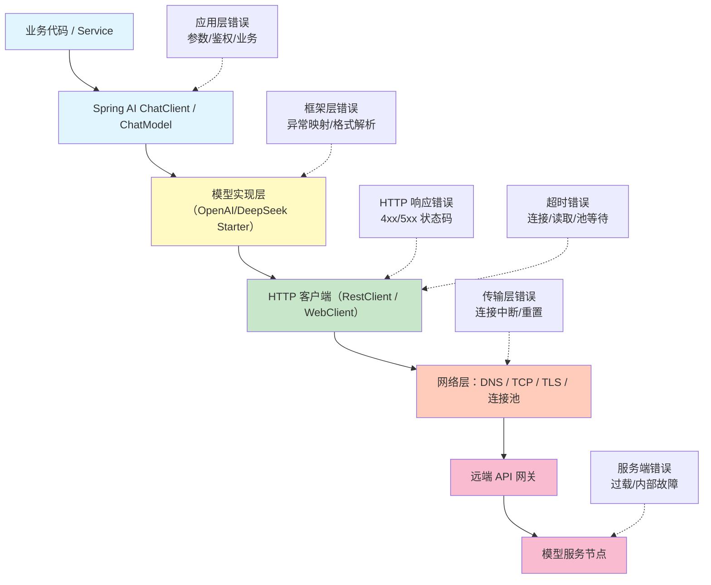

# Spring AI 知识笔记：鉴权、限流、网络错误、超时与重试退避策略

## 0. 学习目标与技术基线

### 0.1 学习目标

学完本章你将能够：

1. 梳理从业务代码到远端模型服务的完整调用链路与错误分层
2. 准确区分鉴权错误、限流、网络故障、超时、服务端错误的成因与风险
3. 根据错误类型、请求发送阶段、幂等性与时间预算设计合理的重试策略
4. 在 Spring AI 1.1.x 项目中配置超时、异常分类与可控重试机制
5. 规避重试风暴、多层重试、非幂等重试等生产常见故障
6. 通过 Mock 模拟故障验证重试逻辑的正确性

### 0.2 技术基线

| 技术         | 版本              | 说明                                                         |
| ------------ | ----------------- | ------------------------------------------------------------ |
| JDK          | 21 LTS            | 代码示例基于 Java 21 语法                                    |
| Spring Boot  | 3.5.16            | 自动配置、底层 HTTP 客户端基于此版本                         |
| Spring AI    | 1.1.x             | 所有 API、异常类、配置均基于 1.1.x 官方文档核验              |
| Resilience4j | 2.x               | 生产级重试推荐组件，Spring Boot 3.x 兼容                     |
| 模型服务     | DeepSeek API 兼容 | 服务商特定错误码单独标注，通用逻辑适用于所有 OpenAI 兼容接口 |

>
> ⚠️ 版本说明：本文所有 Spring AI API 基于 1.1.x 官方规范整理，生产落地前请对照项目实际 BOM 版本核验。Spring AI 本身仅定义异常分类，不提供完整重试框架，需配合 Resilience4j / Spring Retry 使用。

### 0.3 完整调用链路与错误分层

从业务代码到远端模型服务，每一层都可能产生错误，定位时必须先确定故障发生在哪一阶段，不能只看最终异常类名。



错误定位原则：

- 收到完整 HTTP 响应体和状态码 → HTTP 响应层错误
- 没有收到响应、连接建不起来 → 传输层 / 超时错误
- 状态码 4xx → 客户端侧问题，大多不可重试
- 状态码 5xx → 服务端侧问题，大多可有限重试

---

## 1. 错误分类与定位层次

### 1.1 四大错误类别

| 类别          | 发生阶段                               | 典型特征                                 | 重试可能性           |
| ------------- | -------------------------------------- | ---------------------------------------- | -------------------- |
| HTTP 响应错误 | 请求已到达服务端，服务端返回明确状态码 | 有完整 HTTP 状态码、响应体、错误码       | 视状态码而定         |
| 传输层错误    | 连接建立前/传输中中断                  | 无有效 HTTP 响应，抛出 IO 异常、连接异常 | 视请求是否已发送而定 |
| 超时类错误    | 某阶段等待超过阈值                     | 抛出 TimeoutException、SocketTimeout 等  | 视超时类型而定       |
| 应用层错误    | 业务参数、格式、鉴权、余额等           | 4xx 状态码、业务错误码                   | 绝大多数不可重试     |

### 1.2 为什么不能只看状态码做决策

- 同一个 500 可能是瞬时抖动，也可能是永久业务错误
- 同一个超时可能是连接超时（请求未发出），也可能是读取超时（请求已发出）
- 不同服务商对 403 的语义定义不同，可能是无权限，也可能是配额耗尽
- 必须结合：**错误发生阶段 + 状态码 + 错误码 + 请求幂等性 + 剩余时间预算** 综合决策

---

## 2. 各类错误详解

### 2.1 鉴权与请求参数错误

#### 核心状态码与含义

| 状态码                   | 通用语义                    | 典型原因                                   | 是否可重试     |
| ------------------------ | --------------------------- | ------------------------------------------ | -------------- |
| 401 Unauthorized         | 身份认证失败，凭证无效/缺失 | API Key 错误、为空、已撤销、环境变量未注入 | ❌ 绝对不可重试 |
| 403 Forbidden            | 已认证但无权限访问          | 账户无该模型权限、IP 被封禁、违规内容拦截  | ❌ 不可重试     |
| 400 Bad Request          | 请求格式/参数错误           | 参数缺失、类型错误、超长上下文、格式不兼容 | ❌ 不可重试     |
| 422 Unprocessable Entity | 请求格式合法但语义错误      | 工具调用参数错误、JSON Schema 不匹配       | ❌ 不可重试     |
| 402 Payment Required     | 账户余额/计费状态异常       | 余额不足、套餐过期、账单逾期               | ❌ 不可重试     |

>
> 服务商特定说明：DeepSeek 平台 401 代表 API Key 无效，403 代表权限/合规限制，429 代表限流，具体以官方文档为准。
> 引用：DeepSeek Error Codes | DeepSeek 错误码：[](https://api-docs.deepseek.com/zh-cn/quick_start/error_codes/)[https://api-docs.deepseek.com/zh-cn/quick_start/error_codes/](https://api-docs.deepseek.com/zh-cn/quick_start/error_codes/)

#### 工程要点

1. **凭证错误重试无效**：密钥、权限、参数、余额不修正，重试多少次都失败，只会浪费资源
2. **错误日志规范**：记录状态码、服务商错误码、请求 ID、提示信息，**禁止打印完整 API Key 和敏感请求内容**
3. **快速失败**：此类错误直接抛出明确的业务异常，不要进入重试逻辑
4. **配置校验**：启动时校验 API Key 是否配置，避免运行时才发现缺失

### 2.2 限流、并发限制与 429

#### 核心概念区分

| 概念       | 含义                      | 粒度     |
| ---------- | ------------------------- | -------- |
| QPS / RPM  | 每秒/每分钟请求次数限制   | 时间频率 |
| 并发数限制 | 同时进行的请求数量上限    | 并发量   |
| Token 配额 | 单位时间内可用 Token 总量 | 用量额度 |
| 账户级限额 | 整个账户的总限制          | 全局     |
| 模型级限额 | 单个模型的单独限制        | 单模型   |

#### 429 状态码说明

- 触发原因：请求频率过高、并发超限、配额耗尽
- 服务端通常会返回 `Retry-After` 响应头，指示多久后可以重试
- **绝对不能立即高频重试**，否则会形成重试风暴，加重服务端压力，还可能被封禁

#### 客户端限流策略

1. **令牌桶 / 漏桶算法**：客户端主动限制发送速率，不依赖服务端 429
2. **并发闸门**：控制同时进行的请求数量，避免打满并发限制
3. **多实例协调**：分布式场景下，每个实例各自限流会导致总量超限，需用 Redis 等做全局限流
4. **指数退避 + 抖动**：收到 429 后，按指数增长等待时间，并加入随机抖动避免惊群效应

>
> 引用：DeepSeek Rate Limit & Isolation | DeepSeek 限速与隔离：[](https://api-docs.deepseek.com/quick_start/rate_limit/)[https://api-docs.deepseek.com/quick_start/rate_limit/](https://api-docs.deepseek.com/quick_start/rate_limit/)

### 2.3 网络传输错误

#### 常见网络错误对比

| 错误类型            | 发生阶段               | 请求是否已发出 | 重试风险                                         | 典型原因                               |
| ------------------- | ---------------------- | -------------- | ------------------------------------------------ | -------------------------------------- |
| DNS 解析失败        | 连接建立前             | ❌ 未发出       | 低，可安全重试                                   | 域名错误、DNS 服务器故障、本地网络异常 |
| TCP 连接拒绝        | 连接建立前             | ❌ 未发出       | 低，可安全重试                                   | 端口不通、服务未启动、防火墙拦截       |
| TLS 握手失败        | 连接建立中             | ❌ 未发出       | 分情况：证书配置错误不可重试；临时握手失败可重试 | 证书过期、不信任、协议不兼容、网络抖动 |
| 连接重置 / 提前关闭 | 请求发送中或响应中     | ⚠️ 不确定       | 中，可能已处理                                   | 服务端主动断开、中间节点断连、网络波动 |
| 连接池获取失败      | 客户端内部             | ❌ 未发出       | 低，可安全重试                                   | 连接池耗尽、连接泄漏                   |
| 响应读取中断        | 请求已发出，响应接收中 | ✅ 已发出       | 高，可能重复处理/重复计费                        | 网络中断、服务端中断、超时             |

#### 关键原则：请求是否已发送

- **连接建立前的错误**：请求肯定没发出去，重试是安全的，不会产生重复副作用
- **请求发出后响应中断**：服务端可能已经处理了请求（比如模型已经生成并扣费），只是客户端没收到响应。重试会导致重复计费、重复执行，必须评估幂等性与成本
- 这是重试设计中最容易被忽略的风险点，不能把所有网络错误都当成可安全重试

### 2.4 超时分类详解

绝对不能把所有超时都统称为“连接超时”，不同超时发生在不同阶段，风险和处理方式完全不同。

| 超时类型                 | 含义                         | 配置层级               | 请求是否已发出 | 重试风险       |
| ------------------------ | ---------------------------- | ---------------------- | -------------- | -------------- |
| DNS 解析超时             | 域名解析 IP 等待超时         | 操作系统 / HTTP 客户端 | ❌ 未发出       | 低             |
| 连接超时 Connect Timeout | TCP 连接建立等待超时         | HTTP 客户端            | ❌ 未发出       | 低             |
| TLS 握手超时             | TLS 安全握手等待超时         | HTTP 客户端            | ❌ 未发出       | 低             |
| 连接池获取超时           | 从连接池拿连接等待超时       | HTTP 客户端连接池      | ❌ 未发出       | 低             |
| 读取超时 Read Timeout    | 连接建立后，等待响应数据超时 | HTTP 客户端            | ✅ 已发出       | 中高           |
| 请求总时限               | 单次调用的整体时间上限       | 业务层 / 容错组件      | -              | 视阶段而定     |
| 业务 Deadline            | 上游业务允许的总耗时         | 业务接口层             | -              | 超出则快速失败 |

#### 工程要点

1. **读取超时最危险**：请求已经发出去了，超时不代表服务端没处理，重试可能重复扣费
2. **总时限兜底**：必须设置整体超时，避免重试叠加导致请求无限耗时
3. **流式请求超时**：流式响应是长连接，不能用普通读取超时，需配置首包超时、空闲读取超时、整体生命周期限制
4. **超时时间设置**：要大于模型平均响应时间，过短会导致正常请求被中断，过长会占用连接资源

### 2.5 服务端错误（5xx）

#### 常见状态码与含义

| 状态码                    | 通用语义             | 典型原因                 | 是否可重试                 |
| ------------------------- | -------------------- | ------------------------ | -------------------------- |
| 500 Internal Server Error | 服务端内部处理失败   | 服务端代码异常、处理出错 | ⚠️ 有限重试，可能是瞬时故障 |
| 502 Bad Gateway           | 网关收到上游无效响应 | 上游服务崩溃、协议错误   | ✅ 可有限重试               |
| 503 Service Unavailable   | 服务暂不可用         | 过载、维护、熔断         | ✅ 可退避重试               |
| 504 Gateway Timeout       | 网关等待上游超时     | 上游处理太慢、过载       | ✅ 可有限重试               |

#### 处理原则

- 5xx 大多是瞬时故障，可进行有限次、带退避的重试
- 但不能无限重试，超过最大次数后必须快速失败
- 503 优先遵循 `Retry-After` 响应头的建议等待时间
- 持续 5xx 应触发熔断，停止发送请求，避免打垮服务端

---

## 3. 重试决策总表

这是本章核心决策依据，所有错误类型的处理策略统一汇总：

| 错误类型            | 典型表现             | 是否重试     | 前置条件                         | 等待策略        | 最终处理               |
| ------------------- | -------------------- | ------------ | -------------------------------- | --------------- | ---------------------- |
| 401 鉴权失败        | API Key 无效/缺失    | ❌ 不重试     | 凭证修正前绝不重试               | 无              | 抛出鉴权异常，告警通知 |
| 403 无权限          | 账户/IP/内容无权限   | ❌ 不重试     | 权限开通前不重试                 | 无              | 抛出权限异常，记录原因 |
| 400/422 参数错误    | 请求格式/语义错误    | ❌ 不重试     | 参数修正前不重试                 | 无              | 抛出参数异常，修正请求 |
| 402 余额不足        | 账户欠费/配额耗尽    | ❌ 不重试     | 充值/扩容前不重试                | 无              | 抛出计费异常，告警通知 |
| 429 限流            | 请求频率超限         | ✅ 受控重试   | 尊重 Retry-After，不超过限流阈值 | 指数退避 + 抖动 | 超次数后抛出限流异常   |
| DNS 解析失败        | 域名无法解析         | ⚠️ 少量重试   | 确认域名正确                     | 短间隔固定等待  | 超次数后抛出网络异常   |
| TCP 连接失败        | 连接被拒绝           | ⚠️ 少量重试   | 确认地址端口正确                 | 短间隔退避      | 超次数后抛出连接异常   |
| TLS 证书错误        | 证书不信任/过期      | ❌ 不重试     | 配置修正前不重试                 | 无              | 抛出安全异常，检查证书 |
| 连接池获取超时      | 连接池耗尽           | ✅ 可重试     | 连接池配置合理                   | 短间隔等待      | 超次数后抛出池耗尽异常 |
| 读取超时 / 响应中断 | 等待响应超时         | ⚠️ 谨慎重试   | 确认操作幂等、可接受重复成本     | 退避等待        | 超次数后抛出超时异常   |
| 500 服务内部错误    | 服务端处理失败       | ✅ 有限重试   | 非业务类 500                     | 指数退避 + 抖动 | 超次数后抛出服务异常   |
| 502 网关错误        | 上游响应无效         | ✅ 有限重试   | -                                | 指数退避 + 抖动 | 超次数后抛出网关异常   |
| 503 服务不可用      | 过载/维护            | ✅ 有限重试   | 遵循 Retry-After                 | 退避等待        | 超次数后触发熔断       |
| 504 网关超时        | 上游响应超时         | ✅ 有限重试   | -                                | 退避等待        | 超次数后抛出超时异常   |
| 业务校验失败        | 输出不符合业务规则   | ❌ 不重试     | 规则修正前重试无效               | 无              | 业务降级或人工处理     |
| 流式响应中途中断    | 已输出部分内容后报错 | ❌ 不自动重试 | 避免内容重复                     | 无              | 业务层决定是否重新发起 |

---

## 4. 重试算法与预算设计

### 4.1 三种重试算法对比

| 算法                | 原理                 | 优点                       | 缺点                             | 适用场景                 |
| ------------------- | -------------------- | -------------------------- | -------------------------------- | ------------------------ |
| 固定间隔重试        | 每次等待相同时间     | 简单、可预测               | 容易造成惊群效应，加重服务端压力 | 简单本地故障、低并发场景 |
| 指数退避            | 等待时间逐次倍增     | 给服务端足够恢复时间       | 后期等待过长，且固定时间点易惊群 | 服务端过载、限流场景     |
| 指数退避 + 随机抖动 | 指数基础上加随机偏移 | 避免惊群效应，分散请求峰值 | 等待时间不可预测                 | 高并发、生产环境推荐     |

### 4.2 指数退避 + 全抖动 算法

#### 公式

```
第 n 次重试等待时间 = random(0, min(最大间隔, 初始间隔 * (倍率 ^ (n-1))))
```

#### 伪代码

```
/**
 * 指数退避 + 全抖动 等待时间计算
 * @param retryCount 当前重试次数（从1开始）
 * @param initialInterval 初始间隔 ms
 * @param multiplier 倍率，通常 2
 * @param maxInterval 最大等待间隔 ms
 * @return 实际等待时间 ms
 */
public long calculateWaitTime(int retryCount, long initialInterval, double multiplier, long maxInterval) {
    long baseWait = (long) (initialInterval * Math.pow(multiplier, retryCount - 1));
    long cappedWait = Math.min(baseWait, maxInterval);
    // 全抖动：0 ~ cappedWait 之间随机
    return (long) (Math.random() * cappedWait);
}
```

### 4.3 核心预算参数设计

| 参数                     | 含义                     | 推荐值参考 | 注意事项                               |
| ------------------------ | ------------------------ | ---------- | -------------------------------------- |
| 最大尝试次数 maxAttempts | 总共调用次数（含首次）   | 3~4 次     | 绝大多数库包含首次调用，不是“重试几次” |
| 初始等待间隔             | 第一次重试的等待时间     | 100~500ms  | 根据接口响应时间调整                   |
| 退避倍率                 | 每次等待时间的倍数       | 2          | 标准指数退避                           |
| 最大等待间隔             | 单次等待的上限           | 5~10s      | 避免等待时间无限增长                   |
| 总超时预算               | 整个重试过程的总耗时上限 | 30s 以内   | 必须小于上游业务 Deadline              |
| 抖动系数                 | 随机偏移范围             | 0~1 全抖动 | 避免惊群效应，生产必加                 |

>
> ⚠️ 巨坑提醒：绝大多数容错库（Resilience4j、Spring Retry）的 `maxAttempts` 是**包含首次调用**的。例如 `maxAttempts=3` 表示：首次调用 + 2 次重试，总共 3 次。配置时务必核对库的定义，否则会多一次或少一次重试。

### 4.4 幂等性与重试安全

#### 什么是幂等操作

- 同一个操作执行一次和执行多次，结果完全相同，没有额外副作用
- 模型文本生成类请求：多次调用会产生不同结果，且多次扣费，**不是无副作用的幂等操作**
- 只读查询类：可认为是幂等的

#### 重试安全判断

1. **连接建立前失败**：请求未发出，重试安全
2. **请求已发出，结果未知**：
   - 可接受重复成本 → 可重试
   - 重复副作用不可接受 → 不重试，直接失败
3. **明确收到失败响应**：按错误类型决策

### 4.5 多层重试与重试风暴

#### 什么是重试风暴

如果 HTTP 客户端有 2 次重试，Resilience4j 有 2 次重试，业务层又有 2 次重试，那么一次故障会触发 `1 × 3 × 3 × 3 = 27` 次请求，瞬间放大流量，打垮服务端。

#### 防控原则

1. **单一责任层原则**：只在一层做重试，其他层不重试。推荐在业务服务层统一重试，HTTP 客户端关闭自动重试
2. **最大次数严格限制**：全链路总重试不超过 2~3 次
3. **退避 + 抖动**：避免请求集中在同一时刻
4. **熔断机制**：错误率达到阈值后，停止请求一段时间，快速失败

---

## 5. Spring AI 1.1.x 工程落地

### 5.1 Spring AI 内置异常体系

Spring AI 1.1.x 定义了两套异常基类，用于标记异常是否可重试，本身不包含重试实现，需配合容错框架使用。

| 异常类                    | 语义       | 含义                   | 重试建议           |
| ------------------------- | ---------- | ---------------------- | ------------------ |
| `TransientAiException`    | 瞬时异常   | 临时故障，重试可能成功 | ✅ 可纳入重试白名单 |
| `NonTransientAiException` | 非瞬时异常 | 永久故障，重试必然失败 | ❌ 禁止重试         |

>
> 官方参考：Spring AI Retry API (1.1.x JavaDoc) | Spring AI 重试异常 API：[](https://docs.spring.io/spring-ai/docs/1.1.2/api/org/springframework/ai/retry/package-summary.html)[https://docs.spring.io/spring-ai/docs/1.1.2/api/org/springframework/ai/retry/package-summary.html](https://docs.spring.io/spring-ai/docs/1.1.2/api/org/springframework/ai/retry/package-summary.html)

>
> 说明：Spring AI 各模型实现会将底层 HTTP 异常映射为上述两类异常，但映射粒度依版本不同有差异。生产环境建议自定义异常映射，精确控制重试范围。

### 5.2 底层 HTTP 客户端超时配置

Spring AI 1.1.x 的 OpenAI 兼容模型（含 DeepSeek）底层基于 Spring 的 `RestClient`（同步）和 `WebClient`（流式），可通过配置属性或自定义客户端设置超时。

#### 配置示例（application.yml）

```
spring:
  ai:
    openai:
      # DeepSeek 兼容配置
      base-url: ${DEEPSEEK_BASE_URL:[https://api.deepseek.com](https://api.deepseek.com)}
      api-key: ${DEEPSEEK_API_KEY}
      chat:
        options:
          model: deepseek-chat
      # 底层客户端超时配置（不同 Starter 配置项略有差异，以实际版本为准）
      rest-client:
        connect-timeout: 5s
        read-timeout: 60s
```

>
> 官方参考：DeepSeek Chat :: Spring AI Reference | Spring AI DeepSeek 聊天模型：[](https://docs.spring.io/spring-ai/reference/1.1/api/chat/deepseek-chat.html)[https://docs.spring.io/spring-ai/reference/1.1/api/chat/deepseek-chat.html](https://docs.spring.io/spring-ai/reference/1.1/api/chat/deepseek-chat.html)

### 5.3 推荐方案：Resilience4j Retry 集成

生产环境推荐使用 Resilience4j 作为统一重试容错组件，和 Spring AI 解耦，可灵活配置重试规则、异常白名单、退避策略。

#### 依赖引入

```
<dependency>
    <groupId>io.github.resilience4j</groupId>
    <artifactId>resilience4j-spring-boot3</artifactId>
    <version>2.2.0</version>
</dependency>
```

#### 重试配置示例

```
resilience4j:
  retry:
    instances:
      ai-chat:
        max-attempts: 3  # 含首次调用，共3次 = 1次首次 + 2次重试
        wait-duration: 200ms
        enable-exponential-backoff: true
        exponential-backoff-multiplier: 2
        max-wait-duration: 5s
        enable-randomized-wait: true  # 开启抖动
        # 可重试异常白名单
        retry-exceptions:
          - org.springframework.ai.retry.TransientAiException
          - java.net.SocketTimeoutException
          - java.net.ConnectException
        # 不可重试异常黑名单
        ignore-exceptions:
          - org.springframework.ai.retry.NonTransientAiException
          - java.lang.IllegalArgumentException
```

#### 服务层使用示例

```
import io.github.resilience4j.retry.annotation.Retry;
import org.springframework.ai.chat.client.ChatClient;
import org.springframework.stereotype.Service;

@Service
public class AiChatService {

    private final ChatClient chatClient;

    public AiChatService(ChatClient.Builder builder) {
        this.chatClient = builder.build();
    }

    @Retry(name = "ai-chat", fallbackMethod = "chatFallback")
    public String chat(String userInput) {
        return chatClient.prompt()
                .user(userInput)
                .call()
                .content();
    }

    /**
     * 重试全部失败后的降级方法
     */
    private String chatFallback(String userInput, Exception ex) {
        // 降级逻辑：返回友好提示、记录日志、触发告警
        throw new AiServiceUnavailableException("AI 服务暂时不可用，请稍后重试", ex);
    }
}
```

### 5.4 同步与流式调用的重试差异

| 调用方式      | 是否支持自动重试 | 原因                                                    | 建议方案                       |
| ------------- | ---------------- | ------------------------------------------------------- | ------------------------------ |
| 同步 call()   | ✅ 支持           | 一次性返回完整结果，失败可整体重试                      | 使用 Resilience4j 标准重试     |
| 流式 stream() | ❌ 不建议自动重试 | 已向客户端输出部分 Token 后中断，从头重试会导致内容重复 | 业务层处理，或设计断点续传逻辑 |

>
> 重要：流式响应中途发生错误时，前端已经收到了部分文字，自动从头重发会导致重复内容。必须由业务层判断中断位置，或直接告知用户失败，由用户手动重新发起。

### 5.5 统一异常映射与可观测性

1. **统一异常封装**：将所有 AI 调用异常映射为业务可识别的异常类型（鉴权、限流、超时、服务错误等）
2. **保留原始异常链**：封装时保留原始 cause，便于排查根因
3. **核心指标监控**：
   - 请求成功率、失败率
   - 各错误类型占比
   - 平均重试次数
   - 平均响应时间、P95/P99 耗时
   - 熔断触发次数
4. **告警规则**：错误率突增、鉴权错误、余额不足、持续限流及时告警

---

## 6. 最小可运行模拟实践

>
> 说明：以下为示例代码，未在真实环境执行验证，旨在演示测试思路。可通过 MockWebServer / WireMock 模拟各种故障响应，验证重试逻辑。

### 6.1 实践目标

通过模拟故障验证以下场景：

1. 401 错误不重试，直接失败
2. 400 参数错误不重试
3. 429 限流触发退避重试
4. 503 错误有限重试，超次数失败
5. 连接超时触发重试
6. 业务异常不进入重试
7. 验证总调用次数符合配置
8. 验证退避时间符合预期

### 6.2 测试思路

1. 使用 WireMock 模拟模型接口，按需返回指定状态码和延迟
2. 配置 Resilience4j 重试规则
3. 调用服务方法，断言调用次数、等待时间、最终异常类型
4. 分别测试可重试和不可重试异常

### 6.3 单元测试示例伪代码

```
@SpringBootTest
class AiRetryTest {

    @Autowired
    private AiChatService aiChatService;

    @MockBean
    private ChatClient chatClient;

    @Test
    void transientError_shouldRetryTwice_thenFail() {
        // 模拟每次调用都抛出 TransientAiException
        when(chatClient.prompt().user(anyString()).call().content())
                .thenThrow(new TransientAiException("temporary error"));

        // 执行调用
        assertThatThrownBy(() -> aiChatService.chat("test"))
                .isInstanceOf(AiServiceUnavailableException.class);

        // 验证总共调用了 3 次（1次首次 + 2次重试）
        verify(chatClient, times(3)).prompt();
    }

    @Test
    void nonTransientError_shouldNotRetry() {
        // 模拟抛出非瞬时异常
        when(chatClient.prompt().user(anyString()).call().content())
                .thenThrow(new NonTransientAiException("invalid key"));

        assertThatThrownBy(() -> aiChatService.chat("test"))
                .isInstanceOf(AiAuthException.class);

        // 验证只调用了 1 次，没有重试
        verify(chatClient, times(1)).prompt();
    }
}
```

---

## 7. 测试用例矩阵

| 序号 | 测试场景         | 输入模拟               | 预期结果                                | 覆盖点           |
| ---- | ---------------- | ---------------------- | --------------------------------------- | ---------------- |
| 1    | 401 鉴权错误     | 返回 401 响应          | 直接失败，无重试，抛出鉴权异常          | 不可重试错误     |
| 2    | 400 参数错误     | 返回 400 响应          | 直接失败，无重试，抛出参数异常          | 不可重试错误     |
| 3    | 429 限流         | 返回 429 + Retry-After | 按退避策略重试 2 次，仍失败则抛限流异常 | 限流重试 + 退避  |
| 4    | 503 服务不可用   | 前两次 503，第三次成功 | 共调用 3 次，最终成功                   | 5xx 有限重试     |
| 5    | 连接超时         | 连接阶段超时           | 重试 2 次，最终失败抛连接异常           | 传输层错误重试   |
| 6    | 读取超时         | 读取阶段超时           | 谨慎重试 1 次，失败则抛超时异常         | 读取超时风险控制 |
| 7    | 业务校验异常     | 业务层抛出参数非法     | 不进入重试逻辑，直接抛出                | 业务异常不重试   |
| 8    | 达到最大重试次数 | 持续返回 500           | 总调用次数 = maxAttempts，最终失败      | 重试次数边界     |

---

## 8. 常见误区与故障排查

### 8.1 常见误区

❌ **误区 1：所有错误都重试，总能成功**

- 后果：浪费资源、放大故障、重复扣费、重试风暴
- 正确：只对瞬时、可安全重试的错误进行有限次重试

❌ **误区 2：maxAttempts 就是重试几次**

- 后果：实际重试次数和预期不符，要么多了要么少了
- 正确：先确认所用库的定义，绝大多数库包含首次调用

❌ **误区 3：读取超时和连接超时一样处理**

- 后果：重复发送请求，导致重复计费、重复执行副作用
- 正确：连接超时可安全重试，读取超时要评估幂等性

❌ **误区 4：多层重试更可靠**

- 后果：故障时请求量指数级增长，形成重试风暴
- 正确：只在一层做重试，明确责任边界

❌ **误区 5：流式响应也能自动重试**

- 后果：前端收到重复内容，拼接混乱
- 正确：流式不做自动重试，业务层处理中断

❌ **误区 6：指数退避就够了，不用抖动**

- 后果：所有客户端同时重试，形成惊群效应，再次打垮服务
- 正确：生产环境必须加随机抖动

❌ **误区 7：429 马上重试，多试几次就能过**

- 后果：加重服务端压力，可能被封禁，限流更严重
- 正确：退避等待，客户端主动限流

### 8.2 故障排查思路

1. **看异常类型**：是 HTTP 状态码异常，还是 IO 异常、超时异常
2. **看发生阶段**：连接建立前 / 连接建立后 / 响应读取中
3. **看错误详情**：服务商错误码、请求 ID、提示信息
4. **看重试次数**：是否触发了重试，重试了几次
5. **看时间分布**：偶发还是持续，集中在什么时段
6. **看关联指标**：成功率、耗时、错误率变化趋势

---

## 9. 面试高频问题与自测

### 9.1 核心面试题

**1. 为什么 401、429、503 不能用相同的重试策略？**
答题要点：

- 401 是鉴权失败，属于永久配置问题，不修正凭证重试永远失败，所以绝对不能重试
- 429 是限流，说明服务端扛不住了，立即重试只会加重压力，必须退避等待，遵循限流规则
- 503 是服务不可用，通常是瞬时过载，可带退避有限重试，但也不能高频重试
- 三者错误性质不同：永久配置错误 / 流量超限 / 服务瞬时故障，所以策略完全不同

**2. 为什么连接超时、读取超时与总 deadline 必须区分？**
答题要点：

- 发生阶段不同：连接超时是建立连接前，读取超时是请求已发出等响应，总 deadline 是整体耗时上限
- 风险不同：连接超时请求肯定没发出去，重试安全；读取超时请求已发出，重试可能重复处理
- 配置意义不同：连接超时控制建连等待，读取超时控制响应等待，总 deadline 控制整体耗时，三者各司其职
- 不能把所有超时都设成一个值，否则无法区分风险，也无法做精细化重试决策

**3. 请求已发送但响应未收到时，为什么不能确认服务端没有处理？**
答题要点：

- 这是分布式系统的经典两将军问题，客户端无法知道断开时服务端有没有收到并处理
- 模型调用场景下，很可能服务端已经生成完成并扣费，只是响应包在网络中丢了
- 这时候重试会导致重复扣费，所以必须评估幂等性和可接受的成本
- 不能默认“没收到响应就是没处理”，这是很多重试 bug 的根源

**4. 指数退避为什么还需要 jitter 和最大等待时间？**
答题要点：

- 指数退避是等待时间逐次翻倍，给服务端恢复时间
- 如果没有抖动，所有客户端的重试时间点完全一致，会形成惊群效应，再次把服务端打垮，加随机抖动可以把请求打散
- 最大等待时间是防止退避到后期等待时间过长，请求耗时不可控
- 三者配合才能既保护服务端，又控制总耗时

**5. 为什么多层重试会放大请求数量？**
答题要点：

- 每一层重试是相乘关系，不是相加
- 例如 HTTP 层 2 次重试，业务层 2 次重试，一次故障就会变成 3×3=9 次请求
- 故障发生时大量重试涌入，形成重试风暴，导致服务端雪上加霜，甚至彻底雪崩
- 正确做法是只在一层做重试，明确责任边界，全链路总重试次数控制在 2~3 次

**6. 哪些错误必须先修复根因而不能重试？**
答题要点：

- 鉴权类：401、403，密钥错误、权限不足
- 参数类：400、422，请求格式、参数错误
- 账户类：402，余额不足、套餐过期
- 配置类：TLS 证书错误、域名错误、模型不存在
- 业务类：输出不符合业务规则、内容违规
- 这些错误根因不解决，重试多少次都不会成功，只会浪费资源

**7. Spring AI 重试配置与底层 HTTP 超时如何配合？**
答题要点：

- Spring AI 定义了 Transient 和 NonTransient 两类异常，作为重试判断的依据
- 底层 HTTP 客户端负责配置连接、读取等超时参数，控制单次请求的时间
- 重试框架（如 Resilience4j）负责根据异常类型、退避策略执行重试逻辑
- 三者关系：HTTP 超时 → Spring AI 异常映射 → 重试框架决策
- 注意避免 HTTP 客户端自带重试和上层重试叠加，形成多层重试

**8. 流式响应部分输出后为什么不能简单从头自动重试？**
答题要点：

- 流式响应是逐 Token 下发给客户端的，如果已经输出了一部分再报错，客户端已经收到了部分内容
- 这时候从头自动重试并拼接，会导致内容重复、逻辑混乱
- 而且流式中断通常发生在生成过程中，服务端可能已经处理并扣费了，重试会重复扣费
- 正确做法是不做自动重试，由业务层提示用户失败，或设计断点续传机制

**9. 如何用 Mock 测试证明重试次数、退避和不重试策略正确？**
答题要点：

- 使用 Mock 框架模拟服务调用，指定抛出特定异常
- 对于可重试异常，验证方法调用次数等于 maxAttempts 配置值
- 对于不可重试异常，验证调用次数等于 1，没有发生重试
- 验证最终抛出的异常类型符合预期
- 退避时间可以通过模拟时间或统计总耗时大致验证
- 还要测试 fallback 降级逻辑是否正确触发

### 9.2 自测清单

- 能说出 5 种不可重试的错误类型和原因
- 能区分连接超时和读取超时的风险差异
- 能解释指数退避 + 抖动的作用
- 能说明什么是重试风暴以及如何避免
- 能设计一套针对 AI 接口的重试配置方案
- 能说出 Spring AI 两套异常基类的语义
- 能解释为什么流式调用不适合自动重试

---

## 10. 官方参考资料

1. DeepSeek Error Codes | DeepSeek 错误码：[](https://api-docs.deepseek.com/zh-cn/quick_start/error_codes/)[https://api-docs.deepseek.com/zh-cn/quick_start/error_codes/](https://api-docs.deepseek.com/zh-cn/quick_start/error_codes/)
2. DeepSeek Rate Limit & Isolation | DeepSeek 限速与隔离：[](https://api-docs.deepseek.com/quick_start/rate_limit/)[https://api-docs.deepseek.com/quick_start/rate_limit/](https://api-docs.deepseek.com/quick_start/rate_limit/)
3. DeepSeek Chat :: Spring AI Reference | Spring AI DeepSeek 聊天模型：[](https://docs.spring.io/spring-ai/reference/1.1/api/chat/deepseek-chat.html)[https://docs.spring.io/spring-ai/reference/1.1/api/chat/deepseek-chat.html](https://docs.spring.io/spring-ai/reference/1.1/api/chat/deepseek-chat.html)
4. Spring AI Retry API (1.1.x JavaDoc) | Spring AI 重试异常 API：[](https://docs.spring.io/spring-ai/docs/1.1.2/api/org/springframework/ai/retry/package-summary.html)[https://docs.spring.io/spring-ai/docs/1.1.2/api/org/springframework/ai/retry/package-summary.html](https://docs.spring.io/spring-ai/docs/1.1.2/api/org/springframework/ai/retry/package-summary.html)
5. REST Clients :: Spring Framework 6.2 Reference | Spring Framework 6.2 REST 客户端：[](https://docs.spring.io/spring-framework/reference/6.2/integration/rest-clients.html)[https://docs.spring.io/spring-framework/reference/6.2/integration/rest-clients.html](https://docs.spring.io/spring-framework/reference/6.2/integration/rest-clients.html)
6. Retry | Resilience4j 重试机制：[](https://resilience4j.readme.io/docs/retry)[https://resilience4j.readme.io/docs/retry](https://resilience4j.readme.io/docs/retry)

---

## 验收自检清单

| 验收项           | 完成情况 | 说明                                         |
| ---------------- | -------- | -------------------------------------------- |
| 调用链与错误分层 | ✅        | 完整梳理了从业务到服务端的调用链路与错误分层 |
| 错误类型全覆盖   | ✅        | 鉴权、限流、网络、超时、服务端错误全部覆盖   |
| 重试决策表       | ✅        | 所有错误类型均有明确的重试策略与处理方式     |
| 重试算法讲解     | ✅        | 三种算法对比、指数退避+抖动、核心参数说明    |
| 幂等性与重试风暴 | ✅        | 讲清了请求发送阶段风险、多层重试问题         |
| Spring AI 适配   | ✅        | 异常体系、超时配置、Resilience4j 集成方案    |
| 同步与流式差异   | ✅        | 明确说明流式不建议自动重试的原因             |
| 模拟实践与测试   | ✅        | 提供了测试思路与用例矩阵                     |
| 常见误区与排查   | ✅        | 7 个典型误区与排查思路                       |
| 面试题与自测     | ✅        | 9 道核心面试题与自测清单                     |
| 版本准确性       | ✅        | 基于 Spring AI 1.1.x，标注了版本注意事项     |
| 官方引用         | ✅        | 关键结论均有对应官方资料链接                 |

>
> 说明：本文代码示例为教学演示，未在真实项目中编译运行。生产落地请结合项目实际版本进行充分测试与验证。