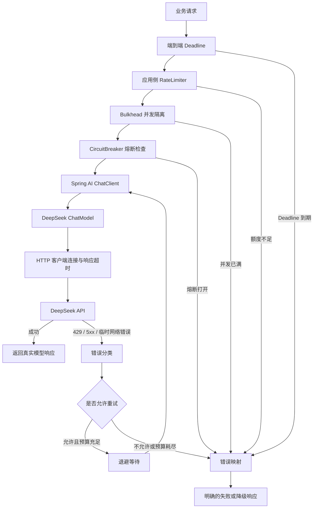
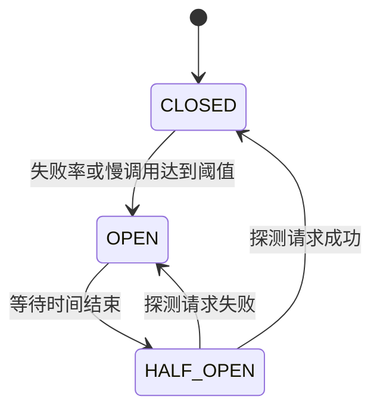

# Spring AI M2：模型调用超时、重试退避、限流与降级

## 1. 学习目标与版本核验

### 1.1 学习目标

本章解决一个核心问题：

**当大模型服务出现网络延迟、请求超时、HTTP 429、服务器错误或持续不可用时，Java 应用如何控制请求、避免重试风暴、保护自身资源，并返回真实、可识别的业务结果？**

需要建立以下能力：

- 正确配置模型调用的网络超时和端到端时限。
- 识别哪些错误可以重试、哪些必须立即失败。
- 理解指数退避、随机抖动和总耗时预算。
- 区分限流、并发隔离、超时和熔断。
- 实现明确的降级响应。
- 比较 Spring AI Retry 与 Resilience4j 的职责。
- 使用 Mock 验证故障处理，不依赖真实模型 API。

### 1.2 版本核验结果

本笔记采用以下版本作为分析基线：

| 组件                       | 版本   | 说明                           |
| -------------------------- | ------ | ------------------------------ |
| JDK                        | 21     | Java 运行和编译环境            |
| Spring Boot                | 3.5.16 | 项目指定版本                   |
| Spring AI                  | 1.1.8  | 采用明确的 1.1.x 补丁版本      |
| Spring AI DeepSeek Starter | 1.1.8  | 模型接入模块                   |
| Resilience4j               | 2.4.0  | Spring Boot 3 Starter 对应版本 |
| Maven                      | 3.9.16 | 项目构建工具                   |

**版本兼容性注意：**

Spring AI 1.1.8 的官方发布说明列出了 Spring Boot 3.5.15 的依赖升级。不能据此声称 Spring AI 1.1.8 与 Spring Boot 3.5.16 已完成官方逐组合测试。

本项目仍应通过 Maven 依赖解析、编译、启动及 Mock 集成测试确认该具体组合是否正常。

Resilience4j 2.4.0 提供 `resilience4j-spring-boot3` 模块，但同样需要在当前项目中实际验证依赖解析和启动。

参考：

- [Spring AI 1.0.9, 1.1.8 Available Now | Spring AI 1.0.9、1.1.8 正式发布](https://spring.io/blog/2026/06/12/spring-ai-1-1-8-1-0-9-avaialble-now/)
- [Releases | Resilience4j 发布记录](https://github.com/resilience4j/resilience4j/releases)

---

## 2. 模型调用可靠性全景

### 2.1 可靠性治理流程



### 2.2 各机制的职责

| 机制           | 解决的问题             | 不负责的事情             |
| -------------- | ---------------------- | ------------------------ |
| HTTP 超时      | 限制网络操作等待时间   | 不负责控制重试次数       |
| Deadline       | 限制整个业务调用耗时   | 不保证底层远程任务停止   |
| Retry          | 临时失败后重新尝试     | 不负责限制并发或持续流量 |
| Backoff        | 控制重新尝试的时间间隔 | 不决定是否应该重试       |
| RateLimiter    | 限制请求速率           | 不负责故障熔断           |
| Bulkhead       | 限制同时执行的请求数量 | 不负责长期请求速率       |
| CircuitBreaker | 故障期间快速拒绝请求   | 不负责自动修复服务       |
| Fallback       | 提供明确的替代业务结果 | 不能伪造模型成功响应     |

核心原则：这些机制解决不同的问题，不应该把它们统称为“重试配置”。

---

## 3. 超时模型与调用总时限

### 3.1 四类网络和执行超时

| 超时类型       | 控制对象             | 典型问题                       |
| -------------- | -------------------- | ------------------------------ |
| 连接池获取超时 | 从连接池获取可用连接 | 连接池资源被占满               |
| 连接建立超时   | 建立 TCP 连接等操作  | 目标服务器无法连接             |
| 响应/读取超时  | 等待响应或读取数据   | 模型长时间没有响应             |
| 端到端总时限   | 整个业务请求         | 多次重试和退避导致请求耗时失控 |

注意：

- 连接超时不等于模型响应超时。
- 读取超时不等于整个业务流程的总时限。
- HTTP 客户端超时与模型 API 内部执行超时不是同一个概念。
- 连接池获取超时不等于连接建立超时。

连接池获取超时尤其重要：即使模型服务正常，应用本地连接池资源耗尽，也可能导致请求等待超时。

如果使用 Reactor Netty，其连接池具有独立的 `pendingAcquireTimeout` 设置，不能将它误认为 Boot 的通用 `connect-timeout`。

### 3.2 单次尝试超时与 Deadline

假设一次模型调用最多尝试 3 次：

| 阶段       | 最大时间 |
| ---------- | -------: |
| 第一次请求 |     4 秒 |
| 第一次退避 |   0.5 秒 |
| 第二次请求 |     4 秒 |
| 第二次退避 |     1 秒 |
| 第三次请求 |     4 秒 |
| 合计       |  13.5 秒 |

还需要为请求构造、网络调度、响应解析等开销预留时间。

可以设置一个示例端到端预算：

\[
T_{\text{deadline}}=15s
\]

但注意：这个例子只说明时间预算关系，并非通用推荐值。

实际预算必须根据业务 SLA、模型响应延迟、网络情况和模型服务限制确定。

计算原则：

\[
T_{\text{total}}
\geq
\sum_{i=1}^{n}T_{\text{attempt},i}
+
\sum_{i=1}^{n-1}T_{\text{backoff},i}
+
T_{\text{overhead}}
\]

如果剩余 Deadline 已无法容纳下一次尝试及其必要执行时间，就不应再发起下一次模型调用。

### 3.3 Spring Boot 3.5.16 HTTP 超时配置

Spring Boot 3.5 的同步和响应式 HTTP 客户端配置具有不同的属性前缀。

```yaml
spring:
  http:
    client:
      connect-timeout: 3s
      read-timeout: 15s

    reactiveclient:
      connect-timeout: 3s
      read-timeout: 15s
```

对应关系：

| 配置                                         | 作用                                   |
| -------------------------------------------- | -------------------------------------- |
| `spring.http.client.connect-timeout`         | RestClient/RestTemplate 客户端连接超时 |
| `spring.http.client.read-timeout`            | 同步客户端读取超时                     |
| `spring.http.reactiveclient.connect-timeout` | 响应式客户端连接超时                   |
| `spring.http.reactiveclient.read-timeout`    | 响应式客户端读取超时                   |

Spring AI 1.1.8 的 DeepSeek API 实现使用 `RestClient.Builder` 和 `WebClient.Builder`：

- 同步模型调用使用 RestClient 路径。
- 流式模型调用使用 WebClient 路径。

因此，这两组配置分别有实际意义。

但必须注意：

1. Boot 提供的是客户端基础配置，不等于统一的端到端 Deadline。
2. 自定义 HTTP Client 或 Builder 时，自动配置可能被覆盖。
3. 不同底层 HTTP 实现对读取超时的具体语义可能不同。
4. 连接池等待需要针对底层连接池单独配置。

参考：

[Calling REST Services | 调用 REST 服务（Spring Boot 3.5）](https://docs.spring.io/spring-boot/3.5/reference/io/rest-client.html)

### 3.4 Reactor timeout

响应式调用可使用：

```java
Mono<String> result = modelCall()
        .timeout(Duration.ofSeconds(15));
```

对于 Flux：

```java
Flux<String> stream = modelStream()
        .timeout(Duration.ofSeconds(30));
```

需要明确：

- `Mono.timeout` 可以限制整个 Mono 等待时间。
- `Flux.timeout` 常用于限制元素之间的等待时间，必须明确采用的是哪种 timeout 语义。
- 超时会触发取消上游订阅的尝试，但不能保证远程服务器已经停止处理。
- 对于 SSE 流式返回，应区分首包等待、分片空闲时间和整个流的最大持续时间。

不要将所有超时都使用一个简单的 `timeout()` 包装来替代底层 HTTP 网络超时。

### 3.5 CompletableFuture 与 Resilience4j TimeLimiter

Resilience4j TimeLimiter 面向 `Future` 和 `CompletionStage` 等异步执行模型。

示意：

```java
TimeLimiterConfig config = TimeLimiterConfig.custom()
        .timeoutDuration(Duration.ofSeconds(5))
        .cancelRunningFuture(true)
        .build();
```

关键点：

- `timeoutDuration` 限制调用方等待的时间。
- `cancelRunningFuture` 表示超时后是否尝试取消 Future。
- `cancel()` 不等于能够强制终止任意阻塞 I/O。
- 如果底层 HTTP 请求不响应中断，工作线程仍可能继续占用资源。

因此，对于同步 `ChatModel.call()`，应优先正确配置底层客户端超时，再使用有界线程池和外层时间预算。

不要创建无限制线程来包装阻塞调用。

参考：

[TimeLimiter | 时间限制器（Resilience4j）](https://resilience4j.readme.io/docs/timeout)

### 3.6 客户端超时不代表服务端没有执行

这是一个重要的工程边界。

例如：

1. Java 应用向 DeepSeek 发送请求。
2. DeepSeek 已收到请求并开始推理。
3. 响应在网络中延迟。
4. Java 客户端达到读取超时。
5. 应用无法确认远程请求最终是否完成。

因此：

- 客户端超时只说明本地等待已经超时。
- 不代表服务端没有处理请求。
- 不代表服务端没有产生调用费用。
- 不代表立即重试不会产生第二次模型推理。

对模型纯生成请求，重复调用可能增加费用和生成次数；对包含工具调用的任务，重复请求还可能间接重复触发业务副作用。

---

## 4. Spring AI 1.1.8 内置 Retry

### 4.1 Starter 与自动配置

DeepSeek Starter：

```xml
<dependency>
    <groupId>org.springframework.ai</groupId>
    <artifactId>spring-ai-starter-model-deepseek</artifactId>
</dependency>
```

Spring AI BOM 应统一管理 Spring AI 相关依赖。

### 4.2 Retry 属性

Spring AI DeepSeek 1.1.x 官方文档提供以下配置：

| 配置项                                     | 1.1.8 文档默认值 | 实际含义                     |
| ------------------------------------------ | ---------------: | ---------------------------- |
| `spring.ai.retry.max-attempts`             |               10 | 最大总尝试次数               |
| `spring.ai.retry.backoff.initial-interval` |             2 秒 | 指数退避初始间隔             |
| `spring.ai.retry.backoff.multiplier`       |                5 | 退避增长倍率                 |
| `spring.ai.retry.backoff.max-interval`     |           3 分钟 | 最大退避间隔                 |
| `spring.ai.retry.on-client-errors`         |            false | 是否重试 4xx 客户端错误      |
| `spring.ai.retry.exclude-on-http-codes`    |               空 | 明确不触发重试的 HTTP 状态码 |
| `spring.ai.retry.on-http-codes`            |               空 | 明确触发重试的 HTTP 状态码   |

### 4.3 max-attempts 是多少次？

`max-attempts=3` 表示：

- 第一次正常请求。
- 第一次失败后重试一次。
- 第二次失败后再重试一次。

因此总共最多调用 3 次，而不是首次调用加 3 次额外重试。

Spring AI 1.1.8 DeepSeek 实现使用 `org.springframework.retry.support.RetryTemplate`。Spring Retry 的 `SimpleRetryPolicy` 明确规定最大尝试次数包含第一次调用。

参考：

[SimpleRetryPolicy | 简单重试策略（Spring Retry）](https://docs.spring.io/spring-retry/docs/current/apidocs/spring.retry/org/springframework/retry/policy/SimpleRetryPolicy.html)

### 4.4 同步调用与流式调用的区别

Spring AI 1.1.8 DeepSeek 源码中：

同步调用：

```java
this.retryTemplate.execute(
        ctx -> this.deepSeekApi.chatCompletionEntity(request)
);
```

因此同步 `call()` 会经过内置 RetryTemplate。

流式调用：

```java
Flux<DeepSeekApi.ChatCompletionChunk> completionChunks =
        this.deepSeekApi.chatCompletionStream(request);
```

这条 `stream()` 路径没有经过上述 RetryTemplate。

这是本次版本核验得到的重要结论：

<badge color="success">已核实源码</badge> **不能认为 Spring AI 1.1.8 DeepSeek 的同步重试配置会自动覆盖流式调用。**

如果对流式 Flux 使用 `retryWhen`，上游订阅可能重新执行完整模型请求，而不是接着上次已输出的位置继续生成。

如果部分内容已经发送给前端，重试可能产生重复文本、重复前缀或不连续结果。因此，流式请求默认应避免在已经发送内容后自动重新发起整个模型请求。

源码：

- [DeepSeekChatModel.java | DeepSeek 聊天模型实现（Spring AI 1.1.8）](https://github.com/spring-projects/spring-ai/blob/v1.1.8/models/spring-ai-deepseek/src/main/java/org/springframework/ai/deepseek/DeepSeekChatModel.java)
- [DeepSeekApi.java | DeepSeek API 客户端实现（Spring AI 1.1.8）](https://github.com/spring-projects/spring-ai/blob/v1.1.8/models/spring-ai-deepseek/src/main/java/org/springframework/ai/deepseek/api/DeepSeekApi.java)

### 4.5 推荐的最小配置

```yaml
spring:
  ai:
    retry:
      max-attempts: 3

      backoff:
        initial-interval: 500ms
        multiplier: 2
        max-interval: 2s

      on-client-errors: false

      on-http-codes:
        - 429
        - 500
        - 503

      exclude-on-http-codes:
        - 400
        - 401
        - 402
        - 403
        - 404
        - 422
```

说明：

- 只对明确允许重试的状态码开启重试。
- 保持 `on-client-errors=false`，避免默认重试所有 4xx。
- 429、500、503 作为显式重试候选。
- 业务校验和认证错误不应该通过重试解决。
- `on-http-codes` 与 `exclude-on-http-codes` 不要配置重叠状态码，避免产生难以理解的分类规则。

以上是示例配置，仍应通过实际 1.1.8 项目和 Mock HTTP 测试确认绑定及行为。

### 4.6 Spring AI Retry 的职责边界

Spring AI Retry 主要处理模型调用过程中的重试与退避。

它不等于：

- HTTP 连接超时。
- HTTP 读取超时。
- 端到端 Deadline。
- 请求速率限制。
- 最大并发数控制。
- 熔断。
- 完整降级。

此外，上述属性中没有声明随机抖动配置项。如果需要随机退避，需要使用自定义策略或其他重试实现。

参考：

[DeepSeek Chat | DeepSeek 聊天模型（Spring AI 1.1）](https://docs.spring.io/spring-ai/reference/1.1/api/chat/deepseek-chat.html)

---

## 5. 重试决策与退避

### 5.1 不同错误的重试决策

| 错误或状态       | DeepSeek 文档描述       | 建议策略                   |
| ---------------- | ----------------------- | -------------------------- |
| HTTP 400         | 请求格式错误            | 不重试，修复请求           |
| HTTP 401         | 认证失败                | 不重试，核对 API Key       |
| HTTP 402         | 账户余额不足            | 不重试，处理余额问题       |
| HTTP 403         | 权限问题                | 通常不重试                 |
| HTTP 422         | 参数无效                | 不重试，修复参数           |
| HTTP 429         | 请求过快或并发/QPS 超限 | 有限退避，配合本地限流     |
| HTTP 500         | 服务器错误              | 可有限重试                 |
| HTTP 503         | 服务过载                | 可有限重试                 |
| 连接重置         | 临时网络问题候选        | 根据异常类型和预算有限重试 |
| 读取超时         | 结果可能未知            | 谨慎重试，评估重复调用成本 |
| 业务参数校验失败 | 本地输入不符合业务要求  | 不重试                     |
| 客户端取消       | 调用方已放弃请求        | 不应无条件重试             |

DeepSeek 将 429 描述为请求过快或超过并发/QPS 限制，并建议合理调整请求速率。

其文档对 500、503 给出短暂等待后重试的建议。

参考：

[Error Codes | 错误代码（DeepSeek API）](https://api-docs.deepseek.com/quick_start/error_codes/)

### 5.2 指数退避

常见退避策略：

- 固定间隔：每次等待相同时间。
- 指数退避：等待间隔逐渐增加。
- 指数退避 + 随机抖动：在退避时间基础上增加随机变化。

指数退避公式：

\[
T_k = \min(T_{\max}, T_0 \times m^{k-1})
\]

其中：

- \(T_0\)：初始退避间隔。
- \(m\)：退避倍率。
- \(T_{\max}\)：最大等待间隔。
- \(k\)：第几次退避。

示例：

| 退避次数 | 计算       | 等待时间 |
| -------- | ---------- | -------: |
| 第一次   | 500ms × 2⁰ |    500ms |
| 第二次   | 500ms × 2¹ |       1s |
| 第三次   | 500ms × 2² |       2s |

如果最大退避间隔是 2 秒，后续等待不会继续无限增长。

### 5.3 随机抖动

为什么需要抖动？

假设 100 个客户端同时收到 429，并统一等待 1 秒后重试。

那么 1 秒后，它们可能再次同时请求，继续触发限流。

这会形成重试风暴。

一种常见的 Full Jitter 策略：

\[
T_k \sim U(0,\min(T_{\max},T_0 \times 2^{k-1}))
\]

即从当前最大退避间隔范围内随机选择实际等待时间。

**Spring AI 1.1.8 的上述 `spring.ai.retry.*` 配置没有暴露随机抖动属性。**

若业务确实需要抖动，应采用自定义 Retry 或 Resilience4j Retry，而不是假设内置配置会自动产生随机时间。

### 5.4 Retry-After

HTTP `Retry-After` 支持两种表达方式：

1. 延迟秒数。
2. HTTP 日期。

例如：

```http
Retry-After: 10
```

表示建议等待 10 秒后再请求。

```http
Retry-After: Fri, 31 Dec 1999 23:59:59 GMT
```

表示等待到指定时间。

处理原则：

- 只有响应确实包含该头部且其值合法时才使用。
- 优先遵守服务端提供的合理等待时间。
- 等待时间不能超过本次业务剩余 Deadline。
- 如果服务端要求等待时间超过本次请求预算，应直接结束当前请求或进入受控等待机制。
- 没有 Retry-After 时，使用本地退避策略。

特别注意：本次核验的 DeepSeek 错误码文档并未保证每个 429 或 503 响应都一定返回 Retry-After。

Spring AI 内置 Retry 属性也没有专门的 Retry-After 配置项。

RFC 9110 对该字段的定义：

[HTTP Semantics | HTTP 语义规范（RFC 9110）](https://www.rfc-editor.org/rfc/rfc9110.html)

### 5.5 多层重试放大

假设：

- Spring AI 最多尝试 3 次。
- Resilience4j Retry 最多尝试 3 次。
- 业务层还会重试 2 次。

最坏情况下，可能产生：

\[
3 \times 3 \times 2 = 18
\]

次底层模型请求。

因此推荐明确重试责任：

| 层次            | 主要职责                                     |
| --------------- | -------------------------------------------- |
| HTTP 客户端     | 网络连接和响应超时                           |
| Spring AI Retry | 模型调用错误分类和有限重试                   |
| Resilience4j    | 限流、熔断、并发隔离                         |
| 业务层          | 处理最终失败及业务补偿，不重复叠加无边界重试 |

如果决定改用 Resilience4j Retry 完整管理重试，应将 Spring AI 的 `max-attempts` 收敛到 1，避免双重重试。

---

## 6. 限流、并发隔离与熔断

### 6.1 服务端限流与应用侧限流

**DeepSeek 服务端限流：**

当账户请求速率或并发超过限制时，服务可能返回 HTTP 429。

**应用侧限流：**

Java 应用在发出模型请求之前主动限制访问数量。

两者的目标不同：

- 服务端限流保护模型供应商的资源。
- 应用侧限流保护自身成本、连接池和下游资源，并减少不必要的 429。

不能只依赖服务端 429 才开始处理限流。

### 6.2 QPS 与并发数

QPS 是一段时间内的请求数量。

并发数是在某一时刻同时执行的请求数量。

两者不能混为一谈。

例如：

- 一秒内允许 10 个请求，不代表最多只能同时执行 10 个请求。
- 如果每个模型请求耗时 30 秒，即使 QPS 不高，也可能累积大量并发调用。

### 6.3 Resilience4j RateLimiter

核心属性：

| 属性                 | 含义                       |
| -------------------- | -------------------------- |
| `limitForPeriod`     | 每个刷新周期允许的许可数量 |
| `limitRefreshPeriod` | 许可刷新周期               |
| `timeoutDuration`    | 等待获取许可的最长时间     |

示例：

```yaml
resilience4j:
  ratelimiter:
    instances:
      model:
        limitForPeriod: 5
        limitRefreshPeriod: 1s
        timeoutDuration: 0
```

含义：单个本地 RateLimiter 实例，每个刷新周期提供 5 个许可，拿不到许可时立即拒绝，而不是继续等待。

注意：

Resilience4j RateLimiter 是按刷新周期管理许可的机制，并不等同于平滑的 Redis 令牌桶。

它使用本地内存管理状态。多个 JVM 实例各自拥有自己的 RateLimiter，不能直接当作全局分布式限流器。

参考：

[RateLimiter | 限流器（Resilience4j）](https://resilience4j.readme.io/docs/ratelimiter)

### 6.4 Bulkhead 并发隔离

Bulkhead 控制同一时间允许多少个调用正在执行。

示例：

```yaml
resilience4j:
  bulkhead:
    instances:
      model:
        maxConcurrentCalls: 4
        maxWaitDuration: 0
```

含义：

- 最多允许 4 个并发调用。
- 没有可用执行许可时，不等待，直接拒绝。

与 RateLimiter 的区别：

| 对比     | RateLimiter      | Bulkhead       |
| -------- | ---------------- | -------------- |
| 控制对象 | 请求速率         | 并发执行数量   |
| 主要单位 | 时间周期内许可数 | 同时执行数     |
| 主要目的 | 控制模型调用频率 | 保护本地资源   |
| 主要风险 | 超限请求被拒绝   | 并发资源被占满 |

默认建议优先选择有界等待或立即拒绝，避免积累大量已经过期的模型请求。

### 6.5 CircuitBreaker 熔断

熔断器有三个核心状态：

| 状态      | 作用                             |
| --------- | -------------------------------- |
| CLOSED    | 正常放行请求并统计失败           |
| OPEN      | 故障达到阈值后拒绝请求           |
| HALF_OPEN | 允许少量探测请求判断服务是否恢复 |

状态变化：



示例配置：

```yaml
resilience4j:
  circuitbreaker:
    instances:
      model:
        slidingWindowType: COUNT_BASED
        slidingWindowSize: 20
        minimumNumberOfCalls: 10
        failureRateThreshold: 50
        waitDurationInOpenState: 10s
        permittedNumberOfCallsInHalfOpenState: 3
```

以上仅为学习示例，不代表适用于所有业务的最佳参数。

熔断应主要统计真正代表模型服务不健康的错误：

- 临时网络异常。
- 模型服务 5xx。
- 持续超时。
- 明确的服务过载。

通常不应把用户参数错误、认证错误和业务校验错误全部计入模型故障率。

### 6.6 三种机制的区别

| 机制           | 拒绝条件                   |
| -------------- | -------------------------- |
| RateLimiter    | 当前时间窗口内没有足够许可 |
| Bulkhead       | 最大并发资源已占满         |
| CircuitBreaker | 目标服务处于 OPEN 状态     |

它们可以组合，但不能互相替代。

---

## 7. 降级机制

### 7.1 降级与重试的区别

重试的目标是重新尝试获得正常服务结果。

降级的目标是在正常服务无法提供结果时，返回一个明确、受控且符合业务要求的替代行为。

例如：

- 模型服务不可用：返回明确的暂不可用提示。
- 已有可信缓存：返回缓存内容，同时明确其来源和时间。
- 高风险诊断任务：转人工处理。
- 模型调用超出总时限：返回请求超时状态。
- 配额不足：提醒调用方稍后重试。

### 7.2 禁止伪造成功

以下做法不允许：

- 返回空字符串却伪装成模型成功。
- 用固定文本冒充 DeepSeek 的实时回答。
- 把未经验证的缓存内容冒充新生成结果。
- 在模型失败后自行编造一份诊断结论。
- 将失败状态包装为 HTTP 200 成功响应。

### 7.3 推荐降级响应

例如：

```json
{
  "status": "UNAVAILABLE",
  "degraded": true,
  "content": null,
  "errorCode": "MODEL_TEMPORARILY_UNAVAILABLE",
  "message": "模型服务暂时不可用，请稍后重试。"
}
```

如果使用缓存：

```json
{
  "status": "DEGRADED",
  "degraded": true,
  "content": "此前经过验证的知识库结果。",
  "source": "VERIFIED_CACHE",
  "cachedAt": "2026-11-02T10:00:00+08:00"
}
```

这两类返回必须明确区别正常模型响应和降级结果。

---

## 8. Spring AI Retry 与 Resilience4j 比较

| 比较维度 | Spring AI Retry                     | Resilience4j                                 |
| -------- | ----------------------------------- | -------------------------------------------- |
| 核心定位 | 模型调用重试                        | 通用容错组件                                 |
| 配置方式 | `spring.ai.retry.*`                 | Java API、YAML 或注解                        |
| 错误分类 | 模型实现和 HTTP 状态码              | 自定义异常分类及谓词                         |
| 指数退避 | 支持                                | 支持                                         |
| 随机抖动 | 当前 Spring AI 配置没有对应公开属性 | 支持相应自定义策略                           |
| 超时     | 不负责完整网络超时和总 Deadline     | TimeLimiter 处理 Future/CompletionStage 时限 |
| 限流     | 不提供完整通用限流器                | RateLimiter                                  |
| 并发隔离 | 不提供完整通用并发隔离              | Bulkhead                                     |
| 熔断     | 不是完整熔断方案                    | CircuitBreaker                               |
| 降级     | 不是完整降级体系                    | 可结合 fallback 机制                         |
| 流式调用 | 取决于具体模型实现                  | 取决于 Reactor/异步适配及取消语义            |

### 8.1 方案 A：只使用 Spring AI Retry

适用：

- 初始模型接入。
- 同步文本生成。
- 主要需求是重试临时网络或服务端异常。
- 不需要复杂限流和熔断。
- 希望降低依赖和代码复杂度。

优点：

- 配置简单。
- 与模型调用层集成。
- 不需要自己包装一次 RetryTemplate。

不足：

- 缺乏通用并发隔离。
- 缺乏应用侧限流。
- 不是完整熔断和降级方案。
- 退避配置没有明确的随机抖动参数。
- 不自动解决端到端 Deadline。

### 8.2 方案 B：Spring AI Retry + Resilience4j

建议作为当前学习阶段的轻量进阶方案。

职责安排：

| 层次         | 使用机制               |
| ------------ | ---------------------- |
| 网络客户端   | 连接和读取超时         |
| Spring AI    | 模型调用 Retry         |
| Resilience4j | RateLimiter            |
| Resilience4j | Bulkhead               |
| Resilience4j | CircuitBreaker         |
| 业务服务     | 最终错误映射和明确降级 |

这一方案保留 Spring AI 对模型调用异常的处理，同时由 Resilience4j 控制本地资源。

建议不要一开始再引入第二套 Resilience4j Retry。

### 8.3 方案 C：使用 Resilience4j 统一管理重试

适用：

- 需要严格自定义错误分类。
- 需要随机抖动。
- 需要解析 Retry-After。
- 需要将不同模型供应商统一到相同重试策略。

实现要求：

1. 设置 Spring AI `max-attempts=1`。
2. 由自定义重试层负责重试次数和退避。
3. 将模型异常转换为明确的业务错误类别。
4. 必要时解析真实 HTTP 响应头。
5. 统一控制总 Deadline。

缺点是开发和配置复杂度更高。

### 8.4 当前推荐

**当前阶段推荐方案 B。**

先使用 Spring AI Retry 处理同步模型调用中的可重试异常，再按实际需求增加 Resilience4j RateLimiter、Bulkhead 和 CircuitBreaker。

不要为了展示 Resilience4j 的全部组件而一次性引入 Retry、TimeLimiter、ThreadPoolBulkhead、分布式限流和复杂工作流。

---

## 9. 最小实践：Mock 模型与故障模拟

### 9.1 目标

建立一个独立的模型调用可靠性实验，不调用真实 DeepSeek API。

验证：

- 正常成功。
- 429。
- 503。
- 临时网络失败。
- 超时。
- 连续失败。
- 本地限流拒绝。
- 并发隔离。
- 熔断打开。
- 半开恢复。
- 明确降级。

### 9.2 Maven 依赖建议

以下是依赖组织示例：

```xml
<properties>
    <java.version>21</java.version>
    <spring-ai.version>1.1.8</spring-ai.version>
    <resilience4j.version>2.4.0</resilience4j.version>
</properties>

<dependencyManagement>
    <dependencies>
        <dependency>
            <groupId>org.springframework.ai</groupId>
            <artifactId>spring-ai-bom</artifactId>
            <version>${spring-ai.version}</version>
            <type>pom</type>
            <scope>import</scope>
        </dependency>

        <dependency>
            <groupId>io.github.resilience4j</groupId>
            <artifactId>resilience4j-bom</artifactId>
            <version>${resilience4j.version}</version>
            <type>pom</type>
            <scope>import</scope>
        </dependency>
    </dependencies>
</dependencyManagement>

<dependencies>
    <dependency>
        <groupId>org.springframework.ai</groupId>
        <artifactId>spring-ai-starter-model-deepseek</artifactId>
    </dependency>

    <dependency>
        <groupId>io.github.resilience4j</groupId>
        <artifactId>resilience4j-spring-boot3</artifactId>
    </dependency>

    <dependency>
        <groupId>org.springframework.boot</groupId>
        <artifactId>spring-boot-starter-actuator</artifactId>
    </dependency>

    <dependency>
        <groupId>org.springframework.boot</groupId>
        <artifactId>spring-boot-starter-aop</artifactId>
    </dependency>

    <dependency>
        <groupId>org.springframework.boot</groupId>
        <artifactId>spring-boot-starter-test</artifactId>
        <scope>test</scope>
    </dependency>
</dependencies>
```

说明：

- 如果只使用 Resilience4j 编程式 API，可以只引入 `resilience4j-circuitbreaker`、`resilience4j-ratelimiter` 和 `resilience4j-bulkhead`，不必引入完整 Spring Boot Starter。
- 如果使用 Spring Boot Starter 的 YAML 自动配置、注解和 AOP，需要 Actuator、AOP 等配套依赖。
- 如果实际使用 Reactor 操作符，还需要按官方说明增加 `resilience4j-reactor`。
- 本示例没有必要添加 Resilience4j Retry，因为同步模型调用已经使用 Spring AI Retry。

参考：

[Getting Started | 入门指南（Resilience4j Spring Boot 3）](https://resilience4j.readme.io/docs/getting-started-3)

### 9.3 Mock 模型调用接口

为了将模型供应商和可靠性策略隔离，先定义一个简单接口：

```java
public interface ModelGateway {

    String generate(String prompt);
}
```

生产环境使用 Spring AI 实现：

```java
@Service
@Profile("deepseek")
public class DeepSeekModelGateway implements ModelGateway {

    private final ChatClient chatClient;

    public DeepSeekModelGateway(ChatClient.Builder builder) {
        this.chatClient = builder.build();
    }

    @Override
    public String generate(String prompt) {
        return chatClient.prompt()
                .user(prompt)
                .call()
                .content();
    }
}
```

Mock 环境不需要真实模型：

```java
public class StubModelGateway implements ModelGateway {

    private final AtomicInteger calls = new AtomicInteger();

    private volatile RuntimeException failure;

    public void setFailure(RuntimeException failure) {
        this.failure = failure;
    }

    public int getCalls() {
        return calls.get();
    }

    @Override
    public String generate(String prompt) {
        calls.incrementAndGet();

        if (failure != null) {
            throw failure;
        }

        return "MOCK_MODEL_RESPONSE";
    }
}
```

测试中可以为 Stub 配置：

- 正常返回。
- 模拟 429 异常。
- 模拟 503 异常。
- 模拟读取超时异常。
- 持续失败。

生产模型调用和 Mock 实现使用相同的 `ModelGateway` 接口。

### 9.4 Resilience4j 最小配置

示例：

```yaml
resilience4j:
  ratelimiter:
    instances:
      model:
        limitForPeriod: 5
        limitRefreshPeriod: 1s
        timeoutDuration: 0

  bulkhead:
    instances:
      model:
        maxConcurrentCalls: 4
        maxWaitDuration: 0

  circuitbreaker:
    instances:
      model:
        slidingWindowType: COUNT_BASED
        slidingWindowSize: 10
        minimumNumberOfCalls: 5
        failureRateThreshold: 50
        waitDurationInOpenState: 10s
        permittedNumberOfCallsInHalfOpenState: 2
```

这些数字是测试参数，不是生产推荐值。

### 9.5 通过编程式 API 组合策略

使用编程式装饰器，可以明确执行顺序：

```java
Supplier<String> modelCall =
        () -> modelGateway.generate(prompt);

Supplier<String> protectedCall =
        RateLimiter.decorateSupplier(
                rateLimiter,
                Bulkhead.decorateSupplier(
                        bulkhead,
                        CircuitBreaker.decorateSupplier(
                                circuitBreaker,
                                modelCall
                        )
                )
        );

String result = protectedCall.get();
```

执行顺序：

1. RateLimiter 检查请求速率。
2. Bulkhead 检查并发许可。
3. CircuitBreaker 检查熔断状态。
4. 最终执行模型调用。
5. 由 Spring AI 自身处理其配置的同步模型重试。

注意：这个组合在正常调用时，每个业务请求只经过一次外层限流和并发检查。Spring AI 内部可能针对该请求产生多次底层模型调用。

### 9.6 明确降级结果

建议使用明确的返回类型：

```java
public record ModelResult(
        String status,
        String content,
        boolean degraded,
        String errorCode,
        String message
) {

    public static ModelResult success(String content) {
        return new ModelResult(
                "SUCCESS",
                content,
                false,
                null,
                null
        );
    }

    public static ModelResult unavailable(String code, String message) {
        return new ModelResult(
                "UNAVAILABLE",
                null,
                true,
                code,
                message
        );
    }
}
```

业务层捕获限流、并发拒绝和熔断异常后，返回明确的 `UNAVAILABLE` 结果。

不要将 `MOCK_MODEL_RESPONSE` 或固定文本用于生产降级响应。

### 9.7 Mock 集成测试设计

如果要验证 Spring AI 自身的 Retry，而不是真实调用 DeepSeek，应使用本地 Mock HTTP Server。

测试配置中把：

```yaml
spring:
  ai:
    deepseek:
      base-url: http://localhost:随机端口
      api-key: test-api-key
```

指向测试中的 Mock Server。

Mock Server 可以依次返回：

```text
第一次：HTTP 503
第二次：HTTP 200 + 模型响应 JSON
```

最终检查：

- Mock Server 收到了几次请求。
- Spring AI 是否按配置重试。
- 最终响应是否正常解析。
- 超出最大尝试次数时是否抛出预期异常。
- 没有发起真实 DeepSeek 网络调用。

这里的本地 Mock HTTP Server 比单纯 Mock 一个 `ChatClient` 更有价值，因为它可以验证实际 DeepSeek HTTP 客户端和 Spring AI Retry 链路。

---

## 10. 测试矩阵与验收

| 编号 | 场景                       | 预期结果                           |
| ---- | -------------------------- | ---------------------------------- |
| T01  | 正常模型调用               | 成功一次，不产生额外重试           |
| T02  | HTTP 400                   | 不重试，返回请求错误               |
| T03  | HTTP 401                   | 不重试，认证错误                   |
| T04  | HTTP 402                   | 不重试，余额错误                   |
| T05  | HTTP 429                   | 按明确规则有限退避                 |
| T06  | HTTP 503 → 200             | 有限重试后成功                     |
| T07  | 连续 503                   | 达到最大总尝试次数后停止           |
| T08  | 单次响应超时               | 超时被正确识别                     |
| T09  | 总 Deadline 到期           | 不继续启动后续尝试                 |
| T10  | RateLimiter 超限           | 请求被快速拒绝                     |
| T11  | Bulkhead 已满              | 并发请求被拒绝或按策略短暂等待     |
| T12  | 连续模型失败               | CircuitBreaker 进入 OPEN           |
| T13  | 等待后半开探测             | 允许指定数量的探测请求             |
| T14  | 降级响应                   | 标明不可用，不伪造模型结果         |
| T15  | 流式响应开始输出后发生错误 | 不自动重复发送已有内容             |
| T16  | 多层重试组合               | 底层调用次数没有发生非预期乘法放大 |

### 测试必须记录

- 实际调用次数。
- 每次调用间隔。
- 最终状态。
- 异常类型。
- 是否发生退避。
- 是否进入熔断。
- 是否发生降级。
- 真实 HTTP 状态码（适用时）。
- 执行命令和测试日志。

**本笔记没有在你的 M2 项目仓库中实际执行 Maven 构建、JUnit 测试或真实模型调用。** 上面的代码和测试设计是实践模板，不是已通过测试的工程证据。具体版本组合和类 API 必须在项目中完成依赖解析及编译验证。

---

## 11. 监控与诊断

至少记录以下指标：

| 指标            | 作用                         |
| --------------- | ---------------------------- |
| 模型请求总数    | 观察整体调用量               |
| 请求成功数      | 观察模型可用性               |
| 请求失败数      | 分析故障趋势                 |
| HTTP 429 数     | 识别供应商限流               |
| 5xx 数          | 观察模型服务异常             |
| 超时数          | 识别响应性能问题             |
| 重试次数        | 判断重试是否过于频繁         |
| 重试耗时        | 判断退避是否影响业务 SLA     |
| 限流拒绝数      | 识别本地容量控制             |
| Bulkhead 拒绝数 | 判断并发资源是否不足         |
| 熔断状态        | 判断模型服务是否处于故障保护 |
| 降级次数        | 观察真实服务不可用的影响     |
| 端到端延迟      | 衡量整体业务体验             |
| Token 用量      | 衡量调用成本                 |

日志建议记录：

- requestId。
- 模型标识。
- 业务场景。
- 调用耗时。
- 重试次数。
- HTTP 状态码。
- 异常分类。
- 最终结果状态。

不要记录：

- API Key。
- Authorization Header。
- 无必要的完整 Prompt。
- 用户隐私。
- 不必要的完整模型响应。

---

## 12. 常见故障与排查

| 故障                     | 主要排查方向                                   |
| ------------------------ | ---------------------------------------------- |
| 所有 4xx 都在重试        | 检查 `on-client-errors`                        |
| 429 反复出现             | 检查本地 RateLimiter 和重试策略                |
| 503 重试过多             | 检查 max-attempts 和退避设置                   |
| 请求耗时远超 SLA         | 检查每次超时、退避和 Deadline                  |
| 同步请求超时             | 检查 RestClient 连接与读取超时                 |
| 流式请求无响应           | 检查 WebClient 和响应式连接配置                |
| 应用线程池耗尽           | 检查阻塞调用和 Bulkhead                        |
| 熔断一直 OPEN            | 检查失败分类、恢复时间和实际服务状态           |
| 明明已超时，远程仍在执行 | 检查取消语义，不能假设客户端超时终止服务端请求 |
| 测试中重试次数不符合预期 | 检查是否有多层 Retry、异常分类及总尝试次数     |

---

## 13. 面试与技术表达总结

### 必须能够清楚回答的问题

**问题 1：超时和重试有什么区别？**

超时控制一次操作或整个业务流程最多等待多久；重试是在符合条件的失败发生后再次执行。超时解决等待失控，重试解决部分临时故障。

**问题 2：为什么不能所有异常都重试？**

参数错误、认证失败、权限错误和余额不足不会因为等待一段时间就自动修复。盲目重试会浪费资源并增加调用成本。

**问题 3：为什么需要指数退避和随机抖动？**

指数退避降低持续故障时的请求压力，随机抖动防止大量客户端在相同时间再次请求，造成重试风暴。

**问题 4：RateLimiter 和 Bulkhead 有什么区别？**

RateLimiter 控制单位时间内允许发起的请求数量，Bulkhead 控制同时执行的请求数量。一个控制速率，一个控制并发资源。

**问题 5：CircuitBreaker 与 Retry 有什么区别？**

Retry 会在失败后尝试重新执行；CircuitBreaker 在发现服务持续不健康时暂时拒绝调用，避免资源继续消耗。

**问题 6：为什么 Spring AI Retry 不能替代 Resilience4j？**

Spring AI Retry 主要负责模型调用层的重试，而 Resilience4j 提供限流、并发隔离、熔断和 TimeLimiter 等独立机制，职责不相同。

**问题 7：客户端超时后能否直接重试？**

不能无条件重试。客户端超时并不能证明服务端没有收到或处理请求。对于有副作用的工具调用，还必须增加业务幂等和去重保护。

**问题 8：Spring AI 1.1.8 的 DeepSeek 流式调用是否自动使用同步 Retry？**

不应这样认为。源码中同步 `call()` 使用 RetryTemplate，而 `stream()` 的请求路径没有使用这套 RetryTemplate。流式请求重新订阅也不能恢复已经输出的内容。

**问题 9：模型不可用时应该怎样降级？**

返回明确的服务不可用状态、可信且标记来源的缓存结果，或转人工处理。不能凭空生成内容来冒充模型成功。

---

## 14. 官方参考资料

### Spring AI

- [DeepSeek Chat | DeepSeek 聊天模型（Spring AI 1.1）](https://docs.spring.io/spring-ai/reference/1.1/api/chat/deepseek-chat.html)
- [DeepSeekChatModel.java | DeepSeek 聊天模型源码（Spring AI 1.1.8）](https://github.com/spring-projects/spring-ai/blob/v1.1.8/models/spring-ai-deepseek/src/main/java/org/springframework/ai/deepseek/DeepSeekChatModel.java)
- [DeepSeekApi.java | DeepSeek API 客户端源码（Spring AI 1.1.8）](https://github.com/spring-projects/spring-ai/blob/v1.1.8/models/spring-ai-deepseek/src/main/java/org/springframework/ai/deepseek/api/DeepSeekApi.java)

### Spring Boot 与 HTTP 客户端

- [Calling REST Services | 调用 REST 服务（Spring Boot 3.5）](https://docs.spring.io/spring-boot/3.5/reference/io/rest-client.html)

### Spring Retry

- [SimpleRetryPolicy | 简单重试策略（Spring Retry）](https://docs.spring.io/spring-retry/docs/current/apidocs/spring.retry/org/springframework/retry/policy/SimpleRetryPolicy.html)

### Resilience4j

- [Introduction | Resilience4j 介绍](https://resilience4j.readme.io/docs/getting-started)
- [Getting Started | Spring Boot 3 入门](https://resilience4j.readme.io/docs/getting-started-3)
- [Retry | 重试](https://resilience4j.readme.io/docs/retry)
- [RateLimiter | 限流器](https://resilience4j.readme.io/docs/ratelimiter)
- [CircuitBreaker | 熔断器](https://resilience4j.readme.io/docs/circuitbreaker)
- [Bulkhead | 舱壁隔离](https://resilience4j.readme.io/docs/bulkhead)
- [TimeLimiter | 时间限制器](https://resilience4j.readme.io/docs/timeout)
- [Releases | Resilience4j 发布记录](https://github.com/resilience4j/resilience4j/releases)

### DeepSeek

- [Error Codes | 错误代码](https://api-docs.deepseek.com/quick_start/error_codes/)
- [Rate Limit & Isolation | 限流与隔离](https://api-docs.deepseek.com/quick_start/rate_limit/)

### HTTP 标准

- [HTTP Semantics | HTTP 语义规范（RFC 9110）](https://www.rfc-editor.org/rfc/rfc9110.html)

---

## 15. 最终掌握标准

完成本章后，至少能够独立做到：

- [ ] 区分连接、连接池、响应读取和端到端超时。
- [ ] 解释 Spring AI 1.1.8 的 Retry 属性及默认值。
- [ ] 明确 `max-attempts=3` 是 3 次总尝试。
- [ ] 设计 400、401、402、422、429、500、503 的错误处理规则。
- [ ] 计算指数退避时间，并解释随机抖动。
- [ ] 设计包含重试和等待在内的总 Deadline。
- [ ] 区分 RateLimiter、Bulkhead、CircuitBreaker 和 TimeLimiter。
- [ ] 解释同步与流式 DeepSeek 调用的重试差异。
- [ ] 使用 Mock 验证 429、503、超时、连续失败和熔断。
- [ ] 返回明确的降级结果，不伪造模型内容。
- [ ] 解释 Spring AI Retry 与 Resilience4j 的轻量组合方案。
- [ ] 能够从日志和指标定位模型调用可靠性问题。

**本章核心结论：**

模型调用可靠性不是简单地配置几个 Retry 参数，而是以总 Deadline 为约束，以错误分类决定是否重试，以退避控制重试压力，以限流和 Bulkhead 保护本地资源，以 CircuitBreaker 保护故障期间的系统，再以真实、明确的降级行为保障业务可控性。