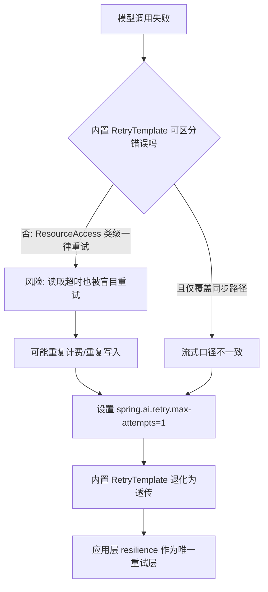
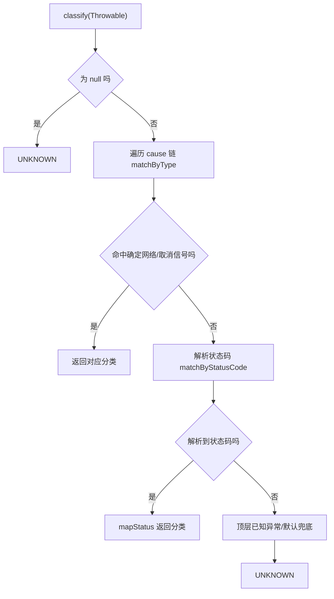
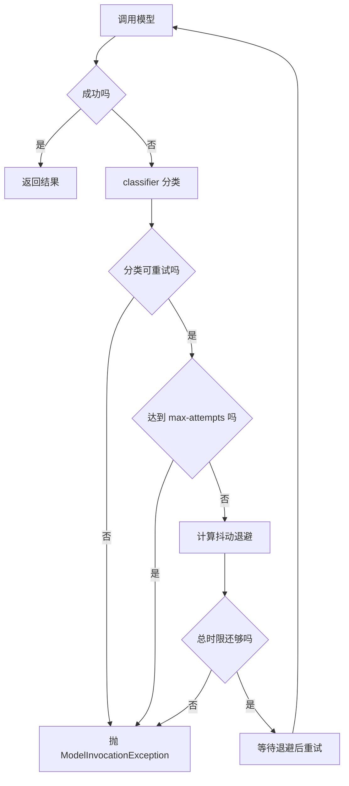

# D20 项目迭代全量信息与操作

> 迭代名称：D20——统一模型调用异常映射、超时配置与有限重试（仅对确认适合重试的失败启用重试）
> 物理包：`com.zl.d20`；模块：`D20_UMIEM`；聚合根：`M2-Java\D20`
> 技术基线：JDK 21（21.0.7）、Spring Boot 3.5.16、Spring AI 1.1.8（BOM 锁定，禁 2.x）、Spring MVC（Tomcat 10.1.55）、Reactor 3.7.19、spring-retry 2.0.13、MyBatis-Plus 3.5.17
> 文档约定：首次出现英文缩写给出全称与中文；Mermaid 图兼容 Typora 0.11.18（节点 ID 唯一、无 HTML 标签、节点英文双引号）。

---

## 1. 迭代概述

### 1.1 三条主线

1. **统一异常分类与对外错误映射**：同步与流式两条链路共用一套内部异常分类（`ModelErrorCategory`），任何模型调用失败先归一到确定分类，再映射到对外业务码，避免同一类错误在不同接口返回不同语义。
2. **超时外部化并区分语义**：把「建连超时、读取超时、单次总时限、流式空闲超时」四类时间预算显式区分并外部化，基于 JDK（Java Development Kit，Java 开发工具包）内置 `java.net.http.HttpClient` 落地，不再使用不可区分的粗粒度超时。
3. **有上限、可观测、可配置、单一责任层的有限重试**：新增应用层 `resilience`（韧性）包作为唯一重试责任层；仅对确认可安全重试的失败（建连失败、限流、上游 5xx）重试，读取超时默认不重试；禁止多层重试叠加。

### 1.2 关键事实（先给结论）

- Spring AI 1.1.8 内置阻塞重试默认 **10 次**、指数退避（initial 2000ms、multiplier 5、上限 180000ms），且对 `ResourceAccessException` **类级一律重试**，无法区分「请求未发送的建连失败」与「请求已发送后的读取超时」。
- 本迭代把内置重试置为 **不重试**（`spring.ai.retry.max-attempts=1`），在应用层新增唯一韧性层，彻底杜绝多层重试叠加。
- 类路径无 Apache HttpClient5、无 reactor-netty、无 OkHttp，同步/反应式客户端均落到 JDK 内置 `HttpClient`；应用自身代码不直接使用 `RestClient/WebClient/HttpClient`，故定制全局构建器等同模型作用域。
- 同步/流式接口契约（路径、方法、请求/响应 DTO、HTTP 统一 200、业务码）**零破坏**。

### 1.3 记忆简语

- **「一层重试两（次）封顶」**：默认 max-attempts=2，即最多重试 1 次，唯一责任层。
- **「连可重试，读默不重试」**：建连失败请求未发出可安全重试；读取超时结果不确定、可能重复计费，默认不重试。
- **「流前可重试，流后不重放」**：流式仅在首个内容片段之前允许重试，首片段后失败只透传错误，不重放、不拼接。
- **「四钟各管一段」**：建连、读取、总时限、流式空闲四类超时语义分离。

---

## 2. 仓库与模块结构

### 2.1 竖屏层级树（关键部分）

```
D20
├─ pom.xml                         # 聚合 POM，packaging=pom，import spring-ai-bom 1.1.8
└─ D20_UMIEM
   ├─ pom.xml                      # 模块 POM，显式 spring-boot-starter-web
   ├─ src
   │  ├─ main
   │  │  ├─ java/com/zl/d20
   │  │  │  ├─ D20SpringAiApplication.java
   │  │  │  ├─ common/             # Result、ResultCode、全局异常、配置异常
   │  │  │  ├─ config/             # AiProperties、AiConstants
   │  │  │  ├─ controller/         # ChatController（同步）、ChatStreamController（流式）
   │  │  │  ├─ conversation/       # 角色准备、历史消息转换
   │  │  │  ├─ history/            # 会话/消息持久化、上下文窗口
   │  │  │  ├─ knowledge/          # 编排器、检索、引用注册表
   │  │  │  ├─ service/            # AiChatService、Mock/DeepSeek 实现、StreamChunk
   │  │  │  ├─ device/             # 设备场景与工单候选
   │  │  │  ├─ prompt/             # Prompt 模板管理
   │  │  │  ├─ logging/            # TraceId、访问日志
   │  │  │  └─ resilience/         # D20 新增：异常分类/超时/有限重试（6 个类）
   │  │  └─ resources
   │  │     ├─ application.yml     # 新增 resilience 段 + spring.ai.retry 关闭
   │  │     ├─ db/                 # 建表 DDL
   │  │     └─ static/             # 前端页面与 sse-parser
   │  └─ test
   │     ├─ java/com/zl/d20/
   │     │  ├─ （骨架自带 5 个测试类）
   │     │  └─ resilience/         # D20 新增 3 个韧性测试类
   │     └─ resources/application-test.yml
   └─ target
```

### 2.2 坐标与版本

| 项 | 值 |
|---|---|
| 聚合根 groupId / artifactId | org.ai.m2.ds / D20 |
| 模块 artifactId | D20_UMIEM |
| 物理包 | com.zl.d20 |
| 主类 | D20SpringAiApplication（@SpringBootApplication + @ConfigurationPropertiesScan） |
| 服务端口 | 8080 |
| parent | spring-boot-starter-parent 3.5.16 |
| Spring AI BOM | 1.1.8（锁定，禁止 2.x） |
| spring-retry | 2.0.13（spring-ai 传递在类路径，非新增） |
| JDK | 21（java 21.0.7） |

---

## 3. 现状核验与调用链（POM / 字节码 / 依赖树）

### 3.1 依赖证据表

| 证据 | 内容 | 结论 |
|---|---|---|
| 模块 POM | 显式 `spring-boot-starter-web`，注释「锚定 Tomcat + Spring MVC」 | Servlet 栈 |
| 模块 POM | 无 `spring-boot-starter-webflux` | 无反应式自动装配入口 |
| 依赖树 | 无 httpclient5、无 reactor-netty、无 okhttp | 客户端落到 JDK HttpClient |
| 依赖树 | spring-web 6.2.19 含 JdkClientHttpRequestFactory / JdkClientHttpConnector | JDK 工厂可用 |
| 依赖树 | spring-retry 2.0.13 由 spring-ai 传递 | 非新增依赖 |
| Grep | 应用自身代码无 RestClient/WebClient/HttpClient 直接使用 | 全局 Customizer 即模型作用域 |

### 3.2 Spring AI 内置重试机制（字节码实证）

| 配置项 `spring.ai.retry.*` | 默认值 | 说明 |
|---|---|---|
| max-attempts | 10（激进） | 总尝试次数 |
| backoff.initial-interval | 2000ms | 首次退避 |
| backoff.multiplier | 5 | 退避倍率 |
| backoff.max-interval | 无默认 | 退避上限（RetryUtils 内部用 180000ms） |
| on-client-errors | false | 4xx 是否重试 |
| on-http-codes / exclude-on-http-codes | 无默认 | 自定义状态码策略 |

- `RetryUtils.DEFAULT_RETRY_TEMPLATE`：maxAttempts=10，retryOn `TransientAiException` 与 `ResourceAccessException`，指数退避（2000ms、倍率 5、上限 180000ms），**无抖动**。
- `RetryUtils.SHORT_RETRY_TEMPLATE`：maxAttempts=10，同两类异常，固定退避 100ms。
- 关键边界：内置对 `ResourceAccessException` 类级一律重试，**无法区分建连失败与读取超时**；且阻塞重试只作用于同步路径，流式走 Reactor `Flux`，不经过阻塞 `RetryTemplate`。

### 3.3 DeepSeek 调用链

- `DeepSeekChatModel implements ChatModel`，持 `public final RetryTemplate`：同步 `call → internalCall` 用 `retryTemplate.execute` 包裹；流式 `stream → internalStream` 走 Reactor `Flux`，不用阻塞 `RetryTemplate`。
- `DeepSeekApi` 同时持阻塞 `RestClient` 与反应式 `WebClient`，构造器注入 `RestClient.Builder`、`WebClient.Builder`、`ResponseErrorHandler`，自身不设 request factory（依赖 Boot 自动配置的构建器）。
- DeepSeek 元数据无任何超时属性。

### 3.4 关闭内置重试的决策流程



---

## 4. 统一异常分类与对外映射

### 4.1 内部异常分类（11 值）

| 分类 ModelErrorCategory | 默认可重试 | 对外业务码 | 典型触发 |
|---|---|---|---|
| PARAM_ERROR | 否 | 4001 | HTTP 400、非法参数、Bean Validation |
| AUTH_ERROR | 否 | 5001 | HTTP 401/403、密钥缺失/占位 |
| MODEL_NOT_FOUND | 否 | 5001 | HTTP 404 |
| CONTENT_POLICY_REJECT | 否 | 5001 | HTTP 409/422 |
| RATE_LIMIT_RECOVERABLE | 是 | 5002 | HTTP 429 |
| UPSTREAM_UNAVAILABLE | 是 | 5002 | HTTP 500/502/503/504 |
| CONNECT_FAILURE | 是 | 5002 | 建连超时、连接拒绝、未知主机、TLS 握手 |
| READ_TIMEOUT | 否 | 5002 | HTTP 408、读取/空闲超时 |
| RESPONSE_PARSE_ERROR | 否 | 5001 | 响应体无法映射 |
| CLIENT_CANCELLED | 否 | 5000 | 客户端取消/断开 |
| UNKNOWN | 否 | 5000 | 未归类，保守不重试 |

### 4.2 HTTP 状态码映射口径

- 429 → RATE_LIMIT；408 → READ_TIMEOUT；401/403 → AUTH；404 → MODEL_NOT_FOUND；
- 409/422 → CONTENT_POLICY；`>=500` → UPSTREAM；400 → PARAM；其余 4xx → AUTH。
- 分类器正则 `(?:HTTP\s+)?(\d{3})\s*-\s`，兼容 Spring AI 错误处理器两种消息格式（`HTTP nnn - body` 与 `nnn - body`）。

### 4.3 分类决策链



### 4.4 分类器关键边界（cause 匹配顺序）

- `HttpConnectTimeoutException` 是 `HttpTimeoutException` 的子类，**必须先判**建连超时，否则会被读取超时分支吞掉。
- `SocketTimeoutException` 按消息是否含 `connect` 粗分建连/读取。
- Reactor 超时抛出 `java.util.concurrent.TimeoutException`（与 JDK `HttpTimeoutException` 不同继承体系），统一归为 READ_TIMEOUT。

---

## 5. 超时外部化

### 5.1 四类超时语义

| 超时 | 配置键 | 默认值 | 作用层 | 含义 |
|---|---|---|---|---|
| 建连超时 | connect-timeout | 3s | JDK HttpClient.connectTimeout | 建立 TCP/TLS 连接上限 |
| 读取超时 | read-timeout | 30s | JdkClient 工厂 setReadTimeout | 两次数据之间等待上限 |
| 单次总时限 | total-deadline | 60s | 韧性层（同步严格、流式单 attempt） | 一次逻辑调用总墙钟 |
| 流式空闲超时 | stream-idle-timeout | 30s | Flux.timeout | 两个分片之间空闲上限 |

### 5.2 与既有超时的分层

- `app.ai.stream-timeout-ms=60000`：SSE（Server-Sent Events，服务器发送事件）容器超时，是流式跨重试的**硬外边界**，非模型 HTTP 客户端超时。
- `spring.ai.retry.*`：本次置为不重试。
- `app.ai.resilience.*`：模型客户端与应用层韧性的唯一配置前缀。

### 5.3 客户端配置（ModelClientConfiguration）

- `@Bean modelHttpClient`：JDK `HttpClient` 设置 connectTimeout。
- `@Bean RestClientCustomizer`：`JdkClientHttpRequestFactory` + setReadTimeout。
- `@Bean WebClientCustomizer`：`JdkClientHttpConnector` + setReadTimeout。
- 该配置类只负责「客户端工厂与超时」，不承载重试，符合单一职责。

---

## 6. 有限重试设计

### 6.1 同步 executeBlocking（显式有限循环）

- 进入时记录总 deadline（纳秒）；`for attempt 1..maxAttempts` 循环调用。
- 失败时先分类：不可重试 → 立即抛 `ModelInvocationException`；可重试但 attempt 达上限 → 抛重试耗尽；否则计算带抖动退避，并与剩余时间比较，剩余不足 → 受总时限约束停止。
- 退避被中断时恢复中断标志并抛 CLIENT_CANCELLED。

### 6.2 流式 guardFlux（Reactor 算子）

- `AtomicBoolean emitted`：`doOnNext` 首片段后置 true。
- `Retry.backoff`：`jitter` 抖动、`maxBackoff` 上限，`filter` 要求 `!emitted && 可重试`，保证首片段后不重试。
- `Flux.timeout`：首片段前受总时限约束，首片段后按空闲超时。
- `onErrorMap`：把 Reactor 终端错误（含 retryExhaustion）统一转 `ModelInvocationException`。

### 6.3 重试决策表

| 失败分类 | 默认是否重试 | 控制开关 |
|---|---|---|
| CONNECT_FAILURE | 是 | 受 max-attempts 约束 |
| RATE_LIMIT_RECOVERABLE | 是 | 受 max-attempts 约束 |
| UPSTREAM_UNAVAILABLE | 是 | 受 max-attempts 约束 |
| READ_TIMEOUT | 否 | retry-on-read-timeout=true 时可重试 |
| 其余 8 类 | 否 | 无开关，保守不重试 |

### 6.4 同步与流式重试流程



---

## 7. 关键代码导读

### 7.1 resilience 包（6 个类，单一责任分层）

| 类 | 职责 |
|---|---|
| ModelErrorCategory | 11 值枚举，统一分类 + retryable + ResultCode |
| ModelInvocationException | 携带 category 的统一异常，安全消息不含上游报文 |
| ModelResilienceProperties | @ConfigurationProperties("app.ai.resilience")，@PostConstruct 校验 |
| ModelExceptionClassifier | cause 链类型匹配 → 状态码正则 → 兜底 |
| ModelResilienceSupport | 唯一重试层：executeBlocking 与 guardFlux |
| ModelClientConfiguration | JDK HttpClient + 两个 Customizer，只管超时 |

### 7.2 服务接入点（DeepSeekAiChatService）

- 构造器注入 `ModelResilienceSupport`；**4 处阻塞** `chatModel.call` 改 `executeBlocking(() -> chatModel.call(prompt))`；
- **3 处流式** `chatModel.stream` 改 `guardFlux(chatModel.stream(prompt))`（含 toTypedStream 供两个思考流方法复用）。
- 全局异常处理器新增 `@ExceptionHandler(ModelInvocationException)`，按 `getCategory().getResultCode()` 映射；保留既有 NonTransient/Transient 处理器。

---

## 8. 配置说明

### 8.1 韧性配置项（application.yml，均支持环境变量覆盖）

| 配置 | 默认值 | 环境变量 |
|---|---|---|
| app.ai.resilience.connect-timeout | 3s | MODEL_CONNECT_TIMEOUT |
| app.ai.resilience.read-timeout | 30s | MODEL_READ_TIMEOUT |
| app.ai.resilience.total-deadline | 60s | MODEL_TOTAL_DEADLINE |
| app.ai.resilience.stream-idle-timeout | 30s | MODEL_STREAM_IDLE_TIMEOUT |
| app.ai.resilience.max-attempts | 2（校验 1~5） | MODEL_MAX_ATTEMPTS |
| app.ai.resilience.retry-on-read-timeout | false | MODEL_RETRY_ON_READ_TIMEOUT |
| backoff.initial / multiplier / max-interval / jitter-factor | 200ms / 2.0 / 5s / 0.2 | MODEL_BACKOFF_* |
| spring.ai.retry.max-attempts | 1 | SPRING_AI_RETRY_MAX_ATTEMPTS |

### 8.2 安全主线（密钥）

- 真实 DeepSeek Key 只允许经运行进程环境变量 `DEEPSEEK_API_KEY` 注入；配置文件只保留占位 `d01-mock-key-not-for-authentication`。
- 默认全链路 mock、零外网；真实联调须用户当轮显式授权、独立手动、脱敏虚构输入。
- `DeepSeekAiChatService` 调用前 `validateCredential`，占位/空白/含 mock 的 Key 快速失败。

---

## 9. 验证与操作

### 9.1 编译与测试命令

```powershell
# 主代码编译
& 'D:\SoftwareInstall\Apache\Maven\apache-maven-3.9.16\bin\mvn.cmd' -f 'D20_UMIEM\pom.xml' -DskipTests compile

# 全量测试
& 'D:\SoftwareInstall\Apache\Maven\apache-maven-3.9.16\bin\mvn.cmd' -f 'D20_UMIEM\pom.xml' test
```

### 9.2 全量测试结果（真实执行）

- **Tests run: 44, Failures: 0, Errors: 0, Skipped: 0，BUILD SUCCESS**。
- 其中新增韧性测试 3 个类：ModelExceptionClassifierTest（16）、ModelResiliencePropertiesTest（6）、ModelResilienceSupportTest（9）；骨架自带 5 类 13 方法保持全绿。

### 9.3 真机验证结果（mock 模式，零外网）

| 验证项 | 结果 |
|---|---|
| 启动 | Tomcat 8080 干净启动，无错误，运行时上下文为 Servlet |
| 健康检查 | code=200，mode=mock |
| 同步对话 | code=200，完整契约（sessionId/scene/templateId/mock 字段） |
| 流式 SSE | 1 start + 21 delta + 1 complete，totalChars=123 |
| 长度核对 | delta 拼接长度=123，与 totalChars 一致 |
| 收尾 | 停止应用后端口 8080 释放，无 D20 残留 Java 进程 |

### 9.4 操作清单（手工复现）

1. 确认 MySQL 3306、Redis 6379 已启动，8080 空闲。
2. 启动应用：`mvn -f D20_UMIEM\pom.xml spring-boot:run`（默认 AI_MODE=mock）。
3. 健康检查：GET `/api/v1/ai/health`。
4. 同步：POST `/api/v1/ai/chat`。
5. 流式：POST `/api/v1/ai/chat/stream`，用非缓冲客户端观察分帧。
6. 结束后停止应用并确认端口释放；本迭代全程不执行 git commit。

---

## 10. 边界、风险与注意事项

- **流式总时限口径（诚实标注）**：`guardFlux` 的总时限在每次重试重订阅时重新计时（单次 attempt 级），并非严格跨 attempt 的硬总 Deadline；跨重试的硬总边界由 SSE 容器 `stream-timeout-ms=60000` 兜底。
- **读取超时默认不重试**：请求已发出、结果不确定，盲目重试可能重复计费/重复副作用；确需重试须显式打开 `retry-on-read-timeout`。
- **GlobalExceptionHandler 的 HTTP 直测覆盖**：异常处理器是薄透传，分类→业务码绑定由单元测试覆盖；未对 ModelInvocationException 单独做一条 mock 模式 HTTP 用例（mock 链路不自然产生该异常）。
- **不做项**：不升级依赖、不引 Resilience4j/新框架、不迁移 WebFlux、不重写同步接口、不扩建断路器/限流/Fallback/多模型路由、不改 Redis 前缀与表结构。
- 健康检查 application 标签仍为历史遗留 D17_DHSA_MTDCA，按最小改动原则未修改。

---

## 11. 交付物清单

| 类型 | 路径 |
|---|---|
| 主代码（新增 6 类） | D20_UMIEM/src/main/java/com/zl/d20/resilience/ |
| 主代码（修改 3 处） | DeepSeekAiChatService、GlobalExceptionHandler、application.yml |
| 测试代码（新增 3 类、31 方法） | D20_UMIEM/src/test/java/com/zl/d20/resilience/ |
| 文档一 | docs/proj_docs/D20-项目迭代全量信息与操作.md |
| 文档二 | docs/proj_docs/D20-模型异常超时与有限重试技术说明及实践指南.md |
| 迭代日志 | logs/D20/、logs/D20-迭代日志.md |
| 证据 | docs/evidence/D20/ |
| 临时资料 | docs/temp_docs/D20/（不自动删除） |
| 状态记录 | docs/proj_docs/D20-iteration-state.md |

> 官方溯源：
> 《Spring Boot Reference | Spring Boot 参考文档》：https://docs.spring.io/spring-boot/3.5.16/reference/
> 《Spring AI Reference 1.1 | Spring AI 1.1 参考文档》：https://docs.spring.io/spring-ai/reference/1.1/
> 《Spring Retry | Spring Retry 参考》：https://docs.spring.io/spring-retry/docs/2.0.13/reference/
> 《Spring Framework Web MVC | Spring MVC 参考》：https://docs.spring.io/spring-framework/reference/6.2/web/webmvc.html
