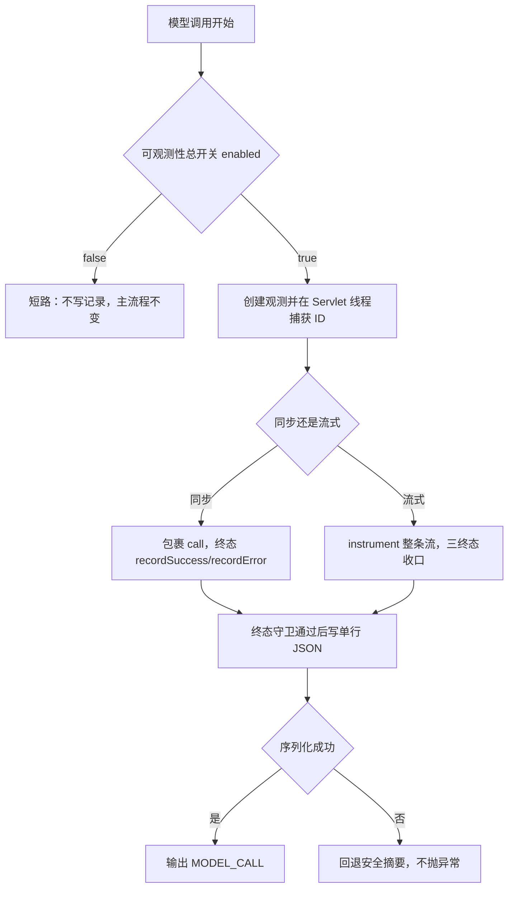
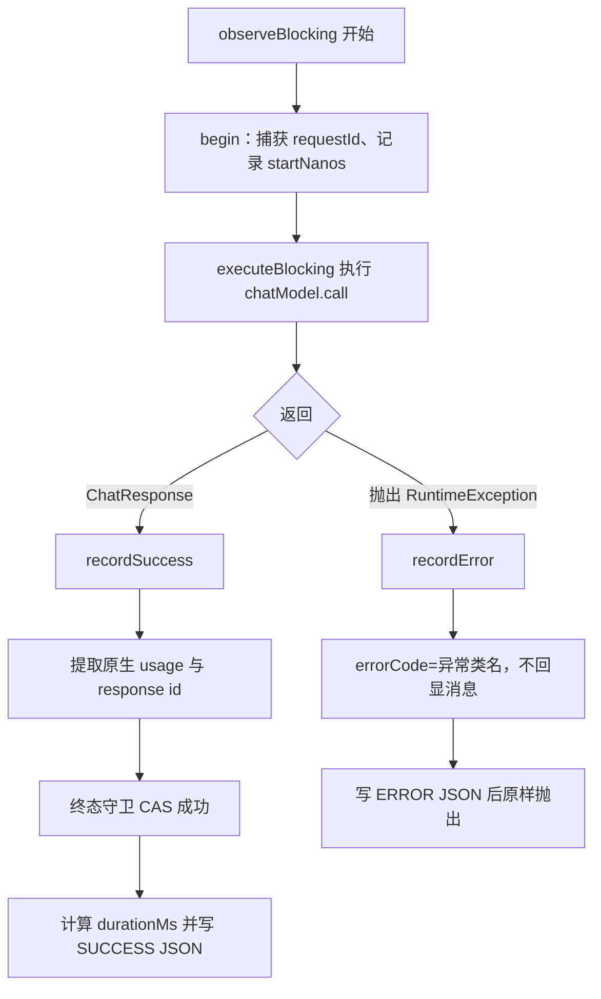
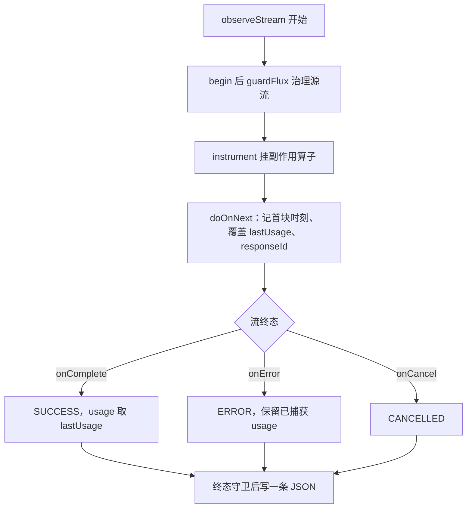

# D21 聊天调用可观测性技术说明与实践指南

> 视角：以「12 年 Java 架构师 + 6 年 AI 工程落地」的工程口径，讲清最小可观测性（Observability）为什么这样设计、底层机制是什么、如何独立落地与避坑。
> 适用基线：JDK 21、Spring Boot 3.5.16、Spring AI 1.1.8、Spring MVC（Tomcat）、Reactor 3.7.19。
> 约定：首次出现英文缩写给全称与中文；Mermaid 兼容 Typora 0.11.18；同文档内参考链接不重复引用。

---

## 1. 概念辨析

### 1.1 名词表（首次出现给全称与中文）

| 英文术语 | 全称 / 中文 | 说明 |
|---|---|---|
| Observability | 可观测性 | 通过外部输出（日志、指标、链路）理解系统内部状态的能力 |
| MDC | Mapped Diagnostic Context，映射诊断上下文 | SLF4J/Logback 基于 ThreadLocal 的日志上下文，pattern 用 `%X{key}` 取值 |
| ThreadLocal | 线程局部变量 | 每个线程独立一份副本，线程池复用时需显式清理 |
| TraceId / RequestId | 链路标识 / 请求标识 | 把一次请求跨组件的日志关联起来的 ID |
| Usage | Token 用量 | Provider 返回的 prompt/completion/total tokens 元数据 |
| TTFT | Time To First Chunk，首块到达时间 | 流式调用从发起到收到第一个分片的延迟 |
| Monotonic Clock | 单调时钟 | 只增不减的计时源（`System.nanoTime`），适合测耗时 |
| UMD | Universal Module Definition，通用模块定义 | 前后端通用的模块封装形态（本模块前端解析器采用） |

### 1.2 可观测性的三支柱与本迭代的取舍

- 经典三支柱：Logs（日志）、Metrics（指标）、Traces（链路追踪）。本迭代是**学习型单体应用**，不引入 Micrometer/OpenTelemetry 等重型栈，而是用「结构化日志」这一个载体同时承载：
  - Logs：白名单单行 JSON 终态记录；
  - Traces：requestId/traceId 关联（当前同值，预留分布式分离）；
  - Metrics：durationMs、TTFT、Token 数值作为可聚合字段写入日志。
- 这是「最小可用」而非「完整平台」：目标是让每次模型调用都可关联、可审计、可统计，且不泄露敏感信息。

### 1.3 记忆简语

- **「日志即最小观测台」**：单体学习项目用结构化日志一肩挑三支柱，先可用再演进。
- **「白名单进日志，黑名单靠不住」**：只写明确允许的字段，比列举要排除的字段更安全。
- **「MDC 跟线程走，跨线程先抓牢」**：ThreadLocal 不跨线程，关键上下文在起点捕获成对象状态。

---

## 2. 为什么需要最小可观测性

### 2.1 三类真实风险

1. **敏感内容泄漏**：把完整 Prompt、完整响应、Authorization、API Key 直接打日志，日志一旦被采集、归档、导出，等于扩大了隐私与密钥暴露面。
2. **日志注入 / 伪造日志行**：外部可控文本（如入参、入站 requestId）若含换行、引号，直接拼接写日志可伪造出一条假的日志，干扰审计甚至注入告警。
3. **线程复用串号**：Tomcat 工作线程被复用，MDC 不清理会让下一个请求沿用上一个 requestId；Reactor 切换线程后 MDC 又可能为空，导致日志无法关联或错误关联。

### 2.2 设计原则：白名单 + 旁路 + 不影响主流程

- **白名单**：`ModelCallRecord` 只声明允许输出的字段，新增敏感字段默认不会被记录，从结构上杜绝误打。
- **旁路（Side Effect Only）**：观测只记录，不参与重试/超时/业务分支决策；`recordSuccess` 原样返回响应，不改变数据。
- **不影响主流程**：`ModelCallRecorder.emit` 捕获一切异常并兜底，序列化失败也只写安全摘要，绝不因观测故障让模型调用失败。

### 2.3 接入决策树



---

## 3. 底层原理

### 3.1 MDC 与线程池复用

- MDC 本质是 `ThreadLocal<Map<String,String>>`。`TraceIdFilter` 在请求开始 `MDC.put`，`finally` 中 `MDC.remove`；没有这步清理，线程池归还线程后，下一个请求会读到上一个 ID（串号）。
- 回写响应头让调用方/网关能把「客户端侧」与「服务端日志」关联；入站 ID 先清洗，拒绝换行等危险字符。

### 3.2 Reactor 线程切换与上下文捕获

- 同步调用在 Servlet（Tomcat 工作）线程执行；流式经过 Reactor，doOnNext/doOnComplete 常在调度线程（如 parallel-*）执行。ThreadLocal 不随线程切换自动传播，真机日志可见 Reactor 线程 `requestId=` 为空。
- 解法不是强行上 Reactor MDC 桥接，而是在**创建观测的 Servlet 线程**就把 `MDC.get("requestId")` 存进 `final capturedRequestId`，之后随对象流转；终态用字段而非 MDC，天然无串号、无泄漏。

### 3.3 单调时钟与墙钟的分工

- `System.nanoTime()` 是单调时钟，只用于测量间隔，不受系统时间回拨影响；`durationMs` 与 TTFT 都基于它。
- `Instant.now()` 是墙钟，可能被校时，只用于 startTime/endTime 的人类可读展示，不参与耗时计算。

### 3.4 Spring AI Usage 抽象的字节码级陷阱

- 可移植 `Usage` 追求跨厂商统一，但隐藏了「缺失」语义：默认 total 逻辑把 null 当 0 相加，`DefaultUsage` 在 getter 层把 null 强制成 0。
- DeepSeek 原生 `DeepSeekApi.Usage` 是保留 null 的 record，携带更真实的信息。`TokenUsageSnapshot` 优先 `getNativeUsage()` 判型读取原生字段，再回退可移植 getter，从而区分「真实 0」与「缺失 null」。

### 3.5 冷流与终态触发

- Reactor `Flux` 是冷流，只有被订阅才执行；`instrument` 在源流上挂 doOnNext/doOnComplete/doOnError/doOnCancel 这些副作用算子，不改变分片内容与顺序。
- onComplete 与 onError 互斥、onCancel 是独立终态；再叠加 `AtomicBoolean` 终态守卫，保证即使算子竞争也只写一条。

---

## 4. 执行流程

### 4.1 同步观测流程



### 4.2 流式观测流程



### 4.3 Token 归一化流程

- 入口先排除 null/EmptyUsage；原生 record 优先读真实字段，否则回退 getter。
- 三字段全空 → NOT_RETURNED；无 total 且 prompt、completion 都在 → total 推导并标 DERIVED；否则保留 Provider total。
- 状态按 prompt 与 completion 是否齐全决定 AVAILABLE/PARTIAL；缺失字段一律保留 null。

### 4.4 对外错误映射为何不丢信息也不泄密

- 异常终态只取 `error.getClass().getSimpleName()` 作为 errorCode，不回显 `getMessage()`（消息里可能含上游报文、密钥片段）。
- 测试 `syncError` 显式断言终态 JSON 不包含异常消息文本，从输出层锁定该行为。

---

## 5. 核心代码导读

### 5.1 终态守卫：AtomicBoolean CAS

```java
if (!terminated.compareAndSet(false, true)) {
    return; // 已写过终态，后续 complete/error/cancel 幂等忽略
}
```

- 第一次终态 CAS 成功才继续构造记录；任何后续终态直接返回，保证「一次调用一条」。

### 5.2 原生 usage 优先读取

```java
if (usage.getNativeUsage() instanceof DeepSeekApi.Usage nativeUsage) {
    return build(nativeUsage.promptTokens(),
            nativeUsage.completionTokens(),
            nativeUsage.totalTokens());
}
return build(usage.getPromptTokens(),
        usage.getCompletionTokens(),
        usage.getTotalTokens());
```

- 模式匹配（Pattern Matching）拿到原生 record，字段保留真实 null；非 DeepSeek 才走可移植回退。

### 5.3 total 推导与状态判定

```java
if (providerTotal == null && prompt != null && completion != null) {
    total = prompt + completion;
    source = UsageSource.DERIVED;
}
UsageStatus status = (prompt != null && completion != null)
        ? UsageStatus.AVAILABLE : UsageStatus.PARTIAL;
```

- 推导只发生在 total 这一个字段，且条件严格；状态独立于数值，确保缺口可见。

### 5.4 首 Chunk 延迟的安全测量

```java
if (firstChunkNanos.compareAndSet(0L, System.nanoTime())) {
    // 仅第一个分片记录
}
```

- 终态时若首块时刻仍为 0（流没发射过分片）或开关关闭，TTFT 返回 null，而不是写 0。

### 5.5 序列化兜底

```java
try {
    callLogger.info(mapper.writeValueAsString(record.toOrderedMap()));
} catch (Exception serializeError) {
    callLogger.info("{\"event\":\"MODEL_CALL\",\"outcome\":\""
            + record.outcome() + "\",\"error\":\"LOG_SERIALIZE_ERROR\"}");
}
```

- 专用 Mapper 关闭 default typing（防多态反序列化风险）、空 Bean 不报错；失败回退摘要，主流程无感。

---

## 6. 配置实践

### 6.1 开发 / 测试推荐（默认即此）

```yaml
app:
  model-observability:
    enabled: true
    record-time-to-first-chunk: true
```

- 学习期默认全量记录，便于观察每次调用的终态与 usage；关闭 enabled 只停 MODEL_CALL，不影响 TraceIdFilter 与访问日志。

### 6.2 环境变量覆盖示例

```powershell
$env:MODEL_OBSERVABILITY_ENABLED='false'   # 关闭终态记录
$env:MODEL_RECORD_TTFT='false'             # 不记录首块延迟
```

- 所有开关均带环境变量占位，容器化部署可不改镜像直接调整。

### 6.3 密钥与日志落点

- 密钥仅经 `DEEPSEEK_API_KEY` 注入，配置文件只留占位；`logback-spring.xml` 用 `%X{requestId}` 关联，日志目录可经 `APP_LOG_HOME` 覆盖。
- 诚实标注：滚动文件基名仍为 `d14-access.log`（历史命名），MODEL_CALL 当前经 root 输出，未单独建 appender；如需独立文件，可后续为该 logger 增加专属 appender。

---

## 7. 实践与避坑（Pitfalls）

| 坑 | 现象 | 正确做法 |
|---|---|---|
| 用墙钟测耗时 | 校时后 duration 出现负数/跳变 | 耗时一律 nanoTime，墙钟只做展示 |
| 信任可移植 total | 缺失被当 0，统计失真 | 优先读原生 record，缺失留 null |
| 流式 usage 累加 | 各分片累计快照相加导致重复计数 | 只覆盖 lastUsage，取最终分片 |
| 跨线程依赖 MDC | Reactor 线程 requestId 为空 | 起点捕获成对象字段，不依赖 ThreadLocal |
| 入站 ID 不清洗 | 换行/引号造成日志注入 | sanitize 后再用，非法则生成 UUID |
| 观测抛异常 | 日志故障连带业务失败 | emit 全兜底，绝不向外抛 |
| 没发射分片也写 TTFT | 用 0 误导「秒回」 | 未发射则 TTFT=null |
| 黑名单式脱敏 | 新增敏感字段被误打 | 白名单字段，默认不记录新内容 |

---

## 8. 验证与覆盖

### 8.1 自动化测试矩阵

| 测试类 | 方法数 | 覆盖重点 |
|---|---|---|
| observability.ModelCallRecorderTest | 8 | 同步成功/异常、流式完成/异常/取消、usage 不累计、无 usage、开关短路 |
| observability.TokenUsageSnapshotTest | 11 | null/Empty/全空、完整、推导、部分（仅 prompt/completion/total）、显式 0、通用回退、NOT_SUPPORTED |
| TraceIdHttpTest（骨架） | 5 | HTTP 层 ID 复用/生成/回写 |
| resilience 3 类 | 31 | D20 韧性回归 |
| 其余骨架类 | 13 | 契约/编排/隔离回归 |

### 8.2 真实执行结果

- 命令：`mvn -f D21_TOKEN_ID_LOGS/pom.xml test`，退出码 0。
- 汇总：**Tests run: 68, Failures: 0, Errors: 0, Skipped: 0，BUILD SUCCESS**。
- 真机 mock：健康检查、同步（回显自定义 ID）、流式（requestId 透传）、无 ID 生成 32 位 UUID 全部通过；敏感扫描无真实密钥；验证后 8080 释放。

### 8.3 已知覆盖边界（诚实说明）

- 真机为 mock 模式，MODEL_CALL 记录由单元测试的 ListAppender 断言，未在 mock 运行期产生真实 MODEL_CALL 行。
- 通用 Provider 回退若自身把缺失强制为 0，快照无法还原；当前仅接入 DeepSeek。
- 真实 DeepSeek 联网 usage 与分布式追踪（traceId 分离）未执行/未接入。

---

## 9. 工程实践小结

### 9.1 记忆简语汇总

- 一次调用一条线，三终态互斥、CAS 防重复。
- ID 在 Servlet 抓、当对象带，跨线程不靠 MDC。
- 耗时看单调，首块单独算，未发射则缺省。
- 缺失留 null，状态说真相，0 是真实不是空缺。
- 流 usage 只覆盖不相加，白名单进日志最稳当。

### 9.2 竖屏层级树（observability 包）

```
observability
├─ ModelCallRecorder            # 入口组件：begin / emit，单行 JSON + 兜底
├─ ModelCallObservation         # 请求级观测：同步/流式收口，终态守卫
├─ ModelCallRecord              # 白名单 record，toOrderedMap 固定顺序
├─ CallOutcome                  # SUCCESS / ERROR / CANCELLED
├─ UsageStatus                  # AVAILABLE/PARTIAL/UNAVAILABLE/NOT_RETURNED/NOT_SUPPORTED
├─ UsageSource                  # PROVIDER_METADATA / DERIVED / NONE
├─ TokenUsageSnapshot           # 原生优先、判空、total 推导
└─ ModelObservabilityProperties # app.model-observability 开关
```

### 9.3 参考资料（同文档不重复）

- 《Spring Boot Reference | Spring Boot 参考文档》：https://docs.spring.io/spring-boot/3.5.16/reference/
- 《Spring AI Reference 1.1 | Spring AI 1.1 参考文档》：https://docs.spring.io/spring-ai/reference/1.1/
- 《Spring Framework Web MVC Async | Spring MVC 异步请求参考》：https://docs.spring.io/spring-framework/reference/6.2/web/webmvc/mvc-ann-async.html
- 《SLF4J MDC | SLF4J 映射诊断上下文》：https://www.slf4j.org/manual.html#mdc
- 《Reactor Reference | Reactor 参考文档》：https://projectreactor.io/docs/core/release/reference/
