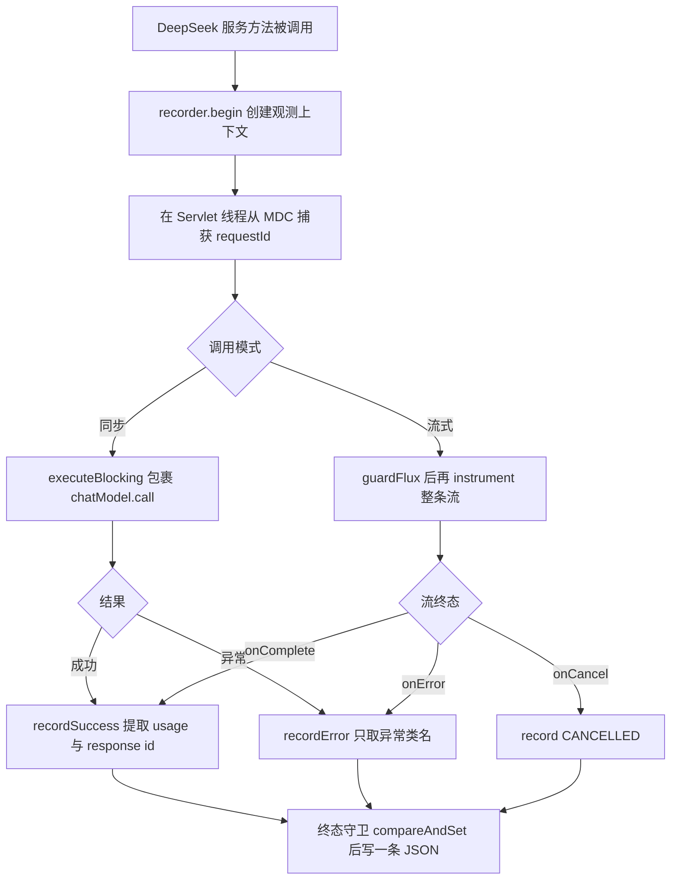
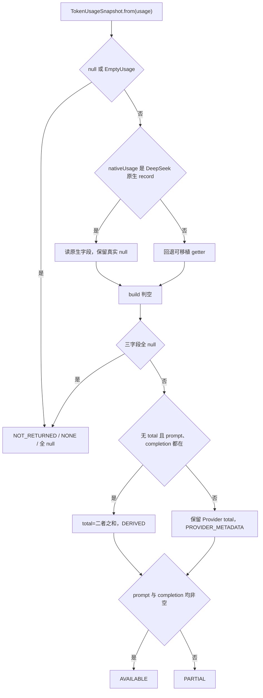

# D21 项目迭代全量信息与操作

> 迭代名称：D21——聊天调用最小可观测性（TraceId 关联、脱敏调用记录、单调时钟延迟与 Token Usage 归一化）
> 物理包：`com.zl.d21`；模块：`D21_TOKEN_ID_LOGS`；聚合根：`M2-Java\D21`
> 技术基线：JDK 21（21.0.7）、Spring Boot 3.5.16、Spring AI 1.1.8（BOM 锁定，禁 2.x）、Spring MVC（Tomcat 10.1.55）、Reactor 3.7.19、spring-web 6.2.19、MyBatis-Plus 3.5.17
> 文档约定：首次出现英文缩写给出全称与中文；Mermaid 图兼容 Typora 0.11.18（节点 ID 唯一、无 HTML 标签、节点英文双引号）。

---

## 1. 迭代概述

### 1.1 三条主线

1. **一次调用一条可关联的终态记录**：为每次逻辑模型调用（同步/流式）输出一条结构化、单行 JSON 的终态记录，携带与 HTTP 链路一致的 requestId（即 traceId），把「服务端日志、响应头、调用方」三者用同一 ID 串起来。
2. **敏感信息不进观测日志**：终态记录字段严格采用白名单，只含关联 ID、Provider、模型、调用模式、起止时间、耗时、终态、安全错误码、usage 状态/来源/数值与 Provider response id；**不包含 API Key、Authorization、Cookie、完整 Prompt、用户原文或完整响应**。
3. **延迟用单调时钟、Token 只信真实数据**：耗时基于 `System.nanoTime()` 单调时钟测量（区分总耗时与首 Chunk 延迟）；Token Usage 优先读取 Provider 原生 record，缺失保留 null 并给出明确状态，绝不估算、绝不把缺失填 0、绝不把流式各分片 usage 相加。

### 1.2 关键事实（先给结论）

- 新增 `observability`（可观测性）包共 **8 个类型**：`ModelCallRecorder`、`ModelCallObservation`、`ModelCallRecord`、`CallOutcome`、`UsageStatus`、`UsageSource`、`TokenUsageSnapshot`、`ModelObservabilityProperties`。
- 终态 `CallOutcome` 只有 **3 个互斥值**：SUCCESS、ERROR、CANCELLED；用 `AtomicBoolean` 保证一次调用只写一条终态记录，成功后不会再补失败、取消与完成不会重复计数。
- Spring AI 可移植 `Usage` 有两个已知陷阱：默认 `getTotalTokens()` 会把 null 的 prompt/completion 当 0 相加，`DefaultUsage` 还会把 null 字段强制成 0。因此本迭代优先读 DeepSeek 原生 `DeepSeekApi.Usage`（保留 null 的 record），其它 Provider 再回退可移植 getter。
- 同步/流式接口契约（路径、方法、请求/响应 DTO、HTTP 统一 200、业务码、SSE 事件）**零破坏**；观测组件只旁路记录，不参与重试/超时业务决策，也不向外抛异常。
- 全量测试 **68 用例全绿、0 跳过**（D20 为 44，本迭代新增 24 个可观测性用例）；真机 mock 链路健康检查、同步、流式、ID 复用/生成/清洗全部验证通过。

### 1.3 记忆简语

- **「一次调用一条线」**：每次逻辑调用只输出一条终态 JSON，三终态互斥、终态守卫防重复。
- **「ID 在 Servlet 抓、当对象带」**：requestId 在 Servlet 线程从 MDC 捕获后作为对象状态携带，不依赖 Reactor 线程上未经验证的 ThreadLocal 传播。
- **「耗时看单调，首块单独算」**：durationMs 用 nanoTime 单调时钟；TTFT 只在流确实发射过分片时才写出。
- **「缺失留 null，状态说真相」**：Token 缺失不填 0，用 UsageStatus/UsageSource 表达缺口与来源。
- **「流 usage 只覆盖不相加」**：流式只保留最后一个有效分片的 usage，绝不累加各分片。

---

## 2. 仓库与模块结构

### 2.1 竖屏层级树（关键部分）

```
D21
├─ pom.xml                         # 聚合 POM，packaging=pom，import spring-ai-bom 1.1.8
└─ D21_TOKEN_ID_LOGS
   ├─ pom.xml                      # 模块 POM，显式 spring-boot-starter-web
   ├─ src
   │  ├─ main
   │  │  ├─ java/com/zl/d21
   │  │  │  ├─ D21SpringAiApplication.java
   │  │  │  ├─ common/             # Result、ResultCode、全局异常、配置异常
   │  │  │  ├─ config/             # AiProperties、AiConstants
   │  │  │  ├─ controller/         # ChatController（同步）、ChatStreamController（流式）
   │  │  │  ├─ conversation/       # 角色准备、历史消息转换、Redis 会话
   │  │  │  ├─ history/            # 会话/消息持久化、上下文窗口
   │  │  │  ├─ knowledge/          # 编排器、检索、引用注册表
   │  │  │  ├─ service/            # AiChatService、Mock/DeepSeek 实现、StreamChunk
   │  │  │  ├─ device/             # 设备场景与工单候选
   │  │  │  ├─ prompt/             # Prompt 模板管理
   │  │  │  ├─ logging/            # TraceId、访问日志、脱敏
   │  │  │  ├─ resilience/         # D20 异常分类/超时/有限重试（6 个类）
   │  │  │  └─ observability/      # D21 新增：最小可观测性（8 个类型）
   │  │  └─ resources
   │  │     ├─ application.yml     # 新增 app.model-observability 段
   │  │     ├─ logback-spring.xml  # %X{requestId} 关联，MODEL_CALL 走 root
   │  │     ├─ db/                 # 建表 DDL
   │  │     └─ static/             # 前端页面与 sse-parser
   │  └─ test
   │     ├─ java/com/zl/d21/
   │     │  ├─ （骨架自带 6 个测试类，含 TraceIdHttpTest）
   │     │  ├─ resilience/         # D20 韧性测试（3 类）
   │     │  └─ observability/      # D21 新增 2 个测试类（19 方法）
   │     └─ resources/application-test.yml
   └─ target
```

### 2.2 坐标与版本

| 项 | 值 |
|---|---|
| 聚合根 groupId / artifactId | org.ai.m2.ds / D21 |
| 模块 artifactId | D21_TOKEN_ID_LOGS |
| 物理包 | com.zl.d21 |
| 主类 | D21SpringAiApplication（@SpringBootApplication + @ConfigurationPropertiesScan） |
| 服务端口 | 8080 |
| parent | spring-boot-starter-parent 3.5.16 |
| Spring AI BOM | 1.1.8（锁定，禁止 2.x） |
| spring-web / Reactor | 6.2.19 / 3.7.19（无 WebFlux/Netty 服务端） |
| JDK | 21（java 21.0.7） |

---

## 3. 现状核验与调用链

### 3.1 继承自 D20 的基线

| 维度 | D20 已建立的事实 | D21 在此基础上的动作 |
|---|---|---|
| 运行时 | 显式 `spring-boot-starter-web`，Tomcat + Spring MVC，无 WebFlux 服务端 | 观测在 Servlet 线程创建、在 Reactor 线程收尾，需显式处理跨线程 |
| 韧性 | `resilience` 包统一异常分类、超时、有限重试 | 观测范围覆盖韧性层全部重试，只在逻辑调用终态写一条记录 |
| 标识 | `TraceIdFilter` 已把 requestId 写入 MDC 并回写响应头 | 观测直接复用该 ID，不另造一套 trace 体系 |
| 密钥 | 真实 Key 仅经环境变量注入，配置文件只留占位 | 终态记录白名单显式排除 Key/Authorization/Cookie |

### 3.2 为什么观测要在「逻辑调用」而非「每次 HTTP 重试」收口

- D20 同步 `executeBlocking` 内部可能发生多次重试（重订阅），但对调用方而言这仍是**一次逻辑调用**。若每次尝试都写一条记录，会出现一次请求多条计数、成功率与延迟被重复统计。
- 因此 `ModelCallObservation` 在进入韧性层之前创建，`recordSuccess/recordError` 在韧性层返回之后才收口；流式同理，`instrument` 包裹的是已被 `guardFlux` 治理后的整条流，终态只在 onComplete/onError/onCancel 触发一次。

### 3.3 观测接入决策



---

## 4. TraceId 关联与跨线程处理

### 4.1 requestId 的生成、复用与清洗

- `TraceIdFilter`（继承 `OncePerRequestFilter`）优先级最高：先读入请求头（默认头名 `X-Request-Id`），经 `LogMaskingUtils.sanitizeInboundRequestId` 清洗；缺失或含非法字符时生成 32 位无横线 UUID。
- 清洗是必要的安全边界：外部传入的 ID 若允许换行、引号等字符，写日志时可构成日志注入或破坏单行 JSON，因此不可直接信任。
- ID 写入 MDC 键 `requestId`、设置为请求属性，并回写响应头；`finally` 中 `MDC.remove` 清理，防止 Tomcat 工作线程复用导致「串号」。

### 4.2 为什么不依赖 Reactor 线程上的 MDC

- MDC 底层是 `ThreadLocal`，只在当前线程有效。流式算子（doOnNext/doOnComplete 等）运行在 Reactor 调度线程（如 parallel-*），并非创建观测的 Servlet 线程；默认情况下 ThreadLocal 不会自动传播，真机日志也可见 Reactor 线程上 `requestId=` 为空。
- 本迭代的做法：`ModelCallObservation` 构造时（Servlet 线程）就把 `MDC.get("requestId")` 存入 `capturedRequestId` 字段，之后作为**对象内部状态**携带，终态记录直接使用该字段，从根本上避免串号与上下文泄漏，也不要求引入额外的 Reactor MDC 桥接。

### 4.3 requestId 与 traceId 的关系

- 当前模块是单进程、无分布式链路追踪（如 OpenTelemetry），终态记录里 `requestId` 与 `traceId` 取同一个值，明确表达「HTTP 请求标识即本次链路标识」。
- 字段仍保留两个名字，是为了将来接入分布式追踪时可分别填充，不改变记录结构。

---

## 5. 模型调用结构化终态记录

### 5.1 白名单字段（ModelCallRecord）

| 字段 | 含义 | 敏感处理 |
|---|---|---|
| event | 固定 `MODEL_CALL`，便于采集过滤 | 常量 |
| requestId / traceId | 关联 ID | 复用清洗后的 ID |
| provider / model | Provider 名与实际生效模型 | 非敏感 |
| callMode | SYNC / STREAM | 常量 |
| startTime / endTime | ISO-8601 墙钟时间 | 仅人类可读 |
| durationMs | 单调时钟总耗时（毫秒） | 计算值 |
| outcome | SUCCESS / ERROR / CANCELLED | 三选一 |
| errorCode | 异常**类名** | 不回显异常消息 |
| usageStatus / usageSource | usage 状态与来源 | 枚举 |
| promptTokens / completionTokens / totalTokens | 真实 Token 数值 | 缺失为 null |
| responseId | Provider 返回的响应 id | 非敏感 |
| timeToFirstChunkMs | 首 Chunk 延迟（毫秒） | 仅流式且发射过分片 |

### 5.2 单行 JSON 如何防日志注入

- `ModelCallRecorder` 用专用 `ObjectMapper`（关闭 default typing、空 Bean 不报错）把 `toOrderedMap()` 序列化为**单行 JSON**，换行、引号等字符被 JSON 转义，外部内容无法通过注入伪造新日志行。
- 输出到独立 logger（名称 `MODEL_CALL`），可在日志配置中单独控制；当前 logback 未给该 logger 单独 appender，经 root 输出到控制台与文件。
- 序列化本身也做兜底：`emit` 捕获任何异常后回退为只含 event/outcome/error 的安全摘要，**绝不向主流程抛异常**。

### 5.3 三终态与终态守卫

- `CallOutcome` 三值互斥：同步成功/流式 onComplete → SUCCESS；同步抛出/流式 onError → ERROR；终态前取消订阅（onCancel）→ CANCELLED。
- `ModelCallObservation.emit` 用 `terminated.compareAndSet(false, true)` 收口：第一次终态才写入，后续 complete/error/cancel 即使竞争也被幂等忽略，保证「一次调用一条记录」。

---

## 6. 延迟测量

### 6.1 为什么用单调时钟

- 墙钟（`Instant.now()`、系统时间）可能被 NTP 校时、手动改时回拨，用它计算耗时会出现负数或跳变。
- 起始时刻记录 `System.nanoTime()`（单调时钟，纳秒），终态用 `(nanoTime - startNanos) / 1_000_000` 得到 `durationMs`；墙钟 startTime/endTime 仅用于人类可读，不参与耗时计算。

### 6.2 总耗时与首 Chunk 延迟（TTFT）

| 指标 | 字段 | 测量方式 | 缺省条件 |
|---|---|---|---|
| 总耗时 | durationMs | 终态 nanoTime 差值 | 始终写出 |
| 首 Chunk 延迟 | timeToFirstChunkMs | 首个分片到达 nanoTime 与起点差值 | 关闭开关或流从未发射分片时为 null |

- TTFT（Time To First Chunk，首块到达时间）是流式体验的关键指标；`firstChunkNanos` 用 `compareAndSet(0, ...)` 只在第一个分片记录一次。
- 只有流确实发射过至少一个分片才计算 TTFT，避免用 0 误导「瞬间响应」；开关 `record-time-to-first-chunk` 可关闭。

---

## 7. Token Usage 归一化

### 7.1 Spring AI Usage 抽象的两个陷阱（字节码实证）

| 陷阱 | 行为 | 后果 |
|---|---|---|
| 默认 getTotalTokens | 当 Provider 未给 total 时，把 null 的 prompt/completion 当 0 相加 | 缺失被伪装成 0，无法区分「没有数据」与「真实 0」 |
| DefaultUsage 强制归零 | 构造时把 null 字段在 getter 层强制成 0 | 部分缺失字段被静默改写 |

- DeepSeek 原生 `DeepSeekApi.Usage` 是保留 null 的 record（字段 prompt/completion/total），因此 `TokenUsageSnapshot.from` 优先判断 `usage.getNativeUsage() instanceof DeepSeekApi.Usage`，直接读原生字段做真实判空。
- 非 DeepSeek Provider 走通用回退，信任可移植 getter；若该实现把缺失强制为 0，属抽象层已知限制，代码 Javadoc 已诚实标注。

### 7.2 状态（UsageStatus）与来源（UsageSource）

| 枚举 | 取值 | 本迭代实际使用 |
|---|---|---|
| UsageStatus | AVAILABLE / PARTIAL / UNAVAILABLE / NOT_RETURNED / NOT_SUPPORTED | 用到 AVAILABLE、PARTIAL、NOT_RETURNED、NOT_SUPPORTED（UNAVAILABLE 预留） |
| UsageSource | PROVIDER_METADATA / DERIVED / NONE | 三者均会出现 |

- 状态判定：prompt 与 completion 均非空 → AVAILABLE；存在真实 usage 但字段有缺失 → PARTIAL；无对象/EmptyUsage/字段全空 → NOT_RETURNED；离线链路 → NOT_SUPPORTED。
- 来源判定：数值直接来自 Provider → PROVIDER_METADATA；本地按规则推导 total → DERIVED；无数据 → NONE。

### 7.3 total 推导规则（只推导一个字段）

- 仅当 **Provider 未给 total，且 prompt 与 completion 都非空**时，才把二者相加得到 total，并标 DERIVED。
- 任一缺失则保留 Provider total 或 null，**绝不反推**；显式 0 被真实记录（既不是缺失也不是伪造）。

### 7.4 流式 usage 只覆盖、不相加

- 流式每个分片可能携带 usage，但这些通常是「累计快照」而非增量；若把各分片相加会严重重复计数。
- `instrument` 内 `lastUsage` 只在分片携带有效 token 时**覆盖**，终态以最后一个有效分片为唯一来源；测试 `streamFinalUsageNotSummed` 明确断言取最终值而非累加。

### 7.5 usage 归一化流程



---

## 8. 关键代码导读

### 8.1 observability 包（8 个类型，单一职责分层）

| 类型 | 种类 | 职责 |
|---|---|---|
| ModelCallRecorder | @Component | 创建观测上下文；把终态序列化为单行 JSON 输出到 MODEL_CALL，异常兜底 |
| ModelCallObservation | 普通类 | 请求级观测：捕获 ID/起点，同步 recordSuccess/recordError，流式 instrument，终态守卫 |
| ModelCallRecord | record | 白名单终态载体，toOrderedMap 固定字段顺序，null 保留 |
| CallOutcome | 枚举 | SUCCESS/ERROR/CANCELLED 三终态 |
| UsageStatus | 枚举 | usage 五态（本迭代用四态） |
| UsageSource | 枚举 | PROVIDER_METADATA/DERIVED/NONE |
| TokenUsageSnapshot | record | 原生优先、判空、total 推导、状态/来源归一 |
| ModelObservabilityProperties | @ConfigurationProperties | 前缀 app.model-observability，enabled 与 recordTimeToFirstChunk |

### 8.2 服务接入点（DeepSeekAiChatService）

- 构造器注入 `ModelCallRecorder`；新增两个私有收口方法：
  - `observeBlocking`：`begin` → `executeBlocking(chatModel.call)` → `recordSuccess`，catch 中 `recordError` 后原样抛出。
  - `observeStream`：`begin` → `guardFlux(chatModel.stream)` → `observation.instrument` 返回带观测的 ChatResponse 流。
- 同步/流式各方法（含思考模式、角色链路）统一走这两个收口，删除了「打印完整 Prompt/完整响应」的日志点。
- Mock 链路不经过模型调用，按设计不产生 MODEL_CALL 记录（其 usage 语义为 NOT_SUPPORTED 的场景由快照工厂保留）。

---

## 9. 配置说明

### 9.1 可观测性配置（application.yml，均支持环境变量覆盖）

| 配置 | 默认值 | 环境变量 | 含义 |
|---|---|---|---|
| app.model-observability.enabled | true | MODEL_OBSERVABILITY_ENABLED | 总开关，关闭后不写终态记录（不影响 TraceId/访问日志） |
| app.model-observability.record-time-to-first-chunk | true | MODEL_RECORD_TTFT | 是否记录首 Chunk 延迟 |

### 9.2 日志配置（logback-spring.xml）

- 控制台/文件 pattern 均含 `[requestId=%X{requestId}]`，与 MDC 键一致，同一请求日志可关联。
- 日志目录可经 `APP_LOG_HOME` 覆盖，默认 `M2-Java/logs`；文件 appender 按天 + 10MB 切分、保留 15 天、总量 1GB。
- 诚实标注：滚动文件基名仍为历史遗留的 `d14-access.log`，MODEL_CALL logger 当前经 root 输出，未单独建 appender。

### 9.3 安全主线（密钥）

- 真实 DeepSeek Key 只允许经环境变量 `DEEPSEEK_API_KEY` 注入；配置文件仅保留占位 `d01-mock-key-not-for-authentication`。
- 默认全链路 mock、零外网；真实联调须用户当轮显式授权、独立手动、脱敏虚构输入。
- 终态记录白名单从结构上排除 Key/Authorization/Cookie；敏感扫描确认无硬编码真实密钥。

---

## 10. 验证与操作

### 10.1 编译与测试命令

```powershell
# 主代码编译
& 'D:\SoftwareInstall\Apache\Maven\apache-maven-3.9.16\bin\mvn.cmd' -f 'D21_TOKEN_ID_LOGS\pom.xml' -DskipTests compile

# 全量测试
& 'D:\SoftwareInstall\Apache\Maven\apache-maven-3.9.16\bin\mvn.cmd' -f 'D21_TOKEN_ID_LOGS\pom.xml' test
```

### 10.2 全量测试结果（真实执行）

- **Tests run: 68, Failures: 0, Errors: 0, Skipped: 0，BUILD SUCCESS**。
- 11 个测试类；新增可观测性测试 2 类共 19 方法：ModelCallRecorderTest（8）、TokenUsageSnapshotTest（11）；D20 韧性 3 类 31 方法与骨架 6 类 18 方法保持全绿。

### 10.3 真机验证结果（mock 模式，零外网）

| 验证项 | 结果 |
|---|---|
| 启动 | Tomcat 8080 干净启动，无错误，运行时为 Servlet |
| 健康检查 | code=200，mode=mock |
| 同步对话（带 X-Request-Id=real-sync-001） | 响应头原样回显 real-sync-001，返回完整契约 |
| 流式 SSE（带 X-Request-Id=real-stream-001） | start + 多 delta + complete，requestId 正确透传 |
| 无 ID 请求 | 自动生成 32 位无横线 ID（实测 5e81d836…） |
| 敏感扫描 | 8 处命中均为占位/配置引用/脱敏逻辑，无真实密钥 |
| 收尾 | 停止应用后 8080 释放，无 D21 残留 Java 进程 |

### 10.4 操作清单（手工复现）

1. 确认 MySQL 3306、Redis 6379 已启动，8080 空闲。
2. 启动应用：`mvn -f D21_TOKEN_ID_LOGS\pom.xml spring-boot:run`（默认 AI_MODE=mock）。
3. 健康检查：GET `/api/v1/ai/health`。
4. 同步：POST `/api/v1/ai/chat`，可自定义 `X-Request-Id` 观察回显。
5. 流式：POST `/api/v1/ai/chat/stream`，用非缓冲客户端观察分帧与 requestId。
6. 结束后停止应用并确认端口释放；本迭代全程不执行 git commit。

---

## 11. 边界、风险与注意事项

- **MODEL_CALL 真机日志的诚实边界**：真机以 mock 模式运行，mock 链路不产生 MODEL_CALL 记录；MODEL_CALL 的单行 JSON 输出由 ModelCallRecorderTest 通过 Logback ListAppender 直接断言，是真实的输出证据，但不是 mock 运行期产生的。
- **通用 Provider 回退限制**：非 DeepSeek 实现若在可移植 getter 把缺失强制为 0，快照无法还原其真实缺失；当前仅接入 DeepSeek，已用原生路径规避。
- **UsageStatus.UNAVAILABLE 未被使用**：该值为适配层显式声明不可用预留，当前归一化逻辑未产生此状态。
- **未实证项**：真实 DeepSeek 联网 usage（无 DEEPSEEK_API_KEY）未执行；分布式追踪（traceId 与 requestId 分离）未接入，当前二者同值。
- **不做项**：不升级依赖、不引 Micrometer/OpenTelemetry 等新框架、不迁移 WebFlux、不改同步/流式接口契约、不改变 D20 韧性与 Redis/表结构。
- 健康检查 application 标签等历史遗留项按最小改动原则未修改。

---

## 12. 交付物清单

| 类型 | 路径 |
|---|---|
| 主代码（新增 8 类型） | D21_TOKEN_ID_LOGS/src/main/java/com/zl/d21/observability/ |
| 主代码（修改 1 处） | service/DeepSeekAiChatService.java（接入观测收口） |
| 配置（新增段） | application.yml：app.model-observability |
| 测试代码（新增 2 类、19 方法） | D21_TOKEN_ID_LOGS/src/test/java/com/zl/d21/observability/ |
| 文档一 | docs/proj_docs/D21-项目迭代全量信息与操作.md |
| 文档二 | docs/proj_docs/D21-聊天调用可观测性技术说明与实践指南.md |
| 迭代日志 | logs/D21/、logs/D21-迭代日志.md |
| 证据 | docs/evidence/D21/ |
| 临时资料 | docs/temp_docs/D21/（不自动删除） |
| 状态记录 | docs/evidence/D21/D21-iteration-state.md |

> 官方溯源：
> 《Spring Boot Reference | Spring Boot 参考文档》：https://docs.spring.io/spring-boot/3.5.16/reference/
> 《Spring AI Reference 1.1 | Spring AI 1.1 参考文档》：https://docs.spring.io/spring-ai/reference/1.1/
> 《Spring Framework Web MVC | Spring MVC 参考》：https://docs.spring.io/spring-framework/reference/6.2/web/webmvc.html
> 《SLF4J MDC | SLF4J 映射诊断上下文》：https://www.slf4j.org/manual.html#mdc
