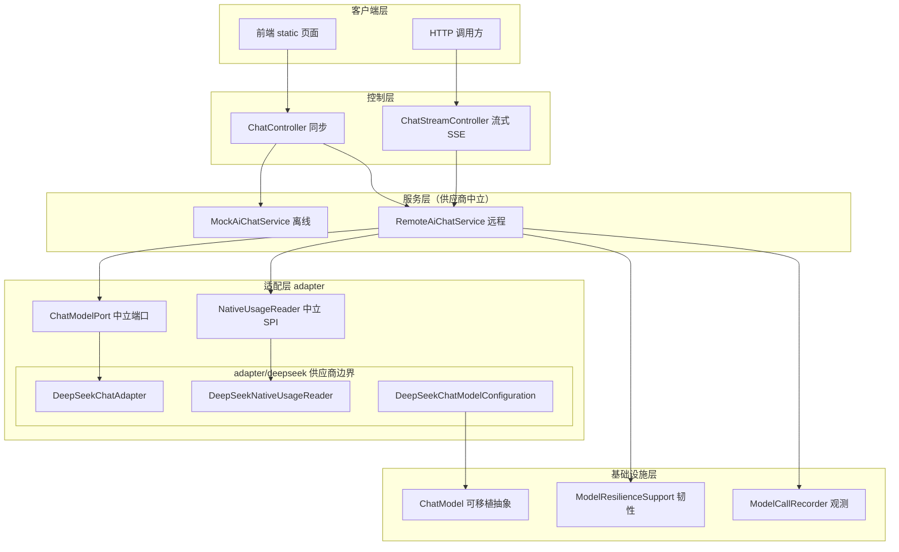
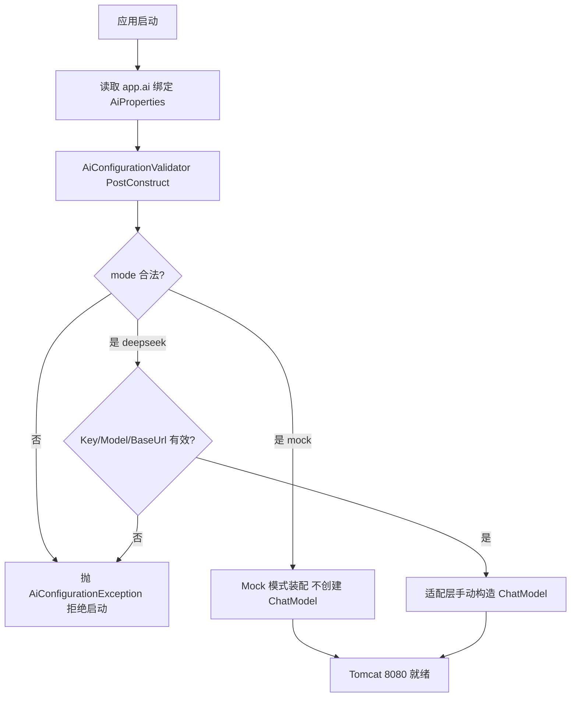
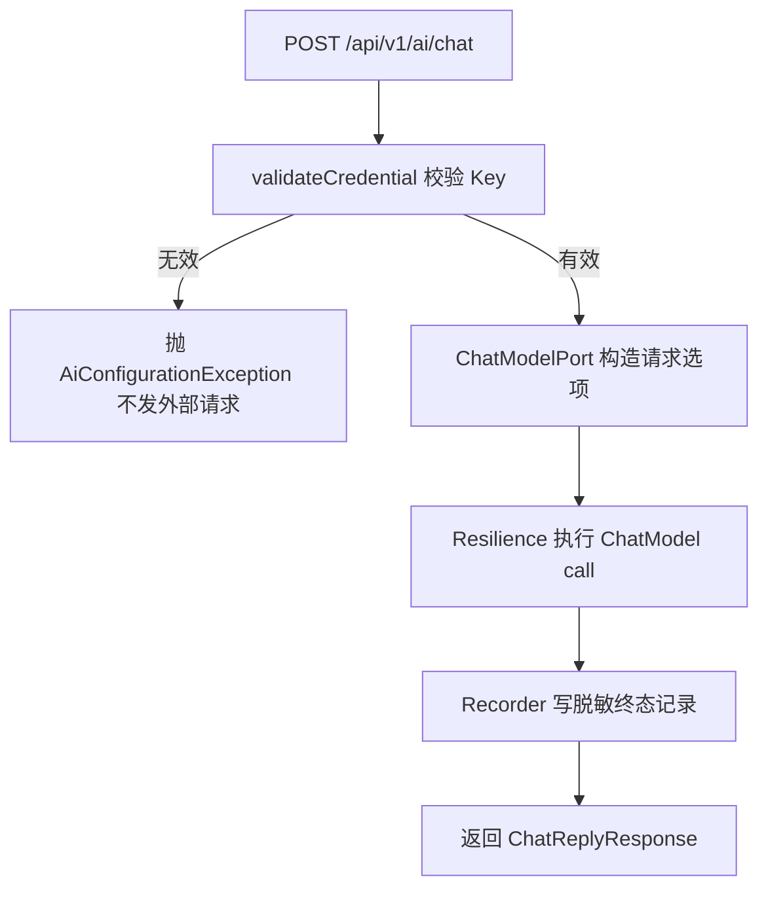
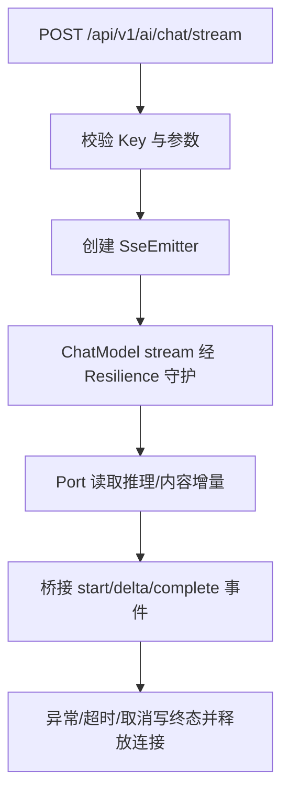

# D22 项目迭代全量信息与操作

> 迭代名称：D22 —— 将模型名（Model）、Base URL、API Key 和运行模式（Mode）外置；保持服务接口不依赖供应商 DeepSeek 的专有 DTO/Options/API/消息/响应类型
> 承接基线：D21（聊天调用最小可观测性）
> 物理包：`com.zl.d22`
> 文档定位：项目迭代全量信息与操作手册（双交付物之一）
> 编写口径：以本地实际代码与真实执行结果为准，不虚构、不夸大

---

## 1. 概述（Overview）

### 1.1 为什么要做 D22

D21 及之前，模型连接存在两类工程问题：

1. **配置与供应商强绑定**：模型名、API Key 通过 `spring.ai.deepseek.*` 命名空间读取，环境变量也带供应商专名（`DEEPSEEK_API_KEY`）。一旦更换模型供应商，需要改动配置结构与业务代码。
2. **供应商专有类型泄漏到业务层**：`service/DeepSeekAiChatService` 直接 `import` 了 `DeepSeekAssistantMessage`、`DeepSeekChatOptions`；`observability/TokenUsageSnapshot` 直接 `import` 了 `DeepSeekApi`。供应商类型越过了分层边界，扩散到服务与观测层。

D22 的目标是把这两类问题**物理收敛**：配置统一到应用自有命名空间 `app.ai.*`，供应商专有类型收敛到 `adapter/deepseek` 适配边界，业务服务层与公开接口只依赖 Spring AI 的可移植抽象。

### 1.2 四个核心目标

| 编号 | 目标 | 验收口径 |
| --- | --- | --- |
| G1 | 模型名 / Base URL / API Key / 运行模式外置到 `app.ai.*` | 统一环境变量 `AI_MODEL / AI_BASE_URL / AI_API_KEY / AI_MODE`，删除 `spring.ai` 块 |
| G2 | 服务层与公开接口不依赖 DeepSeek 专有类型 | 专有类型只出现在 `adapter/deepseek` 包内，由字节码边界测试强制 |
| G3 | 同步/流式契约与既有能力零回归 | 异常/超时/重试/TraceId/脱敏日志/Token usage 全部保留，全量测试通过 |
| G4 | 默认 Mock 无 Key 可启动；真实模式缺配置明确失败 | 缺配置在启动/调用前快速失败，不静默回退 |

### 1.3 技术基线（以 POM 为准）

| 维度 | 版本/事实 |
| --- | --- |
| JDK | 21 |
| Spring Boot | 3.5.16 |
| Spring AI | 1.1.8（`spring-ai-bom` 1.1.8） |
| Spring Cloud / Alibaba | 2025.0.0 / 2025.0.0.0 |
| Maven | 3.9.16 |
| Web 栈 | Servlet / Tomcat + Spring MVC（`spring-boot-starter-web`），无 WebFlux 服务端 |
| 端口 | 8080，`spring.application.name=d22_SpringAI` |
| 模型依赖 | `spring-ai-starter-model-deepseek`（版本由 BOM 治理） |
| 存储 | MySQL（MyBatis-Plus）+ Redis |

---

## 2. 架构与边界（Architecture）

### 2.1 分层结构总览

D22 新增中立适配包 `adapter`，把"会泄漏供应商类型"的两类操作（请求选项构造、推理内容读取）与原生用量读取收敛到适配边界。



### 2.2 边界规则（机器强制）

- **中立端口**（`adapter` 根包）：只引用 Spring AI 可移植抽象，不引用任何供应商类型。
- **供应商实现**（`adapter/deepseek` 子包）：所有 `DeepSeek*` 专有类型只允许出现在这里。
- **强制手段**：`VendorBoundaryTest` 直接解析 `target/classes` 下每个 class 的常量池，
  一旦边界之外的类引用 `org/springframework/ai/deepseek`，测试立即失败。
- 业务/服务/控制器/观测类对供应商的认知，仅保留为**观测标签字符串**（如 `provider="deepseek"`），
  这是数据不是类型耦合。

### 2.3 为什么排除自动配置

Spring AI 的 `DeepSeekChatAutoConfiguration` 会读取 `spring.ai.deepseek.*` 自动装配 `ChatModel`。
D22 改用 `app.ai.*` 手动构造，因此在启动类显式排除它，避免两套配置并存：

```java
@SpringBootApplication(exclude = DeepSeekChatAutoConfiguration.class)
@ConfigurationPropertiesScan
public class D22SpringAiApplication { ... }
```

---

## 3. 代码改动清单（Code Changes）

### 3.1 改动总览

| 类型 | 文件 | 说明 |
| --- | --- | --- |
| 重写 | `config/AiProperties.java` | 新增 `model/baseUrl/apiKey`，去掉 `@Component`，类内无供应商类型 |
| 修改 | `resources/application.yml` | 删除整个 `spring.ai` 块，`app.ai` 新增三字段，更新头注释 |
| 新建 | `adapter/ChatModelPort.java` | 中立端口：请求选项 + 推理内容 |
| 新建 | `adapter/NativeUsageReader.java` | 中立 SPI：原生用量读取 |
| 新建 | `adapter/NativeUsage.java` | 中立 record：三字段均可空 |
| 新建 | `adapter/deepseek/DeepSeekChatAdapter.java` | DeepSeek 端口实现 |
| 新建 | `adapter/deepseek/DeepSeekNativeUsageReader.java` | DeepSeek 原生 usage 读取 |
| 新建 | `adapter/deepseek/DeepSeekChatModelConfiguration.java` | 手动装配 `ChatModel` |
| 重写 | `D22SpringAiApplication.java` | 排除 `DeepSeekChatAutoConfiguration` |
| 新建 | `service/RemoteAiChatService.java` | 供应商中立远程服务 |
| 删除 | `service/DeepSeekAiChatService.java` | 旧耦合服务，已删除 |
| 修改 | `service/AiChatService.java` | Javadoc 指向 `RemoteAiChatService` |
| 重写 | `observability/TokenUsageSnapshot.java` | 去 DeepSeek，新增 reader 版 `from` |
| 修改 | `observability/ModelCallRecorder.java` | 构造注入 `List<NativeUsageReader>` |
| 修改 | `observability/ModelCallObservation.java` | 持有 readers，4 处 `from` 改 reader 版 |
| 修改 | `controller/ChatStreamController.java` | 删 `spring.ai` 的 `@Value`，用 `aiProperties.getModel()` |
| 新建 | `config/AiConfigurationValidator.java` | `@PostConstruct` 快速失败校验 |
| 重写 | `resources/application-local.yml.example` | AI_* 口径 |
| 修改 | `service/MockAiChatService.java` | 文案 `DEEPSEEK_API_KEY` 改 `AI_API_KEY` |

### 3.2 唯一配置源：AiProperties

```java
@Data
@ConfigurationProperties(prefix = "app.ai")
public class AiProperties {
    private String mode = AiConstants.MODE_MOCK;        // mock | deepseek
    private String model = "deepseek-flash";            // AI_MODEL
    private String baseUrl = "https://api.deepseek.com";// AI_BASE_URL
    private String apiKey = "";                         // AI_API_KEY
    private int maxMessageLength = 2000;
    private long streamTimeoutMs = 60000L;
}
```

要点：

- 去掉 `@Component`，靠启动类的 `@ConfigurationPropertiesScan` 注册，避免重复注册。
- 类内**零供应商专有类型**，只做绑定与默认值。

### 3.3 中立端口与 DeepSeek 实现

`ChatModelPort` 把两类专有操作收敛为可移植方法：

```java
public interface ChatModelPort {
    ChatOptions requestOptions(String model);
    String reasoningContent(AssistantMessage message);
}
```

`DeepSeekChatAdapter` 在边界内处理专有类型：

```java
@Override
public ChatOptions requestOptions(String model) {
    return DeepSeekChatOptions.builder().model(model).build();
}

@Override
public String reasoningContent(AssistantMessage message) {
    if (message instanceof DeepSeekAssistantMessage deepSeekMessage) {
        return deepSeekMessage.getReasoningContent();
    }
    return null;
}
```

### 3.4 手动装配 ChatModel

`DeepSeekChatModelConfiguration` 仅在 `app.ai.mode=deepseek` 时装配，关键点：

- 用 `DeepSeekApi.builder()` 串联 `baseUrl/apiKey/restClientBuilder/webClientBuilder`。
- `defaultOptions` 用 `DeepSeekChatOptions.builder().model().temperature(0.7).build()`（保留基线温度）。
- `RetryTemplate.builder().maxAttempts(1).build()` 关闭 Spring AI 内置重试，
  重试统一由应用层 `app.ai.resilience` 治理，避免多层重试叠加。
- 复用容器注入的 `RestClient.Builder/WebClient.Builder`，它们已携带 `ModelClientConfiguration`
  注入的 JDK HttpClient 超时（连接 3s、读取 30s）。

### 3.5 Token usage 去 DeepSeek 化

`TokenUsageSnapshot` 不再 `import DeepSeekApi`，改为通过 `NativeUsageReader` SPI 读取：

```java
public static TokenUsageSnapshot from(Usage usage, List<NativeUsageReader> readers) {
    if (usage == null || usage instanceof EmptyUsage) { return notReturned(); }
    for (NativeUsageReader reader : readers) {
        if (reader.supports(usage)) {
            NativeUsage nativeUsage = reader.read(usage);
            return build(nativeUsage.promptTokens(),
                    nativeUsage.completionTokens(), nativeUsage.totalTokens());
        }
    }
    return build(usage.getPromptTokens(),
            usage.getCompletionTokens(), usage.getTotalTokens()); // 可移植回退
}
```

- 有匹配 reader：读保留真实 `null` 的原生 record，区分"缺失"与"真实 0"。
- 无匹配 reader：回退可移植 getter（mock 模式即此路径，Spring 注入空列表）。
- `notReturned/notSupported/build` 逻辑与 D21 完全一致，零行为回归。

### 3.6 快速失败校验

`AiConfigurationValidator` 在 `@PostConstruct` 阶段校验：

- `mode` 必须 ∈ `{mock, deepseek}`，否则抛 `AiConfigurationException`。
- `deepseek` 模式：`api-key` 非空白且拒绝占位/含 `mock`，`model` 非空白，
  `base-url` 为合法 http/https URI。
- `mock` 模式：不要求 Key。
- 所有错误消息**不回显 Key**，避免凭据泄漏到启动日志。

---

## 4. 配置契约（Configuration）

### 4.1 新配置与环境变量映射

| 配置项（`app.ai`） | 环境变量 | 默认值 | 说明 |
| --- | --- | --- | --- |
| `mode` | `AI_MODE` | `mock` | 运行模式 |
| `model` | `AI_MODEL` | `deepseek-flash` | 模型名 |
| `base-url` | `AI_BASE_URL` | `https://api.deepseek.com` | 服务基址 |
| `api-key` | `AI_API_KEY` | 空 | 密钥，仅真实模式需要 |
| `max-message-length` | `AI_CHAT_MAX_LENGTH` | `2000` | 消息长度上限 |
| `stream-timeout-ms` | `AI_STREAM_TIMEOUT_MS` | `60000` | SSE 超时 |

### 4.2 配置片段（application.yml）

```yaml
app:
  ai:
    mode: ${AI_MODE:mock}
    model: ${AI_MODEL:deepseek-flash}
    base-url: ${AI_BASE_URL:https://api.deepseek.com}
    api-key: ${AI_API_KEY:}
    max-message-length: ${AI_CHAT_MAX_LENGTH:2000}
    stream-timeout-ms: ${AI_STREAM_TIMEOUT_MS:60000}
```

### 4.3 保留的子配置

`prompt.cache`、`conversation.redis`、`history`、`thinking.reasoner-model`、`knowledge`、
`resilience` 以及与 `app.ai` 平级的 `app.access-log`、`app.model-observability` 全部保持不变。
`thinking.reasoner-model` 仍由 `DEEPSEEK_REASONER_MODEL` 覆盖（思考模型名，属历史保留口径）。

### 4.4 安全约束

- 真实 API Key **只能**通过环境变量或启动参数注入，禁止硬编码、禁止提交 Git。
- `application.yml` 可安全入库，不含任何真实密钥。
- 本地示例 `application-local.yml.example` 已重写为 AI_* 口径。

---

## 5. 关键流程（Flow）

### 5.1 启动与配置校验流程



### 5.2 同步调用流程（真实模式）




### 5.3 流式 SSE 流程



---

## 6. 验证结果（Verification）

### 6.1 编译验证（已执行并通过）

- 命令：`mvn clean compile`
- 结果：exit 0，主源码编译通过（日志 `logs/D22/compile-main.log`）。

### 6.2 全量测试（已执行并通过）

- 命令：`mvn test`
- 结果（`logs/D22/full-test-2.log`）：

```text
Tests run: 83, Failures: 0, Errors: 0, Skipped: 0
BUILD SUCCESS
```

测试构成：

| 类别 | 测试类 | 方法数 | 结果 |
| --- | --- | --- | --- |
| 新增 | `DeepSeekChatAdapterTest` | 3 | 通过 |
| 新增 | `DeepSeekNativeUsageReaderTest` | 4 | 通过 |
| 新增 | `AiConfigurationValidatorTest` | 7 | 通过 |
| 新增 | `VendorBoundaryTest` | 1 | 通过 |
| 基线 | 其余 11 个测试类 | 68 | 全部通过 |
| 合计 | — | 83 | 全通过 |

> 基线（改动前）实测 68 个全通过（`logs/D22/baseline-test.log`），D22 新增 15 个，合计 83。

### 6.3 真机验证（Mock 模式，已执行并通过）

| 验证项 | 真实结果 |
| --- | --- |
| 无 Key 启动 | `Started D22SpringAiApplication in 6.31 seconds`，Tomcat 8080，无异常 |
| 同步接口 | `code=200`、`mode=mock`、`model=offline-mock`、`mocked=true`、含 `sessionId` |
| 健康检查 | `code=200`，返回模式与上下文窗口 |
| SSE 流式 | `start` + 16 个 `delta` + `complete`，命名事件完整 |
| 访问日志 | `CONTROLLER_ACCESS/HTTP_REQUEST/HTTP_RESPONSE`，TraceId 关联，单行 JSON，无 Key 泄漏 |

### 6.4 负向验证（真实模式缺 Key，已执行并通过）

设置 `AI_MODE=deepseek`、空 `AI_API_KEY` 启动，结果：

```text
Caused by: AiConfigurationException: deepseek 真实模式未配置有效密钥：
AI_API_KEY 缺失、为空白或仍为占位密钥，应用已拒绝启动
```

上下文刷新被取消，**不静默回退**到 Mock，错误消息不回显 Key。

### 6.5 未验证项（诚实标注）

- **真实 DeepSeek 联网烟雾测试：未执行、未验证。** 本机无 `AI_API_KEY`，
  待注入真实 Key 后按 `AI_MODE=deepseek` 启动并调用同步/流式接口补验。

---

## 7. 证据索引（Evidence）

证据目录：`docs/evidence/D22/`，含 `README.md` 索引及以下真实产物：

| 文件 | 对应验证 |
| --- | --- |
| `mock-startup.log` | Mock 启动成功 |
| `mock-sync-response.json` | 同步接口 |
| `mock-health.json` | 健康检查 |
| `mock-sse-stream.txt` | SSE 事件流 |
| `mock-access-log-lines.txt` | 脱敏访问日志 |
| `deepseek-nokey-startup.log` | 缺 Key 快速失败 |
| `full-test-2.log` | 全量测试 |

---

## 8. 竖屏层级树（Hierarchy Tree）

```text
com.zl.d22
├─ D22SpringAiApplication（exclude DeepSeekChatAutoConfiguration）
├─ common（异常/全局处理/Result）
├─ config
│  ├─ AiProperties（app.ai 唯一配置源，零供应商类型）
│  ├─ AiConfigurationValidator（PostConstruct 快速失败）
│  ├─ AiConstants（MODE_MOCK/MODE_DEEPSEEK/占位 Key）
│  └─ 其他 *Properties
├─ adapter
│  ├─ ChatModelPort（中立端口）
│  ├─ NativeUsageReader（中立 SPI）
│  ├─ NativeUsage（中立 record，字段可空）
│  └─ deepseek（供应商边界，唯一允许 DeepSeek 类型处）
│     ├─ DeepSeekChatAdapter
│     ├─ DeepSeekNativeUsageReader
│     └─ DeepSeekChatModelConfiguration（手动 ChatModel）
├─ controller（ChatController / ChatStreamController，读 AiProperties）
├─ service
│  ├─ AiChatService（接口）
│  ├─ MockAiChatService（离线，零字段）
│  ├─ RemoteAiChatService（供应商中立远程服务）
│  └─ 其他类型（ChatInvocation/ThinkingSettings/StreamChunk 等）
├─ observability
│  ├─ TokenUsageSnapshot（去 DeepSeek，reader 版 from）
│  ├─ ModelCallRecorder（注入 List<NativeUsageReader>）
│  └─ ModelCallObservation（持有 readers）
├─ resilience（异常分类/超时/有限重试，单一责任层）
├─ history / conversation / knowledge / prompt / device / logging
└─ resources（application.yml 删 spring.ai；logback；SQL；static；语料）
```

---

## 9. 注意事项与风险（Notes & Risks）

1. **多供应商平台保持克制**：任务书未要求支持第二家供应商，D22 不引入 `provider` 平台化字段，
   仅保留观测标签 `provider="deepseek"`。未来新增供应商时，在 `adapter` 下新增子包实现端口即可。
2. **真实联网路径未验证**：无 Key 环境下只能验证装配与负向逻辑，真实 HTTP 成功路径需补验。
3. **健康接口 `application` 字段**仍显示历史常量 `D17_DHSA_MTDCA`，属既有展示值，
   与 D22 需求无关，本次未改动。
4. **重试收口**：适配层关闭 Spring AI 内置重试，应用层 `resilience` 是唯一重试责任层，
   勿在两处同时开启重试导致叠加。
5. **Javadoc 不触发边界测试**：注释与普通字符串不进入常量池类引用，
   `ReasoningEffort/ThinkingSettingsResolver` 中仅文案含 deepseek，不影响边界测试。
6. **临时文件不自动删除**：`docs/temp_docs/D22` 与 `logs/D22` 保留，交由用户决定是否清理。

---

## 10. 记忆简语（Mnemonics）

- **配置四件套**：`模式、模型、基址、密钥`，环境变量 `AI_MODE / AI_MODEL / AI_BASE_URL / AI_API_KEY`。
- **边界口诀**：`中立端口在根上，供应商实现进子包；字节码扫描来站岗，越界引用必挂账。`
- **失败原则**：`Mock 无 Key 能起跑，真实缺配快速倒；静默回退绝不搞，错误消息不泄密。`
- **重试原则**：`内置重试要关掉，韧性一层来主导，多层重试最糟糕。`
- **用量原则**：`原生读取走 SPI，缺失为 null、零是零，绝不估算绝不填。`

---

## 11. 官方文档溯源（References）

- 《Spring AI Reference | Spring AI 参考文档》总览：<https://docs.spring.io/spring-ai/reference/1.1/>
- 《Chat Client API | 聊天客户端 API》：<https://docs.spring.io/spring-ai/reference/1.1/api/chatclient.html>
- 《DeepSeek Chat | DeepSeek 聊天集成》：<https://docs.spring.io/spring-ai/reference/1.1/api/chat/deepseek-chat.html>
- 《Dependency Management | 依赖管理》：<https://docs.spring.io/spring-ai/reference/1.1/getting-started.html>
- 《Spring Boot Reference | Spring Boot 参考文档》：<https://docs.spring.io/spring-boot/reference/>

> 说明：以上为 Spring AI 1.1 官方文档。D22 的类型签名结论另以本地字节码 `javap` 核验为准
> （记录见 `docs/temp_docs/D22/`），官方文档用于设计溯源。
