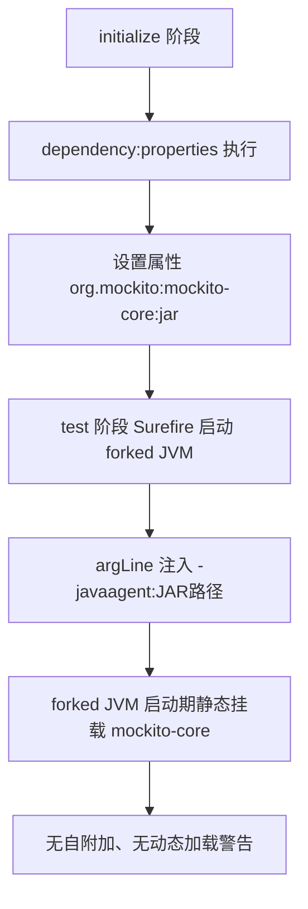

# D23 技术说明与实践指南——Mockito Inline Mock Maker 与 Surefire 配置

> 本指南聚焦 Java 21 动态 Agent 背景、Inline Mock Maker、mockito-core Agent、
> Maven `dependency:properties`、Surefire/Failsafe `argLine`、IDEA 与命令行验证及常见故障。
> 结论以本地实际配置与 `docs/evidence/D23/D23-iteration-state.md` 为准。路径均相对工程根 `M2-Java`。

---

## 1. 背景：Java 21 为什么收紧动态 Agent（是什么 / 为什么）

### 1.1 概念

Java Agent 是通过 JVM 的 `java.lang.instrument` 机制在类加载时**修改字节码（instrumentation）**的组件。
挂载方式有两种：

- **静态（启动期）**：JVM 启动时用 `-javaagent:path.jar` 显式挂载。
- **动态（运行期）**：程序运行后通过 Attach API 动态加载（self-attach）。

### 1.2 Java 21 的变化

为减少运行期字节码注入带来的可维护性与安全风险，较新 JDK 对动态 Agent 加载发出警告，
并预告未来将**默认禁止**。因此依赖运行期插桩的库（如 Mockito Inline）应改为启动期静态挂载。

### 1.3 Mockito 自附加的真实输出（本机基线）

```text
Mockito is currently self-attaching to enable the inline-mock-maker.
This will no longer work in future releases of the JDK.
WARNING: A Java agent has been loaded dynamically (byte-buddy-agent-1.17.8.jar)
WARNING: Dynamic loading of agents will be disallowed by default in a future release
```

> 注意：警告里动态加载的是 byte-buddy-agent，但官方正解是挂载 **mockito-core**（其内部统一管理 byte-buddy 插桩）。

---

## 2. Inline Mock Maker 是什么（原理）

### 2.1 定义与能力

Mock Maker 是 Mockito 负责“创建 Mock 对象、处理字节码”的底层组件。

- **Inline Mock Maker**：通过内联字节码插桩，支持 Mock **Final 类、Final 方法、静态方法、构造器**，
  并能在同一线程内对 `mockConstruction`、`mockStatic` 等提供支持。
- 自 Mockito 5 起，inline 成为**默认 Mock Maker**，因此本项目无需 `mockito-inline` 依赖，也无需显式扩展文件。

### 2.2 本项目的启用方式（已核实）

- 全工程无 `mockito-extensions/org.mockito.plugins.MockMaker` 文件，无 `mockito-inline` 依赖。
- 结论：依赖 Mockito 5.17.0 的默认 inline 能力。
- 保留策略：不新增、不删除、不替换任何 Mock Maker 配置，仅显式挂载 Agent。

### 2.3 显式扩展文件与默认机制的关系

| 形态 | 本项目是否存在 | 含义 |
|---|---|---|
| `src/test/resources/mockito-extensions/org.mockito.plugins.MockMaker` | 否 | 若存在可显式指定 mock-maker-inline 等 |
| mockito-inline 依赖 | 否 | Mockito 2/早期 3 用于开启 inline，5 起非必需 |
| Mockito 5 默认 inline | 是（实际生效） | 无需配置即具备 inline 能力 |

---

## 3. 显式 Agent 的官方机制（原理 + 流程）

### 3.1 总体链路



### 3.2 第一步：dependency:properties 暴露 JAR 路径

- `maven-dependency-plugin` 的 `properties` goal 默认绑定 **initialize** 阶段。
- 它为每个解析到的依赖建立 `groupId:artifactId:type` 形式的属性。
- 本项目关键属性：`org.mockito:mockito-core:jar`，实际值（Debug 第 1374/2462 行）：

```text
org.mockito:mockito-core:jar: D:\SoftwareInstall\Apache\repository\org\mockito\mockito-core\5.17.0\mockito-core-5.17.0.jar
```

### 3.3 第二步：Surefire argLine 追加 -javaagent

- `argLine` 只对 **forked JVM** 生效；Surefire 默认 `forkCount=1`，满足前提。
- 配置：`<argLine>-javaagent:${org.mockito:mockito-core:jar}</argLine>`。
- Debug 解析结果（第 2927 行）：

```text
(s) argLine = -javaagent:D:\SoftwareInstall\Apache\repository\org\mockito\mockito-core\5.17.0\mockito-core-5.17.0.jar
```

### 3.4 为什么本项目不用 @{argLine}

- `@{...}` 是 Surefire 的**延迟属性替换**，主要用于和 JaCoCo 等也写 argLine 的插件协同。
- 本项目无 JaCoCo、无其他插件设置 argLine，直接用 `${...}` 即可，
  避免出现字面量 `@{argLine}` 被当作 JVM 参数导致启动失败。
- 若将来引入 JaCoCo，再按官方说明提供空初始值并使用 `@{argLine}` 合并。

---

## 4. Surefire 与 Failsafe 的边界（配置）

### 4.1 两者分工

| 插件 | 用途 | 本项目状态 |
|---|---|---|
| maven-surefire-plugin | 单元测试（test 阶段） | 已启用，配置 Agent |
| maven-failsafe-plugin | 集成测试（integration-test/verify） | 仅 pluginManagement，未启用 |

### 4.2 为什么 Failsafe 标不适用

- 模块 `build/plugins` 未声明 Failsafe；pluginManagement 不会自动激活插件。
- 无 `*IT.java`、`*ITCase.java` 测试文件。
- 按 R04 要求，不为本需求新增 Failsafe，不改变测试划分。

### 4.3 未来启用 Failsafe 的正确做法

- 必须在 Failsafe 独立的 `argLine` 追加同版本 `-javaagent`，并确保其模块也执行 dependency:properties。
- 不能假设 Surefire 的配置自动作用于 Failsafe。

---

## 5. 验证方式（命令行 + IDEA）

### 5.1 命令行验证（本机实际执行）

```powershell
# 1. 确认版本
mvn -f D23/D23_CRTFC_SSE_MASO/pom.xml dependency:tree `
  "-Dincludes=org.mockito:mockito-core,org.mockito:mockito-inline"

# 2. 确认有效配置
mvn -f D23/D23_CRTFC_SSE_MASO/pom.xml help:effective-pom

# 3. 全量测试 + Debug 看 fork 参数
mvn -f D23/D23_CRTFC_SSE_MASO/pom.xml clean test -X
```

在 Debug 日志中检索：

- `org.mockito:mockito-core:jar:` → 实际 JAR 路径；
- `(s) argLine =` → 确认 forked JVM 参数；
- `forkCount` → 确认非 0；
- 汇总行 `Tests run: 123 ...` 与 `BUILD SUCCESS`。

### 5.2 负向核查（确认警告真的消失）

对新日志检索以下关键词，应全部为 0：

```text
self-attaching / agent has been loaded dynamically /
EnableDynamicAgentLoading / traceUsage / Dynamic loading of agents
```

### 5.3 IntelliJ IDEA 验证方式

- **委托 Maven 运行（推荐）**：Settings → Build Tools → Maven → Runner，勾选 "Delegate IDE build/run actions to Maven"，
  使 IDE 直接走 Surefire 配置，避免 IDE 自带 JUnit Runner 不读取 argLine。
- 若不委托：在 Run/Debug Configuration → Modify options → Add VM options，
  手工加 `-javaagent:<本地仓库 mockito-core-5.17.0.jar 绝对路径>`，版本须与依赖一致。
- 验证点：运行含 Final/静态 Mock 的测试，控制台无 self-attaching 与动态 Agent 警告。

---

## 6. 常见故障与排查（Pitfalls）

| 现象 | 根因 | 处理 |
|---|---|---|
| 仍出现 self-attaching 警告 | 测试未走 Surefire（如 IDE 内置 Runner）或 argLine 未生效 | 委托 Maven；核对 effective-pom 与 `(s) argLine` |
| JVM 报无法识别 `@{argLine}` | 无插件设置该属性却使用了延迟替换 | 改用 `${...}`，或提供空初始值 |
| `-javaagent` 路径找不到 | 路径解析错误或在 initialize 之前引用 | 确认 dependency:properties 已执行、属性名拼写正确 |
| 路径含空格导致启动失败 | 仓库/工作目录含空格 | argLine 中对路径加引号 |
| 引入 JaCoCo 后 Agent 被覆盖 | 两个插件都写 argLine | 改用 `@{argLine}` 合并，保留双方参数 |
| 想靠 -XX:+EnableDynamicAgentLoading 解决 | 仅隐藏警告，未来 JDK 仍会禁止 | 禁止使用，回到显式 -javaagent |
| forkCount=0 时 argLine 无效 | 非 forked 执行不应用 argLine | 先记录现状，再评估最小调整，不静默改并发 |

### 修复停止线

同一根因连续两次修复未解决，立即停止试错，输出诊断记录：现象、复现、根因假设、已尝试、失败证据、下一步验证方案，
再决定是否继续；不得靠反复改写或扩大范围硬试。

---

## 7. 竖屏层级树（知识树）

```text
Mockito 测试构建
├─ 背景
│  ├─ 静态 Agent：-javaagent（启动期，推荐）
│  └─ 动态 Agent：self-attach（Java21 警告，未来禁止）
├─ Inline Mock Maker
│  ├─ Final/静态/构造器 Mock
│  └─ Mockito 5 默认启用，无需扩展文件
├─ 显式配置
│  ├─ dependency:properties → org.mockito:mockito-core:jar
│  └─ surefire argLine → -javaagent（forkCount=1）
└─ 验证
   ├─ 命令行：dependency:tree / effective-pom / test -X
   ├─ IDEA：委托 Maven 或手工 VM options
   └─ 负向：警告关键词 0 命中
```

---

## 8. 记忆简语（Mnemonics）

- **Agent 两类**：`静态 -javaagent 是正道，动态 self-attach 要被禁。`
- **inline 口诀**：`Mockito 5 默认 inline，Final 静态构造都能赢；不删扩展不换将，只挂 Agent 不换兵。`
- **配置口诀**：`properties 把路径亮，argLine 里 javaagent 上；无 JaCoCo 用美元符，fork 为 1 才像样。`
- **验证口诀**：`树、POM、fork、测试四件套，警告清零再报告；Failsafe 没开不硬凑，隐藏参数不能要。`

---

## 9. 官方文档溯源（References）

- 《Mockito – Explicitly setting up instrumentation for inline mocking (Java 21+) | 显式配置 Inline Instrumentation》：<https://javadoc.io/doc/org.mockito/mockito-core/latest/org.mockito/org/mockito/Mockito.html#0.3>
- 《Apache Maven Dependency Plugin – dependency:properties | 依赖插件 properties 目标》：<https://maven.apache.org/plugins/maven-dependency-plugin/properties-mojo.html>
- 《Maven Surefire Plugin – argLine | Surefire 测试 JVM 参数》：<https://maven.apache.org/surefire/maven-surefire-plugin/test-mojo.html>
- 《Maven Surefire Plugin – Fork Options and Parallel Test Execution | Fork 与并行》：<https://maven.apache.org/surefire/maven-surefire-plugin/examples/fork-options-and-parallel-execution.html>
- 《Maven Failsafe Plugin – integration-test | Failsafe 集成测试 JVM 参数》：<https://maven.apache.org/surefire/maven-failsafe-plugin/integration-test-mojo.html>

> 说明：以上为官方文档，用于机制溯源；具体行为以本地源码、有效 POM、Maven Debug 与真实测试结果为准。
