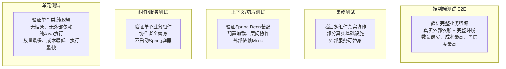

# Spring AI M2 知识笔记：单元测试、Spring 上下文测试、Mock 模型与集成测试分层

>
> 技术基线：JDK 21、Spring Boot 3.5.16、Spring AI 1.1.x、JUnit Jupiter 5.x、Mockito 5.x
> 资料核验日期：2026-11-05
> 说明：Spring AI 1.1.x 官方未提供专用 Mock 模型实现，本文采用 Mockito 与自定义 Fake 方案实现 AI 调用隔离，所有示例均为离线可验证版本，不发起真实模型请求。

## 1. 学习目标与核心结论

### 学习目标

1. 建立 Spring AI 应用的完整测试分层体系，明确各层测试的职责边界、替身策略与适用场景
2. 掌握纯单元测试、Spring 上下文测试、切片测试、集成测试的写法与选型依据
3. 学会对 `ChatModel`/`ChatClient` 等 AI 依赖进行 Mock/Stub/Fake 隔离，实现离线测试
4. 能够针对设备故障问答类 Spring AI 业务设计合理的测试方案，平衡测试效率与置信度

### 核心结论

1. **分层测试是效率与置信度的平衡**：纯业务逻辑用单元测试（毫秒级），配置装配用上下文/切片测试，真实基础设施协作用集成测试，避免所有测试都用 `@SpringBootTest` 导致执行缓慢。
2. **AI 调用必须隔离测试**：真实模型调用存在成本、延迟、不确定性与密钥风险，普通单元与集成测试默认使用替身，仅在专属回归验证中接入真实服务。
3. **Spring AI 1.1.x 无官方 Mock 模型**：框架未提供内置 `MockChatModel`，可通过 Mockito 模拟 `ChatModel` 接口，或手写 Fake 实现来模拟固定响应，满足绝大多数测试场景。
4. **测试边界要清晰**：Mock 模型只能验证应用侧编排逻辑（入参构造、工具执行、异常处理），无法证明真实模型输出质量、厂商 API 兼容性与网络链路正确性。
5. **测试稳定性优先**：AI 应用测试严禁依赖随机模型输出，所有断言必须基于可控的模拟响应，保证测试可重复、结果确定。

## 2. 测试分层总览与对比表

### 测试金字塔与分层边界

测试遵循金字塔结构：越底层数量越多、执行越快、成本越低；越顶层数量越少、执行越慢、置信度越高。



### 各层测试对比表

| 测试层级          | 验证目标                                          | Spring容器                   | 外部依赖处理                        | 执行速度          | 稳定性           | 适用场景                                                | 典型注解/工具                                                |
| ----------------- | ------------------------------------------------- | ---------------------------- | ----------------------------------- | ----------------- | ---------------- | ------------------------------------------------------- | ------------------------------------------------------------ |
| 单元测试          | 单个类的业务逻辑、分支、边界、异常                | 不启动                       | 全部 Mock/Stub 替代                 | 极快（毫秒级）    | 极高，完全可控   | 纯业务计算、输入校验、工具方法、异常分支                | JUnit 5、Mockito、AssertJ                                    |
| 组件测试          | 单个业务组件与其直接协作者的协作逻辑              | 不启动                       | 外部依赖用 Stub/Fake 替代           | 快（毫秒~秒级）   | 高               | 服务层编排逻辑、领域服务、业务流程                      | JUnit 5、Mockito、自定义 Fake                                |
| Spring 上下文测试 | Bean 装配、依赖注入、配置加载、条件装配、自动配置 | 启动（按需裁剪）             | 外部依赖用 `@MockBean` 替代         | 中等（秒级）      | 中高             | 验证配置正确性、Bean 依赖关系、自定义 Starter           | `@SpringBootTest`、`@ContextConfiguration`、`@TestConfiguration` |
| 切片测试          | 特定层（Web/JSON/JPA）的功能正确性                | 启动（仅加载目标层基础设施） | 层外依赖用 `@MockBean` 替代         | 较快（秒级）      | 中高             | Controller 接口校验、JSON 序列化、Repository 数据库操作 | `@WebMvcTest`、`@JsonTest`、`@DataJpaTest`                   |
| 集成测试          | 多个真实组件与基础设施的端到端协作                | 启动（接近完整）             | 核心基础设施真实，外部第三方可 Mock | 慢（十秒~分钟级） | 中               | 数据库事务、服务链路、接口全流程、持久化一致性          | `@SpringBootTest`、Testcontainers、MockMvc、TestRestTemplate |
| 端到端测试        | 完整业务链路、外部系统交互、部署环境正确性        | 完整运行                     | 全部真实依赖                        | 极慢              | 低，受环境影响大 | 核心业务流程回归、生产环境冒烟                          | 自动化测试框架、真实部署环境                                 |

### 为什么不能全用 `@SpringBootTest`，也不能只靠单元测试

- 全用 `@SpringBootTest` 的问题：每次测试都加载完整上下文，执行慢、资源消耗高，大量业务逻辑测试被容器启动拖慢效率；且容易导致测试耦合，单个 Bean 改动引发大量测试失败。
- 只靠单元测试的问题：无法验证 Spring 配置、依赖注入、数据库事务、HTTP 协议等框架与基础设施层面的正确性，容易出现“单元测试全过，一启动就报错”的情况。
- 正确做法：按测试目标选择最轻量化的测试方式，纯逻辑用单元测试，框架集成用切片/上下文测试，真实基础设施协作用集成测试。

## 3. 单元测试

### 核心规范与最佳实践

#### JUnit 5 基础

- 测试类与方法使用 `@Test` 注解，支持生命周期钩子：`@BeforeEach`、`@AfterEach`、`@BeforeAll`、`@AfterAll`
- 断言使用 AssertJ 流式断言，提升可读性；支持参数化测试 `@ParameterizedTest`、异常断言 `assertThrows`
- 测试类默认单例，测试方法之间不得共享可变状态，每个测试独立构造被测对象

#### Mockito 核心用法与边界

- `@Mock`：创建接口/类的 Mock 替身，替代外部依赖
- `@InjectMocks`：将 Mock 依赖注入被测对象，自动完成构造注入
- `when(...).thenReturn(...)`：定义 Mock 对象的方法返回值
- `doThrow(...).when(...).method(...)`：定义异常抛出
- `verify(...)`：验证 Mock 对象的方法调用次数、参数
- `ArgumentCaptor`：捕获方法调用参数，用于断言入参正确性
- **边界**：不要 Mock 私有方法、静态方法、被测类自身内部调用；优先验证可观察行为，而非实现细节。

#### 测试编写原则

- 命名规范：`方法名_场景_预期结果`，如 `queryFaultSolution_emptyInput_throwIllegalArgumentException`
- 结构遵循 **Arrange-Act-Assert（AAA）**：准备数据 → 执行被测方法 → 断言结果
- 单个测试只验证一个行为，避免一个测试断言多个不相关逻辑
- 覆盖正常路径、边界值、空值、异常路径、幂等场景

### 完整单元测试示例

以设备故障问答服务为例，验证输入校验与业务编排逻辑，不启动 Spring 容器。

#### 业务接口与实现

```
// 业务接口：AI 聊天网关，隔离模型实现
public interface AiChatGateway {
    String chat(String userMessage);
}
```

```
// 业务服务：设备故障问答服务
public class FaultQaService {

    private final AiChatGateway aiChatGateway;

    // 构造注入，便于单元测试注入 Mock
    public FaultQaService(AiChatGateway aiChatGateway) {
        this.aiChatGateway = aiChatGateway;
    }

    /**
     * 查询设备故障解决方案
     * @param deviceType 设备类型
     * @param faultDesc 故障描述
     * @return 解决方案
     */
    public String queryFaultSolution(String deviceType, String faultDesc) {
        // 输入校验
        if (deviceType == null || deviceType.isBlank()) {
            throw new IllegalArgumentException("设备类型不能为空");
        }
        if (faultDesc == null || faultDesc.isBlank()) {
            throw new IllegalArgumentException("故障描述不能为空");
        }

        // 构造业务 Prompt
        String prompt = "设备类型：%s\n故障描述：%s\n请给出排查步骤与解决方案".formatted(deviceType, faultDesc);
        // 调用 AI 网关
        return aiChatGateway.chat(prompt);
    }
}
```

#### 单元测试代码

```
import org.junit.jupiter.api.Test;
import org.junit.jupiter.api.extension.ExtendWith;
import org.mockito.ArgumentCaptor;
import org.mockito.InjectMocks;
import org.mockito.Mock;
import org.mockito.junit.jupiter.MockitoExtension;

import static org.assertj.core.api.Assertions.assertThat;
import static org.assertj.core.api.Assertions.assertThatThrownBy;
import static org.mockito.Mockito.*;

@ExtendWith(MockitoExtension.class) // 启用 Mockito，不启动 Spring
class FaultQaServiceUnitTest {

    // Mock 外部依赖
    @Mock
    private AiChatGateway aiChatGateway;

    // 注入 Mock 到被测对象
    @InjectMocks
    private FaultQaService faultQaService;

    @Test
    void queryFaultSolution_normalInput_returnAiResponse() {
        // Arrange
        String deviceType = "工业机器人";
        String faultDesc = "伺服电机报警过载";
        String mockResponse = "排查步骤：1. 检查负载... 解决方案：降低运行速度";
        when(aiChatGateway.chat(anyString())).thenReturn(mockResponse);

        // Act
        String result = faultQaService.queryFaultSolution(deviceType, faultDesc);

        // Assert
        assertThat(result).isEqualTo(mockResponse);

        // 验证入参构造正确
        ArgumentCaptor<String> promptCaptor = ArgumentCaptor.forClass(String.class);
        verify(aiChatGateway, times(1)).chat(promptCaptor.capture());
        String actualPrompt = promptCaptor.getValue();
        assertThat(actualPrompt).contains(deviceType).contains(faultDesc).contains("排查步骤与解决方案");
    }

    @Test
    void queryFaultSolution_emptyDeviceType_throwIllegalArgumentException() {
        // Act + Assert
        assertThatThrownBy(() -> faultQaService.queryFaultSolution("", "电机异响"))
                .isInstanceOf(IllegalArgumentException.class)
                .hasMessage("设备类型不能为空");

        // 校验异常场景下不会调用 AI
        verify(aiChatGateway, never()).chat(anyString());
    }

    @Test
    void queryFaultSolution_nullFaultDesc_throwIllegalArgumentException() {
        // Act + Assert
        assertThatThrownBy(() -> faultQaService.queryFaultSolution("PLC", null))
                .isInstanceOf(IllegalArgumentException.class)
                .hasMessage("故障描述不能为空");

        verify(aiChatGateway, never()).chat(anyString());
    }
}
```

#### 运行与验收

- 运行命令：`mvn test -Dtest=FaultQaServiceUnitTest`
- 预期结果：3 个测试全部通过，无网络请求，执行时间 < 1s
- 验收标准：输入校验逻辑正确，Prompt 构造符合预期，异常场景不会调用下游 AI 服务

## 4. Spring 上下文测试与测试切片

### 核心概念与对比

#### 1. `@SpringBootTest`

- 作用：加载完整的 Spring Boot 应用上下文，接近生产环境的 Bean 集合
- 适用场景：验证应用整体配置、多 Bean 协作、完整业务链路
- 缺点：加载慢，资源消耗大，不应滥用
- 可通过 `classes`、`webEnvironment` 等参数裁剪上下文，减少加载范围

#### 2. `@ContextConfiguration`

- 作用：显式指定 Spring 上下文配置类，灵活加载指定 Bean
- 适用场景：仅需验证部分配置、自定义组件装配，不需要完整 Spring Boot 自动配置
- 比 `@SpringBootTest` 更轻量，加载速度更快

#### 3. 测试专用配置

- `@TestConfiguration`：测试专用配置类，用于补充或覆盖正式配置的 Bean
- `@Import`：导入指定配置类，精准加载所需 Bean
- `@DynamicPropertySource`：动态注入测试配置属性，如数据库地址、Mock 服务端口
- `@MockBean`：Spring Boot 提供的注解，将 Spring 容器中的 Bean 替换为 Mockito Mock 对象，用于隔离外部依赖

#### 4. 测试切片（Slice Test）

- 原理：只加载特定层的 Spring 基础设施，大幅减少上下文加载范围
- 常用切片：
  - `@WebMvcTest`：仅加载 Web 层组件，验证 Controller 接口、参数校验、JSON 序列化
  - `@JsonTest`：验证 JSON 序列化/反序列化、自定义序列化器
  - `@DataJpaTest`：仅加载 JPA 组件，默认使用内存数据库，验证 Repository 操作
- 切片外的依赖需通过 `@MockBean` 替代

### 常见问题与注意事项

- **上下文缓存**：Spring Test 会缓存相同配置的上下文，多个测试复用；若配置不同则会重建，导致测试变慢。尽量统一测试配置，减少上下文数量。
- **Bean 冲突**：测试配置的 Bean 与正式配置重名会导致覆盖，需注意命名与扫描范围。
- **外部连接失败**：上下文启动时若存在真实数据库、Redis 等依赖配置，会导致启动失败；测试环境需配置内存数据库或用 `@MockBean` 替代。
- **配置覆盖顺序**：测试属性 > 正式配置属性，可通过 `@TestPropertySource` 覆盖。

### Spring 上下文测试示例

验证 `FaultQaService` 与配置 Bean 正确装配，AI 依赖用 Mock 替代。

#### 测试代码

```
import org.junit.jupiter.api.Test;
import org.springframework.beans.factory.annotation.Autowired;
import org.springframework.boot.test.context.SpringBootTest;
import org.springframework.boot.test.mock.mockito.MockBean;
import org.springframework.core.env.Environment;

import static org.assertj.core.api.Assertions.assertThat;
import static org.mockito.ArgumentMatchers.anyString;
import static org.mockito.Mockito.when;

@SpringBootTest(classes = {FaultQaService.class, TestAiConfig.class})
// 仅加载指定类，避免加载完整应用，提升速度
class FaultQaContextTest {

    @Autowired
    private FaultQaService faultQaService;

    // 用 MockBean 替换容器中的 AiChatGateway
    @MockBean
    private AiChatGateway aiChatGateway;

    @Autowired
    private Environment env;

    @Test
    void contextLoads_beanExists() {
        // 验证 Bean 成功注入，上下文启动正常
        assertThat(faultQaService).isNotNull();
        assertThat(aiChatGateway).isNotNull();
    }

    @Test
    void serviceCall_withMockBean_returnExpectedResult() {
        // Arrange
        when(aiChatGateway.chat(anyString())).thenReturn("Mock上下文测试回复");

        // Act
        String result = faultQaService.queryFaultSolution("变频器", "过压报警");

        // Assert
        assertThat(result).isEqualTo("Mock上下文测试回复");
    }

    @Test
    void configProperty_loadCorrectly() {
        // 验证配置属性加载正确
        String appName = env.getProperty("spring.application.name");
        assertThat(appName).isEqualTo("fault-qa-service");
    }
}
```

#### 测试配置类

```
import org.springframework.boot.test.context.TestConfiguration;

@TestConfiguration
public class TestAiConfig {
    // 测试专用 Bean 定义，可覆盖正式配置
    @Bean
    public String testOnlyBean() {
        return "test-only";
    }
}
```

#### 验证说明

- ✅ 验证了什么：Spring 上下文可正常启动、Bean 依赖注入正确、配置属性加载正常、MockBean 可正确替换外部依赖
- ❌ 没有验证什么：真实 AI 接口可用性、数据库操作、HTTP 接口正确性、完整业务链路

### Web 切片测试示例

验证 Controller 层接口参数校验、响应状态码与结构。

```
import org.junit.jupiter.api.Test;
import org.springframework.beans.factory.annotation.Autowired;
import org.springframework.boot.test.autoconfigure.web.servlet.WebMvcTest;
import org.springframework.boot.test.mock.mockito.MockBean;
import org.springframework.test.web.servlet.MockMvc;

import static org.mockito.Mockito.when;
import static org.springframework.test.web.servlet.request.MockMvcRequestBuilders.get;
import static org.springframework.test.web.servlet.result.MockMvcResultMatchers.*;

@WebMvcTest(FaultQaController.class)
// 仅加载 Web 层，Service 层用 MockBean 替代
class FaultQaControllerSliceTest {

    @Autowired
    private MockMvc mockMvc;

    @MockBean
    private FaultQaService faultQaService;

    @Test
    void queryFault_validParam_return200() throws Exception {
        // Arrange
        when(faultQaService.queryFaultSolution("电机", "异响"))
                .thenReturn("解决方案：检查轴承润滑");

        // Act + Assert
        mockMvc.perform(get("/api/qa/fault")
                        .param("deviceType", "电机")
                        .param("faultDesc", "异响"))
                .andExpect(status().isOk())
                .andExpect(jsonPath("$.code").value(200))
                .andExpect(jsonPath("$.data.solution").value("解决方案：检查轴承润滑"));
    }

    @Test
    void queryFault_missingParam_return400() throws Exception {
        // 缺失设备类型参数，验证参数校验
        mockMvc.perform(get("/api/qa/fault")
                        .param("faultDesc", "异响"))
                .andExpect(status().isBadRequest());
    }
}
```

## 5. Mock / Stub / Fake 模型测试

### 为什么必须隔离 AI 模型调用

1. **成本问题**：真实模型调用按 Token 计费，大量测试会产生不必要费用
2. **不确定性**：模型输出具有随机性，无法做确定性断言，导致测试不稳定
3. **性能问题**：网络请求耗时远高于本地计算，拖慢测试执行速度
4. **速率限制**：厂商 API 有调用频率限制，批量测试可能触发限流
5. **安全风险**：测试环境易泄露 API Key，存在安全隐患
6. **环境依赖**：测试依赖网络与厂商服务可用性，离线环境无法执行

### 四种替身方案对比

| 替身类型       | 定义                         | 行为特点                           | 适用层级           | 优点                               | 缺点                       |
| -------------- | ---------------------------- | ---------------------------------- | ------------------ | ---------------------------------- | -------------------------- |
| Mock           | 模拟对象，可验证交互行为     | 预定义返回值，可校验调用次数、参数 | 单元测试、组件测试 | 灵活，可精细验证交互               | 编写成本略高，侧重行为验证 |
| Stub           | 桩对象，仅提供预定义返回值   | 固定返回，不验证交互               | 单元测试、组件测试 | 简单轻量，专注结果验证             | 无法验证调用细节           |
| Fake           | 伪造实现，具备简化的业务逻辑 | 有真实实现逻辑，只是简化版         | 组件测试、集成测试 | 行为更接近真实实现，可覆盖更多场景 | 编写维护成本高             |
| 真实模型适配器 | 调用真实厂商 API             | 真实网络请求与模型输出             | 专属回归测试、E2E  | 置信度最高，验证真实链路           | 成本高、慢、不稳定         |

### Spring AI 模型替身实现方案

>
> 说明：Spring AI 1.1.x 官方未提供内置 Mock 模型实现，推荐以下两种方案：
>
>
> 1. **Mockito 模拟 `ChatModel` 接口**：适合单元与组件测试，灵活度高
> 2. **自定义 FakeChatModel**：适合集成测试与上下文测试，行为更稳定

#### 方案一：Mockito 模拟 ChatModel（同步调用）

适用于单元测试与组件测试，直接模拟 Spring AI 原生 `ChatModel` 接口。

```
import org.junit.jupiter.api.Test;
import org.junit.jupiter.api.extension.ExtendWith;
import org.mockito.InjectMocks;
import org.mockito.Mock;
import org.mockito.junit.jupiter.MockitoExtension;
import org.springframework.ai.chat.model.ChatModel;
import org.springframework.ai.chat.model.ChatResponse;
import org.springframework.ai.chat.model.Generation;
import org.springframework.ai.chat.prompt.Prompt;

import java.util.List;

import static org.assertj.core.api.Assertions.assertThat;
import static org.assertj.core.api.Assertions.assertThatThrownBy;
import static org.mockito.Mockito.*;

@ExtendWith(MockitoExtension.class)
class ChatModelMockTest {

    @Mock
    private ChatModel chatModel;

    @InjectMocks
    private SpringAiFaultQaService faultQaService; // 直接依赖 ChatModel 的业务服务

    @Test
    void chat_withMockChatModel_returnFixedResponse() {
        // Arrange：构造 Mock 的 ChatResponse
        String mockContent = "设备故障解决方案：检查电源连接";
        Generation generation = new Generation(mockContent);
        ChatResponse mockResponse = ChatResponse.builder()
                .withGenerations(List.of(generation))
                .build();

        when(chatModel.call(any(Prompt.class))).thenReturn(mockResponse);

        // Act
        String result = faultQaService.querySolution("伺服驱动器", "无显示");

        // Assert
        assertThat(result).isEqualTo(mockContent);
        verify(chatModel, times(1)).call(any(Prompt.class));
    }

    @Test
    void chat_modelReturnEmpty_gracefulHandle() {
        // Arrange：模拟空响应
        ChatResponse emptyResponse = ChatResponse.builder()
                .withGenerations(List.of())
                .build();
        when(chatModel.call(any(Prompt.class))).thenReturn(emptyResponse);

        // Act + Assert
        assertThatThrownBy(() -> faultQaService.querySolution("电机", "异响"))
                .isInstanceOf(IllegalStateException.class)
                .hasMessage("AI 模型返回空响应");
    }
}
```

#### 方案二：自定义 FakeChatModel（可复用）

适用于集成测试与上下文测试，作为 Spring Bean 注入，避免每次测试都 Mock。

```
import org.springframework.ai.chat.model.ChatModel;
import org.springframework.ai.chat.model.ChatOptions;
import org.springframework.ai.chat.model.ChatResponse;
import org.springframework.ai.chat.model.Generation;
import org.springframework.ai.chat.prompt.Prompt;

import java.util.List;
import java.util.Map;
import java.util.concurrent.ConcurrentHashMap;

/**
 * Fake 模型实现，用于测试环境，根据预设规则返回固定响应
 */
public class FakeChatModel implements ChatModel {

    // 预设的问答映射，可在测试中动态配置
    private final Map<String, String> presetResponses = new ConcurrentHashMap<>();
    private String defaultResponse = "这是 Fake 模型的默认回复";

    public void addPresetResponse(String keyword, String response) {
        presetResponses.put(keyword, response);
    }

    public void setDefaultResponse(String defaultResponse) {
        this.defaultResponse = defaultResponse;
    }

    @Override
    public ChatResponse call(Prompt prompt) {
        String userContent = prompt.getContents();
        // 简单匹配关键字返回对应响应
        String response = presetResponses.entrySet().stream()
                .filter(entry -> userContent.contains(entry.getKey()))
                .map(Map.Entry::getValue)
                .findFirst()
                .orElse(defaultResponse);

        Generation generation = new Generation(response);
        return ChatResponse.builder()
                .withGenerations(List.of(generation))
                .build();
    }

    @Override
    public ChatOptions getDefaultOptions() {
        return ChatOptions.builder().build();
    }
}
```

#### 流式调用替身说明

若项目使用 `StreamingChatModel` 的流式能力，可通过 Mockito 模拟返回 `Flux<ChatResponse>`，或在 Fake 实现中返回固定元素流：

- 正常场景：按顺序发射多个增量响应，最后发送完成信号
- 异常场景：发射 `error` 信号
- 空场景：直接发送完成信号
- 取消场景：验证订阅取消后的资源释放

>
> 注意：流式测试需使用 Reactor 测试工具 `StepVerifier` 进行断言，确保流的时序与信号正确。

### Tool Calling 测试要点

Tool Calling 测试分为两个层面，需严格区分：

1. **应用侧逻辑验证（可 Mock 测试）**：验证工具定义是否正确、参数校验是否生效、工具执行是否正常、结果回传格式是否正确。这部分完全可以通过 Mock 模型模拟工具调用指令来测试。
2. **模型侧能力验证（不可 Mock 测试）**：验证模型是否能正确选择工具、生成合法参数。这部分 Mock 模型无法证明，必须使用真实模型在专属测试中验证。

### Mock 模型的证明边界

Mock/Fake 模型可以证明：

- ✅ 应用侧 Prompt 构造逻辑正确
- ✅ 工具调用的参数解析、执行、结果回传逻辑正确
- ✅ 异常场景的降级与错误处理逻辑
- ✅ 业务编排流程与分支逻辑
- ✅ 响应解析与数据映射逻辑

Mock/Fake 模型**无法**证明：

- ❌ 真实厂商 API 的兼容性与可用性
- ❌ 模型输出的质量、准确性与合理性
- ❌ 模型是否会正确选择工具、生成合法参数
- ❌ 真实网络延迟、限流、超时等生产环境问题
- ❌ Token 计费与元数据的准确性

## 6. 集成测试

### 集成测试的定位与边界

集成测试的核心是验证**多个真实组件之间的协作**，而非单个类的逻辑。根据范围可分为：

- **内部集成**：验证应用内多个真实 Bean 的协作，如 Controller → Service → Repository
- **外部集成**：验证应用与外部基础设施的协作，如数据库、Redis、消息队列、第三方 API

Spring AI 应用的集成测试原则：

- 核心业务组件、持久化层使用真实实现
- 外部 AI 模型默认使用 Fake/Stub 替代，避免成本与不稳定性
- 专属 AI 集成测试可单独配置真实模型，归入慢测试套件，不进入默认 CI 流水线

### 集成测试核心策略

- **数据库测试**：使用 H2 内存数据库或 Testcontainers 启动真实数据库，配合 `@Transactional` 实现测试后自动回滚
- **第三方服务**：使用 WireMock 等 Mock Server 模拟外部 HTTP 接口，验证请求构造与响应处理
- **测试数据**：每个测试独立准备数据，避免测试间数据耦合
- **环境隔离**：使用独立的测试配置文件，避免污染开发/生产环境

### 最小集成测试示例

验证 Controller → Service → Repository 完整链路，数据库使用 H2 内存库，AI 模型使用 Fake 实现。

#### 测试代码

```
import org.junit.jupiter.api.Test;
import org.springframework.beans.factory.annotation.Autowired;
import org.springframework.boot.test.context.SpringBootTest;
import org.springframework.boot.test.web.server.LocalServerPort;
import org.springframework.boot.test.web.client.TestRestTemplate;
import org.springframework.http.ResponseEntity;
import org.springframework.test.context.jdbc.Sql;

import static org.assertj.core.api.Assertions.assertThat;

@SpringBootTest(webEnvironment = SpringBootTest.WebEnvironment.RANDOM_PORT)
// 启动完整 Web 环境，随机端口，真实数据库 + Fake AI
class FaultQaIntegrationTest {

    @LocalServerPort
    private int port;

    @Autowired
    private TestRestTemplate restTemplate;

    @Autowired
    private FaultRecordRepository faultRecordRepository;

    @Autowired
    private FakeChatModel fakeChatModel;

    @Test
    @Sql("/test-data/init_fault_records.sql") // 执行测试前初始化数据
    void queryFaultAndRecord_fullLink_success() {
        // Arrange：配置 Fake 模型返回
        fakeChatModel.setDefaultResponse("集成测试解决方案：清理散热风扇");

        // Act：通过 HTTP 调用接口
        String url = "[http://localhost](http://localhost):%d/api/qa/fault?deviceType=伺服电机&faultDesc=过热报警".formatted(port);
        ResponseEntity<ApiResponse> response = restTemplate.getForEntity(url, ApiResponse.class);

        // Assert 1：接口响应正确
        assertThat(response.getStatusCode().is2xxSuccessful()).isTrue();
        assertThat(response.getBody()).isNotNull();
        assertThat(response.getBody().getData().getSolution()).contains("清理散热风扇");

        // Assert 2：数据库成功写入查询记录
        long count = faultRecordRepository.count();
        assertThat(count).isGreaterThan(0);
    }
}
```

### 测试分层执行策略

- **默认 CI 流水线**：执行单元测试 + 切片测试 + 上下文测试 + 无外部依赖的集成测试，全部离线可运行
- **夜间/手动回归**：执行包含真实模型、真实第三方服务的完整集成测试与 E2E 测试
- **发布前验证**：执行核心链路 E2E 测试，接入生产级模型与基础设施

## 7. Spring AI 典型测试场景

结合设备故障问答业务，以下是高频测试场景与验证要点：

### 1. Prompt / 消息构造测试

- 验证点：用户输入、系统提示、历史上下文是否正确拼接成 Prompt
- 测试方式：单元测试 + 参数捕获，断言 Prompt 内容包含所有必要信息，格式符合要求
- 边界场景：特殊字符、超长输入、空历史、多轮对话拼接

### 2. ChatClient / 模型网关输入输出测试

- 验证点：业务参数是否正确传递给模型，响应内容是否正确解析为业务对象
- 测试方式：Mock ChatModel，验证入参格式，模拟不同响应测试解析逻辑
- 边界场景：空响应、多候选结果、元数据缺失

### 3. 结构化输出异常测试

- 验证点：模型返回 JSON 格式错误、缺字段、枚举非法值时的降级处理
- 测试方式：模拟非法 JSON 响应、缺失字段响应、枚举越界响应
- 预期：系统抛出明确异常或返回降级结果，不崩溃、不抛出未受控异常

### 4. Tool Calling 应用侧测试

- 验证点：工具参数校验、权限判断、执行逻辑、结果回传格式
- 测试方式：模拟模型返回工具调用指令，验证工具执行结果与异常处理
- 注意：不验证模型是否会正确调用工具，只验证应用收到工具指令后的处理逻辑

### 5. 流式输出测试（如使用 SSE/Flux）

- 验证点：正常增量输出、错误信号处理、流取消、完成信号
- 测试方式：使用 StepVerifier 断言流的元素顺序、数量、完成/异常信号
- 边界场景：中途断连、超时、部分输出后报错

### 6. 元数据与监控降级测试

- 验证点：Token 用量、响应时长等元数据缺失时，监控逻辑是否安全降级
- 测试方式：模拟无元数据的响应，验证监控记录不报错、不影响主流程

## 8. 最小完整实践

### 实践背景

以简化版「设备故障问答服务」为载体，由浅入深完成 5 层测试实践，全程离线执行，不调用真实 AI。

### 项目结构

```
src
├── main
│   ├── java/com/example/faultqa
│   │   ├── controller/FaultQaController.java
│   │   ├── service/FaultQaService.java
│   │   ├── gateway/AiChatGateway.java
│   │   ├── gateway/impl/SpringAiChatGateway.java
│   │   ├── repository/FaultRecordRepository.java
│   │   └── entity/FaultRecord.java
│   └── resources
│       └── application.yml
└── test
    ├── java/com/example/faultqa
    │   ├── unit/FaultQaServiceUnitTest.java
    │   ├── mock/FakeChatModelTest.java
    │   ├── context/FaultQaContextTest.java
    │   ├── slice/FaultQaControllerSliceTest.java
    │   └── integration/FaultQaIntegrationTest.java
    └── resources
        ├── application-test.yml
        └── test-data/init_fault_records.sql
```

### 步骤 1：单元测试

- **目标**：验证 FaultQaService 的输入校验与 Prompt 构造逻辑
- **代码**：参考第 3 节单元测试示例
- **运行命令**：`mvn test -Dtest=FaultQaServiceUnitTest`
- **预期**：3 个用例全部通过，执行时间 < 1s
- **验收**：空参抛出正确异常，正常输入构造的 Prompt 包含设备类型与故障描述

### 步骤 2：Mock 模型测试

- **目标**：验证业务服务与 ChatModel 的协作逻辑，不调用真实 AI
- **代码**：参考第 5 节 Mockito 模拟 ChatModel 示例
- **运行命令**：`mvn test -Dtest=FakeChatModelTest`
- **预期**：测试通过，无网络请求，返回预设响应
- **验收**：服务正确调用模型，响应解析与异常处理符合预期

### 步骤 3：Spring 上下文测试

- **目标**：验证 Spring 容器启动、Bean 装配与配置加载正确性
- **前置**：配置 `application-test.yml`，关闭真实 AI 配置，使用 Fake 模型
- **运行命令**：`mvn test -Dtest=FaultQaContextTest`
- **预期**：上下文成功启动，Bean 注入正常，配置属性读取正确
- **验收**：无启动报错，Service 与模型 Bean 均可正常注入

### 步骤 4：Web 切片测试

- **目标**：验证 Controller 接口参数校验、响应状态与 JSON 格式
- **代码**：参考第 4 节 Web 切片测试示例
- **运行命令**：`mvn test -Dtest=FaultQaControllerSliceTest`
- **预期**：正常参数返回 200，缺失参数返回 400
- **验收**：接口响应结构符合约定，参数校验生效

### 步骤 5：集成测试

- **目标**：验证 Controller → Service → Repository 全链路协作，数据库真实交互
- **前置**：配置 H2 内存数据库，FakeChatModel 作为 Bean 注入
- **运行命令**：`mvn test -Dtest=FaultQaIntegrationTest`
- **预期**：接口调用成功，数据库成功写入记录
- **验收**：HTTP 响应正确，持久化数据符合预期，全程无真实 AI 调用

>
> 说明：以上代码为完整示例，可直接复制到本地项目验证；执行结果需以本地实际运行为准。

## 9. 常见错误与排查

### 1. Spring 上下文启动失败

- **常见原因**：缺少配置属性、依赖 Bean 未定义、数据库连接失败、自动配置冲突
- **排查步骤**：查看启动异常栈，定位缺失的 Bean 或配置；检查测试配置是否覆盖了必要属性；外部依赖是否已用 `@MockBean` 替代

### 2. Mock 不生效，调用了真实方法

- **常见原因**：`@Mock` 未配合 `@ExtendWith(MockitoExtension.class)` 使用；`@MockBean` 未在 Spring 测试中使用；Mock 对象与被测对象不是同一个实例
- **排查步骤**：确认测试类注解正确；确认依赖注入方式匹配（构造注入/字段注入）；打印对象地址确认是 Mock 实例

### 3. 测试之间互相影响，单独通过批量失败

- **常见原因**：共享可变状态、数据库数据未清理、静态变量修改、上下文缓存污染
- **排查步骤**：检查测试类是否有共享成员变量；数据库测试使用 `@Transactional` 回滚；静态变量测试后恢复；确认上下文配置一致性

### 4. 误调用真实 AI 接口，产生费用

- **常见原因**：测试配置未覆盖正式配置，真实模型 Bean 被加载；Mock 遗漏，真实适配器生效
- **排查步骤**：测试环境配置禁用真实 AI 自动配置，强制使用 Fake 实现；网关层增加调用日志，审计测试请求；API Key 使用测试账号或占位符

### 5. 流式测试断言不稳定

- **常见原因**：未使用 Reactor 测试工具，直接 Thread.sleep 等待；异步时序问题
- **排查步骤**：使用 `StepVerifier` 进行流断言，不要依赖线程等待；验证订阅、取消、错误信号的处理逻辑

### 6. 上下文反复重建，测试执行慢

- **常见原因**：不同测试类的配置差异大，无法复用缓存；`@MockBean` 导致上下文失效
- **排查步骤**：统一测试基类与配置；减少 `@MockBean` 的使用，尽量用测试配置统一替换；合并相关测试类，共享上下文

## 10. 测试分层决策表与自查清单

### 测试分层决策表

| 测试目标                             | 推荐层级        | 是否启动 Spring | AI 依赖处理 | 数据库依赖            | 执行频率    |
| ------------------------------------ | --------------- | --------------- | ----------- | --------------------- | ----------- |
| 验证纯业务逻辑、输入校验、分支判断   | 单元测试        | 否              | Mock        | 无                    | 每次提交    |
| 验证服务编排逻辑、工具调用流程       | 组件测试        | 否              | Stub/Fake   | 无                    | 每次提交    |
| 验证 Bean 装配、配置加载、条件注解   | 上下文测试      | 是（最小化）    | @MockBean   | 内存库/Mock           | 每次提交    |
| 验证 Controller 接口、参数校验、JSON | Web 切片测试    | 是（仅Web层）   | @MockBean   | Mock                  | 每次提交    |
| 验证 Repository、SQL、事务           | 数据切片测试    | 是（仅JPA层）   | 无          | 内存库/Testcontainers | 每次提交    |
| 验证完整业务链路、持久化一致性       | 集成测试        | 是（完整）      | Fake        | 真实/Testcontainers   | 每日构建    |
| 验证真实模型兼容性、输出质量         | AI 专项集成测试 | 是              | 真实模型    | 真实                  | 每周/版本前 |
| 验证完整部署环境与端到端流程         | E2E 测试        | 完整运行        | 真实        | 真实                  | 版本发布前  |

### 自查清单

- 纯业务逻辑测试没有启动 Spring 容器
- 没有为了方便把所有测试都写成 `@SpringBootTest`
- AI 模型调用在普通测试中已被 Mock/Stub/Fake 替代
- 测试断言不依赖模型随机输出，结果完全可控
- 测试代码中无真实 API Key、密钥等敏感信息
- 明确区分了应用侧逻辑验证与模型能力验证
- 集成测试使用了独立的测试环境，不污染开发数据
- 测试覆盖了正常、异常、边界三类场景
- 测试命名清晰，单个测试只验证一个行为
- 慢测试与快测试已拆分到不同执行套件

## 11. 面试高频问题（附答案）

1. **Spring Boot 测试中 @SpringBootTest 和 @WebMvcTest 有什么区别？分别什么时候用？**
答：`@SpringBootTest` 会加载完整的 Spring Boot 应用上下文，适合验证整体配置与完整链路；`@WebMvcTest` 是切片测试，仅加载 Web 层相关 Bean，适合只验证 Controller 层的场景。纯 Web 层验证用切片测试，执行更快；需要验证完整服务链路用 `@SpringBootTest`。
2. **@Mock 和 @MockBean 的区别是什么？**
答：`@Mock` 是 Mockito 的注解，创建普通 Mock 对象，不涉及 Spring 容器，用于纯单元测试；`@MockBean` 是 Spring Boot 提供的注解，会将 Spring 容器中的对应 Bean 替换为 Mock 对象，用于 Spring 上下文测试中隔离外部依赖。
3. **为什么 Spring AI 应用的测试通常要 Mock 模型调用？**
答：真实模型调用存在计费成本、响应不确定、网络延迟、限流限制、密钥安全等问题，会导致测试慢、不稳定、成本高。普通测试只需要验证应用侧逻辑，Mock 模型完全可以满足需求，仅在专项验证中使用真实模型。
4. **单元测试和集成测试的核心区别是什么？**
答：单元测试验证单个类或组件的逻辑，不启动 Spring，所有外部依赖都 Mock，执行快、完全可控；集成测试验证多个真实组件的协作，启动 Spring 容器，使用部分真实基础设施，置信度更高但执行更慢。
5. **Mock 模型测试能证明什么？不能证明什么？**
答：能证明应用侧的 Prompt 构造、工具执行、响应解析、异常处理等编排逻辑正确；不能证明真实模型的输出质量、厂商 API 兼容性、网络链路正确性、模型工具选择能力。
6. **测试切片的原理是什么？常用的切片有哪些？**
答：测试切片通过只加载特定层的自动配置，裁剪 Spring 上下文范围，在保证验证能力的前提下提升启动速度。常用切片有 `@WebMvcTest`（Web层）、`@DataJpaTest`（数据层）、`@JsonTest`（JSON序列化）。
7. **Spring Test 的上下文缓存机制有什么用？什么情况下会重建上下文？**
答：上下文缓存可以让多个测试复用同一个 Spring 上下文，避免重复启动容器，大幅提升测试速度。当测试的配置类、Bean 定义、属性配置不同时，会触发上下文重建；使用 `@MockBean` 也可能导致上下文无法复用。
8. **Tool Calling 功能应该怎么测试？**
答：分两层测试：应用侧用 Mock 模型模拟工具调用指令，验证参数校验、工具执行、结果回传逻辑；模型侧需要使用真实模型做专项测试，验证模型是否能正确选择工具、生成合法参数。两者不能混为一谈。
9. **为什么不推荐在单元测试中 Mock 私有方法？**
答：私有方法是实现细节，不是对外行为。单元测试应该验证可观察的行为，而非内部实现。Mock 私有方法会导致测试与实现强耦合，代码重构时测试极易失效，失去测试意义。
10. **集成测试中数据库测试有哪些最佳实践？**
答：使用独立测试数据库（内存库或 Testcontainers）；每个测试独立准备数据，避免数据耦合；使用 `@Transactional` 注解实现测试后自动回滚；不要依赖开发环境的存量数据；测试后清理数据，保持环境干净。

## 12. 官方参考资料

1. Testing Spring Boot Applications | 测试 Spring Boot 应用：[](https://docs.spring.io/spring-boot/3.5/reference/testing/spring-boot-applications.html)[https://docs.spring.io/spring-boot/3.5/reference/testing/spring-boot-applications.html](https://docs.spring.io/spring-boot/3.5/reference/testing/spring-boot-applications.html)
2. Spring Framework Unit Testing | Spring 框架单元测试：[](https://docs.spring.io/spring-framework/reference/testing/unit.html)[https://docs.spring.io/spring-framework/reference/testing/unit.html](https://docs.spring.io/spring-framework/reference/testing/unit.html)
3. Spring AI ChatClient | Spring AI 聊天客户端：[](https://docs.spring.io/spring-ai/reference/1.1/api/chatclient.html)[https://docs.spring.io/spring-ai/reference/1.1/api/chatclient.html](https://docs.spring.io/spring-ai/reference/1.1/api/chatclient.html)
4. JUnit 5 User Guide | JUnit 5 用户指南：[](https://junit.org/junit5/docs/current/user-guide/)[https://junit.org/junit5/docs/current/user-guide/](https://junit.org/junit5/docs/current/user-guide/)
5. Mockito Core Documentation | Mockito 核心文档：[](https://javadoc.io/doc/org.mockito/mockito-core/latest/org/mockito/Mockito.html)[https://javadoc.io/doc/org.mockito/mockito-core/latest/org/mockito/Mockito.html](https://javadoc.io/doc/org.mockito/mockito-core/latest/org/mockito/Mockito.html)
6. Spring Boot Testing | Spring Boot 测试总览：[](https://docs.spring.io/spring-boot/3.5/reference/testing/)[https://docs.spring.io/spring-boot/3.5/reference/testing/](https://docs.spring.io/spring-boot/3.5/reference/testing/)

>
> 说明：Spring AI 官方 Evaluation Testing 文档主要面向模型效果评估，不属于通用 Mock 测试框架，因此未作为核心测试方案引用。
