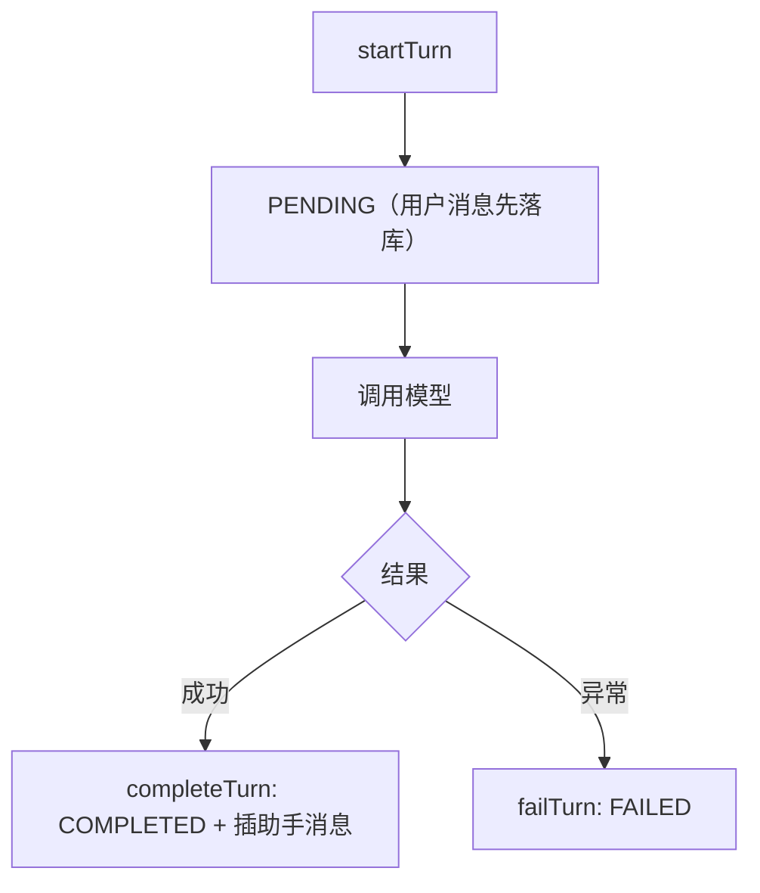
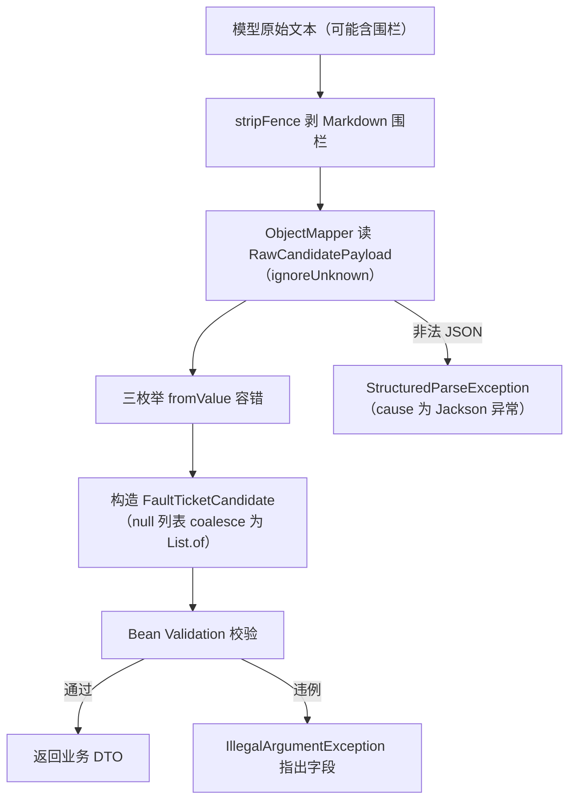

# D23 聊天-SSE-Memory-结构化输出回归测试与关键问题修复——技术说明与操作实践指南

> 本指南聚焦“关键技术机制 + 测试设计 + 运行调试方法 + 失败场景实践”，
> 所有结论以本地实际源码与 `docs/evidence/D23/D23-iteration-state.md` 为准。
> 路径均相对工程根 `M2-Java`。

---

## 1. 核心概念：回归测试为什么能离线、不依赖 Key

### 1.1 定义

回归测试（Regression Test）是在代码迭代后，对**既有行为契约**重新执行的自动化测试，
目标是证明“新改动没有破坏旧行为”。D23 的默认回归满足三条硬约束：

1. 不依赖真实 API Key；
2. 不访问外网、不产生真实模型费用；
3. 可在本地一条命令稳定复现。

### 1.2 实现机制：三类测试资产分工

| 测试资产 | 机制 | 是否触网 | 代表类 |
|---|---|---|---|
| 纯单元测试 | 直接 new 被测对象，手工传入依赖 | 否 | StructuredCandidateParserTest |
| 可控替身集成测试 | `@Primary` 注入测试替身，替换真实 AiChatService | 否 | AiFailureLifecycleTest |
| 真机 HTTP 集成测试 | RANDOM_PORT + JDK HttpClient，但模型仍是 mock/替身 | 否（仅本机回环） | SseEventOrderTest |

> 关键区分：真机 RANDOM_PORT 只代表“真实启动 Tomcat 与 MVC 异步层”，不代表调用真实大模型。
> 模型层始终被 mock 或替身接管，因此默认回归不触网。

---

## 2. 四域关键技术机制（原理）

### 2.1 同步聊天：轮次状态机

`ChatController.chat` 与 `ChatHistoryService` 共同维护一条轮次状态机：



- HTTP 层统一返回 200，业务结果靠 `code` 区分：SUCCESS 200、PARAM_INVALID 4001、SYSTEM_ERROR 5000、AI_CONFIG_ERROR 5001、AI_UNAVAILABLE 5002。
- 全局异常处理器把不同异常映射为对应业务码，失败时 `data` 为 null。

### 2.2 SSE：SseEmitter 桥接 Reactor Flux

本工程无 WebFlux 服务端，SSE 用 Spring MVC 原生 `SseEmitter` 把 `Flux<StreamChunk>` 桥接为命名事件：

- 事件名：`start / delta / thinking / citations / complete / error`。
- `safeSend`：`synchronized (emitter)` + `finished` AtomicBoolean，防止并发发送与终态后重复发送。
- 双层超时：应用层 `.timeout(streamTimeoutMs)` 先触发；容器超时设为 `streamTimeoutMs + 5000ms`（CONTAINER_TIMEOUT_GRACE_MS）兜底。
- `persisted` AtomicBoolean 保证 Reactor 回调与容器回调（onCompletion/onTimeout/onError）之间，终态只落库一次。
- 客户端断开（onError）：助手已有正文 → `interruptTurn` 保留 INTERRUPTED；无正文 → `failTurn`。

### 2.3 Memory：权威存储与兼容资产分层

- **权威存储（主链路）**：MySQL `ChatHistoryService`。
  - `getContextWindow` 只取最近 N 条 `COMPLETED`（倒序 LIMIT 再 reverse），窗口首条孤立 assistant 则向前补一条 user。
  - PENDING/FAILED/INTERRUPTED 不进窗口；序号靠父行 X 锁串行化 + `MAX(sequence)+1`，唯一约束 `uk_session_sequence` 兜底。
- **兼容/学习资产（不进主链路）**：`ConversationMemory`(Redis) 与 `ConversationSession`。
  - `ConversationSession` 单会话 20 条 FIFO 截断、`removeLast` 失败回滚、`snapshot` 返回不可变副本。

### 2.4 结构化输出：不可信输入的解析与校验

`StructuredCandidateParser.parse` 是一条“先清洗、再反序列化、再容错、最后校验”的管线：



枚举容错规则：

| 枚举 | 非法/缺失输入 | 容错结果 |
|---|---|---|
| TicketCategory | 未知类别 | UNKNOWN |
| CandidateStatus | 非 CANDIDATE | NEEDS_CLARIFICATION |
| InformationSource | 未知 | MODEL_INFERRED |
| InformationSource | null | USER_STATED |

Bean Validation 约束：`symptomSummary` @NotBlank 且 @Size(max=500)、`deviceModel` max=128、`faultCode` max=64、`uncertaintyNote` max=1000。

---

## 3. 测试替身与可控 Flux 设计原理

### 3.1 为什么用 @Primary 替身

`KnowledgeChatOrchestrator` 构造器注入 `AiChatService`。测试中通过 `@TestConfiguration` 再定义一个 `@Primary` Bean：

- Spring 在多个候选中优先选择 `@Primary`，无需改生产代码即可替换实现。
- 替身可精确控制“返回什么 / 抛什么 / 何时发射”，从而稳定复现失败与超时，不依赖网络抖动。

### 3.2 替身核心形态（示意）

```java
static class ControllableAiChatService implements AiChatService {
    private final AtomicReference<RuntimeException> syncError = new AtomicReference<>();
    private final AtomicReference<Flux<StreamChunk>> stream = new AtomicReference<>();

    @Override
    public AiChatResult chat(ChatInvocation i, ThinkingSettings s) {
        RuntimeException e = syncError.get();
        if (e != null) { throw e; }
        return new AiChatResult("mock", "offline-mock", true, false, "fallback", null);
    }

    @Override
    public Flux<StreamChunk> streamChat(ChatInvocation i, ThinkingSettings s) {
        Flux<StreamChunk> f = stream.get();
        return f != null ? f : Flux.empty();
    }
}
```

### 3.3 用 Flux 构造三类场景

- 正常分块：`Flux.just(c1, c2, c3)`。
- 上游异常：`Flux.concat(Flux.just(contentChunk), Flux.error(new RuntimeException("boom")))`。
- 应用层超时：`Flux.never()` 配合 `@TestPropertySource(properties = "app.ai.stream-timeout-ms=300")`，由 `.timeout` 触发 `TimeoutException`。

---

## 4. 测试设计与断言策略

### 4.1 断言最终可观察结果

- 结构化：断言 DTO 每个字段值、枚举映射、列表内容，而非仅 `assertThatNoException`。
- SSE：断言完整事件名序列、delta seq 严格递增、`complete.seq` 与 delta 数量一致、`totalChars` 与 delta 文本长度和一致。
- Memory：断言窗口内真实内容数组与角色交替顺序，且全部属于同一 session。

### 4.2 失败落库的回查方法

失败响应不回传 sessionId，回查采用“唯一 owner → 分页查会话 → 分页查消息 → 断言状态”：

```java
await().atMost(Duration.ofSeconds(10)).untilAsserted(() -> {
    var sessions = historyService.pageSessions(owner, 1, 10).records();
    assertThat(sessions).isNotEmpty();
    var messages = historyService.pageMessages(owner, sessions.get(0).getSessionId(), 1, 50).records();
    assertThat(messages).anyMatch(m -> m.getStatus() == MessageStatus.FAILED);
});
```

### 4.3 原始 SSE 解析

真机测试用 JDK `HttpClient` 的 `BodyHandlers.ofLines()` 逐行读取，按空行分隔事件、按 `event:`/`data:` 前缀提取，
避免依赖任何 SSE 客户端库，保证验证的是服务器真实输出文本。

---

## 5. 运行与调试操作实践（How-to）

### 5.1 运行全量回归（默认，无需 Key）

```powershell
# PowerShell（pwsh 7），Maven 主路径
& "D:\SoftwareInstall\Apache\Maven\apache-maven-3.9.16\bin\mvn.cmd" `
  -f "E:\AI\project\AI-Learning-one\M2-Java\D23\D23_CRTFC_SSE_MASO\pom.xml" clean test
```

预期：`Tests run: 123, Failures: 0, Errors: 0, Skipped: 0`，BUILD SUCCESS，退出码 0。

### 5.2 只跑某个测试类（快速反馈）

```powershell
& "D:\SoftwareInstall\Apache\Maven\apache-maven-3.9.16\bin\mvn.cmd" `
  -f "E:\AI\project\AI-Learning-one\M2-Java\D23\D23_CRTFC_SSE_MASO\pom.xml" `
  test "-Dtest=StructuredCandidateParserTest"
```

### 5.3 输出落盘再分析（本机可靠做法）

前台常吞原生命令 stdout，建议把结果重定向到文件再用 Read/Grep 查看：

```powershell
& $mvn -f $pom test *>&1 | Out-File -LiteralPath "E:\AI\project\AI-Learning-one\M2-Java\logs\D23\run.log" -Encoding utf8
```

### 5.4 Mock 模式启动应用（手动验证，无需 Key）

```powershell
$env:AI_MODE = "mock"
& $mvn -f $pom spring-boot:run
# 健康检查：GET http://127.0.0.1:8080/api/v1/ai/health
```

### 5.5 真实模式（具备 Key 时，默认不执行）

```powershell
$env:AI_MODE = "deepseek"
$env:AI_API_KEY = "你的真实密钥"   # 仅环境变量注入，禁止写入文件
& $mvn -f $pom spring-boot:run
```

> 无真实 Key 时该路径一律标“未验证”，不得用假 Key 假装跑通。

---

## 6. 失败场景与排查实践

### 6.1 先分类，再决定改哪里

| 失败来源 | 判别特征 | 处理 |
|---|---|---|
| 测试期望写错 | 断言文本/类型与实际不符，生产逻辑无异常 | 改测试，对齐真实契约 |
| 测试编译问题 | 缺导入、AssertJ 无此方法 | 补导入/换可用断言 |
| 真实生产缺陷 | 多个测试指向同一实现行为错误 | 按 R05 最小根因修复 |

### 6.2 本轮真实复盘（全部为测试侧问题）

1. 异常消息实际是“模型输出不是合法 JSON，无法生成候选”，测试误写为“结构化候选结果解析失败”。
2. 校验异常前缀实际是“模型候选字段校验失败”，测试误写为“结构化候选结果校验失败”。
3. 缺失列表：解析器显式把 null coalesce 为 `List.of()`（StructuredCandidateParser 第 66-67 行），断言由 isNull 改 isEmpty。
4. AssertJ 该 ListAssert 无 `isStrictlyOrdered()`，改用 `isSorted()`。
5. SSE 测试漏 `import java.util.stream.Stream`，编译报错，补导入。

### 6.3 修复停止线（必须遵守）

同一根因连续两次修复未解决，立即停止试错，先输出诊断记录：现象、复现步骤、根因假设、已尝试修改、失败证据、下一步验证方案，
再决定是否继续；不得靠反复改写或扩大范围硬试。

---

## 7. 竖屏层级树（测试视角）

```text
src/test/java（com.zl.d23，21 类 / 123 方法）
├─ 纯单元（不启动上下文）
│  ├─ device/StructuredCandidateParserTest（18）
│  ├─ device/DeviceEnumFallbackTest（5）
│  └─ conversation/ConversationSessionTest（6）
├─ 集成测试（@ActiveProfiles test）
│  ├─ MultiTurnContextWindowTest（5，MOCK）
│  ├─ SseEventOrderTest（3，RANDOM_PORT）
│  └─ AiFailureLifecycleTest（3，RANDOM_PORT + 替身 + timeout=300）
└─ 基线（15 类 / 83 方法，含 SyncChatContract/StreamSseHttp/SessionIsolation 等）
```

---

## 8. 常见问题与避坑（Pitfalls）

1. **不要把“真机端口”当“真实模型”**：RANDOM_PORT 只验证 Web 层，模型仍需 mock/替身。
2. **AssertJ 方法要看实际类型**：`AbstractListAssert` 上没有 `isStrictlyOrdered()`，用 `isSorted()` 或转 Iterable。
3. **缺失集合字段先看实现**：本解析器主动 coalesce 为 `List.of()`，不要凭 Jackson 通用印象断言 null。
4. **超时断言要给余量**：用 Awaitility 轮询回查，而不是 `Thread.sleep` 固定等待。
5. **日志别打敏感信息**：失败落库只记异常类型，完整 Prompt/密钥不进日志。
6. **不要为通过而弱化断言**：测试只增不删，失败先查根因，不允许直接屏蔽。

---

## 9. 记忆简语（Mnemonics）

- **离线三不**：`不要 Key、不连外网、不花费用`。
- **替身口诀**：`Primary 替身换实现，返回抛错可控管；Flux never 验超时，error 不把 complete 扮。`
- **断言口诀**：`字段事件和落库，最终结果才算数；方法调用不算数，没抛异常也不够。`
- **排查口诀**：`先分测试与生产，测试问题改断言；同根两次修不好，停下诊断再向前。`

---

## 10. 官方文档溯源（References）

- 《Spring AI Reference | Spring AI 参考文档》总览：<https://docs.spring.io/spring-ai/reference/1.1/>
- 《Chat Client API | 聊天客户端 API》：<https://docs.spring.io/spring-ai/reference/1.1/api/chatclient.html>
- 《DeepSeek Chat | DeepSeek 聊天集成》：<https://docs.spring.io/spring-ai/reference/1.1/api/chat/deepseek-chat.html>
- 《Dependency Management | 依赖管理》：<https://docs.spring.io/spring-ai/reference/1.1/getting-started.html>
- 《Spring Boot Reference | Spring Boot 参考文档》：<https://docs.spring.io/spring-boot/reference/>

> 说明：以上为 Spring AI 1.1 官方文档。具体行为与签名以本地源码、字节码和 Maven 测试证据为准；
> 官方文档用于设计溯源，不替代本地验证。
