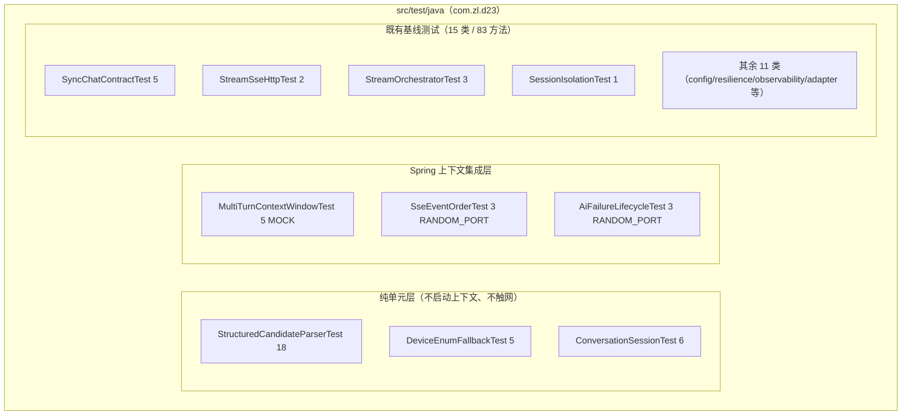
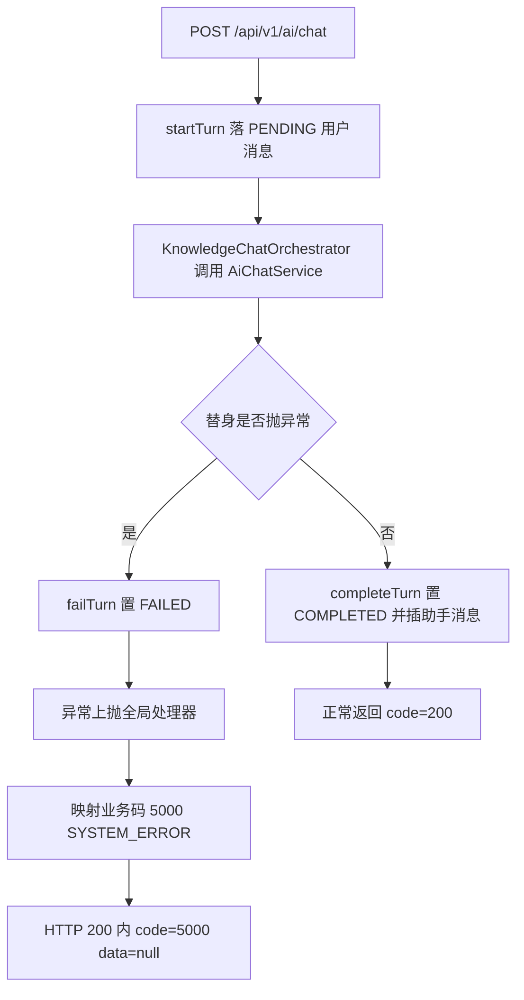
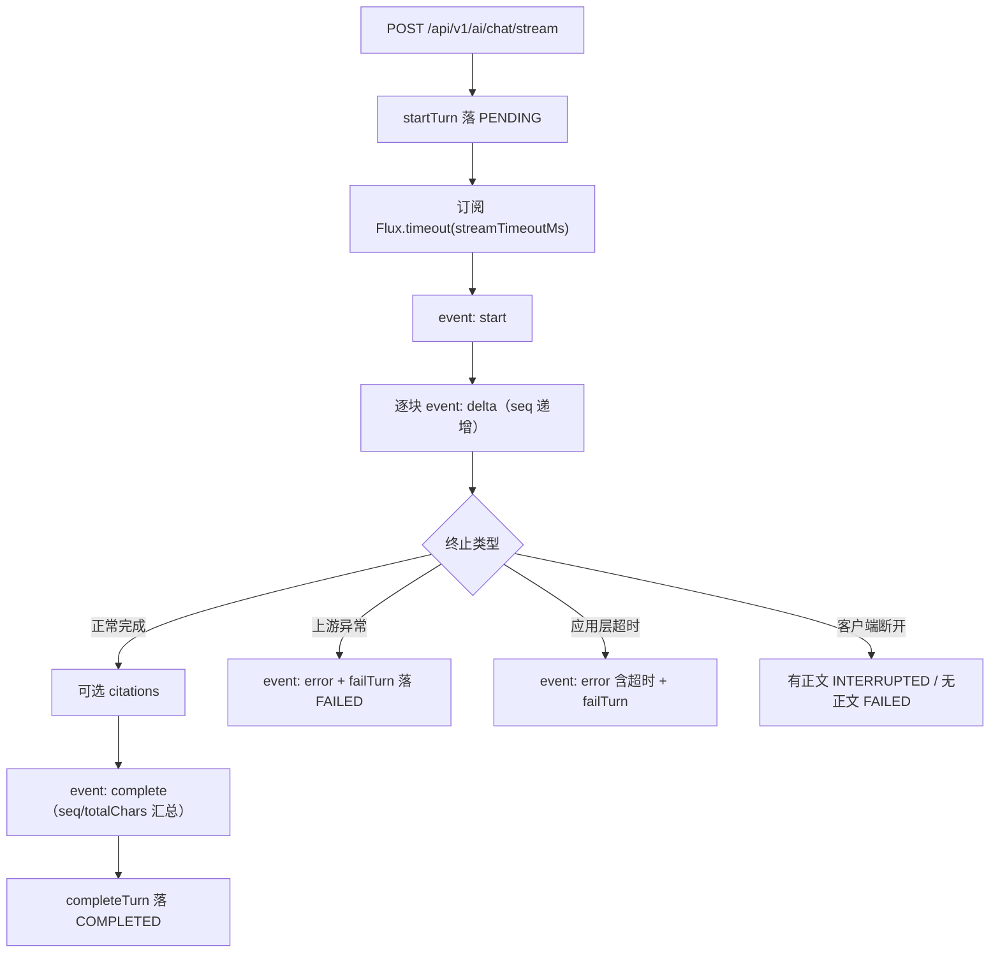
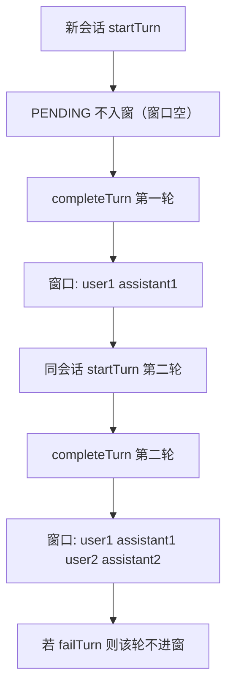

# D23 聊天-SSE-Memory-结构化输出回归测试与关键问题修复——项目迭代全量信息与操作

> 本文档从 `docs/evidence/D23/D23-iteration-state.md`、实际 Git 状态、Maven 测试报告与运行证据生成，
> 不依赖历史对话补写未经证实的事实。所有结论均标注证据路径。
> 路径均相对工程根 `M2-Java`。

---

## 1. 概述（Overview）

### 1.1 为什么要做 D23

D22 完成了“模型配置外置 + 供应商无关服务接口”，把对 DeepSeek 的直接耦合收敛到 `adapter` 适配边界。
D23 承接 D22 的完整能力，目标不是新增业务功能，而是为四条核心链路建立**可重复、可离线、不依赖真实 Key 的回归测试网**，
并据测试证据修复确认的关键问题，防止后续迭代在“同步聊天、SSE 流式、Memory 多轮上下文、结构化输出”上出现行为漂移。

### 1.2 两个核心目标

1. **补齐回归覆盖**：为 R01 同步聊天、R02 SSE 流式、R03 Memory、R04 结构化输出补齐正常/边界/失败/隔离路径测试。
2. **证据驱动修复**：只有经测试确认的真实生产缺陷才修复（R05）；测试自身问题改测试，不把测试失败当作实现缺陷。

### 1.3 技术基线（以 POM 实际为准）

| 项 | 值 / 结论 |
|---|---|
| 根 POM | 继承 spring-boot-starter-parent 3.5.16 |
| 依赖管理 | import spring-ai-bom 1.1.8、spring-cloud 2025.0.0、spring-cloud-alibaba 2025.0.0.0 |
| JDK / 构建 | JDK 21、Maven 3.9.16 |
| Web 栈 | Servlet/Tomcat + spring-boot-starter-web（无 WebFlux 服务端），端口 8080 |
| 模型依赖 | spring-ai-starter-model-deepseek（版本由 BOM 治理） |
| 装配方式 | 启动类 exclude DeepSeekChatAutoConfiguration，手动构造 ChatModel |
| 测试 profile | application-test.yml（仅覆盖 app.ai.history.default-owner=ut-default） |

> 偏差说明：模块 POM 内“自动装配 DeepSeekChatModel”注释为过时注释，实际行为是手动装配，不影响运行；
> 按最小改动原则本轮不修改无关注释。

---

## 2. 四域现状与测试架构（Architecture）

### 2.1 总体测试分层



### 2.2 四域缺口与补测结论

| 域 | 权威实现 | 补测前主要缺口 | 本轮补测 |
|---|---|---|---|
| R01 同步 | ChatController → KnowledgeChatOrchestrator → ChatHistoryService | 同步模型异常的失败落库与业务码 | AiFailureLifecycleTest 同步失败用例 |
| R02 SSE | ChatStreamController（SseEmitter 桥接 Flux） | delta seq/complete 汇总、error 事件、应用层超时 | SseEventOrderTest + AiFailureLifecycleTest |
| R03 Memory | MySQL ChatHistoryService（主）；ConversationSession（兼容资产） | 多轮顺序/空历史/仅 COMPLETED 入窗/FIFO | MultiTurnContextWindowTest + ConversationSessionTest |
| R04 结构化 | device/StructuredCandidateParser（未被调用的 @Component） | 此前无任何解析器测试（最大缺口） | StructuredCandidateParserTest + DeviceEnumFallbackTest |

### 2.3 边界规则（保持兼容）

- 不改变任何接口路径、HTTP 方法、请求/响应字段、状态码与业务语义；HTTP 统一 200，靠业务 code 区分。
- 公共能力（异常处理、TraceId、脱敏、模型配置）优先复用，不在两条链路复制两套逻辑。
- 模型结构化结果视为**不可信输入**，解析后仍执行应用层枚举与 Bean Validation 校验。

---

## 3. 测试改动清单（Code Changes）

### 3.1 改动总览

- **生产代码改动：0 个文件**。Git 状态仅显示 6 个新增测试类（全部为未跟踪 `??`），无任何已跟踪文件被修改。
- **新增测试：6 个类、40 个测试方法**。全量测试由基线 83 增至 123。

| # | 测试类（相对路径） | 类型 | 方法数 | 需求 |
|---|---|---|---|---|
| 1 | `D23/D23_CRTFC_SSE_MASO/src/test/java/com/zl/d23/device/StructuredCandidateParserTest.java` | 纯单元 | 18 | R04 |
| 2 | `D23/D23_CRTFC_SSE_MASO/src/test/java/com/zl/d23/device/DeviceEnumFallbackTest.java` | 纯单元 | 5 | R04 |
| 3 | `D23/D23_CRTFC_SSE_MASO/src/test/java/com/zl/d23/conversation/ConversationSessionTest.java` | 纯单元 | 6 | R03 |
| 4 | `D23/D23_CRTFC_SSE_MASO/src/test/java/com/zl/d23/MultiTurnContextWindowTest.java` | @SpringBootTest MOCK | 5 | R03 |
| 5 | `D23/D23_CRTFC_SSE_MASO/src/test/java/com/zl/d23/SseEventOrderTest.java` | @SpringBootTest RANDOM_PORT | 3 | R02 |
| 6 | `D23/D23_CRTFC_SSE_MASO/src/test/java/com/zl/d23/AiFailureLifecycleTest.java` | @SpringBootTest RANDOM_PORT + 可控替身 | 3 | R01/R02 |

### 3.2 关键测试设计意图

- **断言最终可观察结果**：DTO 字段、SSE 事件序列、真实落库状态，而非仅断言“方法被调用”或“没抛异常”。
- **可控替身**：`AiFailureLifecycleTest` 用 `@TestConfiguration + @Primary` 注入 `ControllableAiChatService`，
  可注入同步异常或任意 `Flux<StreamChunk>`，全程不触网、不产生费用。
- **真机 SSE**：`SseEventOrderTest` 与 `AiFailureLifecycleTest` 用 RANDOM_PORT + JDK `HttpClient` 读取原始 SSE 文本并自写解析，
  覆盖真实 HTTP 异步层，而非只在 Mock 层验证。

---

## 4. 回归测试矩阵（R01–R05）

| 需求 | 覆盖测试类 | 关键验证行为 |
|---|---|---|
| R01 同步聊天 | SyncChatContractTest（5）、AiFailureLifecycleTest（1） | 正常/角色同步、空白/超长/非法 owner、异常落 FAILED + 业务码 5000 |
| R02 SSE | SseEventOrderTest（3）、StreamSseHttpTest（2）、StreamOrchestratorTest（3）、AiFailureLifecycleTest（2） | 事件顺序、delta seq 单调、complete 汇总、error 事件、客户端断开、应用层超时 |
| R03 Memory | MultiTurnContextWindowTest（5）、ConversationSessionTest（6）、SessionIsolationTest（1） | 会话关联、消息正序、空历史、仅 COMPLETED 入窗、FIFO 截断、跨会话隔离 |
| R04 结构化 | StructuredCandidateParserTest（18）、DeviceEnumFallbackTest（5） | 合法映射、围栏剥离、枚举容错、非法 JSON、字段缺失/超长校验 |
| R05 修复 | 不适用（无确认的生产缺陷） | 测试侧期望/导入问题已在状态文件 R05 节说明 |

---

## 5. 关键流程（Flow）

### 5.1 同步失败生命周期（R01）



### 5.2 SSE 事件与终态落库（R02）



### 5.3 多轮上下文窗口（R03）



---

## 6. 配置契约（Configuration）

### 6.1 唯一命名空间 app.ai

| 配置 | 默认值 / 环境变量 | 说明 |
|---|---|---|
| `app.ai.mode` | `${AI_MODE:mock}` | mock / deepseek |
| `app.ai.model` | `${AI_MODEL:deepseek-flash}` | 模型名 |
| `app.ai.base-url` | `${AI_BASE_URL:https://api.deepseek.com}` | 供应商基址 |
| `app.ai.api-key` | `${AI_API_KEY:}` | 密钥，仅环境变量注入，禁止硬编码 |
| `app.ai.stream-timeout-ms` | 默认 60000（测试中临时设 300） | 应用层流式超时 |
| `app.ai.max-message-length` | 默认 2000 | 入参长度上限 |
| `app.ai.history.context-window-messages` | 默认 10 | 上下文窗口条数 |

### 6.2 安全约束

- API Key 必须通过环境变量或程序实参注入，禁止写入文件或提交 Git。
- 错误落库只记异常类型（`getClass().getSimpleName()`），不记上游报文；日志不输出完整 Prompt 与敏感业务数据。

---

## 7. 验证结果（Verification）

### 7.1 修复前基线（已执行并通过）

- 命令：`mvn -f D23/D23_CRTFC_SSE_MASO/pom.xml test`，退出码 0。
- 结果：Tests run: 83, Failures: 0, Errors: 0, Skipped: 0，BUILD SUCCESS。
- 日志：`logs/D23/baseline-test.log`。

### 7.2 修复后全量回归（已执行并通过）

- 命令：`mvn -f D23/D23_CRTFC_SSE_MASO/pom.xml clean test`，退出码 0。
- 结果：**Tests run: 123, Failures: 0, Errors: 0, Skipped: 0，BUILD SUCCESS**。
- 日志：`logs/D23/full-regression.log`（汇总行见第 702 行）。
- 增量核对：83（基线）+ 40（新增）= 123，数量闭合。

### 7.3 未验证项（诚实标注）

- 真实模型 remote 模式（真实 DeepSeek 同步/SSE、外网、真实计费）：未验证，本机无真实 AI_API_KEY。
- 跨进程重启后的上下文恢复：未验证，依赖真实 MySQL 实例与应用重启。
- 历史读取失败（DB 异常）分支、容器级超时兜底：未单独模拟，记为后续可补项。

---

## 8. Git 差异与敏感信息扫描

### 8.1 Git 差异核查

- `git status --short` 结果（`logs/D23/git-status.log`）：仅 6 个新增测试文件/目录为未跟踪，无 `M`（修改）项。
- 结论：零生产代码改动、零接口签名变更、零配置文件改动；测试只增不删，未弱化任何既有断言。

### 8.2 敏感信息扫描

- 对 `src/test/java` 扫描 `api-key/password/secret/token/sk-/bearer/credential/private-key`：
  - 新增 6 个测试类**零命中**凭证类字符串。
  - 基线类中的 `sk-real`/`sk-super-secret-123456` 等为显式假值，且用于验证错误消息“不泄漏密钥”（`doesNotContain(secret)`），非真实凭证。
- 结论：无硬编码真实密钥、无临时调试代码、无无关改动。

---

## 9. 证据索引（Evidence）

| 类别 | 路径 |
|---|---|
| 结构化状态文件 | `docs/evidence/D23/D23-iteration-state.md` |
| 修复前基线日志 | `logs/D23/baseline-test.log` |
| 全量回归日志 | `logs/D23/full-regression.log` |
| 历史失败运行（保留） | `logs/D23/unit-1.log`、`unit-2.log`、`unit-3.log`、`new-all.log`、`new-all-2.log` |
| Git 状态 | `logs/D23/git-status.log` |
| 测试设计文档 | `docs/temp_docs/D23/D23-test-design.md` |
| 正式文档 | `docs/proj_docs/` 两份 D23 文档 |

### 验收标准（AC）状态

| 编号 | 状态 | 依据 |
|---|---|---|
| AC01 同步契约兼容 | 通过 | SyncChatContractTest + AiFailureLifecycle |
| AC02 SSE 行为契约 | 通过 | SseEventOrder + StreamSseHttp + AiFailure |
| AC03 Memory 关联/顺序/隔离 | 通过 | MultiTurnContextWindow + SessionIsolation + ConversationSession |
| AC04 结构化映射/拒绝 | 通过 | StructuredCandidateParser + DeviceEnumFallback |
| AC05 缺陷复现—修复闭环 | 不适用（本轮无确认的生产缺陷，理由见状态文件 R05） |
| AC06 回归真实执行 | 通过 | 123 测试、退出码 0 |
| AC07 无破坏/敏感/无关改动 | 通过 | Git 仅新增测试、扫描干净 |
| AC08 文档从证据生成 | 通过 | 两份 D23 正式文档 |

---

## 10. 竖屏层级树（Hierarchy Tree）

```text
com.zl.d23
├─ D23SpringAiApplication（exclude DeepSeekChatAutoConfiguration）
├─ common（异常/全局处理/ResultCode：200/4001/5000/5001/5002）
├─ config（AiProperties/AiConfigurationValidator/AiConstants）
├─ adapter
│  ├─ 中立端口（ChatModelPort/NativeUsageReader/NativeUsage）
│  └─ deepseek（DeepSeekChatAdapter/Reader/Configuration，供应商边界）
├─ controller
│  ├─ ChatController（同步）
│  └─ ChatStreamController（SseEmitter：start/delta/thinking/citations/complete/error）
├─ service（AiChatService 接口/Mock/Remote/ChatInvocation/StreamChunk/ThinkingSettings）
├─ history（ChatHistoryService：PENDING/COMPLETED/FAILED/INTERRUPTED，上下文窗口）
├─ conversation（ConversationMemory/ConversationSession，兼容资产）
├─ device
│  ├─ StructuredCandidateParser（@Component，当前未被调用，本轮补测固化）
│  ├─ dto（RawCandidatePayload/FaultTicketCandidate）
│  └─ model（三枚举 + fromValue 容错）
├─ knowledge / prompt / resilience / observability / logging
└─ test（21 类 = 15 基线 + 6 新增，共 123 测试方法）
```

---

## 11. 注意事项与风险（Notes & Risks）

1. **未被调用的解析器**：`StructuredCandidateParser` 全工程无注入/调用，本轮仅补测试固化行为，不删除、不擅自接入；是否接入设备链路记为新任务。
2. **真实联网路径未验证**：无 Key 环境仅验证离线与负向逻辑，真实 HTTP 成功路径需在具备 Key 时补验。
3. **超时双层设计**：应用层 `.timeout(streamTimeoutMs)` 先触发，容器兜底为 `streamTimeoutMs + 5000ms`；本轮验证应用层，容器兜底未单独触发。
4. **终态只落一次**：`persisted` AtomicBoolean + `safeSend` 同步块保证 Reactor 回调与容器回调不重复写库、不重复发送。
5. **健康接口展示值**：`ChatController.health` 的 application 仍显示历史常量 `D17_DHSA_MTDCA`，属既有展示值，本轮未改动。
6. **临时文件不自动删除**：`docs/temp_docs/D23` 与 `logs/D23` 全部保留，交由用户决定是否清理。

---

## 12. 记忆简语（Mnemonics）

- **回归四域**：`同步、SSE、记忆、结构化`，正常边界失败隔离都要抓。
- **SSE 口诀**：`start 开头 complete 尾，delta seq 不越位；error 不伪造 complete，终态落库只一回。`
- **记忆口诀**：`PENDING/FAILED 不进窗，COMPLETED 正序才登场；会话隔离不串线，空历史时窗口凉。`
- **结构化口诀**：`围栏先剥 JSON 读，枚举容错再校验；非法输出不进业务，字段违例点名字。`
- **修复原则**：`测试问题改测试，真实缺陷才动生产；无 Key 离线全跑通，不夸修复不冒充。`

---

## 13. 官方文档溯源（References）

- 《Spring AI Reference | Spring AI 参考文档》总览：<https://docs.spring.io/spring-ai/reference/1.1/>
- 《Chat Client API | 聊天客户端 API》：<https://docs.spring.io/spring-ai/reference/1.1/api/chatclient.html>
- 《DeepSeek Chat | DeepSeek 聊天集成》：<https://docs.spring.io/spring-ai/reference/1.1/api/chat/deepseek-chat.html>
- 《Dependency Management | 依赖管理》：<https://docs.spring.io/spring-ai/reference/1.1/getting-started.html>
- 《Spring Boot Reference | Spring Boot 参考文档》：<https://docs.spring.io/spring-boot/reference/>

> 说明：以上为 Spring AI 1.1 官方文档，用于设计溯源；本轮行为结论以本地实际源码与 Maven 测试证据为准。
