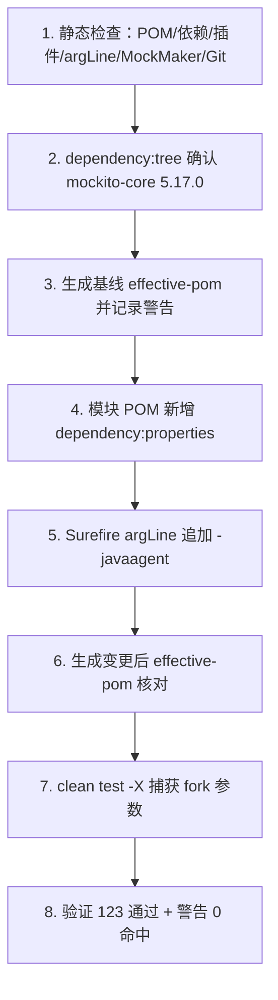

# D23 项目迭代全量信息与操作——Mockito 显式 Java Agent

> 本文档从 `docs/evidence/D23/D23-iteration-state.md`（子迭代二）、实际 Git Diff、有效 POM/依赖报告与测试证据生成，
> 不依赖历史对话回忆，不复制原项目架构说明。路径均相对工程根 `M2-Java`。

---

## 1. 目标与范围（Overview）

### 1.1 为什么要做

D23 的测试大量使用 Mockito Inline Mock Maker（支持 Final 类、静态方法、构造器 Mock）。
在 Java 21 及以上，JDK 收紧了“动态 Agent 加载”策略：Mockito 若不显式挂载，会在运行时**自附加（self-attach）**
byte-buddy-agent，并产生 JDK 警告，且未来 JDK 版本将默认禁止动态加载。

本迭代用**官方推荐的显式 Agent 机制**解决，而不是用隐藏警告的参数绕过。

### 1.2 范围与边界

- 仅规范测试构建环境：改 POM 构建配置，不改 Spring Boot 业务代码、不改现有测试逻辑、不升级无关依赖。
- 不新增、不删除、不替换 Mock Maker；不新增 Failsafe。
- 禁止 `-XX:+EnableDynamicAgentLoading`、`-Djdk.instrument.traceUsage` 等仅改变警告呈现的参数。

### 1.3 技术基线（以 POM 实际为准）

| 项 | 值 |
|---|---|
| JDK / 构建 | JDK 21（21.0.7）、Maven 3.9.16 |
| 父 POM | spring-boot-starter-parent 3.5.16 |
| 测试依赖 | spring-boot-starter-test 3.5.16（test） |
| Mockito | mockito-core 5.17.0、mockito-junit-jupiter 5.17.0（test） |
| Surefire | maven-surefire-plugin 3.5.6（forkCount 默认 1） |
| Failsafe | maven-failsafe-plugin 3.5.6（仅 pluginManagement，未启用） |
| dependency-plugin | maven-dependency-plugin 3.8.1（父 POM 管理版本） |

---

## 2. 现状（Current State）

### 2.1 变更前的关键事实

- 全工程**不存在** `mockito-extensions/org.mockito.plugins.MockMaker` 文件，也无 `mockito-inline` 依赖。
- Inline Mock Maker 由 **Mockito 5 的默认 Mock Maker** 提供（Mockito 5 起 inline 为默认）。
- Surefire 仅配置 `systemPropertyVariables(spring.profiles.active=test)`，**无 argLine、无 forkCount 覆盖、无 JaCoCo**。
- Failsafe 只在父 POM 的 pluginManagement 中存在，模块 `build/plugins` 未声明，且无 `*IT/*ITCase` 测试文件。

### 2.2 变更前的警告（基线证据）

`logs/D23/full-regression.log` 第 53–57 行：

- `Mockito is currently self-attaching to enable the inline-mock-maker ...`
- `WARNING: A Java agent has been loaded dynamically (byte-buddy-agent-1.17.8.jar)`
- `WARNING: ... run with -XX:+EnableDynamicAgentLoading to hide this warning`（该参数被禁止）
- `WARNING: Dynamic loading of agents will be disallowed by default in a future release`

---

## 3. 修改文件与配置决策（Changes & Decisions）

### 3.1 修改文件清单

| 文件 | 类型 | 目的 |
|---|---|---|
| `D23/D23_CRTFC_SSE_MASO/pom.xml` | 修改（唯一已跟踪文件） | 新增 dependency:properties 解析路径；Surefire 追加 -javaagent |
| 业务 Java / 现有测试类 | 零修改 | 保持范围边界 |
| 依赖/插件版本 | 零升级 | 版本沿用父 POM 治理 |

Git Diff：1 个文件，26 增 3 删（`logs/D23/git-diff-after.log`）。

### 3.2 关键配置（实际写入模块 POM）

```xml
<plugin>
  <groupId>org.apache.maven.plugins</groupId>
  <artifactId>maven-dependency-plugin</artifactId>
  <executions>
    <execution>
      <id>resolve-dependency-paths</id>
      <goals><goal>properties</goal></goals>
    </execution>
  </executions>
</plugin>

<plugin>
  <groupId>org.apache.maven.plugins</groupId>
  <artifactId>maven-surefire-plugin</artifactId>
  <configuration>
    <argLine>-javaagent:${org.mockito:mockito-core:jar}</argLine>
    <systemPropertyVariables>
      <spring.profiles.active>test</spring.profiles.active>
    </systemPropertyVariables>
  </configuration>
</plugin>
```

### 3.3 配置决策与理由

1. **路径解析**：`dependency:properties` 默认绑定 initialize 阶段，为依赖建立 `groupId:artifactId:type` 属性，
   即 `org.mockito:mockito-core:jar`，值为本次实际解析 JAR，保证 Agent 与测试依赖**同版本**。
2. **参数合并**：变更前无 argLine、无 JaCoCo，故直接追加，不覆盖任何参数；`systemPropertyVariables` 原样保留。
3. **不使用 @{argLine}**：没有其他插件设置 argLine，直接用 `${...}` 即可，避免字面量 `@{argLine}` 与空初始值问题。
4. **Fork 前提**：forkCount 默认 1（forked JVM），argLine 可生效；未改变并发/隔离。
5. **Failsafe 不适用**：未启用且无集成测试文件，按要求不新增，R04 标不适用。

---

## 4. 执行步骤（Execution Flow）



### 4.1 实际执行命令

```powershell
# 依赖树
mvn -f D23/D23_CRTFC_SSE_MASO/pom.xml dependency:tree `
  "-Dincludes=org.mockito:mockito-core,org.mockito:mockito-inline,org.mockito:mockito-junit-jupiter"

# 有效 POM（前后各一次）
mvn -f D23/D23_CRTFC_SSE_MASO/pom.xml help:effective-pom "-Doutput=...effective-pom-after.xml"

# 全量测试 + Debug（捕获 fork JVM 参数）
mvn -f D23/D23_CRTFC_SSE_MASO/pom.xml clean test -X
```

---

## 5. 测试与验证结果（Verification）

### 5.1 多维证据（不只看警告消失）

| 验证维度 | 结论 | 证据 |
|---|---|---|
| 依赖版本 | mockito-core 5.17.0 未变 | logs/D23/mockito-tree.log |
| 有效 POM | argLine 与 dependency 执行生效 | effective-pom-after.xml 第 11376-11410 行 |
| 路径解析 | 属性指向实际 JAR | full-test-agent-debug.log 第 1374、2462 行 |
| fork JVM 参数 | `(s) argLine = -javaagent:...mockito-core-5.17.0.jar` | 同日志第 2927 行；forkCount=1 第 2943 行 |
| 测试结果 | 123 通过、0 失败/错误/跳过 | 同日志第 3667 行，BUILD SUCCESS |
| 警告消失 | 警告关键词计数 = 0 | 全量 Debug 日志负向核查 |

### 5.2 实际解析的 Agent 路径

```text
D:\SoftwareInstall\Apache\repository\org\mockito\mockito-core\5.17.0\mockito-core-5.17.0.jar
```

### 5.3 未验证项（诚实标注）

- 真实模型 remote 模式（无 AI_API_KEY）：未验证，与本构建任务无直接关系。
- Failsafe 集成测试：项目未启用，标不适用，未执行。

---

## 6. 交付结果（Deliverables）

| 类别 | 路径 |
|---|---|
| 正式文档 1 | `docs/proj_docs/D23-项目迭代全量信息与操作-Mockito显式JavaAgent.md` |
| 正式文档 2 | `docs/proj_docs/D23-技术说明与实践指南-Mockito Inline Mock Maker与Surefire配置.md` |
| 状态记录 | `docs/evidence/D23/D23-iteration-state.md`（追加子迭代二） |
| 静态检查 | `docs/temp_docs/D23/D23-agent-static-check.md` |
| 日志 | `logs/D23/`（mockito-tree、effective-pom 前后、full-test-agent-debug、git-diff 等） |

---

## 7. 竖屏层级树（Hierarchy Tree）

```text
D23 测试构建链路
├─ 依赖（test）
│  ├─ spring-boot-starter-test 3.5.16
│  ├─ mockito-core 5.17.0（默认 inline Mock Maker）
│  └─ mockito-junit-jupiter 5.17.0
├─ 构建插件（模块 build/plugins）
│  ├─ maven-dependency-plugin 3.8.1
│  │  └─ resolve-dependency-paths → properties（initialize）
│  └─ maven-surefire-plugin 3.5.6
│     ├─ argLine = -javaagent:${org.mockito:mockito-core:jar}
│     └─ systemPropertyVariables: spring.profiles.active=test
└─ 未启用
   └─ maven-failsafe-plugin 3.5.6（仅 pluginManagement，无 *IT 测试）
```

---

## 8. 注意事项与风险（Notes & Risks）

1. **属性在 initialize 之后才可用**：Surefire 位于 test 阶段，晚于 initialize，故 `${...}` 可正常解析；勿在更早阶段引用。
2. **未来若引入 JaCoCo**：需改用 `@{argLine}` 合并并提供空初始值，避免覆盖 JaCoCo 的 Agent 参数。
3. **未来若启用 Failsafe**：必须为其独立配置同版本 -javaagent，Surefire 配置不会自动作用于 Failsafe。
4. **路径含空格/特殊字符**：本机仓库路径无空格；若路径含空格，argLine 内需加引号处理。
5. **不要回退到隐藏警告参数**：警告消失只是结果，正确性以有效 POM、依赖解析、fork 命令行与测试共同证明。

---

## 9. 记忆简语（Mnemonics）

- **核心口诀**：`properties 出路径，argLine 挂 Agent；版本同根不另选，inline 能力不挪坑。`
- **避坑口诀**：`不碰 EnableDynamic，不用 @{argLine}；fork 为 1 才生效，Failsafe 没有不硬拼。`
- **验证口诀**：`有效 POM、依赖树、fork 命令、测试数，四证齐全才算数，单看警告会失误。`

---

## 10. 官方文档溯源（References）

- 《Mockito – Explicitly setting up instrumentation for inline mocking (Java 21+) | Mockito 显式配置 Inline Instrumentation》：<https://javadoc.io/doc/org.mockito/mockito-core/latest/org.mockito/org/mockito/Mockito.html#0.3>
- 《Apache Maven Dependency Plugin – dependency:properties | Maven 依赖插件 properties 目标》：<https://maven.apache.org/plugins/maven-dependency-plugin/properties-mojo.html>
- 《Maven Surefire Plugin – argLine | Surefire 测试 JVM 参数》：<https://maven.apache.org/surefire/maven-surefire-plugin/test-mojo.html>
- 《Maven Surefire Plugin – Fork Options and Parallel Test Execution | Fork 与并行》：<https://maven.apache.org/surefire/maven-surefire-plugin/examples/fork-options-and-parallel-execution.html>
- 《Maven Failsafe Plugin – integration-test | Failsafe 集成测试 JVM 参数》：<https://maven.apache.org/surefire/maven-failsafe-plugin/integration-test-mojo.html>
