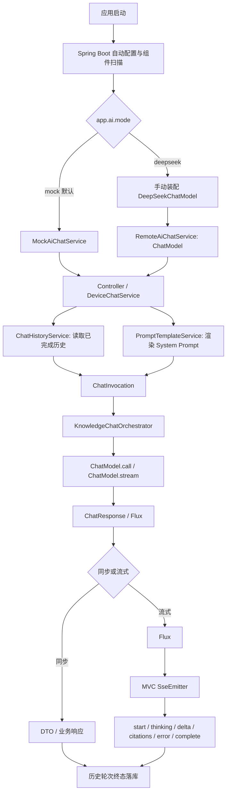
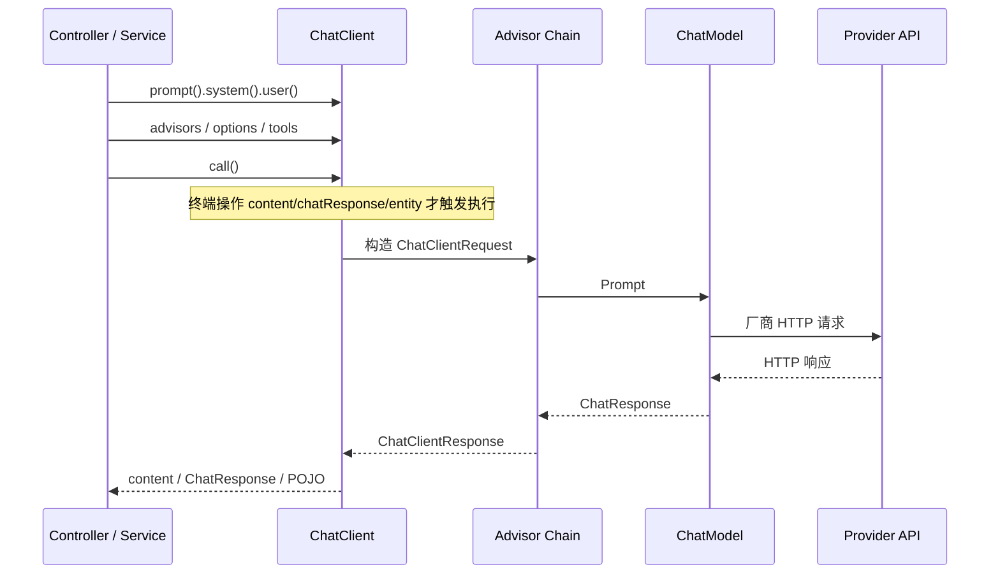
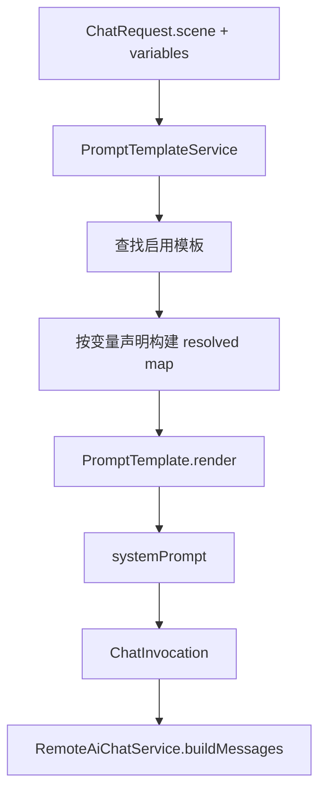
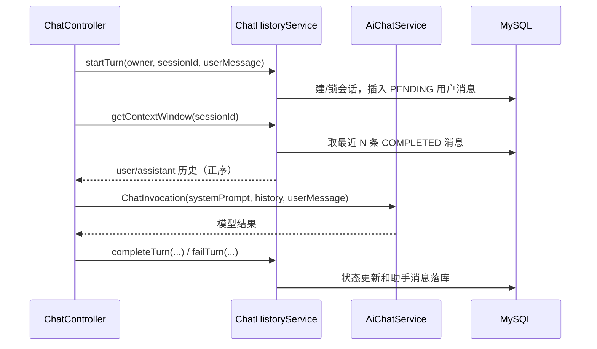
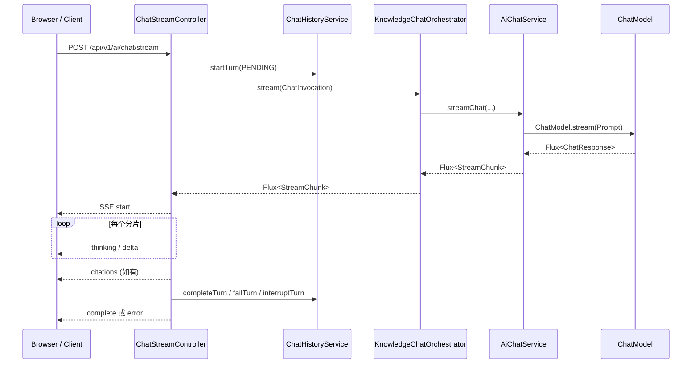

# Spring AI M2 知识笔记：七大核心链路

> **技术基线**：JDK 21、Spring Boot 3.5.16、Spring AI 1.1.8、Maven 3.9.16；模型服务背景为 DeepSeek。  
> **项目**：`storyzhangli/M2-Java/D23/D23_CRTFC_SSE_MASO`，包名 `com.zl.d23`。  
> **资料核验日期**：2026-11-06。  
> **范围**：只分析仓库和生成学习笔记；未修改项目代码、依赖、数据库或配置，未调用真实模型。

---

## 1. 学习目标与核心结论

本笔记围绕一次 Spring AI 请求从应用启动到模型返回、上下文管理、结构化处理、SSE 推送和异常收口的完整链路展开。首先要记住以下项目事实：

1. **D23 引入 DeepSeek Starter，但主动排除了 DeepSeek 模型自动配置。** 真实模式下由 `DeepSeekChatModelConfiguration` 手动创建 `DeepSeekApi` 和 `DeepSeekChatModel`，使用项目自己的 `app.ai.*` 配置；默认 `mock` 模式不创建真实 ChatModel。
2. **项目主调用路径使用 `ChatModel`，没有采用 `ChatClient`。** `RemoteAiChatService` 自己组装 `Prompt`，调用 `chatModel.call(prompt)` 或 `chatModel.stream(prompt)`。`ChatClient` 是 Spring AI 提供的高层 Fluent API，适合作为独立学习内容，但不能误说成 D23 的现有实现。
3. **Prompt 模板管理是项目能力，Advisor 模板记忆不是。** 项目用 `PromptTemplateService` + Spring AI `PromptTemplate` 渲染角色系统提示词；用户输入、历史消息与 SystemMessage 分开组装。
4. **当前主链路的会话历史权威存储为 MySQL。** `ChatHistoryService` 保存完整历史和消息状态，再按消息条数取最近的 COMPLETED 消息作为模型上下文。Redis `ConversationMemory` 虽存在，但 D23 状态文档明确说明它不进入主链路。
5. **结构化输出类存在，但尚未接入设备业务主流程。** `StructuredCandidateParser` 可解析 JSON 并做 Bean Validation，但代码状态记录确认它没有被注入/调用；当前设备工单候选由确定性规则服务 `FaultTicketCandidateService` 构建。
6. **项目是 Servlet/Tomcat + Spring MVC。** 上游模型 `Flux<ChatResponse>` 被转换为 `Flux<StreamChunk>`，再由 Controller 订阅并桥接到 MVC `SseEmitter`；这不等于运行 WebFlux Server。
7. **失败策略由应用层统一治理。** DeepSeek ChatModel 的 Spring AI `RetryTemplate` 被设为单次尝试；应用层 `ModelResilienceSupport` 负责分类、有限重试、退避、Deadline 和流式重试边界。

### 项目与框架能力状态

| 能力 | Spring AI 1.1.8 框架提供 | D23 当前状态 |
|---|---|---|
| DeepSeek ChatModel Starter / 自动配置 | 提供 | Starter 存在；DeepSeek 自动配置被显式排除，手动装配 ChatModel |
| ChatClient / Builder / Advisors | 提供 | 未用于主链路；代码实际直接调用 ChatModel |
| Prompt / PromptTemplate / Message | 提供 | 已使用 Prompt、消息类型和 PromptTemplate |
| ChatMemory / MessageWindowChatMemory / MessageChatMemoryAdvisor | 提供 | 未用于主链路；项目自建 MySQL ChatHistory |
| StructuredOutputConverter / BeanOutputConverter | 提供 | 未用于业务调用；存在未接入的手动 JSON Parser |
| ChatModel.stream / Reactor Flux | 提供 | 已使用；Flux 桥接到 MVC SseEmitter |
| RetryTemplate / 模型异常类型 | 提供 | ChatModel 内置重试关闭；应用层自定义韧性治理 |

---

## 2. 技术基线、项目扫描范围

### 2.1 版本与依赖核验

| 项目 | 仓库实际值 | 判断 |
|---|---|---|
| Java | 21 | 与学习基线一致 |
| Spring Boot | 3.5.16 | 由 D23 父 POM 管理 |
| Spring AI | 1.1.8 | 由 `spring-ai-bom` 统一管理 |
| Maven | 3.9.16 | D23 状态文档记录的构建环境版本 |
| Web | `spring-boot-starter-web` | Servlet/MVC/Tomcat |
| 模型 Starter | `spring-ai-starter-model-deepseek` | BOM 管理版本；未引入 OpenAI 等其他模型 Starter |
| Redis | `spring-boot-starter-data-redis` | 用于 Prompt 缓存、保留的 Redis 会话组件等，不是当前主历史权威存储 |
| Validation | `spring-boot-starter-validation` | DTO 与候选字段校验 |
| Test | `spring-boot-starter-test` | JUnit 5、Mockito、Spring Test、MockMvc 等 |

依赖版本与自动装配依据应分别看根 POM、模块 POM 和 Spring AI BOM，不能只看某个依赖声明有没有 `<version>`。

### 2.2 本次实际读取的主要文件

| 范围 | 主要文件 | 本笔记用途 |
|---|---|---|
| 构建与启动 | `D23/pom.xml`、`D23/D23_CRTFC_SSE_MASO/pom.xml`、`D23SpringAiApplication.java` | 版本、Starter、Web 技术栈、自动配置排除 |
| 模型装配 | `adapter/deepseek/DeepSeekChatModelConfiguration.java`、`DeepSeekChatAdapter.java`、`adapter/ChatModelPort.java` | ChatModel 创建和供应商专属类型隔离 |
| 调用服务 | `service/RemoteAiChatService.java`、`MockAiChatService.java`、`AiChatService.java`、`ChatInvocation.java` | 同步/流式请求、Prompt 消息组装、Mock |
| 请求编排 | `controller/ChatController.java`、`ChatStreamController.java`、`knowledge/KnowledgeChatOrchestrator.java` | 业务入口、RAG 提示词增强、同步与 SSE 生命周期 |
| Prompt | `prompt/PromptTemplateService.java`、`PromptTemplateValidator.java`、`MybatisPromptTemplateRepository.java` | 模板持久化、变量白名单、ST4 渲染 |
| 会话历史 | `history/ChatHistoryService.java`、`conversation/HistoryMessageConverter.java`、`RoleConversationService.java`、`ConversationMemory.java` | MySQL 历史、上下文窗口、Redis 兼容组件边界 |
| 结构化候选 | `device/StructuredCandidateParser.java`、`FaultTicketCandidateService.java`、`DeviceChatService.java` | JSON Parser 状态与设备业务实际路径 |
| 失败治理 | `resilience/ModelClientConfiguration.java`、`ModelExceptionClassifier.java`、`ModelErrorCategory.java`、`ModelResilienceSupport.java`、`common/GlobalExceptionHandler.java` | 超时、分类、重试、异常映射 |
| 测试与证据 | `src/test/java/com/zl/d23/**`、`docs/evidence/D23/D23-iteration-state.md` | 测试覆盖、当前验证边界 |

本次未逐行读取所有前端静态资源、数据库 Mapper、全部 DTO 和每个测试类；只在理解端到端调用链需要时读取直接关联文件。项目状态以读取到的当前 `master` 分支文件为依据，不推断未读取的本地未提交状态。

### 2.3 项目核心代码入口

- 启动类：`D23/D23_CRTFC_SSE_MASO/src/main/java/com/zl/d23/D23SpringAiApplication.java`
- DeepSeek 模型装配：`.../adapter/deepseek/DeepSeekChatModelConfiguration.java`
- ChatModel 调用：`.../service/RemoteAiChatService.java`
- 同步入口：`.../controller/ChatController.java`
- 流式入口：`.../controller/ChatStreamController.java`
- Prompt 模板：`.../prompt/PromptTemplateService.java`
- 主历史存储：`.../history/ChatHistoryService.java`
- 结构化 Parser：`.../device/StructuredCandidateParser.java`
- 失败治理：`.../resilience/ModelResilienceSupport.java`

---

## 3. 七大链路总览



注意这张图描述的是 D23 实际应用结构，不是 Spring AI 框架内部的所有组件。D23 目前没有 `ChatClient` Advisor 链，也没有使用 Spring AI `ChatMemory` 自动记忆 Advisor。

---

## 4. Spring AI 自动配置

### 4.1 Starter、底层依赖与 BOM 的关系

- **Starter** 是面向应用的依赖入口，负责聚合模型实现和自动配置所需依赖。
- **底层模型模块**提供 Java API、客户端与模型实现，例如 DeepSeek API 客户端、`DeepSeekChatModel`。
- **Auto-configuration 模块**根据类路径、属性和 Bean 条件创建配置属性对象及模型 Bean。
- **Spring AI BOM**统一管理 Spring AI 各模块的版本，避免 Starter、Model、Client 等组件版本不一致。
- **Spring Boot Auto-configuration**根据候选自动配置类和条件装配，把框架约定转成 Spring Bean。

D23 模块声明 `spring-ai-starter-model-deepseek`，没有手写版本号；版本由 `D23/pom.xml` import 的 Spring AI BOM 1.1.8 管理。

### 4.2 Spring Boot 自动配置机制

Spring Boot 3 的自动配置候选类通常通过 JAR 中的 `META-INF/spring/org.springframework.boot.autoconfigure.AutoConfiguration.imports` 暴露。候选配置类仍需通过条件判断才能生效。常见条件：

| 条件 | 含义 | 常见用途 |
|---|---|---|
| `@ConditionalOnClass` | 指定类存在于 ClassPath 才匹配 | 只在模型客户端依赖存在时启用配置 |
| `@ConditionalOnMissingBean` | 容器中不存在指定 Bean 时才匹配 | 用户自定义 Bean 时回退，不重复创建默认 Bean |
| `@ConditionalOnProperty` | 属性满足指定值才匹配 | 按模式或开关启用模型配置 |
| `@ConditionalOnBean` | 指定 Bean 已存在时才匹配 | 依赖已有 ChatModel 后创建上层 Bean |

条件不匹配不一定是错误。需要通过启动条件评估报告确认是哪项条件未通过。

常用排查顺序：

1. `mvn dependency:tree` 确认 Starter 与版本确实在运行时依赖中。
2. `jar tf <jar>` 检查依赖 JAR 是否包含 `AutoConfiguration.imports`。
3. 启动时增加 `--debug`，查看 Condition Evaluation Report。
4. 检查 `@SpringBootApplication(exclude=...)` 是否排除目标配置。
5. 检查自定义 Bean 是否导致 `@ConditionalOnMissingBean` 回退条件不再匹配。
6. 用 Spring 上下文测试断言目标 Bean 的存在、类型、数量和配置值。

### 4.3 D23 的特殊处理：排除 DeepSeek 自动配置

D23 启动类：

```java
@SpringBootApplication(exclude = DeepSeekChatAutoConfiguration.class)
@ConfigurationPropertiesScan
public class D23SpringAiApplication {
    public static void main(String[] args) {
        SpringApplication.run(D23SpringAiApplication.class, args);
    }
}
```

真实模式下的手动装配核心逻辑：

```java
@Bean
public ChatModel chatModel(
        AiProperties properties,
        RestClient.Builder restClientBuilder,
        WebClient.Builder webClientBuilder,
        ObservationRegistry observationRegistry) {

    DeepSeekApi api = DeepSeekApi.builder()
            .baseUrl(properties.getBaseUrl())
            .apiKey(properties.getApiKey())
            .restClientBuilder(restClientBuilder)
            .webClientBuilder(webClientBuilder)
            .build();

    DeepSeekChatOptions defaults = DeepSeekChatOptions.builder()
            .model(properties.getModel())
            .temperature(0.7d)
            .build();

    RetryTemplate noRetry = RetryTemplate.builder().maxAttempts(1).build();

    return DeepSeekChatModel.builder()
            .deepSeekApi(api)
            .defaultOptions(defaults)
            .retryTemplate(noRetry)
            .observationRegistry(observationRegistry)
            .build();
}
```

这段代码只在 `app.ai.mode=deepseek` 条件匹配时注册。它有三个明确目的：

- 以 `app.ai.*` 作为应用连接配置的单一来源，不再与 `spring.ai.deepseek.*` 两套属性并行。
- 通过适配层控制 `ChatModel` Bean 生命周期，业务服务只依赖通用 `ChatModel`。
- 把 Spring AI 内部 RetryTemplate 的尝试次数设置为 1，由应用层韧性组件作为唯一重试责任层。

`AI_MODE` 默认 `mock`。`MockAiChatService` 不注入 `ChatModel` 或 HTTP 客户端，因此 Mock 模式不会因调用该服务而意外访问真实模型。

### 4.4 ChatClient Builder 自动配置与项目差异

Spring AI 1.1.8 的 `ChatClientAutoConfiguration` 在类路径和属性条件匹配时提供 prototype scope 的 `ChatClient.Builder`。通常每个注入点得到独立 Builder 克隆。属性 `spring.ai.chat.client.enabled=false` 可关闭默认 Builder 自动配置。**这只说明框架具备该能力，不表示项目使用它。**

D23 主链路没有注入 `ChatClient.Builder` 或 `ChatClient`。因此：

- 不应把 `RemoteAiChatService` 描述为通过 ChatClient 调用。
- 不应假定 `ChatClient` Advisor 自动应用于 D23 的 `ChatModel.call/stream`。
- 仅从当前代码可确认手动 `ChatModel` 装配；若要确认运行时自动创建的 ChatClient.Builder，应在本机启动上下文或测试中查 Bean，而不是从 Starter 存在就推断业务正在使用。

### 4.5 自动配置覆盖与多模型组织

一般实践：

- 单模型应用优先使用 Starter 默认配置，避免重复手动装配。
- 需要自定义 HTTP 客户端、供应商专属 Options 或多模型路由时，再手动构建模型 Bean。
- 使用 `@Qualifier` 明确区分多个 `ChatModel`，避免只靠变量名猜测注入对象。
- `@Primary` 适合确实存在合理默认模型时；不能把它当作隐藏 Bean 冲突的工具。
- 排除自动配置前先确认需要替代的范围，避免把模型 Bean、观测或客户端共用配置一并误关。

---

## 5. ChatClient 与 ChatModel

### 5.1 两者不是同一个抽象层

| 对象 | 职责 | 关注点 |
|---|---|---|
| `ChatModel` | 模型调用抽象 | Prompt 进、ChatResponse 出；面向模型层 |
| `StreamingChatModel` | 流式模型调用抽象 | 以响应式流输出 ChatResponse 分片 |
| `ChatClient` | 面向应用的 Fluent API 门面 | 构造请求、Advisor、模板、工具、返回内容或实体 |
| `ChatClient.Builder` | 配置 ChatClient 的构建器 | 默认 System/User、Options、Advisors、工具、模板渲染器 |
| `Prompt` | 一次模型请求的消息集合及请求选项 | system/user/assistant/tool 等消息与 ChatOptions |
| `ChatResponse` | 模型响应载体 | Generation 列表与模型响应元数据 |
| `Generation` | 一条生成结果 | AssistantMessage 输出及相关结果元数据 |
| `AssistantMessage` | 助手消息 | 正文、工具调用等助手侧结构 |

`ChatClient` 通常内部组合 `ChatModel` 并运行 Advisor 链；`ChatModel` 本身不等于 Advisor，也不自动提供完整业务会话历史。

### 5.2 ChatClient 的常见调用链



在 1.1.8 ChatClient 中，`call()` 返回调用响应规格对象，本身不是“内容已经取回”的结果。通常在 `content()`、`chatResponse()`、`entity(...)` 或 `responseEntity(...)` 等终端操作时执行模型调用。

示例（独立 ChatClient 用法，**不是 D23 当前源码**）：

```java
ChatClient client = ChatClient.builder(chatModel).build();

String answer = client.prompt()
        .system("你是工业设备故障知识助手。不能编造设备参数。")
        .user(user -> user.text("设备出现故障码 {code}，请说明排查方向。")
                .param("code", "E101"))
        .call()
        .content();
```

需要模型元数据或完整响应时用 `.chatResponse()`；需要把结果转换成类型时使用 `.entity(Class)` 或对应 Converter；要同时取得原始 `ChatResponse` 与转换实体可看 `responseEntity(...)`。

### 5.3 D23 实际调用链：直接使用 ChatModel

`RemoteAiChatService` 的同步主流程：

1. 校验 `AI_API_KEY` 是否为空、占位值或无效值；不满足时在外部请求前快速失败。
2. 根据业务 `ChatInvocation` 组装 `SystemMessage`、历史 `AssistantMessage` / `UserMessage`、当前 `UserMessage`。
3. 创建 `Prompt(messages, requestOptions)`。
4. 经 `ModelResilienceSupport.executeBlocking` 执行 `chatModel.call(prompt)`。
5. 从 `ChatResponse.getResult().getOutput()` 读取 AssistantMessage，取文本与 DeepSeek 专属 reasoning 字段。
6. 生成项目自己的 `AiChatResult` / DTO。

流式类似，但调用 `chatModel.stream(prompt)`，先保留 `Flux<ChatResponse>` 元数据，再拆成 `StreamChunk.ReasoningChunk` 或 `ContentChunk`。

项目 `ChatModelPort` 将请求 Options 构造与 reasoning 内容提取隔离到厂商适配层：Service 不直接 import DeepSeek 专属 Options 或消息子类。这是项目自定义的 Vendor Adapter Port，不是 Spring AI 自带的另一个模型抽象。

### 5.4 call 与 stream 的边界

| 方式 | 返回形态 | 执行/消费特征 | 常见用途 |
|---|---|---|---|
| `ChatModel.call(Prompt)` | `ChatResponse` | 阻塞等完整响应 | 同步 REST、结构化转换 |
| `ChatModel.stream(Prompt)` | `Flux<ChatResponse>` | 订阅后接收分片；可取消 | 实时生成、SSE |
| `ChatClient.call().content()` | `String` | 高层终端操作，返回文本 | 一般对话 |
| `ChatClient.call().chatResponse()` | `ChatResponse` | 保留响应信息 | Token、finish reason 等元数据 |
| `ChatClient.stream().content()` | `Flux<String>` | 文本增量流 | 流式文本展示 |

注意：`Flux` 的一个元素是框架/供应商映射出的响应分片，不保证一个元素等于一个模型 Token、一个词或一句话。

### 5.5 多模型 Bean 与默认 Builder

D23 只有一个真实 DeepSeek `ChatModel` Bean，另外有 `ChatModelPort` 的 DeepSeek 实现。默认 Mock 服务与 Remote 服务由 `app.ai.mode` 条件分别装配。`MockAiChatService` 不是 `ChatModel` Mock Bean，而是对上层业务 `AiChatService` 的离线实现。

多模型练习建议：

```java
@Bean("deepSeekChatClient")
ChatClient deepSeekChatClient(ChatModel deepSeekChatModel) {
    return ChatClient.builder(deepSeekChatModel).build();
}
```

不要在同一容器里注册多个无差别 `ChatModel` 后依赖隐式注入。生产代码应使用明确的 `@Qualifier`，并在测试中断言目标模型路由正确。

---

## 6. Prompt 与消息构建

### 6.1 Prompt 的消息结构

一次模型请求不是简单的字符串，而是消息序列与请求选项的组合。常见角色：

| 消息类型 | 作用 | 边界 |
|---|---|---|
| `SystemMessage` | 系统级规则、角色约束、任务边界 | 不能让未经验证的用户输入直接拼接进系统指令 |
| `UserMessage` | 当前用户输入、用户提供的数据 | 不可信内容，必须按数据处理 |
| `AssistantMessage` | 历史模型回答 | 历史回答也可能包含错误信息，不能等同于事实 |
| Tool 相关消息/调用 | 工具调用请求与工具结果 | 工具调用结构与执行责任要区分；当前 D23 主对话未实现通用 Tool Calling 链 |

D23 使用 `ChatInvocation(systemPrompt, userMessage, history)` 在应用层显式区分三部分，进入 `RemoteAiChatService.buildMessages()` 后再转换为 Spring AI `Message`。

### 6.2 PromptTemplate 与 TemplateRenderer

Spring AI `PromptTemplate` 提供模板文本到 Prompt / Message 的渲染能力。默认模板实现使用基于 StringTemplate（ST4）的 `StTemplateRenderer`；默认变量分隔符使用 `{...}`。若模板中有 JSON 的字面花括号，可能与变量语法冲突；可配置不同 renderer / delimiter，或按模板约定转义。

D23 的模板路径：



项目模板管理包括：

- 通过 `PromptTemplateRepository` 读取/写入模板；正式持久化实现为 MyBatis-Plus Repository。
- `resolveEnabledRoleTemplate(scene)` 限定允许的角色场景，只允许启用且未删除模板。
- `render(entity, inputs)` 拒绝未声明变量；必填变量缺失且无默认值则失败；模板值作为变量数据注入，而不是拼到系统规则位置。
- `PromptTemplateValidator` 提前提取占位符、验证声明一致性，并用桩值做一次真实 `PromptTemplate` 试渲染。
- 模板更新时版本号递增；会话记录模板 ID 与模板版本，便于追溯。

项目约定字面 JSON 花括号使用 `\{` / `\}` 形式；这是 D23 的 Validator 规则，不要扩展为所有 Spring AI TemplateRenderer 的通用规则。

### 6.3 Options 与模型参数

`ChatOptions` 是通用参数抽象；厂商 Options（例如 `DeepSeekChatOptions`）扩展专属字段。模型名、temperature、最大输出 Token 等参数能否生效，取决于厂商 API 和 Spring AI 适配器具体映射，不能只因有同名 Java 字段就认为不同 Provider 语义完全相同。

D23 当前做法：

- 模型默认 Options 在 `DeepSeekChatModelConfiguration` 中创建，显式设置默认 model 与 temperature。
- 请求级模型选择在 `RemoteAiChatService.buildModelOptions(effectiveModel)` 中委托 `ChatModelPort`，DeepSeek 实现返回 `DeepSeekChatOptions.builder().model(model).build()`。
- 思考模式当前不是通过通用 `thinking` 字段设置，而是由服务器选择不同 model 名；reasoning 从 DeepSeek 专属 AssistantMessage 读取。
- 未从当前主链路代码确认所有字段的合并优先级，因此不要泛化出“Prompt Options 必然覆盖全部默认 Options”的结论。应针对具体字段查 1.1.8 API / Model 实现并以可观察测试验证。

### 6.4 Prompt 安全规则

1. System 指令与 User 输入分开保存和组装；当前项目 `ChatInvocation` 即明确表达这一点。
2. 模板变量必须有声明白名单，不能让客户端传任意键覆盖模板控制字段。
3. 对用户文本、历史文本、知识检索片段均视为不可信数据，提示词中明确标注引用内容边界。
4. Prompt 模板应有稳定 ID、版本、启停状态和审查机制。
5. 不在普通日志中记录完整 Prompt、聊天历史或完整模型回答。
6. 对涉及设备控制、正式工单、数据写入的模型输出，必须先经过业务校验与授权流程。

---

## 7. 对话记忆与历史管理

### 7.1 ChatMemory 与 Chat History 的区别

- **ChatMemory**：为后续模型调用选择并提供必要上下文；它关心“下一次请求要带哪些消息”。
- **Chat History**：完整对话记录，通常服务于审计、用户查看、检索、统计和跨进程持久化。
- **Token Context Window**：模型一次请求能容纳的 Token 总预算。
- **Message Window**：应用按消息数量/轮次筛选的窗口。

消息数量窗口不等于 Token 窗口。10 条长消息可能超过模型上下文上限；20 条短消息也可能仍然很小。

### 7.2 Spring AI 1.1.8 的 ChatMemory / Advisor

Spring AI 1.1.8 提供 `ChatMemory`、`ChatMemoryRepository`、`MessageWindowChatMemory` 与 `MessageChatMemoryAdvisor` 等机制。

- `ChatMemory`：对会话消息执行 add/get/clear 等操作。
- `ChatMemoryRepository`：负责底层消息存取。
- `MessageWindowChatMemory`：管理窗口，不是完整审计历史的替代品；默认窗口为 20 条消息，超出后移除旧消息并保留 SystemMessage。
- `MessageChatMemoryAdvisor`：在 ChatClient Advisor 流程中读取指定会话记忆，将历史消息作为消息集合加入 Prompt，并在调用后更新记忆。
- `ChatMemory.CONVERSATION_ID`：记忆 Advisor 请求必须显式提供会话 ID。Spring AI 1.1.6 开始不再允许隐式默认会话 ID；遗漏时会抛 `IllegalArgumentException`。
- `PromptChatMemoryAdvisor`：自 1.1.3 起已弃用，优先选择 `MessageChatMemoryAdvisor`。

独立示例（**D23 未使用**）：

```java
ChatMemory memory = MessageWindowChatMemory.builder()
        .maxMessages(20)
        .build();

ChatClient client = ChatClient.builder(chatModel)
        .defaultAdvisors(MessageChatMemoryAdvisor.builder(memory).build())
        .build();

String answer = client.prompt()
        .user("上次提到的设备型号是什么？")
        .advisors(a -> a.param(ChatMemory.CONVERSATION_ID, serverOwnedConversationId))
        .call()
        .content();
```

生产上 `serverOwnedConversationId` 必须由服务端绑定当前认证用户和会话，不能直接信任客户端给出的可猜 ID；同一 ID 不能跨用户共享。

### 7.3 D23 主链路：MySQL 完整历史 + 应用自主管理窗口

当前主链路不使用 Spring AI `ChatMemory` / `MessageChatMemoryAdvisor`，而是 `ChatHistoryService` 管理 MySQL 历史：



具体规则：

- `startTurn()` 在短事务内创建/打开会话并插入 PENDING 用户消息。
- 模型 HTTP 调用发生在事务之外，不持有数据库连接等待模型响应。
- 成功时 `completeTurn()` 把用户消息更新为 COMPLETED，并插入 COMPLETED 助手消息。
- 失败时 `failTurn()` 将用户消息标记 FAILED，不伪造助手成功消息。
- SSE 客户端断开时有部分输出则保留 INTERRUPTED 助手消息；无部分输出则只标记失败/中断用户消息。
- `getContextWindow()` 仅选取最近 N 条 COMPLETED 消息，按消息序号正序返回；PENDING、FAILED、INTERRUPTED 不进入下一次 Prompt。
- 默认 `app.ai.history.context-window-messages=10`，这个值是消息数，不是 Token 数。
- 用户归属由 `owner` 字段隔离；当前 `X-Dev-User` 是开发身份头，不是真实认证授权。生产部署必须替换为认证主体并校验会话所有权。

### 7.4 Redis ConversationMemory 的现状

`conversation/ConversationMemory.java` 是保留的 Redis 会话实现：一个会话使用独立 Redis Key 保存 JSON，访问时刷新 TTL，内部最多保留 20 条消息。但 `RoleConversationService` 的注释、`application.yml` 注释和 D23 状态记录明确说明：D17 后主历史权威存储已经切换为 MySQL，Redis `ConversationMemory` 不进入当前主链路。

不要把它描述为“当前 D23 的实际 ChatMemory Advisor Repository”，也不要认为开启 `spring-boot-starter-data-redis` 就自动启用了 Spring AI Redis ChatMemory。

### 7.5 上下文窗口改进方向

项目现有 message-count window 足以演示多轮会话管理，但不足以精准控制上下文 Token 预算。后续可在业务层补充：

- 在拼装 Prompt 前按模型 Tokenizer / 服务端 Usage 能力估算 Token；估算必须标注为估算值。
- 预留 System Prompt、当前输入、工具定义、RAG 内容和模型输出预算。
- 超限时按优先级裁剪历史或摘要，而不是简单截断字符串。
- 保证对话轮次完整，不要只保留孤立 AssistantMessage。
- 用模型真实返回 Usage 做离线校准，但不要将未知 Usage 填成 0。

---

## 8. 结构化输出

### 8.1 必须区分的四层

| 层次 | 做什么 | 不能保证什么 |
|---|---|---|
| Prompt JSON 指令 | 告诉模型希望输出 JSON | 不能保证结果一定是合法 JSON |
| JSON / JSON Schema 格式约束 | 定义结构或字段形状 | 不保证业务事实正确、权限合法 |
| `StructuredOutputConverter` | 清理/解析模型文本并映射 Java 类型 | 不替代业务校验与授权 |
| Bean Validation / 业务校验 | 验证字段约束和业务规则 | 不证明模型事实陈述真实 |

`BeanOutputConverter<T>` 可根据 Java 类型生成 JSON Schema 格式指令，并使用 Jackson 将 JSON 映射为目标 Java 类型；`MapOutputConverter` 映射为 Map；`ListOutputConverter` 面向列表输出。它们本质上是输出转换器，按 1.1.8 官方文档明确属于 best-effort 转换：模型仍可能不遵循格式，因此必须校验。

Spring AI 1.1.8 另有 Native Structured Output 路径，可通过 `AdvisorParams.ENABLE_NATIVE_STRUCTURED_OUTPUT` 请求适配器把 Schema 传给 Provider 原生结构化输出 API。它和“把 JSON 指令拼进 Prompt 再解析”不是同一机制；只有官方文档明确列出的模型/适配器组合才能认定支持。1.1.8 文档列出的原生支持示例没有包含 DeepSeek，因此 D23 的 DeepSeek Adapter 不应被假定支持该功能。

### 8.2 ChatClient 转换入口

独立示例（**D23 目前未采用**）：

```java
public record FaultSummary(
        String deviceModel,
        String faultCode,
        List<String> symptoms,
        boolean needsClarification) {}

FaultSummary summary = chatClient.prompt()
        .user("请根据故障描述生成结构化候选：主轴报 E101，伴随过热。")
        .call()
        .entity(FaultSummary.class);
```

对嵌套泛型结果可使用 `ParameterizedTypeReference<T>` 形式的实体转换 API。需要完整 ChatResponse 元数据时选择 `responseEntity(...)`。实际可用的 converter / method 签名以项目所用 Spring AI 1.1.8 Javadoc 为准。

### 8.3 可靠处理链

建议处理步骤：

1. 模型输出读取：处理 null、空白和拒绝响应。
2. 清理输出包装：只对预期情况移除 Markdown JSON Fence，不使用无约束正则破坏内容。
3. JSON 解析：Jackson 失败时记录受控错误类型，不将原文和敏感内容写入日志。
4. DTO 映射：处理缺字段、未知字段、类型不匹配、枚举未知值。
5. Bean Validation：`@NotBlank`、`@Size`、集合元素约束等。
6. 业务校验：设备是否属于当前用户、故障分类是否合理、候选是否完整。
7. 授权与幂等：经过业务人员确认后才创建正式工单或执行副作用。
8. 有限修复重试：只在解析失败等明确可修复场景进行少量尝试；必须设置次数与成本上限。

### 8.4 D23 的实际结构化候选实现

`StructuredCandidateParser`：

- 使用 Jackson 将模型原始文本映射到 `RawCandidatePayload`。
- 解析前剥离 Markdown Fence。
- 用枚举 `fromValue()` 对未知分类/状态/来源做受控回退。
- 通过 Jakarta Bean Validation 校验 `FaultTicketCandidate`。
- 非法 JSON 抛出 `StructuredParseException`；字段校验失败抛出 `IllegalArgumentException`。

但 `docs/evidence/D23/D23-iteration-state.md` 明确记录：该 `@Component` 在工程中没有注入/调用，**并未接入实际业务链路**。

当前 `DeviceChatService.handle()` 的工单候选构建路径为：

`PromptTemplateService` → `ChatHistoryService` → `DeviceInformationExtractor`（基于正则/关键词确定性提取）→ `ClarificationService` → `AiChatService` 生成对话答复 → `FaultTicketCandidateService` 根据已提取信息和澄清结果构建候选 DTO。

`FaultTicketCandidateService` 不调用模型，且当前不会写正式工单表；`DeviceChatService` 也不注入正式工单 Port。这个设计降低了把模型输出直接当业务事实的风险，但并不意味着未来不需要对候选 DTO 做业务复核。

### 8.5 D23 相关测试

`StructuredCandidateParserTest` 覆盖纯 JSON、代码围栏、额外字段、未知枚举、null 来源、非法 JSON、空白输出和 Bean Validation 字段约束。D23 状态文件报告该测试 18 个方法通过，配套 `DeviceEnumFallbackTest` 5 个方法通过。测试证明 Parser 自身可用，不证明该 Parser 已接入设备业务主链路。

---

## 9. SSE 流式响应

### 9.1 Flux 与 SSE 的关系

- `Flux<T>` 是 Reactor 的 0..N 元素异步序列，是应用内的数据流抽象。
- SSE 是 HTTP 响应协议，浏览器通过 `text/event-stream` 接收服务端发出的事件。
- `SseEmitter` 是 Spring MVC Servlet 栈的异步 SSE 响应载体。
- `Flux<ServerSentEvent<?>>` 是 WebFlux 常见的响应形式；它不是 Spring AI `stream()` 自动返回的 SSE。
- 模型分片、HTTP 网络分片、SSE event、模型 Token 是不同层次，不能假设一一对应。

### 9.2 D23 的 Web 技术栈

D23 模块显式引入 `spring-boot-starter-web`，`ApplicationTypeTest` 在真实 Spring 上下文中验证：

- ApplicationContext 为 Servlet WebApplicationContext。
- WebServerFactory 为 `TomcatServletWebServerFactory`。
- 不存在 `ReactiveWebServerFactory`。
- `reactor.core.publisher.Flux` 与 `WebClient` 类存在。

因此 **“类路径有 Reactor / WebClient”不等于“Web 应用已经切换到 WebFlux Server”**。D23 用 Spring MVC 的 `SseEmitter` 暴露流式 API。

### 9.3 D23 实际流式链路



### 9.4 D23 的事件协议

| 事件名 | 含义 | 当前实现 |
|---|---|---|
| `start` | 本次流开始 | 包含 requestId、mode、model、sessionId、角色模板等元数据 |
| `thinking` | 思考内容分片 | 仅在配置允许展示时发送；默认不应无条件展示内部推理内容 |
| `delta` | 正文增量 | 带递增 `seq` 和 `content` |
| `citations` | 引用来源 | 检索注册表中实际引用的来源 |
| `error` | 流失败 | 包含业务码与客户端可理解错误 |
| `complete` | 正常完成 | 带最终 seq、mode、model、mocked、totalChars 等 |

当前项目通过 `SseEmitter.event().name(eventName).data(payload, MediaType.APPLICATION_JSON)` 发送命名事件。D23 自己的事件不使用 SSE `id` / `retry` 字段作为主要恢复机制；客户端当前也不应将 SSE 自动重连误解为服务端能够从断点续传模型生成。

### 9.5 生命周期与资源管理

1. **建立前校验**：Controller 校验请求长度、场景、owner，必要时准备角色 Prompt；这时失败仍可通过统一 JSON 异常格式返回。
2. **建立连接**：返回 `SseEmitter`，设置 `Cache-Control: no-cache` 和 `X-Accel-Buffering: no`，避免代理缓冲。
3. **上游订阅**：订阅 `Flux<StreamChunk>`，先发送 `start`，再逐块处理。
4. **正常完成**：写入完整助手消息，发送可选 citations 与 `complete`，结束 emitter。
5. **模型错误/应用超时**：上游 onError，持久化 FAILED，发送 error，结束 emitter；error 后不能再伪造 complete。
6. **客户端断开**：取消 Reactor Disposable；若已累积部分文本，则保存 INTERRUPTED 部分助手消息；否则只保存失败状态。
7. **容器超时**：取消上游并进行兜底结束；D23 设置容器超时为业务流超时加 5 秒缓冲。

### 9.6 背压、缓冲、慢客户端和取消

- `Flux` 支持 Reactive Streams 背压语义，但 Controller 自己 `subscribe()` 后通过阻塞式 `SseEmitter.send()` 写 Servlet 输出流时，仍需关注写阻塞、慢客户端和缓冲区积压。
- 不能因为上游是 Flux 就宣称整个 MVC 响应写入非阻塞。
- 必须限制单连接缓冲、单次输出大小和最大连接时间；避免把完整 Prompt 或完整响应一直保存在内存。
- 客户端取消要向上传播到 `Disposable.dispose()`，及时取消模型订阅与网络资源。
- `SseEmitter` 连接建立不代表上游生成成功；需要明确 start、首片段、完成、错误、取消的状态。
- SSE 断开后重试整个模型请求可能生成不同结果并重复输出，不能从头重播已发给客户端的 delta。

Mock 模式 `MockAiChatService` 每 6 个字符切片并延迟发射，仅为演示分块；字符块不代表模型 Token 边界。

### 9.7 D23 的 SSE 测试证据

`SseEventOrderTest` 使用 RANDOM_PORT + JDK HttpClient 读取原始 SSE 行，断言：事件以 start 开始，以 complete 结束；delta 序号连续；complete.seq 等于 delta 数；totalChars 等于所有 delta 字符数总和；思考关闭时没有 thinking；拼接正文非空。

D23 状态文件还记录 `StreamSseHttpTest`、`StreamOrchestratorTest`、`AiFailureLifecycleTest` 覆盖错误、超时、断连/取消等场景。状态文件报告 D23 回归共 123 个测试全部通过，但本次只审阅状态文档和测试源码，未在本环境重新执行 Maven。

---

## 10. 失败策略与可靠性

### 10.1 故障类型与默认处理

| 类型 | 常见来源 | 是否适合自动重试 | 项目分类/策略 |
|---|---|---|---|
| 参数错误 | HTTP 400、DTO 校验失败 | 否 | `PARAM_ERROR`，快速失败 |
| 鉴权错误 | HTTP 401 / 403、API Key 无效 | 否 | `AUTH_ERROR`，快速失败 |
| 模型不存在 | HTTP 404 | 否 | `MODEL_NOT_FOUND` |
| 内容策略/请求语义拒绝 | 409 / 422 等 | 否 | `CONTENT_POLICY_REJECT` |
| 限流 | HTTP 429 | 有条件 | `RATE_LIMIT_RECOVERABLE`，应结合 Retry-After 和 Deadline |
| 上游 5xx | HTTP 500/502/503/504 | 有条件 | `UPSTREAM_UNAVAILABLE` |
| 建连失败 | DNS、连接拒绝、建连超时、TLS 握手 | 通常可 | `CONNECT_FAILURE`，请求尚未发出时可重试 |
| 读取超时 | 请求已发送后等待响应超时 | 默认否 | `READ_TIMEOUT`，结果是否已计费不确定 |
| 客户端取消 | Reactor cancel、InterruptedException | 否 | `CLIENT_CANCELLED` |
| 未知异常 | 无法识别 | 否 | `UNKNOWN`，保守失败 |

分类逻辑在 `ModelExceptionClassifier` 中，沿 cause 链匹配 JDK 网络/超时/取消异常，再对 Spring AI 的 `TransientAiException` / `NonTransientAiException` 按 HTTP 状态做分类。

### 10.2 超时不是重试

D23 分开治理：

- `ModelClientConfiguration`：通过 `RestClientCustomizer` / `WebClientCustomizer` 配置 JDK `HttpClient` 建连超时和读取超时。
- `ModelResilienceSupport`：控制一次逻辑模型调用的总 Deadline、有限重试、退避、流式空闲超时及错误归一。
- `ChatStreamController`：控制 HTTP SSE 连接的应用层流超时和 SseEmitter 容器兜底超时。

这些时间边界并不等价：连接超时关注建立连接；读取超时关注响应等待；逻辑 Deadline 包含所有重试；SSE 超时管理用户连接生命周期。

### 10.3 D23 的重试策略

D23 在 `DeepSeekChatModelConfiguration` 中显式配置 `RetryTemplate.maxAttempts(1)`，表示 Spring AI 模型层不额外重试。应用层 `ModelResilienceSupport` 成为单一重试责任层，避免 Spring AI + 应用层双层重试放大请求。

应用配置默认值（来自当前 `application.yml`）：

| 属性 | 默认值 | 含义 |
|---|---:|---|
| `app.ai.resilience.connect-timeout` | 3s | 建连超时 |
| `app.ai.resilience.read-timeout` | 30s | 读取超时 |
| `app.ai.resilience.total-deadline` | 60s | 单次逻辑调用总时限 |
| `app.ai.resilience.stream-idle-timeout` | 30s | 流分片间空闲时限 |
| `app.ai.resilience.max-attempts` | 2 | 总尝试次数，含首次调用 |
| `app.ai.resilience.retry-on-read-timeout` | false | 读取超时默认不重试 |
| `app.ai.resilience.backoff.initial` | 200ms | 退避基数 |
| `app.ai.resilience.backoff.multiplier` | 2.0 | 退避倍率 |
| `app.ai.resilience.backoff.max-interval` | 5s | 单次最大退避 |
| `app.ai.resilience.backoff.jitter-factor` | 0.2 | 退避随机抖动比例 |

同步 `executeBlocking()`：只有分类为可重试的异常才尝试下一次；退避必须落在总 Deadline 内。

流式 `guardFlux()`：使用 `AtomicBoolean emitted` 记录是否已经输出第一个上游分片；**首分片之前**允许有限重试，**一旦已经有分片发出**则不重试，避免重放整个生成流、重复内容和重复费用。

注意：配置 `max-attempts=2` 表示最多两次尝试，不是“首次调用之外重试两次”。

### 10.4 Spring AI `spring.ai.retry.*` 属性与 D23 的关系

Spring AI DeepSeek Starter 的版本文档提供 `spring.ai.retry.*` 通用重试属性（如最大尝试次数、退避间隔、倍率、客户端错误策略、指定 HTTP 状态码）。但 D23 不使用 Starter 自动创建的 DeepSeekChatModel，而是手动构造 ChatModel 并传入 `RetryTemplate(maxAttempts=1)`。因此，不能假定只修改 `spring.ai.retry.*` 就会覆盖 D23 应用层的 `app.ai.resilience.*`。

如果恢复使用自动配置，应以当前 1.1.8 DeepSeek Starter 配置元数据、对应 Javadoc 和真实上下文条件为准，核实重试属性绑定。不要把客户端连接超时配置、Spring AI RetryTemplate 和应用级 Resilience4j 当成同一个机制。

### 10.5 失败后的统一收口

- `GlobalExceptionHandler` 将参数、认证/配置、Spring AI transient/non-transient、`ModelInvocationException` 等映射到稳定业务码。
- 对外响应不返回 API Key、Authorization、上游原始响应、异常堆栈。
- 日志优先记录异常类型和内部分类，而不是上游原始 message。
- 同步失败由 `ChatController` 调用 `failTurn()` 记录 FAILED。
- 流式失败发 `error` 事件，不发 `complete`；超时同样进入失败收口。
- 客户端断开与模型失败要区别：断开可能保留部分输出为 INTERRUPTED；模型异常则 FAILED。

### 10.6 重试与副作用

普通模型文本生成通常没有业务副作用，但 Tool Calling、正式工单创建、扣款、设备控制等可能有。即使模型 API 重试在技术层可行，也必须在业务命令处实现幂等键、执行状态、重复请求判定和权限校验。模型输出不能直接触发高风险副作用。

---

## 11. 横向补充：同步/响应式、安全、可观测性与成本

### 11.1 同步与响应式边界

D23 的应用服务器是 MVC / Tomcat；同步 ChatModel 调用会阻塞当前执行线程，流式 `Flux` 则是上游响应式数据源，Controller 显式订阅并通过 `SseEmitter` 写出。两种模型调用可以共存，不代表应用容器被切换到 WebFlux。

不要在 Servlet 请求线程无限等待长模型调用；应配置请求/连接超时、线程池容量和最大并发。也不要将阻塞数据库访问、阻塞 Tool Callback 放到 Reactor event-loop 线程上。

### 11.2 安全与数据保护

项目当前配置 `AI_API_KEY` 通过环境变量绑定到 `app.ai.api-key`，默认空值；`RemoteAiChatService.validateCredential()` 在调用前拦截空白或占位密钥。真实密钥不得进入源码、配置文件明文、日志、Markdown、测试报告、命令历史或 Git。

其他需要注意的项目安全边界：

- 当前 `X-Dev-User` 是开发归属标识，不是生产用户认证。
- 会话历史必须对当前认证主体校验 owner，不能只校验 sessionId 是否存在。
- System Prompt 与用户输入分离，不允许用户输入改变系统角色定义。
- 工具参数、结构化 DTO、RAG 片段均是不可信输入，必须白名单校验。
- 模型完整 Prompt、响应正文和内部推理内容默认不打日志；reasoning 仅受控显示，且项目注释明确不落库。

### 11.3 可观测性关联

D23 已有 TraceIdFilter、模型调用记录器与脱敏的调用观测模型。需要区分：

- `requestId`：应用入口一次请求关联 ID。
- `traceId` / `spanId`：分布式 Trace 上下文。
- Provider Response ID：厂商响应关联 ID（仅在响应实际提供时存在）。
- `sessionId`：一次会话，不等于单个 HTTP 请求。

日志适合记录单次事件明细；Metrics 适合低基数标签的聚合；Trace 适合跨服务/span 因果链。不要将 `requestId`、`sessionId`、用户 ID 等高基数 ID 作为常规 Meter 标签。

### 11.4 成本与上下文预算

一次请求的实际输入 Token 不仅包括用户当前输入，还包括 System Prompt、对话历史、工具描述、RAG 检索片段和协议封装内容。D23 当前窗口按消息条数限制，不能单独保证上下文不会超限。真实 Usage 缺失时应标未知，不能把字符数估算冒充服务端 Token。

---

## 12. 关键 API / 配置速查

| 主题 | API / 配置 | 说明 | 当前项目使用情况 |
|---|---|---|---|
| 自动配置 | `spring-ai-starter-model-deepseek` | DeepSeek 模型 Starter | 已依赖 |
| 自动配置排除 | `exclude = DeepSeekChatAutoConfiguration.class` | 禁止框架默认创建 DeepSeek ChatModel | 已使用 |
| 模型抽象 | `ChatModel.call(Prompt)` | 同步调用 | Remote 服务使用 |
| 模型流 | `ChatModel.stream(Prompt)` | Flux 响应流 | Remote 服务使用 |
| 高层门面 | `ChatClient.Builder` | 高层 Fluent API Builder | 框架可用，D23 主链路未使用 |
| 模板 | `PromptTemplate.render(Map)` | ST4 默认模板渲染 | 已使用 |
| Advisor 记忆 | `MessageChatMemoryAdvisor` | ChatClient 记忆 Advisor | 框架可用，D23 未使用 |
| 记忆窗口 | `MessageWindowChatMemory` | 最近消息窗口 | 框架可用，D23 未使用 |
| 结构化转换 | `BeanOutputConverter<T>` | 将文本输出转换到 POJO | 框架可用，D23 未使用 |
| MVC SSE | `SseEmitter` | Servlet SSE 写出 | 已使用 |
| Reactor | `Flux<T>` | 模型分片管道 | 已使用 |
| AI Retry | `RetryTemplate` | 模型层重试模板 | D23 设置 maxAttempts=1 |
| 应用重试 | `app.ai.resilience.*` | 统一有限重试/Deadline/退避 | 已使用 |
| 连接超时 | `app.ai.resilience.connect-timeout` | JDK HttpClient 建连超时 | 已使用 |
| 读取超时 | `app.ai.resilience.read-timeout` | HTTP 读取超时 | 已使用 |
| 历史窗口 | `app.ai.history.context-window-messages` | 消息条数窗口 | 默认 10 |

---

## 13. 常见故障诊断

| 现象 | 重点检查 | 常见根因 / 处理 |
|---|---|---|
| 启动后找不到 ChatModel | `AI_MODE`、`@ConditionalOnProperty`、启动类 exclude | mock 模式不创建真实模型；切换 deepseek 必须配置有效环境变量 |
| 存在 DeepSeek Starter 但模型 Bean 不出现 | 启动类 exclude、条件报告、Bean 定义 | D23 主动排除了 DeepSeek 自动配置；应检查手动 `DeepSeekChatModelConfiguration` 条件 |
| 多个 ChatModel 注入歧义 | `@Primary` / `@Qualifier`、Bean 数量 | 明确指定模型 Bean，避免隐式装配 |
| ChatClient Builder 不存在 | ChatClient 自动配置条件、`spring.ai.chat.client.enabled` | 确认依赖和属性；D23 不依赖它完成当前主调用 |
| 模板渲染报占位符缺失 | Prompt 模板变量声明与实际 inputs | 模板占位符需在 variables 中声明；必填变量需有值或默认值 |
| JSON 模板创建失败 | ST4 裸大括号校验 | D23 模板字面 JSON 花括号按项目规则转义 `\{`、`\}` |
| 下一轮模型不知道上一轮内容 | sessionId、owner、`getContextWindow()`、消息状态 | 检查同一会话、owner 隔离、是否 COMPLETED、窗口条数是否覆盖 |
| Redis 会话数据存在但主调用不读取 | `RoleConversationService`、`ChatHistoryService` | Redis ConversationMemory 是保留组件；主路径读取 MySQL 历史 |
| 结构化候选 Parser 没触发 | `StructuredCandidateParser` 注入/调用关系 | Parser 当前未进入业务路径；设备候选走 `FaultTicketCandidateService` |
| SSE 只有 start 没有 delta | Flux 上游是否发射、超时、模型错误、订阅状态 | 检查 `AiChatService.streamChat`、Resilience、SSE onError/timeout |
| SSE 事件乱序或 complete 计数错误 | seq 递增、单订阅、同步发送 | 保持单一订阅和顺序发送；用原始 SSE HTTP 测试验证 |
| SSE 客户端断开后模型仍运行 | `onCompletion` / `onError` 是否 dispose | 取消上游 Disposable，检查是否正确释放网络请求 |
| 模型请求被重试多次 | DeepSeek RetryTemplate、ModelResilienceSupport | 避免多层重试叠加；D23 采用 ChatModel 单次尝试 + 应用层重试 |
| 读取超时重复请求/计费风险 | `retry-on-read-timeout` | 默认关闭；因为请求可能已经到达 Provider，结果状态不确定 |
| 异常接口回显密钥或上游报文 | GlobalExceptionHandler 与日志代码 | 对外使用稳定错误码，日志仅保留安全元数据和异常分类 |

---

## 14. 最小实践与测试验收

本节建议在独立学习分支或本地实验代码中完成；当前任务没有修改仓库。

### 练习 A：ChatClient 高层调用（Mock ChatModel）

目标：理解 Builder、终端操作、完整响应和实体转换。

1. 使用 Mockito/Fake 提供一个确定性 `ChatModel`。
2. 用 `ChatClient.builder(fakeChatModel)` 创建 Client。
3. 分别执行 `.call().content()`、`.call().chatResponse()` 和 `.call().entity(...)`。
4. 断言传入模型的 Prompt 包含正确 System/User 消息；不访问真实 DeepSeek。
5. 对不存在的 JSON 字段、非法 JSON 和 DTO 校验失败分别测试。

### 练习 B：ChatMemory Advisor 与会话 ID

目标：理解 Advisor 读取/写入记忆，以及用户会话隔离。

1. 用 `MessageWindowChatMemory` 配 InMemory repository。
2. 将 `MessageChatMemoryAdvisor` 注册到 ChatClient。
3. 每次调用显式提供 `ChatMemory.CONVERSATION_ID`。
4. 分别用两个 conversationId 发送不同身份上下文，断言互不串线。
5. 故意不提供 conversationId，断言 1.1.8 运行时快速失败。

### 练习 C：D23 主链路阅读与回归

在本地获取代码后可按下列顺序阅读：

1. `ChatController.chat()`：观察 PENDING、上下文加载、模型调用和 complete/fail 收口。
2. `RoleConversationService.prepare()`：观察模板渲染、会话创建与 ChatInvocation 构造。
3. `RemoteAiChatService.buildMessages()`：观察 Message 类型和顺序。
4. `ChatStreamController.streamChat()`：观察 `Flux` 如何被订阅并映射成 SSE。
5. `ModelResilienceSupport`：观察错误分类、重试与首 Chunk 后禁止重试。

### 测试命令

在仓库根目录执行：

```bash
mvn -f D23/D23_CRTFC_SSE_MASO/pom.xml clean test
```

常用单类测试：

```bash
mvn -f D23/D23_CRTFC_SSE_MASO/pom.xml -Dtest=ApplicationTypeTest test
mvn -f D23/D23_CRTFC_SSE_MASO/pom.xml -Dtest=MultiTurnContextWindowTest test
mvn -f D23/D23_CRTFC_SSE_MASO/pom.xml -Dtest=SseEventOrderTest test
mvn -f D23/D23_CRTFC_SSE_MASO/pom.xml -Dtest=StructuredCandidateParserTest test
mvn -f D23/D23_CRTFC_SSE_MASO/pom.xml -Dtest=ModelResilienceSupportTest test
```

### 项目现有测试与证据边界

| 测试 | 验证内容 |
|---|---|
| `ApplicationTypeTest` | Servlet/Tomcat，不是 Reactive WebServer；Flux 类库存在 |
| `SyncChatContractTest` | 同步聊天接口契约 |
| `MultiTurnContextWindowTest` | 完成消息入窗、失败消息排除、会话隔离 |
| `ConversationSessionTest` | Redis 兼容会话领域对象的 FIFO 窗口行为 |
| `SseEventOrderTest` | SSE 事件顺序、seq、totalChars |
| `StreamSseHttpTest` | 实际 HTTP SSE 契约与客户端断连行为 |
| `AiFailureLifecycleTest` | 同步/流式异常和超时失败收口 |
| `StructuredCandidateParserTest` | JSON 解析、枚举回退、字段校验 |
| `DeviceEnumFallbackTest` | 枚举回退规则 |
| `ModelResilienceSupportTest` | 有限重试、超时、首块后不重放等 |

`docs/evidence/D23/D23-iteration-state.md` 记录：D23 测试回归为 **123 通过、0 失败、0 错误、0 跳过**，命令退出码 0；并记录了真实模型 remote 模式因本机无真实 `AI_API_KEY` 而未验证、跨进程重启恢复未验证。**这是仓库证据文件中的既有记录，不是本次会话重新执行的结果。** 本次没有重新执行 Maven 测试，也没有调用真实 DeepSeek。

### 验收标准

- 能画出 D23 的真实调用链，并指出它使用 ChatModel 而非 ChatClient。
- 能解释 `ChatClient` / `ChatModel` 的抽象层次和终端操作执行时机。
- 能解释 Prompt 中 System/User/Assistant 的消息分离，以及模板变量白名单。
- 能区分 ChatMemory、完整 Chat History、消息窗口和 Token Context Window。
- 能准确说出 D23 MySQL 主历史和 Redis ConversationMemory 的实际关系。
- 能说明结构化 Parser 存在但未接入实际业务主链路。
- 能解释 Flux、SseEmitter 与 WebFlux Server 的区别，以及 SSE 正常/失败/取消生命周期。
- 能说明读取超时为何默认不重试、流式首片段后为何不重试。
- 通过 Mock 测试证明应用行为，不把 Mock 结果描述为真实模型效果。

---

## 15. 面试 / 自测题（附简要答案）

**1. Spring AI Starter、Model 模块和 BOM 分别解决什么问题？**  
Starter 提供集成入口与依赖组合；Model 模块提供模型 API 和实现；BOM 统一管理 Spring AI 多模块版本，避免版本漂移。

**2. Spring Boot 自动配置为什么不会无条件创建所有 Bean？**  
自动配置通过 imports 元数据暴露候选项，再根据 ClassPath、属性和现有 Bean 条件判断是否匹配；用户 Bean 可让 `@ConditionalOnMissingBean` 回退配置不再生效。

**3. ChatClient 和 ChatModel 有何区别？**  
ChatModel 是模型调用抽象；ChatClient 是面向应用的 Fluent 门面，负责请求构建、Advisor、模板、工具和结果转换等更高层流程。

**4. `call()` 调用是否立即代表模型已经返回？**  
不一定。ChatClient 的 `call()` 得到响应规格对象，通常要调用 `content()`、`chatResponse()`、`entity()` 等终端操作才执行。

**5. D23 为什么没有使用 ChatClient？**  
当前设计直接依赖 ChatModel，自己构造 Prompt 和消息列表，并将模型专属 Options / reasoning 读取封装在 ChatModelPort；它是现有设计，不代表 ChatClient 不可用。

**6. PromptTemplate 的默认变量语法是什么？JSON 大括号为什么会冲突？**  
默认 STTemplateRenderer 使用 `{变量名}` 作为占位符，JSON 字面花括号可能被模板引擎识别；可换分隔符或按模板规范转义。D23 Validator 要求字面括号转义。

**7. ChatMemory 与 Chat History 是否相同？**  
不同。ChatMemory 管理下一次模型调用需要带入的上下文；Chat History 记录完整会话。D23 用 MySQL 做完整历史，并按消息数挑选上下文。

**8. 为什么 MessageChatMemoryAdvisor 必须提供 conversationId？**  
它是记忆读写隔离键。缺少 ID 无法确定操作哪段会话；Spring AI 1.1.6 起 Advisor 要求显式传入，防止使用共享默认会话。

**9. JSON 指令、BeanOutputConverter 和业务校验是什么关系？**  
JSON 指令是生成引导；Converter 负责解析/映射；Bean Validation 检查字段约束；业务校验确认事实、权限和业务规则。它们不能相互替代。

**10. D23 是否已将 StructuredCandidateParser 用于正式设备对话？**  
没有。Parser 有测试，但状态记录确认未接入；实际设备候选通过确定性 DeviceInformationExtractor、ClarificationService 和 FaultTicketCandidateService 生成。

**11. 有 Flux 是否意味着项目运行 WebFlux？**  
不是。Reactor Flux 可作为模型客户端数据流；D23 的 Web Server 是 Servlet/Tomcat，SSE 通过 MVC SseEmitter 输出。

**12. 模型流分片、SSE 事件和 Token 是否一一对应？**  
不保证。模型响应 chunk 是 SDK/模型映射层的分片；SSE event 是应用协议帧；HTTP 网络分片由传输层决定；Token 是模型分词单位。

**13. 为什么 D23 在收到第一块流数据后不再重试？**  
首块已经交付客户端，再次从头请求会产生重复内容、重复费用或不一致答案。首块之前尚未向客户端交付内容时才允许受控重试。

**14. 连接超时、读取超时和总 Deadline 有什么区别？**  
连接超时发生在建连阶段；读取超时发生在请求发送后等待响应；总 Deadline 限制包括重试与退避在内的一次逻辑调用总时间。

**15. 为什么读取超时默认不重试？**  
请求可能已到达模型服务端甚至已完成推理，只是响应没有及时到达客户端；自动重试可能造成重复调用和费用。

**16. 如何测试 AI 服务而不调用真实模型？**  
Mock/Fake ChatModel 或上层 AiChatService，断言 Prompt、结果映射、异常路径和 SSE 行为；真实服务联调另设环境和授权，不混进日常测试。

---

## 16. 官方参考资料

以下以 Spring AI 1.1.x、Spring Boot 3.5 和 Spring Framework 6.2 文档为主。具体依赖版本以仓库 POM 为准。

1. `Chat Client API|聊天客户端 API`：https://docs.spring.io/spring-ai/reference/1.1/api/chatclient.html  
   用途：ChatClient Fluent API、Builder、`call/stream`、Advisor、内容与实体返回。
2. `Chat Model API|聊天模型 API`：https://docs.spring.io/spring-ai/reference/1.1/api/chatmodel.html  
   用途：ChatModel 与 ChatResponse 的调用抽象。
3. `Prompts|提示词与消息构建`：https://docs.spring.io/spring-ai/reference/1.1/api/prompt.html  
   用途：Prompt、Message、PromptTemplate、TemplateRenderer。
4. `MessageChatMemoryAdvisor (Spring AI 1.1.8 API)|消息式对话记忆 Advisor（Spring AI 1.1.8 API）`：https://docs.spring.io/spring-ai/docs/1.1.8/api/org/springframework/ai/chat/client/advisor/MessageChatMemoryAdvisor.html  
   用途：核对 1.1.8 Advisor 类型、CallAdvisor/StreamAdvisor 行为和 Builder。
5. `ChatMemory Uses (Spring AI 1.1.x API)|ChatMemory 的 API 使用关系（Spring AI 1.1.x）`：https://docs.spring.io/spring-ai/docs/1.1.x/api/org/springframework/ai/chat/memory/class-use/ChatMemory.html  
   用途：核对 ChatMemory、MessageWindowChatMemory 与 Advisor 的类型关系。
6. `Structured Output Converter|结构化输出转换器`：https://docs.spring.io/spring-ai/reference/1.1/api/structured-output-converter.html  
   用途：Spring AI 1.1.8 的 Converter、Bean/Map/List 转换、Native Structured Output 及其 best-effort 保证边界。
7. `DeepSeek Chat|DeepSeek 聊天模型集成`：https://docs.spring.io/spring-ai/reference/1.1/api/chat/deepseek-chat.html  
   用途：DeepSeek Starter、自动配置和模型属性。D23 主动排除自动配置，因此项目当前手动配置优先。
8. `Developing Auto-configuration|开发自动配置`：https://docs.spring.io/spring-boot/3.5/reference/features/developing-auto-configuration.html  
   用途：Spring Boot 条件注解、自动配置导入元数据和自动配置编写规则。
9. `Externalized Configuration|外部化配置`：https://docs.spring.io/spring-boot/3.5/reference/features/external-config.html  
   用途：配置文件、环境变量和其他外部配置源的绑定与覆盖。
10. `Asynchronous Requests|Spring MVC 异步请求`：https://docs.spring.io/spring-framework/reference/6.2/web/webmvc/mvc-ann-async.html  
    用途：SseEmitter、MVC 异步请求处理及响应式类型适配。
11. `Reactive Libraries|响应式库`：https://docs.spring.io/spring-framework/reference/6.2/web/webflux-reactive-libraries.html  
    用途：Spring Framework 对 Reactor Publisher 类型的支持边界。

### 项目代码与证据索引

- `D23 parent POM`：https://github.com/storyzhangli/M2-Java/blob/master/D23/pom.xml
- `D23 module POM`：https://github.com/storyzhangli/M2-Java/blob/master/D23/D23_CRTFC_SSE_MASO/pom.xml
- `D23 startup class`：https://github.com/storyzhangli/M2-Java/blob/master/D23/D23_CRTFC_SSE_MASO/src/main/java/com/zl/d23/D23SpringAiApplication.java
- `DeepSeek model configuration`：https://github.com/storyzhangli/M2-Java/blob/master/D23/D23_CRTFC_SSE_MASO/src/main/java/com/zl/d23/adapter/deepseek/DeepSeekChatModelConfiguration.java
- `RemoteAiChatService`：https://github.com/storyzhangli/M2-Java/blob/master/D23/D23_CRTFC_SSE_MASO/src/main/java/com/zl/d23/service/RemoteAiChatService.java
- `ChatController`：https://github.com/storyzhangli/M2-Java/blob/master/D23/D23_CRTFC_SSE_MASO/src/main/java/com/zl/d23/controller/ChatController.java
- `ChatStreamController`：https://github.com/storyzhangli/M2-Java/blob/master/D23/D23_CRTFC_SSE_MASO/src/main/java/com/zl/d23/controller/ChatStreamController.java
- `ChatHistoryService`：https://github.com/storyzhangli/M2-Java/blob/master/D23/D23_CRTFC_SSE_MASO/src/main/java/com/zl/d23/history/ChatHistoryService.java
- `D23 iteration evidence state`：https://github.com/storyzhangli/M2-Java/blob/master/docs/evidence/D23/D23-iteration-state.md

---

## 最终结论

学习 Spring AI 时，要先掌握框架的抽象层次，再判断项目是否真正使用了该抽象。D23 的主要实现路线是：**Spring Boot 手动装配 DeepSeek ChatModel → PromptTemplate 管理系统提示词 → MySQL 管理完整对话历史和窗口 → ChatModel 同步/流式调用 → MVC SseEmitter 输出 SSE → 应用级韧性组件统一处理失败。**

ChatClient、ChatMemory Advisor、StructuredOutputConverter 是 Spring AI 1.1.8 的重要能力，但当前 D23 主链路并未采用它们。能够准确说出“框架有、项目没有”与“项目已有、但未进入主链路”的边界，是本主题最重要的工程理解能力之一。
